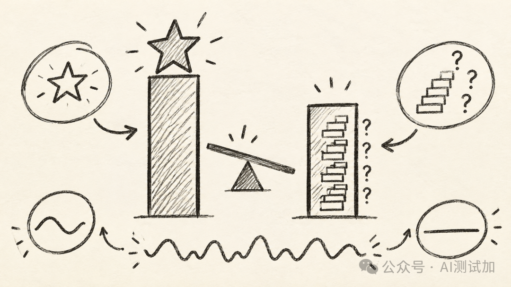

# 真实案例：美团怎么把 Agent 评测从"测出来"做到"改进去"

> Source: wechat
> Author: AI测试加
> Original: https://mp.weixin.qq.com/s/OWCeh34OLDG96YKmWi-kOQ

---

---

上一篇看了淘宝怎么用"大模型裁判"做日级在线评测。这篇看美团的落地实践——不是只测出分数，而是让评测结果**反过来推动 Agent 变强**。核心一句话：评测不是终点，是迭代的起点。

---

## 一、这篇讲的是什么

美团技术团队发了一篇《Agent 评测白皮书》业务实践篇，主角是面向商家的 AI 助手——负责投放巡检、异常诊断、数据报告、计划编辑这些事。

这类 Agent 有个特点：不是聊聊天就行，而是真的要干活。它要读取真实账户数据、调多个工具、遵守投放规则，必要时直接改投放计划。

所以判断它能不能上生产，不能只看"回答得像不像对的"，要验证**整件事干没干成**：意图和时间范围理解准不准、数据和工具调用对不对、关键规则守没守、最终账户状态和交付物符不符合预期。

文章把评测体系的目标概括成三个词：**可测、可信、可优化**。分别对应：能生成可执行可判定的场景、能稳定规模化执行且结论可复核、能从结果定位问题并验证改动。我们顺着这三条线拆开看。

---

## 二、评测集怎么建：两条路互补

做评测第一关永远是：**用什么题考它？**

最直接的想法是从线上坏例子攒——但问题很明显：样本容易集中在已经暴露的错误上，覆盖不系统；新上线的 Agent 压根没多少真实案例。反过来让团队凭经验造题，又怕漏掉关键流程和边界。

美团的解法是两条路同时走：

2.1 自顶向下：从业务 SOP 拆场景

先把每个业务 Skill 还原成**业务状态图**，标清楚六类要素：

| 要素 | 意思 |
| --- | --- |
| 业务状态 | 当前处于什么业务阶段 |
| 数据依赖 | 这一步需要什么数据 |
| 条件分支 | 什么条件下走哪条路 |
| 提前停止点 | 什么时候该停、不再深挖 |
| 能力边界 | 哪些事它做不了 |
| 跨 Skill 转交 | 什么时候该交给别的模块 |

得到的不只是一堆测试用例，更是一张"什么条件下该做什么、何时该停"的行为规范。

文章里到店 KA 每日巡检的例子很直观：没发现异常门店，就跳过投放层下钻直接出报告；账户余额不足，只出账户级预警不深挖门店；发现投放异常才进分层归因；命中直接根因就停止后续弱证据检查。

2.2 自底向上：从 Bad Case 补边界

业务 SOP 描述的是"应该怎样"，但 Agent 实际会怎么失效，得靠真实案例补。

关键动作是：**把具体错误抽象成可复用的失效模式**，再扩展成边界和回归场景。比如有次线上抽检发现：商家让 Agent 巡检"昨日"投放，Agent 出了一份结构完整的报告，但 Trace 显示它查的是**当天**数据——报告再漂亮也是错的。

这个案例不会只当一道错题，而是抽象成"日期理解与计算失效"，再去覆盖今日、昨日、历史日期、周末等各种变体。

两条路合起来，美团为 KA 每日巡检设计了六类共 41 个评测场景——核心流程、触发词变体、业务变量、能力边界都有覆盖。

一个小提醒：路由转交和核心流程同样重要。生产可用的 Agent 不仅要知道"该做什么"，还要知道"什么时候不该启动完整巡检"，而应追问、转交或拒绝。

---

## 三、成功标准怎么定：三层拆解

有了题，还得定义"做对"。以"巡检昨日投放"为例，收到一份报告就算完成吗？美团拆了三层：

**第一层：执行流程遵循业务 SOP 了吗？**

工具调用顺序对不对（先取数、再筛查、后下钻、最后出报告）、必要步骤有没有覆盖、有没有低效或重复调用、条件分支逻辑对不对（没异常时跳没跳过下钻）。

**第二层：过程和结论有据可依吗？**

工具参数和上下文语义一致吗（查询日期是不是"昨日"）、工具选对了吗、有没有违反静态参数约束、输出是不是忠于工具实际返回的数据。

**第三层：输出可交付吗？**

内容缺不缺（有没有真的产出报告）、格式守不守模板、结论有没有模糊表达。

这些检查项汇成评分细则（Rubric），还分了两类：**成功必需项**（必要步骤、顺序调用、正确工具、参数一致性、输出忠实性等）和**质量分层项**（低效调用、规划效率、结论表达），后者不影响成败，只用于分层和诊断。

判定方式也分工：能从 Trace 精确取证的，交给确定性 Grader（规则代码）；需要理解业务语义的，交给 LLM Grader。不好一刀切全让大模型判，也不好全用死规则。

**评测指标五个维度：** 任务完成率看整体成败；Pass@k 和 Pass^k 分别看能力上限和稳定性（这个后面重点讲）；工具调用顺序命中率、必要步骤覆盖率定位成败原因；规划效率、结论确定性看输出质量；Token、调用轮次、端到端时延衡量成本效率。

---

## 四、先校准"尺子"：评测器也会出错

这一章我觉得是全文最值钱的部分。

**评测器本身会错。** 文章引用了一个数据：OpenAI 审计 138 道 SWE-bench Verified 任务时，发现 59.4% 存在任务描述或测试设计缺陷。连业界广泛使用的 Benchmark 都要校准，自家的评测器更不例外。

所以优化 Agent 之前，先确认"尺子"可信，否则你改了 Agent，错的其实是评测规则。

**怎么证明尺子可信？** 建一个由业务专家确认的校准集，明确覆盖 Good Case、Bad Case、边界 Case，分别验证 Trace 解析、确定性 Grader 和 LLM Rubric——不要用一个总体一致率掩盖不同环节的问题。

两个校准案例很典型：

- **确定性 Grader**

  ：早期用"线性顺序"描述工具调用，简单依赖能表达，但会把合理的并行和执行顺序差异误判成失败。人工复核发现这类假阴性后，把复杂路径升级成 DAG——只保留真实数据依赖，互不依赖的步骤允许不同顺序。改完回放历史样本，确认误判消除、没引入新问题。
- **LLM Grader**

  ：重点验证和业务专家的语义判断一致性。抽检后分析问题出在 Rubric 表述、证据缺失，还是业务标准本身有歧义。证据不足的高风险问题，评测器应该允许返回"无法判断"，而不是硬给二分结论。

这里有个特别重要的认知：**评测误判减少，说明尺子更准了，不代表 Agent 变强了。** 只有用校准后的同一套标准重跑 Benchmark，才能判断 Agent 是否真的进步。很多人优化完看指标涨了就以为 Agent 强了——可能只是评测规则更宽松了。

**长期可信靠三种机制：**

1. **自动回归**

   ：改了 Trace 解析、Grader 或 Rubric，就在固定校准集和历史样本上重跑，看有没有引入新误判
2. **稳定抽检**

   ：运行稳定后定期随机抽少量样本人工复核，监测人机一致性和数据分布
3. **触发复核**

   ：模型/Skill/环境大变、指标突然异常、线上反馈和离线判断打架时，提高人工复核比例

人的角色是：校准标准、处理争议、复核高风险结果、识别新失效模式。确认的新问题回流到校准集和回归样本，形成评测器自己的迭代闭环。

---

## 五、根因分析：从"知道失败"到"知道为什么"

任务失败只是结果，不是根因。

任务完成率告诉你"失败了"，分层指标把问题定位到具体检查项——路由、必要步骤、工具参数、条件分支、事实依据、最终输出。但**原子指标只能指出"问题在哪"，根因要回到执行证据里确认**。

同一个"必要步骤缺失"，可能是 Skill 没约束清楚，可能是模型长上下文里漏了要求，也可能是数据、环境甚至 Grader 异常。

美团的实践是**先用指标缩小范围，再看局部 Trace 确认**：定位到具体检查项后，直接看相关的局部 Trace、工具参数和返回结果。只有当指标和 Trace 结论冲突、局部证据不足、问题随机出现、分不清 Skill 还是模型问题时，才去看完整 Trace 或做重复执行验证。这样不用每个坏案例都从头排查整个链路。

巡检案例里，分层指标把问题定位到四类：配置职责混杂、命令路由不唯一、条件分支和停止条件不明确、稳定逻辑过度依赖模型。对应的优化动作遵循同一个原则：

**减少模型需要"记忆"和"自由判断"的确定性约束。** 平台账号参数红线交给公共配置，业务分支和停止条件写进 Skill，解析计算筛选交给确定性代码；模型只聚焦流程调度、条件理解和业务表达。

这个原则相当值得抄——把能确定的东西从模型里拿出来，Agent 自然更稳。优化后用同一套 Benchmark 回归，能力上限和执行效率都明显提升。

---

## 六、最有意思的一个细节：Pass@k 与 Pass^k

这章是全文我最想单独拎出来说的点。

- **Pass@k**

  ：同一任务试 k 次，至少成功一次的比例——衡量"能力上限"，意思是"它会不会做"
- **Pass^k**

  ：同一任务连试 k 次全都成功的比例——衡量"稳定性"，意思是"能不能每次都对"

美团优化后的观察：**Pass^k 仍显著低于 Pass@k**，说明瓶颈已经从"不会做"变成了"不能稳定做对"。

这个区分太重要了。很多团队测 Agent 只看"能不能做成"，忽略"稳不稳定"。真实生产环境里，用户不会给你试 k 次的机会——一次不稳定，体验就崩了。看到 Pass^k 低于 Pass@k，优化方向就不是"让模型更聪明"，而是"消除随机性、加确定性约束、把波动压下来"。

我建议所有做 Agent 评测的人都把这两个指标分开记：一个看天花板，一个看地板。

---

## 七、总结：评测闭环怎么转起来

把这篇和上一篇淘宝的放在一起看，两条闭环正好互补：

- **对评测体系**

  ：任务集 → 校准尺子 → 回归监控，让评测越来越可信
- **对 Agent**

  ：评测结果 → 根因分析 → 定向优化 → 同一套标准重跑验证，让 Agent 越来越强

做评测最忌讳的一件事：测完出个分数就结束了。分数只是起点——真正的价值在"为什么错"和"改完有没有用"。而要回答这两个问题，前提是先有一把**校准过的尺子**。

想把这套方法真正落地？转发给测试团队，一起把第一个 Agent 测明白。

---

**本文为原创解读与个人评论，非原文转载。案例信息引自：美团技术团队公众号文章《Agent评测白皮书》业务实践篇：商家 AI 助手的评测与优化闭环实践（作者：图灵评测×商增），原文详见：https://mp.weixin.qq.com/s/sQrU8O6lj-mYtskuilEDcA 。文中转述均为本文作者按公开信息的理解重述，判断与观点为原创。**
