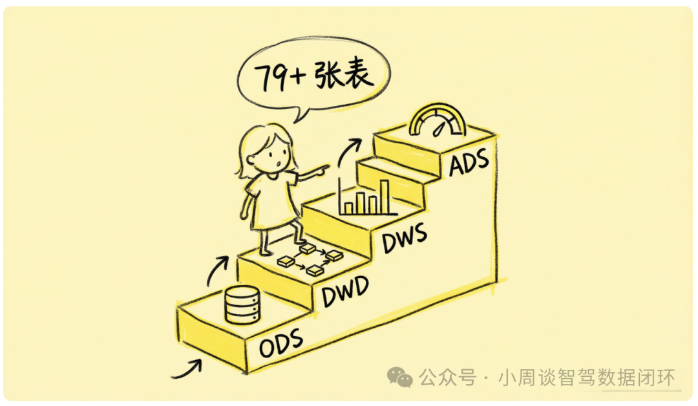

# Apache Paimon 分层建模实践

原文：[智驾数据闭环湖仓实战：Apache Paimon 分层建模实践](https://mp.weixin.qq.com/s/r9FbicVHlbMWFk5jcPLNvQ)  
作者：小周谈智驾数据闭环｜发布：2026-08-31｜系列二·湖仓实战，第 1 篇

智驾数据闭环中的采集、标注、质检、训练、评测和车端回传分布在不同系统。湖仓建模需要把这些系统的记录组织起来，既能追溯一份数据经历过哪些处理，也能计算生产耗时、模型使用情况和闭环效率。

这套方案采用 ODS、DWD、DWS、ADS 四层结构：ODS 接收源数据，DWD 组织标准明细和跨系统关系，DWS 计算可复用指标，ADS 交付应用需要的结果。

## 一、四层架构：划分加工职责与变更边界

湖仓中常见的职责混用包括：应用直接依赖原始业务表，明细加工混入统计逻辑，报表各自重复关联和计算。这样一来，源字段变化或指标调整都可能影响多个应用，也容易积累用途相近、口径不同的表。

四层设计把这些变化放在不同位置处理：

| 层级 | 职责 | 原文的设计约定 |
| --- | --- | --- |
| ODS：原始同步层 | 接收源系统数据 | 尽量保留源结构，只做必要字段映射，补充 `_ingest_time`、`_source_system` |
| DWD：明细数据层 | 清洗、标准化和跨源关联 | 通过 `data_id` 等业务标识连接闭环记录，保留可追溯的明细 |
| DWS：汇总指标层 | 按业务维度计算可复用指标 | 以日期、项目、模型、场景等维度汇总，在这里维护统计口径 |
| ADS：应用数据层 | 交付特定应用需要的结果 | 把报表、大屏需要的字段提前组织好，减少查询端加工 |

> [!note] 批注：同一份采集数据在四层里分别变成什么？
> 用一个教学例子贯穿后文：项目 `P1` 的数据单元为 `D001`，09:00 采集完成，12:00 完成生产交付。这里的标识和时间均为示意。
>
> ODS 保存采集、标注、质检等系统各自的记录；DWD 把属于 `D001` 的记录关联起来，得到标准状态及各阶段时间；DWS 再按项目和日期统计已交付数据的耗时，`D001` 在本例中贡献一条 3 小时的观测；ADS 把这些指标组织成项目看板需要的字段。
>
> DWD 仍能查看单个数据单元的过程，DWS 则把多条明细归入一个统计分组。需要追查某一条异常时回到明细，需要看项目整体情况时读取汇总；这也是两层不能随意混用的原因。

> [!note] 批注：分层怎样隔离源字段变化？
> 假设采集系统把 `task_status` 改名为 `status_code`，DWD 对下游约定的标准字段仍叫 `production_status`。接入侧适配新字段，DWD 更新映射后继续输出相同含义的 `production_status`，DWS 和 ADS 就可以保持原来的读取方式。
>
> 这种隔离依赖稳定的数据契约：字段的含义、类型和取值约定需要一致。若源系统把“完成”从“采集完成”改成了“交付完成”，即使字段名没变，下游耗时计算也必须重新检查。

> [!note] 批注：数据域与分层怎样同时使用？
> 数据域说明这份数据描述哪个业务过程，分层说明它加工到了什么程度。例如训练任务属于训练域：ODS 保存训练平台的源记录，DWD 统一任务状态和关联关系，DWS 统计项目每天的训练耗时。
>
> 同一个业务域可以跨越多个加工层，也可以接入多个来源系统。因此设计表时，要同时确定它的业务过程和加工职责，不能仅凭“来自训练平台”就判断应放在哪一层。

## 二、ODS 层：保留源信息并记录接入来源

ODS 是源数据的接收层：尽量保留源表字段及其原始含义，不在这里统一业务命名、拼接跨系统关系或计算业务指标。上游字段不规范、类型不统一等问题，留到 DWD 按标准处理。

ODS 按业务域组织源表，各域的表和来源系统如下。

| 数据域 | ODS 表 | 来源系统 |
| --- | --- | --- |
| 采集域 | `ods_collect_task` / `ods_vehicle_info` / `ods_sensor_config` / `ods_data_file_meta` | 采集管理系统、车辆管理系统、配置管理系统、文件管理系统 |
| 生产域 | `ods_production_line_task` / `ods_argo_workflow` / `ods_annotation_task` / `ods_annotation_result` / `ods_qc_task` / `ods_qc_result` / `ods_manual_operation_log` | 产线平台 MySQL、Argo 元数据库、标注平台、质检平台、Kafka |
| 数据资产域 | `ods_dataset_info` / `ods_dataset_version` / `ods_dataset_data_list` / `ods_scene_tag` | 数据管理平台 MySQL、场景标签系统 |
| 训练域 | `ods_training_task` / `ods_training_metric` / `ods_model_version` | 训练平台 MySQL、模型管理平台 |
| 评测域 | `ods_evaluation_task` / `ods_evaluation_result` / `ods_badcase_record` | 评测平台 MySQL |
| 仿真域 | `ods_simulation_scenario` / `ods_simulation_result` | 仿真平台 MySQL |
| 回传域 | `ods_vehicle_trigger_event` / `ods_vehicle_function_test` / `ods_shadow_mode_data` | 车端回传 Kafka |
| 部署域 | `ods_ota_task` / `ods_vehicle_software_version` | OTA 平台、车辆管理平台 |
| 分析域 | `ods_issue_record` | 问题管理平台 MySQL |
| 挖掘域 | `ods_mining_task` / `ods_mining_rule_config` | 数据挖掘平台 MySQL；其中规则配置经 Flink CDC 同步 |
| 质量门禁 | `ods_quality_issue` | 入湖质量门禁服务，记录被隔离的异常数据并支持重放 |

每张 ODS 表追加 `_ingest_time` 和 `_source_system`：前者记录数据进入湖仓的时间，后者标识数据来自哪个系统。

> [!note] 批注：入湖时间与业务发生时间分别用来算什么？
> 沿用 `D001`：采集在 09:00 完成，记录在 09:10 才进入湖仓。09:00 是业务时间，`_ingest_time=09:10` 是接入时间；两者之差可以帮助观察接入延迟。
>
> 若交付时间为 12:00，按采集完成时间计算的业务耗时是 3 小时，改用入湖时间就变成了 2 小时 50 分钟。指标需要哪一种时间，应由业务定义决定。`_source_system` 用来识别来源；继续追查具体记录时，还需要源主键、版本或位点等信息。

> [!note] 批注：保留源字段，为什么还不一定能回放所有历史？
> 假设源系统先把 `D001` 写成“待标注”，之后更新为“已标注”。ODS 如果使用 Paimon 主键表持续 Upsert，最新态查询看到的是主键合并后的当前记录，字段保真并不自动保留每次更新事件。
>
> 想看当前状态，可以读取主键表；想按顺序追查每次变化，还需要变更日志或单独的历史设计，并配置相应留存。Paimon 的表状态与 Changelog 是不同的读取对象，详见 [Paimon 1.3 主键表](https://paimon.apache.org/docs/1.3/primary-key-table/overview/)及 [Changelog Producer](https://paimon.apache.org/docs/1.3/primary-key-table/changelog-producer/)。

## 三、DWD 层：连接数据单元、处理过程与使用关系

DWD 完成跨系统清洗、关联和标准化。该方案在这一层落实全局标识，形成闭环追溯视图，并扩展图片、标签和向量等挖掘明细。

### 1. 把 data_id、clip_id、image_id 落到实际关系中

原文沿用 `data_id`、`clip_id`、`image_id` 三级标识，把它们作为主键或关联键。`dwd_data_production_chain` 以 `data_id` 为主键，组织单个数据单元从采集、标注、质检到交付的状态和时间，供效率分析与追溯使用。

> [!note] 批注：data_id、clip_id、image_id 分别连接哪一层明细？
> 在本例中，把 `D001` 对应的采集片段记为 `C001`，其中一张抽帧图片记为 `I001`。片段明细描述 `C001`，图片明细描述 `I001` 并保留它与片段的关系；标注、质检、处理产物和训练使用记录，再通过关联键连接到相应的数据对象。这组标识仅用于解释，不代表真实编码格式或固定的一对一关系。
>
> 关联键解决“这些记录属于哪份数据”，主键解决“怎样区分本表的每一行”。例如 `D001` 有两次处理运行，若运行表只用 `data_id` 做主键，两次运行就可能被合并，无法同时保留。应先确定一行描述一次运行，再选择能区分运行的键；`data_id` 仍可作为关联键保留。

### 2. 区分生产过程表与闭环追溯表

`dwd_data_production_chain` 关注生产阶段的状态和耗时；`dwd_closed_loop_trace` 则以 `data_id` 为入口，汇集跨阶段的使用和状态信息，例如参与过哪些训练任务、关联哪些模型版本和评测任务、是否出现 Badcase，以及是否关联车端触发记录。

追溯时，以数据单元为入口查询闭环信息，再沿关联关系回查原始采集片段。

> [!note] 批注：全局状态快照与过程明细分别回答什么？
> 对 `D001`，生产链路记录可以说明它何时标注、何时质检、何时交付；闭环追溯视图可以说明它已被哪些训练任务使用、关联哪些模型或评测记录。前者用于分析某个阶段，后者用于从一份数据找到跨阶段的使用关系。
>
> 如果质检失败后重跑了一次，只保留“当前质检通过”就看不到第一次失败。追查失败原因时仍要进入运行明细和产物记录。因此，快照适合提供查询入口，运行历史负责保留具体经过。

> [!note] 批注：从 Badcase 回查采集数据，实际需要什么关系？
> Badcase 指评测或车端暴露出的异常样例。先从 Badcase 找到对应的评测样本或触发事件，再利用记录好的映射定位 `data_id` 和采集片段，才能继续查生产过程与产物版本。
>
> 表中存在 `data_id` 字段，还不足以完成这条追溯；各环节要持续记录关联关系。查询得到“这份数据参与过某模型训练”说明了使用血缘，不能单凭这一点认定它造成了模型的某次错误。

### 3. 挖掘域扩展到图片、标签与向量

原文在挖掘域列出 8 张表，覆盖挖掘任务、挖掘结果、场景缺口、抽帧图片、标签字典、数据级标签、图片级标签和图片向量。

其中，`dwd_mining_image_vector_detail` 被描述为体量最大的表，规模为千万至亿级行，并包含高维向量。原文方案只对这张表按 `dt` 分区，其他表使用主键和 Bucket 管理更新。

> [!note] 批注：图片、标签和向量为什么要分别建明细？
> 图片明细用来定位 `I001` 及其来源片段；标签字典统一“夜间”“雨天”等标签的含义，图片标签关系再记录 `I001` 具有哪些标签；向量明细保存模型提取的数值特征，用于后续相似度计算等处理。
>
> 它们描述同一对象的不同信息。图片级标签只描述某一帧，clip 级标签描述整个片段，二者的粒度不同，不能在没有规则的情况下互相替代。向量存入表后，检索性能还取决于索引和查询服务，不能把存储向量等同于已经建好向量检索系统。

> [!note] 批注：分区与 Bucket 分别把数据分成什么？
> 按 `dt` 分区，是把不同日期的数据组织到不同分区中；Bucket 则继续组织表或分区内部的数据。主键负责识别更新对象，因此分区、分桶和主键可以同时存在，各自承担不同职责。
>
> 这篇方案只给图片向量表按 `dt` 分区，是结合其体量作出的选择，并非其他主键表不能分区。选择日期分区时，还要看查询是否按日期过滤、更新是否跨日期、过期数据怎样清理。
>
> 主键与分区字段的组合也要结合更新方式判断。Paimon 1.3 支持主键未包含全部分区字段的跨分区 Upsert，具体行为与 Bucket 模式、合并引擎有关，见 [Flink SQL DDL](https://paimon.apache.org/docs/1.3/flink/sql-ddl/)及 [Data Distribution](https://paimon.apache.org/docs/1.3/primary-key-table/data-distribution/)。

## 四、DWS 与 ADS：计算指标并交付应用结果

该方案的 DWS 设计为 14 张表。以 `dws_closed_loop_efficiency` 为例，按日期和项目汇总采集到交付耗时、训练耗时、评测耗时、完整闭环耗时及 Badcase 解决率。报表复用同一套计算结果，避免各自重新拼接明细、定义公式。

> [!note] 批注：统一指标口径，要先固定哪些东西？
> 假设本例规定：只统计当天完成交付的数据，从采集完成计时到交付完成。`D001` 的耗时为 3 小时；同一项目另一份数据 `D002` 的耗时为 1 小时，则这两份已交付数据的平均耗时为 2 小时。尚未交付的数据不进入这个平均值，应另行观察其数量和等待情况。
>
> 如果另一张报表改为统计“当天开始采集的数据”，即使公式都叫平均交付耗时，两张报表的样本集合也可能不同。业务粒度、时间起止点、日期归属、过滤条件和聚合方法需要一起固定。这里的数字和规则是教学假设，不代表文章项目的实际口径。
>
> Badcase 解决率也需要明确同一观察窗口里的分子与分母，例如“该批 Badcase 中，已通过复验的数量占比”。只把公式写进公共表，却没有统一“解决”的判断，仍然会产生口径差异。

该方案的 ADS 设计为 11 张表，按大盘、难例库、资产目录、模型对比等应用组织结果。应用读取 ADS 时不再做 JOIN，所需字段已由上游加工任务准备好。

> [!note] 批注：ADS 的“零 JOIN”把关联计算放到了哪里？
> 假设项目看板同时展示项目名称、交付数量和平均耗时，ADS 加工任务可以提前把项目属性与统计结果组织到同一张应用表。前端按项目和日期过滤即可，不必每次再关联项目表和明细表。
>
> 关联工作发生在 ADS 的构建或刷新阶段。“零 JOIN”约束的是应用消费查询，并不意味着整个加工链路没有 JOIN。查询端更简单，同时也需要维护这份预加工结果；新增分析维度时，应检查现有 ADS 的粒度和字段是否能支持。

| 层级 | 原文表数 | 该层交付的内容 |
| --- | --- | --- |
| ODS | 28 | 源记录及入湖来源字段 |
| DWD | 27 | 标准明细、过程记录和跨源关联 |
| DWS | 14 | 按明确维度和口径计算的指标 |
| ADS | 11 | 面向具体应用的查询结果 |

## 五、Paimon 表设计：主键、Bucket 与 Changelog

### 1. 主键与 NOT ENFORCED

原文采用业务主键，例如 `ods_collect_task` 使用 `collect_task_id`，`dwd_data_production_chain` 使用 `data_id`；在 Flink SQL 中用 `PRIMARY KEY (...) NOT ENFORCED` 声明。

> [!note] 批注：NOT ENFORCED 与主键 Upsert 分别发生在哪一层？
> `PRIMARY KEY (...) NOT ENFORCED` 是 Flink SQL 的主键声明。`NOT ENFORCED` 表示 Flink 不为这项声明执行运行时唯一性约束检查；Paimon 主键表仍会按主键和配置的合并规则组织表状态。SQL 层不检查约束，与存储层怎样合并同键记录，是两个问题。
>
> 例如 `D001` 先写入“待标注”，随后写入“已标注”。若采用保留后续更新的合并规则，最新态读取的是更新后的状态；不会因为写了 `NOT ENFORCED`，就自动把它们当成两条独立业务明细保留下来。若要保留两次运行，主键本身就必须能区分运行；若要看每次状态变化，则需要变更历史。
>
> 更新顺序和合并引擎仍会影响结果，不能只凭“最后收到一条消息”推断业务版本一定更新。相关定义见 [Flink 1.20 CREATE TABLE](https://nightlies.apache.org/flink/flink-docs-release-1.20/docs/dev/table/sql/create/)与 [Paimon 1.3 主键表](https://paimon.apache.org/docs/1.3/primary-key-table/overview/)。

### 2. Bucket 分桶

原文给出的经验配置是：ODS 小表使用 2～4 个 Bucket，DWD 主要表使用 16～32 个；示例中，`dwd_collect_clip_detail` 为 16，`dwd_production_artifact_detail` 为 32。

> [!note] 批注：16 个 Bucket 为什么不等于 16 个 Flink 并行实例？
> Bucket 是表内的数据组织单位，Flink 并行度描述运行任务的实例数量。固定 Bucket 模式下，记录根据分桶键的哈希分配到 Bucket；同一个作业的任务如何处理这些 Bucket，还涉及连接器和作业执行组织，不能把两个数字直接画等号。
>
> Bucket 过少可能限制写入组织和并行能力，过多则可能增加小文件与维护开销。文章给出的 2～4、16～32 属于项目经验，判断时还应看分桶模式、键分布、读写负载和数据量，见 [Paimon 1.3 Data Distribution](https://paimon.apache.org/docs/1.3/primary-key-table/data-distribution/)。

### 3. changelog-producer 的适用条件

原文把所有 ODS 表统一设置为 `'changelog-producer' = 'input'`，希望下游 Flink 及时消费 ODS 变化、增量更新 DWD。

> [!note] 批注：下游实时计算为什么可能需要旧值？
> Changelog 描述记录怎样变化，Upsert 描述按键写入新状态。例如某个分组里 `D001` 的值从 3 改成 5，下游要更新分组总和，应该先撤回原来的 3，再加入新的 5。只收到新值 5 时，下游还需要自己记住旧值，才能算出本次增加了 2。
>
> 因此，需要分别检查一条记录的字段是否完整、更新是否带有所需的新旧值，以及这些值是否等于 Paimon 合并后的逻辑行。`RowKind` 用来表达插入、更新前、更新后或删除等变化种类，但变化种类齐全不代表每条记录的字段也齐全。

> [!warning] 技术边界：input 只能沿用已经完整的输入变化。
> `input` 把 Writer 收到的变化作为 Changelog 来源；只有这些输入已经等价于表最终逻辑状态的完整变化时，才能直接交给需要完整变化的下游。需要检查 Writer 端实际收到的记录，不能只凭 Source 名称带有 CDC 就决定。
>
> 对部分更新、聚合增量，或缺少旧值的 Upsert，应结合表内旧状态生成变化；需要完整 Changelog 时可选择 `lookup`。它需要读取和缓存旧状态，因此还应评估额外资源与读写开销。配置语义见 [Paimon 1.3 Changelog Producer](https://paimon.apache.org/docs/1.3/primary-key-table/changelog-producer/)。

> [!note] 批注：部分字段更新怎样变成一条完整的新记录？
> 假设旧记录为 `(D001, P1, TODO, PASS)`，字段依次是数据标识、项目、标注状态、质检状态。Writer 收到 `(D001, NULL, DONE, NULL)`，表示本次只更新标注状态。这里假定采用空值不覆盖旧值的 `partial-update` 规则。
>
> Paimon 把这条输入与旧状态合并，得到 `(D001, P1, DONE, PASS)`。若直接采用 `input`，沿用的仍是收到的部分更新，项目和质检状态没有因此自动补齐；需要完整更新语义时，应根据合并前后的逻辑行生成变化。
>
> 同样地，聚合输入中的一个增量也不等于聚合表的新总量。要区分 Writer 收到的记录、表内合并状态和下游收到的 Changelog，见 [Partial Update](https://paimon.apache.org/docs/1.3/primary-key-table/merge-engine/partial-update/)及 [Aggregation](https://paimon.apache.org/docs/1.3/primary-key-table/merge-engine/aggregation/)。

## 六、表清单：保留各域表名与用途

以下列出 DWD、DWS 和 ADS 各表的业务用途。

### DWD 明细表

| 数据域 | 表名 | 用途 |
| --- | --- | --- |
| 采集域 | `dwd_collect_clip_detail` | clip 级采集单元元信息，作为采集血缘起点 |
| 生产域 | `dwd_data_production_chain` | 数据生产主链路 |
| 生产域 | `dwd_production_execution_detail` | 产线执行明细 |
| 生产域 | `dwd_production_artifact_detail` | 处理产物元信息及血缘关联 |
| 生产域 | `dwd_production_run_detail` | 处理运行与重跑记录 |
| 生产域 | `dwd_manual_operation_detail` | 人工操作记录 |
| 数据资产域 | `dwd_dataset_version_detail` | 数据集版本明细 |
| 数据资产域 | `dwd_dataset_data_relation` | 数据集与数据单元的关联 |
| 数据资产域 | `dwd_scene_tag_relation` | 数据与场景标签的关联 |
| 训练域 | `dwd_training_task_detail` | 训练任务明细 |
| 训练域 | `dwd_training_metric_detail` | 训练指标明细 |
| 评测域 | `dwd_evaluation_task_detail` | 评测任务明细 |
| 评测域 | `dwd_evaluation_result_detail` | 评测结果明细 |
| 评测域 | `dwd_badcase_detail` | Badcase 明细 |
| 仿真域 | `dwd_simulation_result_detail` | 仿真结果明细 |
| 回传域 | `dwd_vehicle_trigger_detail` | 车端触发事件明细 |
| 回传域 | `dwd_shadow_mode_detail` | 影子模式数据明细 |
| 部署域 | `dwd_ota_deployment_detail` | OTA 部署明细 |
| 部署域 | `dwd_vehicle_software_distribution_detail` | 车辆软件版本分布 |
| 分析域 | `dwd_issue_detail` | 问题明细 |
| 挖掘域 | `dwd_mining_task_detail` | 挖掘任务明细 |
| 挖掘域 | `dwd_mining_result_detail` | 挖掘结果明细 |
| 挖掘域 | `dwd_scene_gap_detail` | 场景缺口记录 |
| 挖掘域 | `dwd_mining_image_frame_detail` | 抽帧图片明细 |
| 挖掘域 | `dwd_mining_tag_dict_detail` | 统一标签字典 |
| 挖掘域 | `dwd_mining_data_tag_detail` | clip 级数据标签明细 |
| 挖掘域 | `dwd_mining_image_tag_detail` | 图片级标签明细 |
| 挖掘域 | `dwd_mining_image_vector_detail` | 图片向量明细；原文方案中按 `dt` 分区 |
| 闭环域 | `dwd_closed_loop_trace` | 跨环节的数据追溯视图 |
| 闭环域 | `dwd_closed_loop_storage_lifecycle` | 存储生命周期状态明细 |

> [!note] 批注：为什么同一份数据还要区分运行和产物？
> 以 `D001` 为例，第一次处理失败，第二次重跑成功，两次尝试都应留下各自的运行记录；成功运行产生的处理结果，则由产物明细描述。查看当前状态只能知道它已成功，查看运行记录才能知道重跑过，查看产物及其关联才能确定后续到底使用了哪个结果。
>
> 因此设计这些表时，应分别确认一行表示一个数据单元、一次处理尝试，还是一个产物。它们通过关联键连接，但各自的主键要符合本表的粒度。

### DWS：14 张

| 数据域 | 表名 | 用途 |
| --- | --- | --- |
| 生产域 | `dws_production_efficiency_daily` | 产线效率日指标 |
| 生产域 | `dws_annotation_quality_daily` | 标注质量日指标 |
| 数据资产域 | `dws_dataset_statistics` | 数据集统计 |
| 数据资产域 | `dws_scene_distribution` | 场景分布统计 |
| 训练域 | `dws_training_efficiency_daily` | 训练效率日指标 |
| 评测域 | `dws_evaluation_summary` | 评测指标汇总 |
| 评测域 | `dws_badcase_statistics` | Badcase 统计 |
| 回传域 | `dws_trigger_statistics` | 触发事件统计 |
| 部署域 | `dws_deployment_statistics` | 部署统计 |
| 闭环域 | `dws_closed_loop_efficiency` | 闭环效率指标 |
| 闭环域 | `dws_data_contribution` | 数据贡献度指标 |
| 闭环域 | `dws_closed_loop_storage_cost_daily` | 存储成本日指标 |
| 挖掘域 | `dws_mining_efficiency_daily` | 挖掘效率日指标 |
| 挖掘域 | `dws_mining_tag_coverage_daily` | 标签覆盖度日指标 |

> [!note] 批注：怎样区分“数据被使用过”和“数据带来了效果”？
> 若 `D001` 出现在某个训练数据集版本中，并被训练任务使用，可以统计它的使用次数或使用覆盖；这些关系支持血缘追溯，但没有直接给出它对模型效果的贡献。
>
> `dws_data_contribution` 的具体计算需要业务另行定义。若要评价效果贡献，还要有对应的评测方法和比较依据，不能把“参与过训练”直接解释成“带来了多少性能提升”。

### ADS：11 张

| 表名 | 应用用途 |
| --- | --- |
| `ads_closed_loop_dashboard` | 闭环大盘 |
| `ads_production_bottleneck_analysis` | 产线瓶颈分析 |
| `ads_badcase_root_cause_distribution` | Badcase 根因分布 |
| `ads_scene_library_summary` | 场景库汇总 |
| `ads_hard_case_library` | 难例库 |
| `ads_data_asset_catalog` | 数据资产目录 |
| `ads_model_version_comparison` | 模型版本比较 |
| `ads_ota_deployment_summary` | OTA 部署汇总 |
| `ads_trigger_heatmap` | 触发事件热力图 |
| `ads_storage_cost_dashboard` | 存储成本看板 |
| `ads_mining_tag_dashboard` | 挖掘标签分布看板 |

