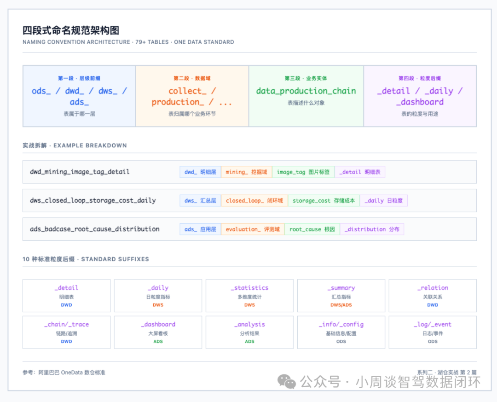
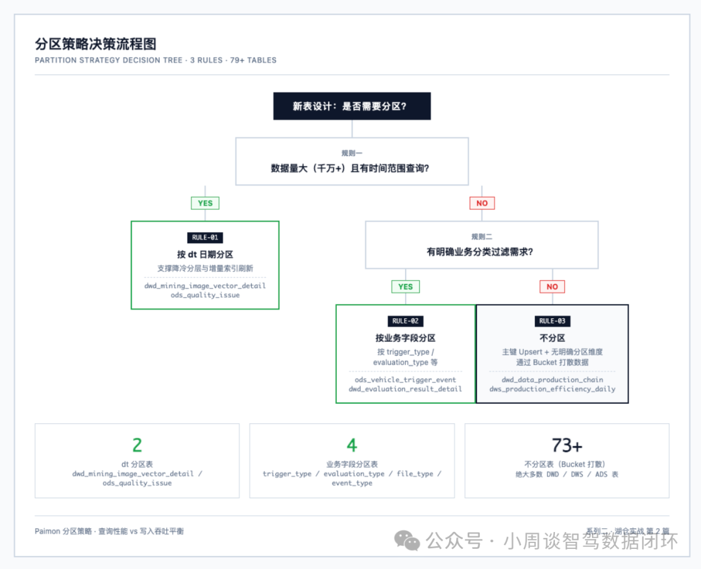
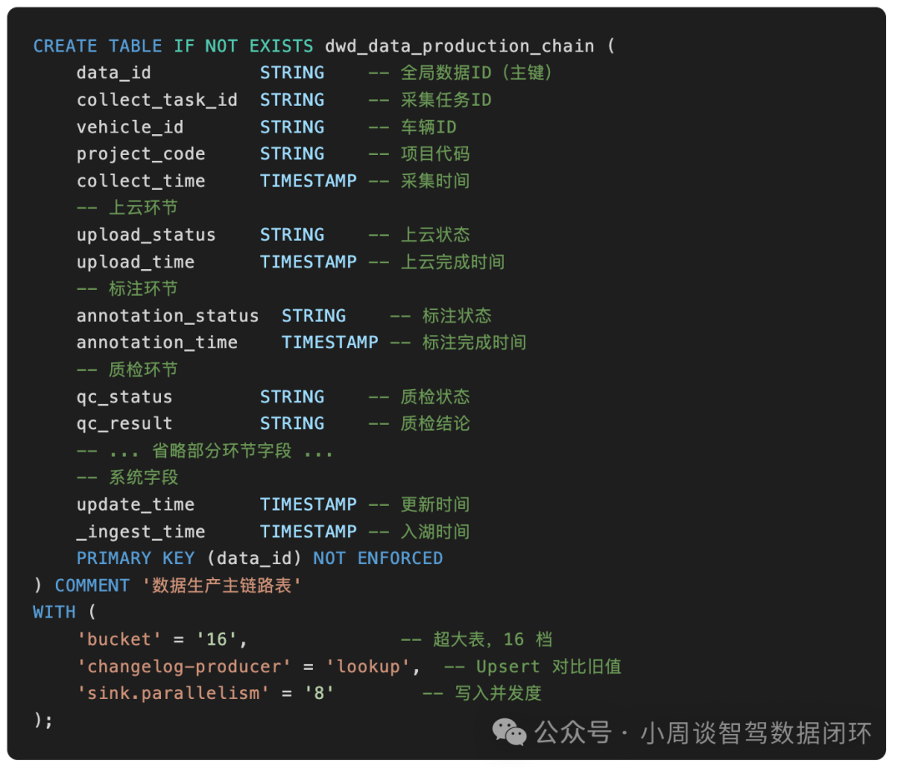

# 数仓命名规范、数据域划分与分区策略

原文：[智驾数据闭环湖仓实战：数仓命名规范 + 11 数据域划分 + 分区策略全解](https://mp.weixin.qq.com/s/aojVFyeM7dtvQZLvJf0TzA)  
作者：小周谈智驾数据闭环｜发布：2026-09-01｜系列二·湖仓实战，第 2 篇

确定 ODS、DWD、DWS、ADS 的加工职责之后，还需要让表名表达业务含义，为表划定业务归属，并根据实际查询和更新方式选择分区、Bucket、主键及 Changelog。本文围绕这几项设计展开，最后用数据生产主链路表的 DDL 串起具体配置。

## 一、四段式命名：表达层级、数据域、实体和粒度

文章借鉴 OneData 的数仓组织思路，在智驾场景采用四段式表名：`{层级前缀}_{数据域}_{业务实体}_{粒度后缀}`。四部分分别说明加工层次、所属业务、描述对象，以及表的粒度或用途。

### 1. 层级前缀

| 前缀 | 层级 | 数据职责 |
| --- | --- | --- |
| `ods_` | 原始同步层 | 接收源记录，尽量保留源信息，不混入业务加工 |
| `dwd_` | 明细数据层 | 完成清洗、标准化和跨源关联，通过 `data_id` 等标识组织闭环明细 |
| `dws_` | 汇总指标层 | 按业务维度汇总明细，维护公共统计口径 |
| `ads_` | 应用数据层 | 提供特定报表、大屏或应用需要的结果 |

### 2. 数据域

域名用相对稳定的英文词根表达，例如 `collect_` 对应采集，`production_` 对应生产，`mining_` 对应挖掘。数据域以业务过程划分，让维护者知道一张表应归哪个业务团队、与哪些过程有关。

### 3. 业务实体

实体名称使用能表达业务对象的英文组合，用下划线分隔。文中的实体示例如下。

| 实体名称 | 描述对象 |
| --- | --- |
| `collect_task` | 采集任务 |
| `data_production_chain` | 数据生产主链路 |
| `vehicle_trigger_event` | 车端触发事件 |
| `closed_loop_trace` | 跨环节的闭环追溯 |
| `mining_image_vector` | 挖掘图片向量 |

### 4. 粒度或用途后缀

| 后缀 | 表达的含义 | 文中适用层 | 示例 |
| --- | --- | --- | --- |
| `_detail` | 业务明细 | DWD | `dwd_training_task_detail` |
| `_daily` | 日粒度指标 | DWS | `dws_production_efficiency_daily` |
| `_statistics` | 多维统计结果 | DWS | `dws_badcase_statistics` |
| `_summary` | 汇总结果 | DWS / ADS | `dws_evaluation_summary` |
| `_relation` | 对象之间的关联 | DWD | `dwd_scene_tag_relation` |
| `_chain` / `_trace` | 过程链路或追溯 | DWD | `dwd_closed_loop_trace` |
| `_dashboard` | 看板数据 | ADS | `ads_closed_loop_dashboard` |
| `_analysis` | 分析结果 | ADS | `ads_production_bottleneck_analysis` |
| `_info` / `_config` | 基础信息或配置 | ODS | `ods_vehicle_info` |
| `_log` / `_event` | 日志或事件 | ODS | `ods_manual_operation_log` |

> [!note] 批注：后缀能说明用途，怎样进一步确定“一行是什么”？
> `_detail` 表明它是明细，却没有说明一行描述一张图片、一条标签，还是一次任务运行。设计主键之前，还要写清记录粒度。
>
> 例如后文使用数据单元 `D001`、图片 `I001` 作为教学标识。图片 `I001` 同时有“夜间”和“雨天”两个标签时，图片标签明细可能需要两条关系记录。若把 `image_id` 单独设为主键，两条标签关系就可能合并；主键应能区分图片与标签的组合。这里的字段组合是讲解假设，实际以标签版本等业务要求为准。
>
> 同样，`_daily` 只说明时间粒度，还要确定按项目、场景还是模型分组。表名帮助定位，记录粒度和指标口径仍需明确约定。

### 5. 表名拆解

| 完整表名 | 层级 | 业务归属 | 对象 | 粒度或用途 |
| --- | --- | --- | --- | --- |
| `dwd_mining_image_tag_detail` | DWD | 挖掘 | 图片标签 | 明细 |
| `dws_closed_loop_storage_cost_daily` | DWS | 闭环 | 存储成本 | 日指标 |
| `ads_badcase_root_cause_distribution` | ADS | 评测相关业务 | Badcase 根因 | 分布结果 |

命名约定使维护者能够从名称初步理解表的职责，并减少同义词、临时缩写和不同团队重复造名带来的沟通成本。



## 二、数据域：按业务过程组织表的归属

文章把智驾闭环中的业务与支撑能力划入以下数据域。表格保留文中的层级分布，用于说明各域承担哪些数据职责。

| 数据域 | 域前缀 | ODS | DWD | DWS | ADS | 业务范围 |
| --- | --- | --- | --- | --- | --- | --- |
| 采集域 | `collect_` | 4 | 1 | — | — | 采集任务、车辆、传感器及 clip |
| 生产域 | `production_` | 8 | 5 | 2 | 1 | 产线运行、标注、质检和生产效率 |
| 数据资产域 | `dataset_` | 4 | 3 | 2 | 1 | 数据集、场景标签和资产目录 |
| 训练域 | `training_` | 3 | 2 | 1 | 1 | 训练任务、训练指标和模型版本 |
| 评测域 | `evaluation_` | 3 | 3 | 2 | 2 | 评测结果、Badcase 和根因分布 |
| 仿真域 | `simulation_` | 2 | 1 | — | — | 仿真场景与执行结果 |
| 回传域 | `trigger_` | 3 | 2 | 1 | 1 | 车端触发、影子模式数据和热力图 |
| 部署域 | `deployment_` | 2 | 2 | 1 | 1 | OTA 部署与车端版本 |
| 分析域 | `issue_` | 1 | 1 | — | — | 问题记录和分析 |
| 挖掘域 | `mining_` | 2 | 10 | 2 | 1 | 挖掘任务、抽帧、标签、向量和推理 |
| 闭环域 | `closed_loop_` | — | 2 | 3 | 2 | 全链路追溯、存储生命周期和成本 |
| 合计（文中口径，含质量门禁表） | — | 32 | 30 | 14 | 11 | 87+ 张 |

挖掘域需要分别记录抽帧、标签、向量和推理等处理过程，因此明细表较多。闭环域以其他业务域的明细为输入，负责跨域整合，在本文方案中没有单独的 ODS 来源表。

质量门禁使用 `ods_quality_issue` 隔离触发硬规则的异常数据，等待处理后再重放。

> [!note] 批注：闭环域没有 ODS，数据从哪里来？
> 以 `D001` 为例，采集系统提供采集事实，生产系统提供处理和交付事实，训练系统提供使用记录。这些来源分别落到各域的 ODS，再加工成标准明细。
>
> 闭环追溯表把上述明细按业务标识关联起来，形成“这份数据经历了什么、被哪里使用”的视图。它描述的是跨系统关系，不需要人为新增一个“闭环源系统”来重复接收相同记录。

> [!note] 批注：异常数据可重放，需要保留什么？
> 隔离表只写“字段校验失败”，还无法重新处理。实际要能找到原记录或原始对象，并知道错误原因、适用规则、源记录身份及处理状态。
>
> 修复规则或源数据后，重放相同业务事件还要考虑去重与更新语义，避免一份数据在主链路里被重复计数。按天清理隔离数据时，也应先确认相关异常已处理，或者仍能从其他归档恢复。

## 三、分区策略：根据过滤、更新和生命周期决定

分区决定数据按什么维度分组存放；Bucket 进一步组织表或分区内部的数据。文章给出三类分区选择。

### 1. 数据量大，且经常按时间范围查询

图片向量明细 `dwd_mining_image_vector_detail` 面对千万至亿级记录，采用 `dt` 日期分区。方案希望以日期为单位处理冷数据，并支持向量索引的增量刷新。

> [!note] 批注：日期分区在什么查询里能减少扫描？
> 假设图片 `I001` 的向量记录在 `dt='2026-09-01'` 分区，`I002` 在 `dt='2026-09-02'` 分区。查询显式限定 `dt='2026-09-02'` 时，可以按分区条件排除前一天的数据。
>
> 若只按 `image_id` 查询而没有可用的日期限制，日期分区本身就不能直接指出应读哪一天。是否分区应同时看数据量与查询条件，不能只凭“这是大表”决定。
>
> 按天分区也不会自动完成降冷或索引刷新；它为这些任务提供处理边界，具体迁移和索引任务仍需独立实现。

### 2. 查询经常按明确的业务类别过滤

车端触发事件 `ods_vehicle_trigger_event` 按 `trigger_type` 分区；评测结果 `dwd_evaluation_result_detail` 按 `evaluation_type` 分区，区分离线、仿真、实车等类别。

> [!note] 批注：业务分类字段适合做分区，还要看什么？
> 若查询通常只查某一种评测类型，把各类数据分开放置可以减少不必要的读取。还要观察取值数量、每类数据量和字段是否稳定。
>
> 如果某个类别占绝大多数数据，仅有类别分区也未必能解决其中的读写压力；若取值过多、每类又很小，则容易产生大量小分区。分类能用于过滤，是选择依据之一，还要结合数据分布与更新方式。

### 3. 按主键持续更新，且没有合适的分区维度

方案中的多数 DWD、DWS 和 ADS 表不额外分区，通过 Bucket 组织数据，避免为了分区而把本来不大的数据拆得过碎。

> [!note] 批注：不分区是否意味着每次查询都要读全表？
> 不分区只表示没有按日期或类别建立这一层物理分组。Paimon 仍可根据主键、Bucket 和文件统计等信息组织读取，具体能跳过多少数据取决于查询条件、文件组织和执行引擎。
>
> 对按 `data_id` 查当前状态的生产主链路表，先确认主键和主要访问方式，通常比人为增加一个查询很少使用的日期字段更有意义。分区和主键 Upsert 也可以同时存在，二者并不互斥。

### 分区方案

| 表名 | 分区字段 | 字段类别 | 文中设计目的 |
| --- | --- | --- | --- |
| `dwd_mining_image_vector_detail` | `dt` | 日期 | 按天管理大体量向量、降冷与索引刷新 |
| `ods_quality_issue` | `dt` | 日期 | 按天管理异常数据留存与清理 |
| `ods_vehicle_trigger_event` | `trigger_type` | 业务分类 | 按触发类型筛选 |
| `dwd_evaluation_result_detail` | `evaluation_type` | 业务分类 | 区分离线、仿真、实车评测 |
| `ods_data_file_meta` | `file_type` | 业务分类 | 区分文件类型 |
| `ods_production_kafka_event` | `event_type` | 业务分类 | 按事件类型组织数据 |



> [!note] 批注：按 dt 分区与自动过期清理之间还差一步。
> 日期分区让一天的数据有明确边界，但不会仅因目录名是日期就自动删除。Paimon 提供 `partition.expiration-time` 等分区过期配置，分区时间解析和过期处理也需配套确定。
>
> 这是按分区进行生命周期管理，不能直接理解为逐行 TTL。相关配置见 [Paimon 1.3 SQL DDL](https://paimon.apache.org/docs/1.3/flink/sql-ddl/)与 [Configuration](https://paimon.apache.org/docs/1.3/maintenance/configurations/)；实际配置应与部署版本一致。

## 四、Bucket 档位与 Changelog 生成方式

### 1. 固定 Bucket 的五档配置

文章在固定 Bucket 方案中使用 1、2、4、8、16 五档，把小型字典或结果表与大体量明细区分开。

| Bucket 数 | 文中适用场景 | 典型层级 | 示例表 |
| --- | --- | --- | --- |
| 1 | 字典或极小结果表 | ADS | `ads_storage_cost_dashboard` |
| 2 | 汇总表或较小的应用表 | DWS / ADS | `dws_production_efficiency_daily` |
| 4 | 中等规模的源表与明细表 | ODS / DWD | `ods_collect_task`、`dwd_training_task_detail` |
| 8 | 较大的明细表 | DWD | `dwd_production_execution_detail` |
| 16 | 大体量或高并发写入表 | DWD | `dwd_data_production_chain`、`dwd_mining_image_vector_detail` |

> [!note] 批注：Bucket 是文件个数，还是数据分组？
> Bucket 是表或分区内部的数据分组；一个 Bucket 可以包含多个数据文件，也会随写入和合并产生新文件。固定 Bucket 模式按分桶键的哈希确定记录所属组，Bucket 数与文件数不能直接等同。
>
> 组数少时，写入可能集中到较少的 Bucket；组数过多时，每次写入的数据又可能分散成更多小文件。文件大小还受写入量、提交频率和 Compaction 等因素影响。这里的五档是项目经验，应结合实际负载选择，见 [Paimon 1.3 Data Distribution](https://paimon.apache.org/docs/1.3/primary-key-table/data-distribution/)。

### 2. 三种 Changelog 方案

`changelog-producer` 决定表怎样向下游提供变化记录。文章按常见链路举出三种配置。

| 模式 | 文章中的典型用途 | 生成方式 |
| --- | --- | --- |
| `input` | ODS 的完整 CDC 输入，或只追加的明细 | 使用 Writer 收到的输入变化生成 Changelog |
| `lookup` | 需要结合旧状态的 DWD Upsert 表 | 查找旧状态，生成相应的更新前后变化 |
| `full-compaction` | 能接受较低刷新频率的 DWS / ADS 聚合结果 | 通过完整合并前后的结果差异产生变化 |

文章用“ODS 的 CDC 透传、DWD 的 Upsert、DWS / ADS 的批量聚合”解释常见选择，希望避免下游缺少更新前记录而重复累计或无法撤回旧结果。

> [!warning] 技术边界：按 Writer 输入语义选择，层级名称不能代替判断。
> 先检查实际写入 Paimon 的记录：字段是否完整，是否含下游需要的旧值，以及变化是否已经等价于表内合并后的完整逻辑变化。这些条件同时满足时，才适合直接使用 `input`。
>
> 部分字段更新、聚合增量或缺少旧值的 Upsert，需要结合表内旧状态生成完整变化，可选择 `lookup`。`RowKind` 表示插入、更新前、更新后、删除等变化种类，种类齐全也不能证明行字段完整。
>
> 因此 ODS 不一定都能用 `input`，DWD 也不一定都需要 `lookup`；判断依据是 Writer 收到的内容以及下游需要的语义。`input` 仍需保存和传输日志，不能把沿用输入理解为没有任何资源开销。配置定义见 [Paimon 1.3 Changelog Producer](https://paimon.apache.org/docs/1.3/primary-key-table/changelog-producer/)。

> [!note] 批注：只有新值时，下游为什么可能算错？
> 假设项目 `P1` 中 `D001` 的某个统计值从 3 变成 5。分组总和应撤回原来的 3，再加入新的 5，净增加 2。下游只收到新值 5，又没有保存旧值时，无法判断应增加 2 还是其他数。
>
> 部分更新还多了一层合并：旧记录是 `(D001, P1, TODO)`，输入是 `(D001, NULL, DONE)`。若采用空值不覆盖旧值的 `partial-update`，表内新状态是 `(D001, P1, DONE)`，而输入本身没有携带完整项目字段。`lookup` 可以结合旧状态产生完整变化；直接使用 `input` 则沿用输入记录。例子的合并前提见 [Partial Update](https://paimon.apache.org/docs/1.3/primary-key-table/merge-engine/partial-update/)。

> [!note] 批注：full-compaction 的延迟由什么决定？
> 这个模式比较完整合并前后的表结果，因此变化生成依赖完整合并实际发生。可以通过 `full-compaction.delta-commits` 等配置组织触发频率，频率与合并成本会影响下游可见变化的时效。
>
> 它适用于能接受这种延迟与成本的链路，不能因为表在 DWS 或 ADS 层就自动选用。低频批量写入也不等于无需安排后续合并，具体触发方式要与作业运行方式配套，见 [Full Compaction](https://paimon.apache.org/docs/1.3/primary-key-table/changelog-producer/#full-compaction)。

## 五、主键与系统字段

### 1. 优先使用业务身份明确的主键

文中优先采用 `data_id`、`training_task_id` 这类能与业务对象对应的键，方便下游理解和关联，避免不同来源各用一套局部自增 ID 却没有映射。

> [!note] 批注：业务主键应该检查哪些条件？
> 以 `data_id` 标识数据单元时，应确认这个标识在约定范围内唯一、跨更新保持稳定，并且各系统能通过它或映射关系找到同一对象。
>
> 使用自增数值本身不决定主键是否合格。如果两个系统都有 `id=100`，它们可能描述完全不同的对象，需要来源范围或全局映射；一个叫 `data_id` 的字段若会重复或随状态变化，也不能直接承担稳定身份。实际判断看唯一性范围、稳定性和映射规则。

### 2. 复合主键表达完整粒度

`dwd_dataset_version_detail` 使用 `(dataset_id, version)`，在同一个数据集下区分不同版本。

> [!note] 批注：为什么只用 dataset_id 会丢版本？
> 假设数据集 `DS01` 先有 `v1`，之后发布 `v2`。表的目标是同时保存两个版本，便需要分别标识 `(DS01, v1)` 和 `(DS01, v2)`。
>
> 若只用 `dataset_id` 做主键，两次写入都指向同一个键，最新态可能只剩更新后的版本；这适合“每个数据集当前版本”这样的另一种表，却不符合版本明细的粒度。主键必须服务于这张表要保留的记录。

### 3. 分区字段与主键一起设计

文中的图片向量表按 `dt` 分区，主键采用 `(image_id, embedding_version, dt)`，同时区分图片、向量版本和日期。

> [!warning] 技术边界：分区字段是否必须放进主键，要结合跨分区更新模式。
> 上面的组合适用于把日期也作为记录身份组成部分的方案。Paimon 1.3 同时支持主键不包含全部分区字段的跨分区 Upsert，不能把“分区表主键必须包含分区字段”作为所有模式下的限制。
>
> 例如 `(I001, E1, 2026-09-01)` 与 `(I001, E1, 2026-09-02)` 是两个不同复合键。若业务期望全表只保留一条 `(I001, E1)`，需要进一步决定日期是否稳定、是否允许跨分区迁移，以及如何维护这个唯一性范围。相关模式见 [Paimon 1.3 SQL DDL](https://paimon.apache.org/docs/1.3/flink/sql-ddl/)和 [Cross Partitions Upsert](https://paimon.apache.org/docs/1.3/primary-key-table/data-distribution/#cross-partitions-upsert)。

### 4. 系统字段约定

| 层级 | 系统字段 | 文章赋予的用途 |
| --- | --- | --- |
| ODS | `_ingest_time`、`_source_system` | 接入时间与来源系统 |
| DWD / DWS / ADS | `_ingest_time`、`update_time` | 接入时间与业务更新时间 |

该方案在 ODS 的统一系统字段中保留来源标识；加工层增加更新时间，供增量处理与变化追踪使用。

> [!note] 批注：不做业务加工，是否意味着 ODS 不会更新？
> ODS 可以不计算新业务含义，同时仍持续接收源系统的更新与删除。“原样同步”描述加工职责，不代表数据只插入一次。
>
> 源表原有的更新时间仍可能有用；统一系统字段里采用 `_source_system`，不等于必须删除源表的 `update_time`。还要区分源业务更新时间、当前层加工时间和入湖时间：重放一条旧记录时，重新进入湖仓的时间可能变晚，业务变化发生的时间却没有改变。
>
> 若用某个时间字段作为增量游标，需要另外保证排序、同时间值处理和迟到回补；单靠字段名叫 `update_time`，不能保证增量不漏数。

## 六、DDL 实战：数据生产主链路表

`dwd_data_production_chain` 以 `data_id` 为入口，组织采集、上云、标注、质检和交付等生产阶段的状态信息。下面是文章提供的 DDL 原图。



依据图中已展示字段整理的 SQL 如下，补齐了字段分隔逗号，保留“部分环节字段省略”的说明。示例假定已选择可用的 Paimon Catalog 和数据库，未实际执行。

```sql
CREATE TABLE IF NOT EXISTS dwd_data_production_chain (
    data_id STRING,                  -- 全局数据 ID
    collect_task_id STRING,          -- 采集任务 ID
    vehicle_id STRING,               -- 车辆 ID
    project_code STRING,             -- 项目代码
    collect_time TIMESTAMP,          -- 采集时间

    -- 上云环节
    upload_status STRING,            -- 上云状态
    upload_time TIMESTAMP,           -- 上云完成时间

    -- 标注环节
    annotation_status STRING,        -- 标注状态
    annotation_time TIMESTAMP,       -- 标注完成时间

    -- 质检环节
    qc_status STRING,                -- 质检状态
    qc_result STRING,                -- 质检结论

    -- 原图省略了部分环节字段

    -- 系统字段
    update_time TIMESTAMP,           -- 更新时间
    _ingest_time TIMESTAMP,          -- 入湖时间
    PRIMARY KEY (data_id) NOT ENFORCED
)
COMMENT '数据生产主链路表'
WITH (
    'bucket' = '16',
    'changelog-producer' = 'lookup',
    'sink.parallelism' = '8'
);
```

> [!note] 批注：这张表里的一行怎样随生产过程变化？
> 假设 `D001` 完成上云后写入 `upload_status='DONE'` 和 `upload_time`，完成标注后再更新 `annotation_status`、`annotation_time`，质检后继续更新 `qc_status`、`qc_result`。这些阶段共享一个 `data_id`，因此表里维护的是同一数据单元逐渐变化的状态。
>
> 它适合回答“现在到哪一步、各阶段何时完成”，并不自动保留所有运行尝试。若第一次质检失败、第二次通过，分析每次尝试仍需要运行明细，与主链路状态表关联。

> [!warning] 技术边界：lookup 不负责把部分字段写入变成 partial-update。
> 图中只配置了 Changelog 生成方式，没有配置 `merge-engine='partial-update'`。Paimon 1.3 的默认合并引擎是 `deduplicate`，不能假定只填写本阶段字段的记录会自动保留其他阶段的旧字段。
>
> 上游如果已经拼好完整新行，可以按完整状态更新；若上游每次只提供一部分字段，则需要先补全状态，或明确配置适用的部分更新规则。`lookup` 负责生成变化，`merge-engine` 决定同键记录怎样合并，两项配置解决不同问题。定义见 [Paimon Configuration](https://paimon.apache.org/docs/1.3/maintenance/configurations/)及 [Partial Update](https://paimon.apache.org/docs/1.3/primary-key-table/merge-engine/partial-update/)。

> [!note] 批注：16 个 Bucket 与 sink.parallelism=8 分别控制什么？
> `'bucket'='16'` 指定固定分桶数量；`'sink.parallelism'='8'` 为 Sink 指定并行度。它们分别描述表的数据组织与写入任务组织，不要求数字相同，也不能据此认定永远是一个任务恰好处理两个 Bucket。
>
> `PRIMARY KEY (data_id) NOT ENFORCED` 中，`NOT ENFORCED` 表示 Flink 不为声明的主键执行运行时唯一性约束检查；Paimon 仍按主键及合并规则形成表状态。Sink 参数见 [Paimon Configuration](https://paimon.apache.org/docs/1.3/maintenance/configurations/)，约束含义见 [Flink CREATE TABLE](https://nightlies.apache.org/flink/flink-docs-release-1.20/docs/dev/table/sql/create/)。

### 本表各项设计

| 设计维度 | 示例选择 | 在该表中的作用 |
| --- | --- | --- |
| 名称 | `dwd_data_production_chain` | DWD 层的数据生产链路明细 |
| 主键 | `data_id` | 将同一数据单元的状态更新归到同一个键 |
| 分区 | 不分区 | 示例未选择明确的分区维度 |
| Bucket | 16 | 文章针对较大写入负载选择的固定分桶数 |
| Changelog | `lookup` | 根据旧状态生成下游所需变化 |
| 系统字段 | `_ingest_time`、`update_time` | 标识接入时间与约定的更新时间 |

命名、业务域和物理配置需要配合使用：名称便于识别职责，粒度决定主键，查询和生命周期影响分区，写入负载影响分桶，输入与下游语义决定 Changelog。共同维护这些约定，才能在新增表和调整链路时继续复用同一套设计。
