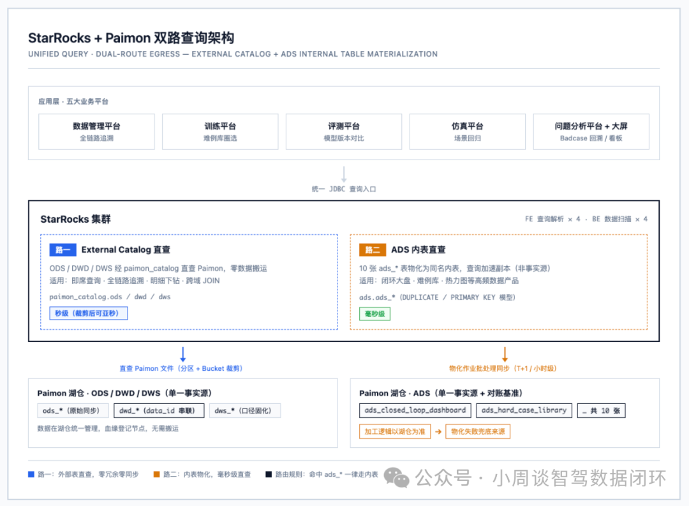
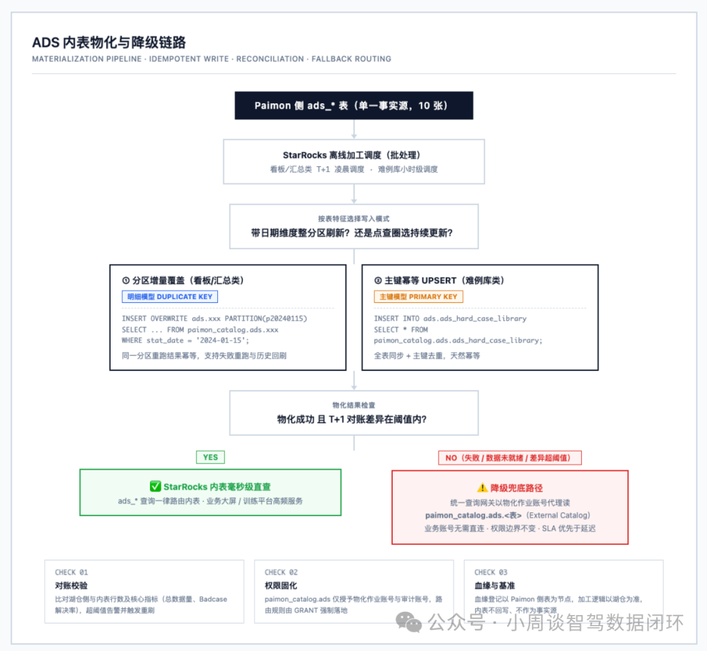

# StarRocks 与 Paimon 双路查询架构

原文：[智驾数据闭环湖仓实战：StarRocks + Paimon 双路查询架构](https://mp.weixin.qq.com/s/0WE9gwt-AsuyzeHgU8rxgQ)  
作者：小周谈智驾数据闭环｜发布：2026-09-02｜系列二·湖仓实战，第 3 篇

Paimon 管理湖仓数据，StarRocks 为业务提供统一 SQL 查询入口。灵活的明细分析通过 External Catalog 读取湖中数据；高频、相对固定的应用查询，把 Paimon ADS 结果同步到 StarRocks 内表后读取。

两条路径分别承担灵活查询与产品化服务。Paimon ADS 是业务结果的权威来源，内表是可以重建的加速副本；刷新、对账和故障降级负责维持这层关系。

## 一、查询场景：响应速度与查询方式各有要求

同一个智驾湖仓需要服务不同平台，查询范围、频率和响应要求并不相同。

| 平台 | 典型需求 | 查询方式 | 文中的响应目标 |
| --- | --- | --- | --- |
| 数据管理平台 | 查单条数据的全链路状态 | 按主键查询，频率较低 | 秒级 |
| 训练平台 | 圈选难例、比较数据集版本 | 高频点查与条件筛选 | 毫秒级 |
| 评测平台 | 比较模型、分析 Badcase | 中频聚合与明细读取 | 秒级 |
| 业务大屏 | 闭环大盘、热力图、成本看板 | 高频且相对固定的聚合查询 | 毫秒级 |
| 问题分析平台 | 回溯异常样例、下钻触发事件 | 即席分析与跨表关联 | 秒级 |

全部通过外表查询，可以减少一套业务数据副本及其同步任务，但查询可能持续承担元数据访问、远端文件读取和湖表合并等成本。全部导入内表则需要维护更多副本、同步任务与一致性检查。

文章据此选择双路出口：探索性、低频且变化较多的查询保留查湖能力；高频、结果结构明确的查询优先使用内表。

> [!note] 批注：毫秒级响应与小时级刷新，为什么可以同时成立？
> 假设难例库在 10:00 完成一次内表刷新，某条记录 `D001` 在 10:10 才进入 Paimon。10:20 查询内表时，可以很快返回结果，却仍然看不到这条新记录；它要等后续刷新才出现。
>
> 响应延迟描述“发出查询后等多久”，数据新鲜度描述“结果反映到哪个业务时刻”。给内表设定毫秒级响应目标，不能替代对刷新延迟的约定。以下涉及 `D001` 的时间和数值均为教学假设。

> [!note] 批注：先按需求选路径，再把规则固定下来。
> 灵活分析需要临时改变字段、条件和关联关系，保留查湖入口能减少为每个新问题复制数据的工作。高频产品查询通常可以提前确定粒度、字段和访问方式，适合维护专门的内表。
>
> 后文把 ADS 默认送到内表，是该方案把高频产品需求归入 ADS 后形成的运行规则。层级前缀只是执行路由的约定，选型仍需同时满足结果正确性、数据新鲜度、并发和查询延迟要求。

## 二、双路架构：一个查询入口，两种数据读取方式

所有平台通过 StarRocks 查询，查询实际落到以下两条路径。

| 路径 | 数据对象 | 主要用途 |
| --- | --- | --- |
| External Catalog | `paimon_catalog.ods`、`paimon_catalog.dwd`、`paimon_catalog.dws` 等湖仓库 | 即席分析、追溯、下钻与跨域 JOIN |
| StarRocks 内表 | 本地 `ads` 库中的应用表 | 大屏、难例库和其他高频产品查询 |

图中的示例部署包含 4 个 FE 查询解析节点、4 个 BE 数据扫描节点，上层经统一 JDBC 入口访问。节点数量属于文章的部署示意。



Paimon 侧的 `ads_*` 维护业务加工口径，StarRocks 内表使用其结果构建加速副本，不把业务更新反向写回湖仓。业务血缘以湖仓结果为依据，副本对账以对应的湖仓数据为基准，刷新失败时也回到同一份 Paimon ADS 结果。

> [!note] 批注：怎样判断“单一事实源”有没有落实？
> 对 `ads_hard_case_library`，难例判定规则和正式结果由湖仓侧维护，内表只复制服务查询所需字段。内表损坏或丢失时，能够从湖仓结果重建。
>
> 如果有人直接在内表修改 `D001` 的难度分数，而湖仓没有对应修改，两条路径就出现不同答案。既然内表是副本，修正规则和结果应先回到权威来源，再通过刷新传播。
>
> 血缘中仍应记录“哪次刷新把哪份湖仓结果写入哪张内表”，否则无法判断一个副本对应哪个源版本。权威来源唯一，不等于只保留源节点而省略复制链路。

> [!note] 批注：这里的“物化”是否就是 StarRocks 物化视图？
> 本文通过普通内表加离线 `INSERT` 作业，把查询结果保存下来供业务读取，没有展示 `CREATE MATERIALIZED VIEW`。因此刷新调度、失败重试、数据就绪检查与路由切换，需要由这条加工链路明确实现。
>
> 这与“创建物化视图后由引擎维护刷新或参与查询改写”是不同的运行方式，不能仅因文章使用“物化”二字就假定自动刷新或自动分流已经存在。

## 三、External Catalog：直接查询 Paimon

### 1. 连接元数据与对象存储

External Catalog 让 StarRocks 取得 Paimon 的表结构和数据位置，再读取湖仓文件。文中使用阿里云 DLF 管理元数据、OSS 存放文件，给出如下环境配置示意。

```sql
-- 原文的 DLF + OSS 环境示意；并非已验证的通用配置
CREATE EXTERNAL CATALOG paimon_catalog
PROPERTIES (
    'type' = 'paimon',
    'metastore' = 'dlf',
    'dlf.region' = 'cn-hangzhou',
    'paimon.catalog.warehouse' =
        'oss://intelligent-driving-lakehouse/paimon/',
    'cache.enabled' = 'true',
    'cache.size' = '107374182400',
    'cache.ttl' = '3600'
);
```

文中用 `107374182400` 字节表达 100 GiB 缓存容量，以 `3600` 表达一小时 TTL。实际连接还需要所选产品和部署环境支持对应 Metastore、存储访问与身份配置。

> [!warning] 技术边界：Catalog 类型与缓存属性需要核对实际版本。
> StarRocks 官方通用 Paimon Catalog 文档使用 `paimon.catalog.type`，列出 `filesystem` 与 `hive` 两类 Metastore。该文档未给出这里的 `metastore='dlf'`、`dlf.region` 和三项 `cache.*` 配置，不能把上面的产品环境示意直接当作通用可执行 DDL。
>
> 若使用云厂商扩展，需要取得对应产品、版本的连接说明；若使用开源部署，应按其支持的 Metastore 和存储方式配置。数据缓存也有独立配置入口，不能仅凭 Catalog 创建成功就认定缓存容量和 TTL 已生效。参见 [Paimon Catalog](https://docs.starrocks.io/docs/data_source/catalog/paimon_catalog/)及 [Data Cache](https://docs.starrocks.io/docs/data_source/data_cache/)。

连接成功后，可查看具体数据库下的表：

```sql
SHOW TABLES FROM paimon_catalog.dwd;
```

> [!note] 批注：能看到表名，是否意味着已经能读取数据？
> 列表操作主要验证元数据可见；真正查询还要能访问对象存储中的数据文件。Metastore 可连接、表级权限满足、文件路径和存储身份可用，是读取链路中的不同条件。
>
> 如果表名能列出但查询失败，应继续区分表结构解析、数据文件访问和类型兼容等问题。External Catalog 提供的是访问入口，并没有预先把整张表复制到内表。

### 2. 按 data_id 查询生产链路

单条数据追溯可以通过全局标识读取生产主链路状态：

```sql
SELECT
    data_id,
    upload_status,
    preprocess_status,
    annotation_status,
    qc_status,
    delivery_status,
    total_production_hours
FROM paimon_catalog.dwd.dwd_data_production_chain
WHERE data_id = 'COLLECT_BP_20240115143022_a3f8';
```

> [!note] 批注：主键点查能保证的是业务定位，不是固定耗时。
> `data_id` 让查询明确指向哪个数据单元；执行时还要定位相关文件，并按 Paimon 读取语义合并同键记录。它与传统数据库逐条访问 B-tree 索引的路径并不相同。
>
> 实际耗时受谓词下推、文件组织、网络、缓存和表状态影响。文章的秒级或亚秒级是场景目标，是否达到应看执行计划、扫描指标与实际并发测试。

### 3. 分区裁剪与 Bucket 裁剪

| 优化方式 | 需要的条件 | 预期作用 |
| --- | --- | --- |
| 分区裁剪 | 查询提供引擎可利用的分区条件，例如日期或业务类别 | 跳过不符合条件的分区 |
| Bucket 裁剪 | 分桶方式与过滤条件允许计算目标 Bucket，且读取链路支持相应裁剪 | 减少要读取的数据分组 |

> [!note] 批注：为什么 WHERE 里出现一个键，还不一定只读一个 Bucket？
> 固定哈希分桶需要足够的分桶键条件才能定位目标组。若实际分桶键是多个字段的组合，而查询只限制其中一个字段，就不一定能算出唯一 Bucket；读取引擎还要支持把相关条件传给 Paimon。
>
> 因此应检查表的真实分桶配置，并用 `EXPLAIN`、Profile 观察实际扫描范围。原文的“命中键后只读一个 Bucket”需要这些条件，不能只从 SQL 里出现 `data_id` 就确认。分桶语义见 [Paimon 1.3 Data Distribution](https://paimon.apache.org/docs/1.3/primary-key-table/data-distribution/)。

> [!note] 批注：外表直查是否总能看到此刻最新的数据？
> 查询读取的是湖仓中已经提交、且当前查询能够解析到的表状态。尚未提交的上游写入本来就不可见，元数据可见性和查询采用的读取状态也会影响结果。
>
> 外表省去了内表刷新这一步，并不等于从业务事件产生到查询可见没有延迟。确认新鲜度时应追踪上游完成、湖表提交、查询可见和副本刷新这些不同时间点。

## 四、ADS 内表：刷新策略、表模型与一致性

### 1. 物化范围和刷新频率

文章把以下应用结果同步为同名 StarRocks 内表。训练平台高频依赖的难例库按小时刷新，其他看板或汇总结果以 T+1 为主。

| 内表 | 用途 | 刷新频率 |
| --- | --- | --- |
| `ads_closed_loop_dashboard` | 闭环大盘 | T+1 |
| `ads_production_bottleneck_analysis` | 产线瓶颈分析 | T+1 |
| `ads_badcase_root_cause_distribution` | Badcase 根因分布 | T+1 |
| `ads_scene_library_summary` | 场景库汇总 | T+1 |
| `ads_hard_case_library` | 训练平台难例圈选 | 小时级 |
| `ads_data_asset_catalog` | 数据资产目录 | T+1 |
| `ads_model_version_comparison` | 模型版本比较 | T+1 |
| `ads_ota_deployment_summary` | OTA 部署汇总 | T+1 |
| `ads_trigger_heatmap` | 触发事件热力图 | T+1 |
| `ads_storage_cost_dashboard` | 存储成本看板 | T+1 |

### 2. 按结果粒度与刷新方式选内表模型

| 结果特征 | 表模型 | 文中刷新方式 |
| --- | --- | --- |
| 带统计日期、一次重算整个日期分区 | `DUPLICATE KEY` 明细模型 | `INSERT OVERWRITE` 覆盖目标分区 |
| 按业务键查询、记录持续变化 | `PRIMARY KEY` 主键模型 | 同键 Upsert，更新已有记录或插入新键 |

下面沿用文章展示的字段。看板表补齐了动态分区的结束边界与名称前缀，便于理解如何建立后续覆盖写所需分区；示例未在实际集群执行，分区和副本配置需与部署环境匹配。

```sql
CREATE TABLE ads.ads_closed_loop_dashboard (
    stat_date DATE NOT NULL,
    project_code VARCHAR(64) NOT NULL,
    total_data_count BIGINT,
    avg_loop_hours DOUBLE,
    badcase_resolve_rate DOUBLE,
    update_time DATETIME
) ENGINE = OLAP
DUPLICATE KEY(stat_date, project_code)
PARTITION BY RANGE(stat_date) ()
DISTRIBUTED BY HASH(project_code) BUCKETS 2
PROPERTIES (
    "dynamic_partition.enable" = "true",
    "dynamic_partition.time_unit" = "DAY",
    "dynamic_partition.start" = "-365",
    "dynamic_partition.end" = "3",
    "dynamic_partition.prefix" = "p"
);

CREATE TABLE ads.ads_hard_case_library (
    data_id VARCHAR(128) NOT NULL,
    hard_case_type VARCHAR(64),
    difficulty_score DOUBLE,
    scene_type VARCHAR(64),
    is_used_in_training BOOLEAN,
    update_time DATETIME
) ENGINE = OLAP
PRIMARY KEY(data_id)
DISTRIBUTED BY HASH(data_id) BUCKETS 8;
```

> [!note] 批注：DUPLICATE KEY 为什么还能实现幂等刷新？
> 明细模型允许相同键的记录同时存在，`DUPLICATE KEY(stat_date, project_code)` 不承担唯一性去重。若把同一批结果重复 `INSERT INTO` 两次，可能保留两份记录。
>
> 这里的幂等来自覆盖写：先确定一个统计日期的完整结果，再替换该日期分区。对相同源结果覆盖同一目标分区，重复执行不继续累加。它依赖写入动作及覆盖范围，而非明细模型的键声明。

> [!note] 批注：动态分区保留范围与历史回刷怎样配合？
> `start=-365` 描述相对当前时间的历史边界，`end=3` 表达向前建立分区的边界，`prefix=p` 用于组成分区名。分区是否已创建仍应通过实际分区列表确认。
>
> 回刷历史日期时，目标分区必须存在，而且不能与当前的过期清理规则冲突。原文后续使用的 `2024-01-15` 是覆盖写语法示例，不代表它在任何运行日期的保留窗口里都存在。配置定义见 [Dynamic Partitioning](https://docs.starrocks.io/docs/table_design/data_distribution/dynamic_partitioning/)。

### 3. 两种写入语句

看板类结果按日期覆盖。下面将原文省略的字段补为上方建表中的完整字段；`p20240115` 必须是已存在的目标分区。

```sql
INSERT OVERWRITE ads.ads_closed_loop_dashboard
PARTITION (p20240115)
SELECT
    stat_date,
    project_code,
    total_data_count,
    avg_loop_hours,
    badcase_resolve_rate,
    update_time
FROM paimon_catalog.ads.ads_closed_loop_dashboard
WHERE stat_date = '2024-01-15';
```

难例库按主键同步。显式列出源字段，避免源表增加字段或调整顺序后，`SELECT *` 意外改变列映射。

```sql
INSERT INTO ads.ads_hard_case_library
SELECT
    data_id,
    hard_case_type,
    difficulty_score,
    scene_type,
    is_used_in_training,
    update_time
FROM paimon_catalog.ads.ads_hard_case_library;
```

> [!warning] 技术边界：全表扫描后 Upsert，不等于完整镜像同步。
> 假设内表有 `D001`、`D002` 两个键，Paimon 删除 `D002` 后只剩 `D001`。再次运行上面的 `INSERT INTO ... SELECT ...`，只会写入查询返回的 `D001`；缺席的 `D002` 不会因此自动从内表删除。
>
> 因而“相同输入重跑不会增加同键行”和“目标完整反映源表当前状态”需要分别保证。后者还要处理删除，例如同步删除事件，或使用经过设计的完整替换、影子表校验后切换等方案。主键模型的数据修改能力与写入语义见 [Primary Key Table](https://docs.starrocks.io/docs/table_design/table_types/primary_key_table/)及 [INSERT](https://docs.starrocks.io/docs/sql-reference/sql-statements/loading_unloading/INSERT/)。

> [!note] 批注：可以重跑，还要防止旧批次覆盖新批次。
> 如果 10:00 刷新读取的旧结果运行较慢，11:00 的新刷新先完成，旧刷新随后提交，仍可能把状态写回较早的版本。主键去重只能约束键对应的记录，不能自动理解哪个调度批次代表更新的业务状态。
>
> 刷新任务应控制并发发布顺序，必要时记录源版本或业务批次。分区覆盖前还要确认源结果已就绪：源表因上游失败而暂时为空，与该业务日期确实没有数据，是不同情况。

### 4. 调度、对账和失败处理

| 工程环节 | 文章方案 |
| --- | --- |
| 调度频率 | 看板与汇总表凌晨 T+1 刷新，难例库按小时刷新 |
| 日期覆盖 | 按 `stat_date` 重算目标分区，支持失败重跑与历史回刷 |
| 对账 | T+1 比较湖仓与内表行数及总量、Badcase 解决率等指标，超阈值告警并重刷 |
| 失败回退 | 内表未就绪或刷新失败时，由统一网关代理读取 Paimon ADS |



> [!note] 批注：对账为什么要先对齐版本或业务批次？
> 假设内表对应 10:00 的结果，Paimon 在 10:10 又发生变化。10:20 直接把内表与湖仓最新结果比较，差异可能只说明刷新尚未追上，而非复制错误。
>
> 对账应限定相同统计日期、过滤范围和业务批次；需要时记录或固定源读取版本。行数与聚合指标适合快速筛查，还要检查业务键及相关字段，因为两边即使行数相同，也可能缺失了不同的记录。
>
> 发现差异后应先区分源结果未就绪、刷新延迟、删除遗漏和写入失败，再决定是否重刷。T+1 检查也不能代替小时级难例库自身的数据就绪监控。

## 五、查询路由与权限边界

### 1. 默认路由

| 数据范围 | 默认查询出口 | 主要需求 | 文中响应目标 |
| --- | --- | --- | --- |
| ADS 产品结果 | StarRocks 本地 `ads` 库 | 看板、难例库、场景库等固定应用 | 毫秒级 |
| ODS / DWD / DWS | `paimon_catalog` | 即席分析、追溯、下钻和 JOIN | 秒级，具体取决于扫描与裁剪 |

正常业务读取 ADS 内表。刷新失败、数据未就绪或审计回溯时，才由受控链路读取 `paimon_catalog.ads`。

> [!note] 批注：统一经过 StarRocks，为什么还需要路由规则？
> SQL 写向 `ads.ads_hard_case_library` 与写向 `paimon_catalog.ads.ads_hard_case_library`，读取的是不同物理对象。统一连接地址并不会自动替调用方决定表名，也不会因两个对象同名就保证答案同步。
>
> 应用、查询网关或服务接口需要明确选择对象，并把内表就绪状态作为切换依据。若想让引擎自动改写查询，应另外配置相应能力，不能从这套普通内表刷新方案中直接推出。

### 2. 通过授权限制访问路径

文章的授权意图是：业务账号读取外部 ODS、DWD、DWS 和本地 ADS；只有物化作业及审计账号可以直接读取外部 ADS。

下面按官方基于对象的授权语法表达这些只读权限。账号、Catalog 和数据库需要事先存在；执行账号需要相应授权能力，以下语句未执行。

```sql
GRANT USAGE ON CATALOG paimon_catalog
TO USER 'data_platform'@'%';

SET CATALOG paimon_catalog;

GRANT SELECT ON ALL TABLES IN DATABASE ods
TO USER 'data_platform'@'%';
GRANT SELECT ON ALL TABLES IN DATABASE dwd
TO USER 'data_platform'@'%';
GRANT SELECT ON ALL TABLES IN DATABASE dws
TO USER 'data_platform'@'%';

GRANT USAGE ON CATALOG paimon_catalog
TO USER 'ads_materialize_job'@'%';
GRANT USAGE ON CATALOG paimon_catalog
TO USER 'audit_account'@'%';

GRANT SELECT ON ALL TABLES IN DATABASE ads
TO USER 'ads_materialize_job'@'%';
GRANT SELECT ON ALL TABLES IN DATABASE ads
TO USER 'audit_account'@'%';

SET CATALOG default_catalog;

GRANT USAGE ON CATALOG default_catalog
TO USER 'data_platform'@'%';
GRANT SELECT ON ALL TABLES IN DATABASE ads
TO USER 'data_platform'@'%';
```

> [!note] 批注：数据库级权限与表的 SELECT 权限要分开表达。
> 授权应指向具体对象类型。这里先选 Catalog，再对某个数据库中的全部表授予 `SELECT`；不把“能使用某个库”和“能读库里的所有表”混为一条含糊授权。
>
> 上面只展示读取边界。物化作业还需要对指定目标内表执行刷新所需的写权限，按实际语句及版本配置；业务账号无需因此获得写权限。相关语法见 [StarRocks GRANT](https://docs.starrocks.io/docs/sql-reference/sql-statements/account-management/GRANT/)。

> [!warning] 技术边界：网关代理回退仍须检查原业务主体的权限。
> 网关使用能读取外部 ADS 的账号，只解决了存储访问。若这个账号可见更多项目或租户，代理查询还必须保留原请求的项目范围、行列限制和审计身份，不能因降级而把作业账号的全部可见数据交给业务方。
>
> 更稳妥的做法是为回退读取设置专用只读身份，并由可信网关固定查询范围。保持相同字段、统计口径与权限条件后，再判断是否允许切换。

> [!note] 批注：回退到湖仓时，究竟保住了哪项服务目标？
> 回退可以在副本不可用时恢复数据访问，但查湖可能更慢，两边的新鲜度也可能不同。需要事先规定降级后的超时、并发上限与返回状态，并根据请求是否允许使用旧结果来选择处理方式。
>
> “服务可用性优先”不能理解为回退后仍自动满足原来的毫秒级延迟目标。还要避免大量业务请求同时转向湖仓，把降级变成另一路过载。

## 六、性能与运维：缓存、资源隔离、慢查询和状态排查

| 运维方向 | 文章中的配置或操作示意 | 目的 |
| --- | --- | --- |
| 数据缓存 | `scan_data_cache_size=10GB`、TTL `3600s`，另设 Page Cache `4GB` | 减少热点数据重复远端读取 |
| 资源组隔离 | 数据管理平台 CPU 示例值 4、并发 20；训练平台 CPU 示例值 2、并发 10 | 限制相互影响，控制平台间资源竞争 |
| 慢查询观察 | `query_time > 10s` 告警，结合 Profile 和执行计划 | 定位扫描过大、过滤失效和资源等待 |
| 状态排查 | `SHOW CATALOGS`、`SHOW TABLE STATUS`、`SHOW PARTITIONS` | 检查连接对象、表状态及实际分区 |

> [!note] 批注：缓存容量、缓存内容与数据新鲜度不是同一个设置。
> 数据文件缓存帮助减少远端 I/O；Page Cache 缓存的对象与元数据缓存也不同。容量决定能容纳多少内容，是否命中取决于查询与缓存策略，不能用一个 TTL 同时解释所有缓存。
>
> 官方 Data Cache 文档使用 `datacache_disk_size`、`datacache_mem_size` 等配置。原文的 `scan_data_cache_size` 和统一 TTL 应视为待按产品版本确认的环境示意，而非照抄即生效的参数。参见 [Data Cache](https://docs.starrocks.io/docs/data_source/data_cache/)。

> [!note] 批注：CPU 示例值 4，是否表示独占 4 个核？
> 不一定。资源组中的 CPU 调度权重与独占核数属于不同控制方式，字段名和支持范围也随版本变化；例如官方文档说明旧的 `cpu_core_limit` 后续采用 `cpu_weight` 表达相对调度权重。
>
> 配置前要确定采用的是权重还是硬隔离，并同时检查内存、并发和查询排队。文章的数字用于说明平台之间需要划分资源，不能直接当作集群容量规划。参见 [Resource Group](https://docs.starrocks.io/docs/administration/management/resource_management/resource_group/)。

> [!note] 批注：结果不一致时，先确定是哪两份数据在比较。
> 如果比较的是 Paimon 与内表，先确认统计范围、源批次、刷新是否完成，以及更新和删除是否正确传播；如果是外表读取不同请求结果不同，再检查源提交状态和元数据可见性。
>
> 缓存只是其中一个可能因素，Compaction 也不是修复所有同步差异的通用动作。Profile 用来观察扫描、I/O 和等待，作业记录用来确认刷新结果，二者结合才能区分查询性能问题与数据一致性问题。

双路架构保留了湖仓的灵活查询能力，同时为固定高频需求维护内表。运行上需要把源结果、复制批次、发布就绪状态、对账和回退连起来：内表查得快，并不自动意味着数据完整、足够新或能够安全重跑。
