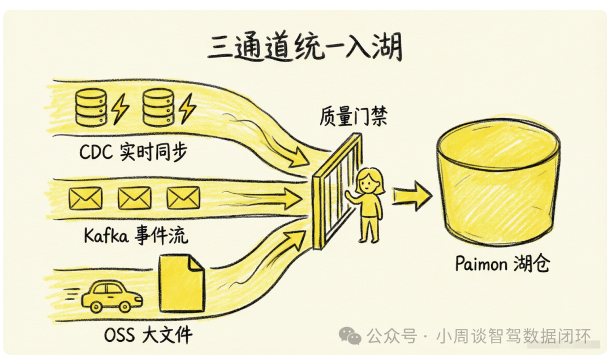
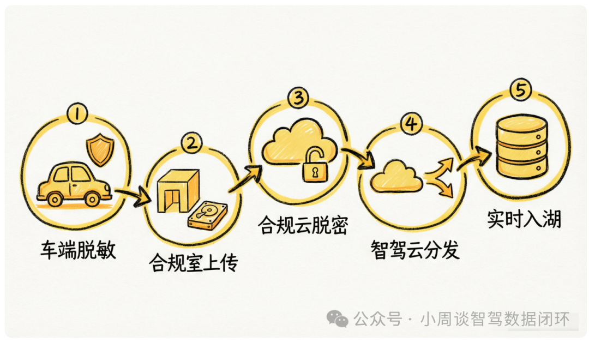

# Flink CDC 实时入湖与多源数据接入

原文：[智驾数据闭环湖仓实战：Flink CDC 实时入湖，多源数据接入架构设计](https://mp.weixin.qq.com/s/Cv4MPPWWOQJCDwyr8XJVpw)  
作者：小周谈智驾数据闭环｜发布：2026-09-03｜系列二·湖仓实战，第 4 篇

业务库的行变化、持续产生的事件和图像点云大文件，具有不同的读取与恢复方式。本文把它们分成 CDC、Kafka 和对象存储三条接入通道，在写入业务湖表之前执行质量检查；文件本体保留在 OSS，文件路径及元信息进入 Paimon。

## 一、接入方式：数据形态与时效要求一起决定

文章涉及产线、标注、质检、训练、评测等 MySQL 数据，以及生产事件、训练指标、车端触发和仿真事件。

| 数据来源 | 接入方式 | 同步节奏 | 文章中的延迟目标 |
| --- | --- | --- | --- |
| 产线、标注、质检 MySQL | Flink CDC | 持续读取变更 | 小于 5 秒 |
| 训练、评测 MySQL | CDC 与定时批量配合 | 实时及小时级 | 小于 5 秒或小时级 |
| 产线、训练、车端回传 Kafka | Flink Kafka 接入 | 持续消费 | 小于 1 秒 |
| 图像、点云等采集文件 | OSS 上传链路，Kafka 传递元信息 | 文件完成后发布元信息 | 元信息小于 5 秒 |

产线状态频繁变化，按小时复制容易让查询结果落后；触发事件会启动后续 Badcase 分析，需要尽快被消费；采集大文件还需要独立的传输、处理与访问控制流程。

因此，先按结构化行、事件和大文件划分通道，再在各通道内选择持续读取或批量同步。不同来源可以共用质量规则、审计字段和运行监控，但不必强行使用同一种传输方式。

> [!note] 批注：消费延迟低，是否就代表湖表已经可查？
> 假设一条事件产生后 0.5 秒被 Flink 消费，这只能说明接入到消费这段很快；后面还有清洗、状态计算、写文件和提交等步骤。
>
> 在依赖 Checkpoint 提交的 Paimon 流式写入中，还要等相应提交完成，其他查询才能读取已发布的表状态。后文给出的 60 秒 Checkpoint 间隔，不能直接证明端到端已经满足亚秒或 5 秒入湖可见性。应分别测量源事件时间、消费时间和湖表可见时间。Paimon 流式写入的 Checkpoint 前提见 [Flink Quick Start](https://paimon.apache.org/docs/1.3/flink/quick-start/)。

## 二、三通道与统一质量门禁

| 通道 | 读取内容 | 入湖方式 |
| --- | --- | --- |
| Flink CDC | MySQL 全量快照及后续 binlog 变化 | 把业务行变化写入 ODS |
| Kafka | 产线埋点、训练指标、回传和仿真事件 | 消费事件，写明细或按约定加工 |
| OSS 文件链路 | 采集文件及处理后的对象 | 文件留在 OSS，元信息经 Kafka 写入 `ods_data_file_meta` |



门禁检查完整性、字段格式与业务规则，并对异常告警。拒绝进入正常业务表的记录写入 `ods_quality_issue`，保留问题信息，经过处理后再重放。

门禁负责判断是否放行，修复由相应的源系统或处理流程完成。

> [!note] 批注：隔离异常记录，与把它直接丢掉有什么区别？
> 以教学数据单元 `D001` 为例，文件路径缺失时，正常文件元信息表不能接收这条记录；但隔离链路应保留原事件或可恢复引用、错误原因和处理状态，方便修复后重放。
>
> 因此“异常不进入业务表”不代表系统不保存任何异常证据。正常结果与隔离结果还需要可靠落地：若拒绝分支只写了一条普通日志，作业恢复后就可能既没有业务记录，也没有可追查的隔离记录。

## 三、CDC 通道：初始快照、持续读取与恢复

### 1. Source、Sink 与同步语句

文章以产线任务表说明接入骨架：声明 MySQL CDC Source，声明 Paimon 主键表，再通过 `INSERT INTO ... SELECT ...` 写入，补充 `_ingest_time` 和 `_source_system`。

下面补全了原文省略的字段、连接占位项及目标路径；连接器、文件系统插件与访问身份需事先配置，SQL 未在实际集群执行。示例只展示同步骨架，质量门禁分流需要另行实现。

```sql
CREATE TABLE mysql_source_production_line_task (
    task_id STRING,
    task_name STRING,
    status STRING,
    create_time TIMESTAMP(3),
    update_time TIMESTAMP(3),
    PRIMARY KEY (task_id) NOT ENFORCED
) WITH (
    'connector' = 'mysql-cdc',
    'hostname' = '<MYSQL_HOST>',
    'port' = '3306',
    'username' = '<CDC_USER>',
    'password' = '<CDC_PASSWORD>',
    'database-name' = 'production_db',
    'table-name' = 'production_line_task',
    'scan.startup.mode' = 'initial',
    'scan.incremental.snapshot.enabled' = 'true'
);

CREATE TABLE paimon_sink_production_line_task (
    task_id STRING,
    task_name STRING,
    status STRING,
    create_time TIMESTAMP(3),
    update_time TIMESTAMP(3),
    _ingest_time TIMESTAMP(3),
    _source_system STRING,
    PRIMARY KEY (task_id) NOT ENFORCED
) WITH (
    'connector' = 'paimon',
    'path' =
        'oss://intelligent-driving-lakehouse/paimon/ods/ods_production_line_task',
    'bucket' = '4',
    'changelog-producer' = 'input'
);

INSERT INTO paimon_sink_production_line_task
SELECT
    task_id,
    task_name,
    status,
    create_time,
    update_time,
    CAST(CURRENT_TIMESTAMP AS TIMESTAMP(3)) AS _ingest_time,
    'production_mysql' AS _source_system
FROM mysql_source_production_line_task;
```

`scan.startup.mode='initial'` 表达从初始快照接入，再继续消费变化；增量快照配置允许按分块方式组织快照读取。`bucket=4` 是目标表的固定分桶选择。

> [!note] 批注：初始快照与 binlog 分别补上哪部分数据？
> 假设任务 `T001` 在作业启动前已经存在，初始快照负责把已有记录读出来；快照读取期间或之后发生的状态更新，再由变更日志接续。
>
> 增量快照还要协调分块读取期间的变化，不能简单理解为“先 SELECT 全表，再随便找个 binlog 位点开始读”。恢复时保存的状态也可能包含尚未完成的快照分块信息。机制见 [MySQL CDC Connector](https://nightlies.apache.org/flink/flink-cdc-docs-release-3.3/docs/connectors/flink-sources/mysql-cdc/)。

> [!note] 批注：增量快照的“无锁”具体免去了什么？
> 官方说明的一个特性是快照读取不需要先获取全局读锁；这有利于降低对源库的影响，但仍会读取源表并消耗数据库资源，也依赖源库、账号和连接器满足相关条件。
>
> 多个并行读取实例还需要互不冲突的 MySQL `server-id`。增量快照不能替代对源库负载、binlog 保留和读取权限的配置检查。相关约束见 [MySQL CDC 文档](https://nightlies.apache.org/flink/flink-cdc-docs-release-3.3/docs/connectors/flink-sources/mysql-cdc/)。

> [!warning] 技术边界：CDC 来源不自动保证 input 的变化语义完整。
> `input` 使用 Writer 实际收到的变化。采用它之前，应同时检查字段是否完整、更新是否包含所需旧值，以及记录是否已等价于表内合并后的完整逻辑变化；不能只凭 Source 名称带有 CDC 决定。
>
> 这里还增加了动态生成的 `_ingest_time`。若重放或处理更新前记录时重新赋值，需要核对这些审计字段与已有表状态是否仍然一致，不能仅凭业务字段完整就认定整行变化完整。
>
> 部分更新、聚合增量或缺少旧值的 Upsert，需要结合旧状态生成完整变化时可选 `lookup`。配置定义见 [Changelog Producer](https://paimon.apache.org/docs/1.3/primary-key-table/changelog-producer/)；动态表达式与更新语义的关系见 [Flink 连续查询中的确定性](https://nightlies.apache.org/flink/flink-docs-release-1.20/docs/dev/table/concepts/determinism/)。

### 2. Checkpoint 保存恢复所需状态

文章给出以下运行配置意图。表中使用 Flink 1.20 的完整配置名表达相应含义，具体部署仍需检查版本与插件。

| 配置 | 示例值 | 用途 |
| --- | --- | --- |
| `execution.checkpointing.interval` | `60s` | 周期性发起 Checkpoint |
| `execution.checkpointing.mode` | `EXACTLY_ONCE` | 采用一致性状态快照模式 |
| `execution.checkpointing.storage` | `filesystem` | 使用文件系统保存 Checkpoint |
| `execution.checkpointing.dir` | `oss://flink-checkpoints/cdc/` | 保存可供集群访问的恢复文件与元数据 |
| 高可用部署 | 三节点 ZooKeeper | 协助 JobManager 高可用管理 |

> [!note] 批注：故障恢复为何不能只记住一个 binlog 位点？
> Checkpoint 需要让 Source 读取进度、算子状态与 Sink 提交状态对应起来。假设从检查点恢复后重新读到了 `T001` 的一条更新，聚合算子也应恢复到同一检查点，而不是保留故障前已经累计过这条记录的状态，再重复累计。
>
> 因此恢复的是整条处理链路的一致状态。ZooKeeper 的高可用职责与 Checkpoint 文件存储也不同，不能只部署 ZooKeeper 就认为状态已经持久化。参见 [Flink Checkpointing](https://nightlies.apache.org/flink/flink-docs-release-1.20/docs/dev/datastream/fault-tolerance/checkpointing/)。

> [!warning] 技术边界：60 秒是触发间隔，不是重放量的硬上限。
> 故障恢复依据最近一次成功且可恢复的 Checkpoint。若检查点运行很慢、连续失败或因并发与暂停设置而延后，最近成功状态可能已经落后数分钟，重放范围也会随之扩大。
>
> 持久化文件还需要保留、兼容，并在恢复时实际选用；Source 所需的 binlog 也必须仍然存在。监控最近成功检查点的年龄，比只检查配置里写着 `60s` 更能反映恢复风险。触发机制见 [Checkpointing 配置](https://nightlies.apache.org/flink/flink-docs-release-1.20/docs/dev/datastream/fault-tolerance/checkpointing/)。

> [!note] 批注：Exactly-Once 为什么不能只靠主键去重？
> 主键 Upsert 可以让同一个键的重复状态写入合并，但如果重放过程已经把某个计数累计两遍，最终写入的错误总数仍然可能只有一行。
>
> 端到端保证需要可重放的 Source、一致恢复的算子状态，以及与 Checkpoint 配套的 Sink 提交和恢复协议同时成立。Exactly-Once 指约定范围内的结果语义，不代表底层每条记录只经过一次执行，也不自动涵盖作业中的普通外部 HTTP 调用。参见 [Flink 连接器保证](https://nightlies.apache.org/flink/flink-docs-release-1.20/docs/connectors/datastream/guarantees/)。

### 3. 集中声明字段映射与转换

文中把源表、目标表、新增字段和转换规则集中写在配置中，使新增接入不必反复修改相同作业代码。

下面保留其配置结构，属于项目映射规则示意；需有配套解析器或作业生成逻辑，不能直接当作通用 Flink CDC Pipeline 文件提交。

```yaml
mappings:
  - source:
      database: production_db
      table: production_line_task
    target:
      database: ods
      table: ods_production_line_task
    field_mappings:
      - target: _ingest_time
        expression: CURRENT_TIMESTAMP
      - target: _source_system
        value: "production_mysql"
    transforms:
      - field: status
        type: uppercase
      - field: config
        type: json_validate
```

> [!note] 批注：字段映射、质量拒绝与业务标准化分别做什么？
> 新增 `_source_system` 是补充接入信息；检查 JSON 是否合法是决定是否放行；把状态转成大写则改变了字段表示。它们可以由同一套接入框架组织，却不是同一种处理。
>
> 若 ODS 承担源记录保真职责，标准化时应明确是否保留源值，或把标准化结果放在 DWD。配置集中管理的价值，在于把这些选择及规则版本写清楚，而非把所有转换都默认塞进入湖口。

## 四、Kafka 通道：事件消费、聚合与事件时间

### 1. Topic、分区与留存

| Topic | 事件来源 | 分区数 | 文章中的留存设置 |
| --- | --- | --- | --- |
| `production-line-events` | 产线埋点 | 16 | 7 天 |
| `training-metrics` | 训练指标 | 8 | 3 天 |
| `vehicle-trigger-events` | 车端触发事件 | 16 | 30 天 |
| `simulation-events` | 仿真任务事件 | 8 | 7 天 |

车端触发事件是后续 Badcase 回查的入口，因此方案为它设置更长的 Kafka 留存。

> [!note] 批注：Kafka 留存与湖仓追溯期限是什么关系？
> Kafka 留存限定了还能从该 Topic 重读多早的事件。已可靠写入湖仓或其他归档的事件，可以采用另一套留存策略；不能只看 Topic 的 30 天配置，就推断所有历史追溯都只能做到 30 天。
>
> 相反，若故障恢复需要读取的 offset 已经超过 Topic 的保留范围，仅有 Checkpoint 文件也不能补回被删掉的消息。应把最大故障时长、回补来源和各处留存一起设计。Kafka 读取位置与恢复语义见 [Flink Kafka Connector](https://nightlies.apache.org/flink/flink-docs-release-1.20/docs/connectors/table/kafka/)。

### 2. 明细直写与指标聚合

产线事件等明细按 `event_id` 组织记录；训练指标在 Flink 中聚合，再写入指标表，以减少下游处理和写入负担。文章选择不把这条指标链路的原始明细全部写入湖仓。

文中的训练指标 SQL 按训练任务与 `epoch` 分组：

```sql
INSERT INTO paimon_training_metric_agg
SELECT
    training_task_id,
    epoch,
    AVG(loss) AS avg_loss,
    MAX(loss) AS max_loss,
    MIN(loss) AS min_loss,
    COUNT(*) AS metric_count
FROM kafka_source_training_metrics
GROUP BY training_task_id, epoch;
```

> [!note] 批注：这条 SQL 计算的是持续分组聚合。
> 它没有时间窗口。假设某任务的 `epoch=1` 先收到 `loss=0.8`，再收到 `loss=0.4`，这个分组的均值会从 `0.8` 更新为 `0.6`，计数从 1 更新为 2；Flink 维护的是不断变化的聚合结果。
>
> Sink 需要能表达这种更新，并按 `(training_task_id, epoch)` 等完整粒度组织结果。仅给 Source 声明 Watermark，不会让这里自动变成窗口，也不会使该分组在某个时刻自动结束。状态如何保留和清理还要单独设计，参见 [Group Aggregation](https://nightlies.apache.org/flink/flink-docs-release-1.20/docs/dev/table/sql/queries/group-agg/)。

> [!note] 批注：任务重试与故障重放，为什么要分别去重？
> Flink 从 Checkpoint 重读消息，是恢复协议的一部分；训练平台重试后又发送一次相同业务指标，则可能在 Kafka 中成为另一条新消息。处理框架不会仅凭两条消息看起来相同就知道它们代表同一次测量。
>
> 若业务要求一次测量只计一次，应定义稳定事件标识或任务运行、epoch、step 等身份，再决定去重规则。只保留聚合结果时，还要确认原始事件是否在其他位置保留，以便核查异常均值或重新计算。

### 3. Watermark 表达事件时间进度

文章为训练指标设置 5 秒乱序余量，为车端事件设置 10 秒。下面是需要放进相应 `CREATE TABLE` 定义中的 Watermark 子句，不是独立执行语句。

```sql
-- 放入训练指标 Source 的字段定义
WATERMARK FOR metric_time
    AS metric_time - INTERVAL '5' SECOND

-- 放入车端事件 Source 的字段定义
WATERMARK FOR event_time
    AS event_time - INTERVAL '10' SECOND
```

> [!note] 批注：Watermark 的方向怎样判断？
> Watermark 描述事件时间已经推进到哪里。假设某输入已观测的最大事件时间是 `10:00:00`，按 5 秒有界乱序策略，其候选 Watermark 可以推进到约 `09:59:55`；多个输入还要结合各自进度。
>
> 此时新到达的 `09:59:50` 事件落在 Watermark 之前，属于需要按迟到策略处理的事件。不能把“时间晚于 Watermark”理解为迟到，也不能把 5 秒直接理解成每条消息到达后等待 5 秒。
>
> Watermark 本身不负责对所有记录排序，也不保证把迟到事件一律丢弃；何时触发、关闭窗口以及怎样处理迟到，要看后续算子。参见 [Time Attributes](https://nightlies.apache.org/flink/flink-docs-release-1.20/docs/dev/table/concepts/time_attributes/)。

如果实际需要“每分钟、每个训练任务与 epoch 一条统计”，则要显式增加时间窗口。下面是补充示例，要求 `metric_time` 已定义为事件时间属性，且目标表具有相应字段与粒度，未实际执行。

```sql
INSERT INTO paimon_training_metric_window_agg
SELECT
    window_start,
    window_end,
    training_task_id,
    epoch,
    AVG(loss) AS avg_loss,
    MAX(loss) AS max_loss,
    MIN(loss) AS min_loss,
    COUNT(*) AS metric_count
FROM TABLE(
    TUMBLE(
        TABLE kafka_source_training_metrics,
        DESCRIPTOR(metric_time),
        INTERVAL '1' MINUTE
    )
)
GROUP BY
    window_start,
    window_end,
    training_task_id,
    epoch;
```

> [!note] 批注：窗口与 Watermark 怎样配合？
> 一分钟窗口把事件划到对应的时间区间，Watermark 推进帮助算子判断何时可以结束一个事件时间窗口。例如 `09:59:00` 到 `10:00:00` 的窗口，不能仅因处理机器的墙上时钟到了 10:00 就认定事件已经到齐。
>
> 若把乱序余量放大，窗口结果通常需要等待更久；若某个活跃输入长期没有推进，整体进度也可能受拖累。输入空闲时可根据场景配置空闲检测，但之后重新到来的旧事件仍要按迟到规则处理。参见 [Window Aggregation](https://nightlies.apache.org/flink/flink-docs-release-1.20/docs/dev/table/sql/queries/window-agg/)及 [Generating Watermarks](https://nightlies.apache.org/flink/flink-docs-release-1.20/docs/dev/datastream/event-time/generating_watermarks/)。
>
> 乱序分布的 P99 可以作为配置参考，还要结合允许的迟到比例、结果时效和回补方案。采用 P99 并不代表其余尾部事件已被正确处理。

## 五、大文件通道：对象外置与元信息入湖

相机、激光雷达、IMU、GNSS 等采集数据中，大体量文件采用对象存储传输。Kafka 传递文件完成与元信息事件，CDC 接收业务表变化；不把大文件本体作为普通业务消息在这两条通道中搬运。

文章中的文件处理方案分为五步。



| 步骤 | 文章中的处理动作 | 方案中的边界要求 |
| --- | --- | --- |
| 车端脱敏 | 采集时实时处理人脸、车牌及地理相关信息，保存到车端 | 控制数据离开车辆前的暴露 |
| 合规室上传 | 指定人员提取硬盘，在专用环境上传到合规云对象存储 | 采用隔离的上传路径，不直接走公开业务通道 |
| 合规云处理 | 处理敏感 POI（文中以军事设施等为例），模糊桥梁限高等数值信息 | 在独立环境执行更复杂处理，控制对外暴露 |
| 智驾云分发 | 将处理后的副本分发到智驾云 OSS，向业务 Kafka 发布元信息 | 按批准的网络和访问边界流转，文中采用同 VPC 方案 |
| 元信息入湖 | Kafka 消费任务写入 `ods_data_file_meta` | 文件本体留在 OSS，湖表记录路径、身份与相关元信息 |

车端处理承担采集侧的前置保护，合规云承担更复杂的后处理。文章以这两段处理作为文件进入后续业务链路的前提。

> [!note] 批注：脱敏标记可以证明处理完成了吗？
> 标记可以作为流程检查字段，但还需要能关联到实际执行的处理任务、规则版本和验收结果。对象上写着“已脱敏”，并不能单独证明文件内容达到了要求。
>
> 上面的五步描述的是文章项目的处理边界，“离车即合规”应理解为该方案的控制目标，不能仅凭部署了两段处理就断言所有数据均满足适用要求。隔离上传、同 VPC 访问和内容处理分别解决不同问题，不能互相替代。

### 1. 文件在 OSS，表里保存身份与位置

元信息由上传服务在确认上传完成后发布，经 Kafka 进入湖仓；定期扫描 OSS 用于补充对账，不作为正常元信息采集的主要方式。

> [!note] 批注：为什么文件路径还需要配合对象版本或校验信息？
> 假设 `D001` 的元信息指向某个 OSS 对象。后续标注与训练应能确定使用的到底是哪份内容；若相同路径被覆盖，只有路径就可能无法复现当时的数据。
>
> 因此可结合对象身份、版本或校验摘要记录实际内容，并关联处理产物和来源数据。湖仓保存的是这些关系与描述，文件内容本身仍由对象存储承担。

> [!note] 批注：文件上传成功与元信息发送成功，怎样避免只完成一半？
> 对象写入完成但 Kafka 发送失败，会形成“文件存在、湖仓没有元信息”；事件先发出但目标副本尚未可读，则形成“元信息可见、文件不可用”。
>
> 上传服务应先确认目标对象完成，再用稳定事件身份可靠发布完成事件，支持发送失败后的重试；消费端按身份幂等处理，运维任务再核对对象与元信息是否匹配。不能仅依靠“这两步通常连续执行”获得跨系统原子性。

### 2. 文件元信息的质量拒绝规则

| 问题 | 文章中的级别 | 处理 |
| --- | --- | --- |
| 缺少脱敏标记 | P0 | 拒绝进入正常业务表 |
| `data_id` 格式非法 | P0 | 拒绝进入正常业务表 |
| 文件不可解码 | P1 | 拒绝进入正常业务表 |
| OSS 路径与记录不一致 | P1 | 拒绝进入正常业务表 |

元信息是后续寻找文件、连接处理产物和追查数据使用关系的入口，因此不能只验证 JSON 语法，还要检查记录与实际对象是否对应。P0、P1 是本文方案的告警分级。

## 六、接入运维：指标、恢复与回补

### 1. 监控阈值

| 指标 | 文章示例阈值 | 告警级别 | 观察对象 |
| --- | --- | --- | --- |
| `cdc_lag_seconds` | 大于 30 秒 | WARNING | CDC 同步落后情况 |
| `cdc_checkpoint_failure` | 连续失败超过 3 次 | CRITICAL | 一致恢复点长期未推进的风险 |
| `kafka_consumer_lag` | 超过 10000 条 | WARNING | 待消费消息积压 |
| `rejected_records_count` | 超过 100 条 | WARNING | 质量门禁拒绝量异常 |

> [!note] 批注：计数阈值怎样变成可用的告警？
> “拒绝超过 100 条”要说明是累计数量、每分钟数量还是某个统计窗口内的数量；不同流量下，同样的数量也可能对应不同拒绝比例。
>
> Kafka lag 的条数需要结合消费速率和事件年龄看，Checkpoint 则应同时看失败次数、完成耗时和最近成功时间。阈值用于发现风险，不能只凭计数越线就确定根因。

### 2. 故障预案与恢复目标

| 场景 | 文章中的处理顺序 | 示例 RTO |
| --- | --- | --- |
| CDC 作业失败 | 检查可用 Checkpoint，按恢复状态启动，再校验结果 | 小于 30 分钟 |
| Kafka 消费积压 | 检查消费并行度与下游写入速度，再决定恢复措施 | 小于 15 分钟 |
| Paimon 写入失败 | 检查 OSS 连通性、表结构和提交异常，修复后恢复 | 小于 30 分钟 |
| 质量异常 | 查询隔离详情，排查源系统，修复后重放 | 小于 1 小时 |

RTO 是恢复时间目标。文章还要求产线、标注、质检及车端回传等高优作业的 Checkpoint 失败接入电话级通知。

> [!note] 批注：扩 Kafka 消费并行度前，先看瓶颈在哪一段。
> 同一消费组读取一个 Topic 时，分区数量会约束其消费分配；但积压也可能来自下游反压、慢窗口或 Sink 写入能力不足。若瓶颈在湖表提交，增加 Source 实例未必能加快整体处理。
>
> 原文把跳过过期数据列为应急选项，但重置 offset 会改变实际处理的数据范围，不能作为普通扩容步骤。只有业务已明确允许丢弃，并保留必要处置记录或回补安排时，才能采用这种恢复策略。

> [!note] 批注：恢复已有作业与重新初始化有什么不同？
> 从可用 Checkpoint 或 Savepoint 恢复，会带回相应的读取进度和算子状态；在没有恢复状态的情况下按 `initial` 新建作业，则会重新进入快照与增量接入流程。
>
> 前者要求状态可用、作业兼容且源日志仍在；后者会重新扫描源数据，需要评估源库负载、目标表处理和历史衔接。若恢复条件已经不满足，应制定受控回补方案，不能反复对着失效位点重启，也不能把“重新初始化”当成无影响的重试。

三条通道分别负责行变更、事件与文件的读取；质量门禁决定数据进入哪条结果分支；Checkpoint、源日志留存和 Sink 提交共同支撑恢复。Watermark 负责事件时间进度，不能代替业务去重、恢复协议或迟到回补。
