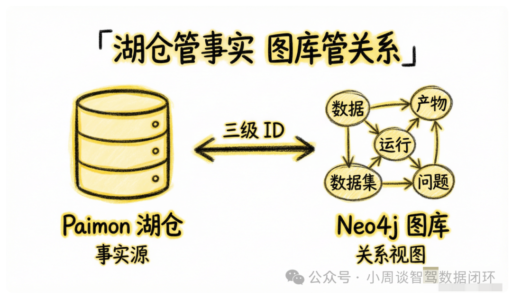
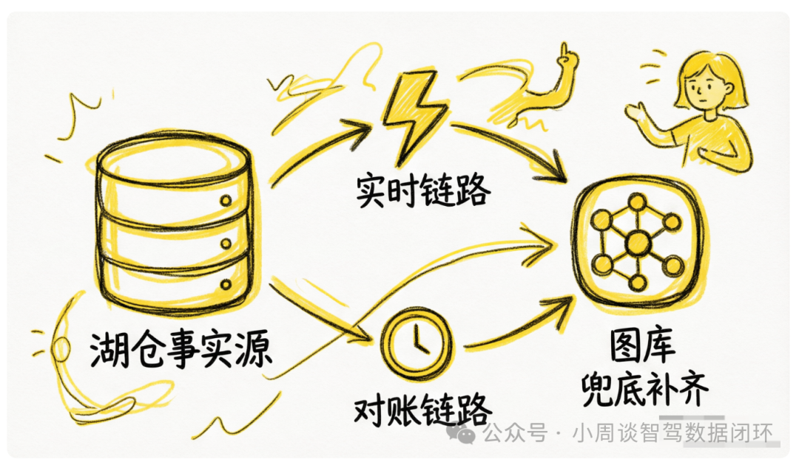

# Paimon 与 Neo4j 湖图双引擎血缘追溯

原文：[智驾数据闭环湖仓实战：Paimon + Neo4j 湖图双引擎数据血缘追溯系统](https://mp.weixin.qq.com/s/Yfrk2Z_izzzGSC_BQMsinQ)  
作者：小周谈智驾数据闭环｜发布：2026-09-04｜系列二·湖仓实战，第 5 篇

文件元信息进入 `ods_data_file_meta` 后，还需要连接后续处理产物、运行记录、数据集版本和异常样例，才能回答某份数据经过哪些算法、被哪些任务使用，以及算法升级影响哪些下游。

文章采用湖仓与图库配合的方式：Paimon 保存可审计的业务事实，Neo4j 维护这些事实的关系投影。查询先在图中定位路径和对象，再按对象标识到湖仓取得参数、质量指标等详情。

## 一、血缘系统需要支持什么

| 目标 | 业务问题 | 方案中的数据支撑 |
| --- | --- | --- |
| 可追溯 | 从任意结果找到采集 clip 和各阶段算法版本 | 图中的多跳路径、湖仓中的对象详情 |
| 可重放 | 根据输入、算法和参数重新运行处理流程 | 参数快照、内容校验信息、输入输出关系 |
| 可对比 | 同一 clip 的新旧算法产物同时存在并比较效果 | 版本分支、替代关系、质量指标 |
| 可演进 | 升级后逐步重刷和切换，历史仍可查询 | 保留旧产物与旧引用，建立新版本分支 |

湖仓便于保存和汇总大量明细，图库便于沿可变深度的关系进行查询。方案据此把对象属性和批量分析留在湖仓，把关系遍历组织为图查询。

> [!note] 批注：为什么不能只看“这条数据现在是什么状态”？
> 假设采集单元 `D001` 经过时间对齐后，由 SLAM v3 生成一份产物，之后又由 v4 重刷。只保存“当前已完成”，无法回答某次训练实际用的是哪份结果。
>
> 血缘需要分别记录原始对象、处理运行、输出产物和下游引用。后文以 `D001` 及其 v3、v4 产物作为教学例子，标识和数据均用于解释机制。

> [!note] 批注：选择图库的依据是什么？
> 固定几张表、固定层数的关联仍可以用 SQL 实现。随着处理分支增多，查询又需要改变方向和深度，图库可以把“沿哪些关系继续走”直接表达在查询中。
>
> 双引擎的代价是多一套投影、同步和一致性管理。是否采用它，应看遍历需求的复杂度、查询负载和维护成本，不能仅凭“涉及血缘”就认为 SQL 无法处理。

## 二、统一对象标识与湖图分工



文章使用以下节点描述处理对象。

| 节点 | 描述对象 | 主要身份 |
| --- | --- | --- |
| `Clip` | 采集数据单元 | `data_id` |
| `Artifact` | 某个处理步骤的产物 | `artifact_id` |
| `Run` | 一次实际运行或重跑尝试 | `run_id` |
| `DatasetVersion` | 固定的数据集版本 | 数据集版本标识 |
| `Badcase` | 被记录的异常样例 | Badcase 标识 |

图中的关系包括 `CONTAINS`、`DERIVED_FROM`、`SUPERSEDED_BY`、`INPUT`、`PRODUCED`、`REFERENCES`、`TRACED_TO`。它们分别承载包含、派生、替代、运行输入、运行输出、版本引用和异常追溯等含义。

`data_id`、`artifact_id`、`run_id` 同时作为湖仓记录和图节点的关联标识，使查询服务能够从图返回的 ID 定位湖仓对象。

> [!note] 批注：统一 ID 减少了什么，仍需要做什么？
> 图返回产物 `A003` 后，服务可直接按 `artifact_id=A003` 查产物详情，无需再维护一套图节点到湖表主键的翻译。
>
> 但这仍然是两次读取及结果组装，不是数据库自动完成的“零成本跨库 JOIN”。还要处理批量取数、权限、图同步延迟，以及图中对象在当前湖表读取范围内是否可见。

### 1. 产物身份与运行身份

文中用 `{data_id}_{step}_{algo_version}_{content_hash}` 组织 `artifact_id`，将所属数据、处理步骤、算法版本和内容摘要放进标识。

同一次输入可以经历多次运行。运行记录描述某次尝试的参数、时间和结果；产物记录描述实际生成并可被下游引用的对象。

> [!note] 批注：重跑后产物相同，为什么还要有新的 run_id？
> 假设第一次处理 `D001` 已成功，但调用方没有收到回执，于是又执行了一次。若两次处理得到相同产物身份，可以复用同一个 Artifact；两次执行仍是不同 Run，便于记录耗时、资源和重试经过。
>
> 因此“执行了两次”和“生成了两个不同产物”是不同问题。多个 Run 可以指向同一产物，不能为了产物去重而抹掉运行历史。

> [!warning] 技术边界：content_hash 相同，不单独保证 artifact_id 相同。
> 按上面的组合方式，还需要 `data_id`、`step`、`algo_version` 等部分都相同，才能得到相同的完整标识。若算法版本由 v3 变为 v4，即使输出内容摘要恰好相同，组合后的 ID 仍可不同。
>
> 哈希怎样计算、参数怎样规范化、哪些依赖会影响身份，都应形成确定规则。稳定 ID 有利于重复写入时识别同一对象，但仍需配套唯一约束、提交和关系维护，不能由 ID 字符串直接推出整个链路天然幂等。

> [!note] 批注：能重新运行，与能得到逐字节相同产物有什么区别？
> 保存 clip、算法版本和参数，使系统知道要怎样发起重放；若需要产物完全相同，还要能取得当时的输入内容、代码及运行依赖，并控制随机种子等会影响结果的因素。
>
> `content_hash` 可以校验结果内容是否相同，却不能单独保证未来计算一定产生相同结果。对于存在数值波动的算法，还需要另行定义是要求字节一致，还是允许约定范围内的质量指标差异。

## 三、实体、版本与运行血缘

| 血缘类型 | 描述的关系 | 图中的表达 | 湖仓中的关联字段 |
| --- | --- | --- | --- |
| 实体血缘 | 输入对象如何派生为后续产物、进入数据集版本 | `CONTAINS`、`DERIVED_FROM` | `parent_artifact_id` 等 |
| 版本血缘 | 同一阶段的新旧产物怎样替代 | `SUPERSEDED_BY` | `superseded_by` |
| 运行血缘 | 某次尝试使用什么、产生什么 | `INPUT`、`PRODUCED` | `input_artifact_ids`、`output_artifact_ids` |

> [!note] 批注：同一个产物为什么需要连接实体、版本和运行？
> 对 `D001` 的 SLAM v4 产物，实体关系说明它依赖哪份对齐结果；版本关系说明它替代哪份 SLAM v3 产物；运行关系说明到底是哪次执行生成了它。
>
> 三种关系解决不同问题。只有父产物指针，看不到失败重跑；只有运行输入输出，未必知道哪个新版本已被选为替代版本。
>
> 若一个运行有多个输入，还需要完整的输入集合或关系明细，不能用一个 `parent_artifact_id` 代替所有输入。它们可以在湖仓中有不同表示，但需要能够无歧义地重建图关系。

### 1. 湖仓元信息表

| 湖仓表 | 保存内容 | 对应图对象 |
| --- | --- | --- |
| `dwd_collect_clip_detail` | clip 级采集信息 | `Clip` |
| `dwd_production_artifact_detail` | 产物属性、父产物与替代关系 | `Artifact` |
| `dwd_production_run_detail` | 运行记录、重跑情况和输入输出集合 | `Run` |
| `dwd_dataset_version_detail` | 数据集版本与 `artifact_refs` | `DatasetVersion` |

关系字段随事实一起落湖，既用于追溯，也为图同步失败后的核对与修复提供依据。

下面保留文章的产物表字段和配置，补齐字段分隔符。SQL 假定已选择可用的 Paimon Catalog 与数据库，未实际执行。

```sql
CREATE TABLE dwd_production_artifact_detail (
    artifact_id STRING,          -- 图节点使用相同对象 ID
    data_id STRING,              -- 所属采集单元
    step STRING,                 -- align / slam / ann / qc / post
    algo_version STRING,
    content_hash STRING,
    param_snapshot STRING,       -- 参数快照，JSON
    parent_artifact_id STRING,   -- 派生关系
    superseded_by STRING,        -- 后继替代产物
    status STRING,               -- active / superseded / invalid
    PRIMARY KEY (artifact_id) NOT ENFORCED
) WITH (
    'bucket' = '32',
    'changelog-producer' = 'input'
);
```

> [!note] 批注：关系事实能不能只保存在图库里？
> 若 Paimon 是唯一事实源，那么图重建所需的节点身份和关系依据，应能从持久化湖仓事实恢复。否则某条边只在图库里存在，图库丢失时就无法据湖仓重建完整血缘。
>
> 这里的“冗余字段”可以理解为便于查询和修复的关系表示，但不能意味着关系事实可以不可靠地保存。图投影可以重建，输入、输出、替代和版本引用这些业务事实本身不能缺失。

> [!note] 批注：产物状态会更新，Changelog 需要注意什么？
> 旧产物由 `active` 改成 `superseded` 时，状态和 `superseded_by` 都会变化。示例中的 `input` 仅在 Writer 输入已经等价于完整逻辑变化时适用，需要同时检查行字段、新旧值和合并后的语义。
>
> 若输入是部分字段更新或缺少旧值的 Upsert，需要结合旧状态生成完整变化时可选择 `lookup`，不能只因为这是元信息表就默认用 `input`。参见 [Paimon Changelog Producer](https://paimon.apache.org/docs/1.3/primary-key-table/changelog-producer/)。

### 2. SLAM v3 升级到 v4

文章的重刷流程保留旧产物，另建新运行和新产物。

1. 为受影响的 clip 发起重刷，使用新的 `run_id` 记录执行。
2. 新产物成功产生后，记录它与输入的关系；按发布策略把旧产物标记为 `superseded`，设置 `superseded_by`。
3. 图中建立旧产物指向新产物的 `SUPERSEDED_BY`。
4. 下游可以选择新的稳定产物，也可以继续绑定指定版本；数据集通过 `artifact_refs` 和 `REFERENCES` 固定具体引用。

> [!note] 批注：替代旧版本，是否要修改历史数据集？
> 假设 `DS_0001_V1` 已发布并引用 v3 产物。v4 通过校验后，可用于构建 `DS_0001_V2`；V1 的引用仍应保持原样，否则用 V1 重训时会悄悄换成新数据。
>
> `SUPERSEDED_BY` 描述替代关系，不等于授权把所有旧引用改掉。新运行完成、产物通过质量检查和正式发布切换，也应区分清楚，避免“计算成功”直接被当成“已经是稳定版本”。

> [!note] 批注：保留历史节点，为什么还可能无法复现？
> 若 v3 节点和 ID 还在，但对应的文件被清理、参数快照被覆盖，历史数据集仍然无法还原。版本引用需要与元信息、文件对象和相关依赖的留存配合。
>
> 产物状态变化可以更新其当前可用性，却不应抹掉历史引用。批量复查时还可按对应湖表快照或业务版本读取；Paimon 的读取方式见 [SQL Query](https://paimon.apache.org/docs/1.3/flink/sql-query/)。

## 四、图投影更新：实时同步与定期修复

血缘事实先写入湖仓，再由图同步任务生成节点和边。实时任务追求较低延迟，定期对账负责发现并修复遗漏。



| 环节 | 文章中的机制 | 职责 |
| --- | --- | --- |
| 事实落湖 | 写 clip、产物、运行、数据集版本及关系字段 | 持久化血缘依据 |
| 实时投影 | 消费湖仓变更，向图库 `MERGE` 节点与关系 | 尽快提供遍历能力，失败不阻塞事实写入 |
| 定期对账 | T+1 或定时扫描湖仓增量，重新核对图对象 | 补齐遗漏，允许重复处理 |

> [!note] 批注：Paimon 的变更来源与 MySQL binlog 有什么区别？
> MySQL CDC 读取数据库的 binlog；Paimon 侧需要根据其表读取与 Changelog 能力取得已提交变化。文章用“湖仓 binlog / 变更消息”概括实时输入，实际实现要明确消费的是哪一种流、从哪里恢复以及如何保存进度。
>
> 如果实时图任务已经失败，湖仓仍可继续积累事实，但此时图会落后。需要记录投影进度并监控延迟，恢复后继续追赶，不能把不阻塞湖仓理解为图始终同步。参见 [Paimon SQL Query](https://paimon.apache.org/docs/1.3/flink/sql-query/)。

### 1. 节点唯一性与 MERGE

`MERGE` 用于匹配已有对象，未找到时再创建。为了让多个同步任务依据同一业务 ID 收敛，应配套身份唯一性约束。

下面用 Neo4j 的约束语法表达节点身份，未在实际数据库执行。

```cypher
CREATE CONSTRAINT clip_id_unique IF NOT EXISTS
FOR (n:Clip) REQUIRE n.id IS UNIQUE;

CREATE CONSTRAINT artifact_id_unique IF NOT EXISTS
FOR (n:Artifact) REQUIRE n.id IS UNIQUE;

CREATE CONSTRAINT run_id_unique IF NOT EXISTS
FOR (n:Run) REQUIRE n.id IS UNIQUE;

CREATE CONSTRAINT dataset_version_id_unique IF NOT EXISTS
FOR (n:DatasetVersion) REQUIRE n.id IS UNIQUE;

CREATE CONSTRAINT badcase_id_unique IF NOT EXISTS
FOR (n:Badcase) REQUIRE n.id IS UNIQUE;
```

> [!note] 批注：为什么有 MERGE 还要唯一性约束？
> 同步进程可能重复投递，也可能并发创建相同 ID 的对象。`MERGE` 表达“匹配或创建”的意图；数据库的唯一性约束负责限制同一标签下出现重复身份，不能只靠调用方先查再写。
>
> 约束也不替业务决定谁是同一对象。若一个数据集版本的 ID 只写成 `v2`，不同数据集的第二版就会被错误合并，应使用包含数据集身份的完整键。参见 [MERGE](https://neo4j.com/docs/cypher-manual/current/clauses/merge/)与 [Managing Constraints](https://neo4j.com/docs/cypher-manual/current/constraints/managing-constraints/)。

以下按文章的 v3、v4、对齐输入和 `DS_0001_V2` 组织建图示例。假定旧产物与输入产物已存在，相关成功运行及版本引用已在湖仓提交；这些前提不满足时，应等待或修复，而非把缺失输入当成已验证事实。

```cypher
MATCH (old:Artifact {id: 'D001_slam_v3_c4d5e6f7'}),
      (input:Artifact {id: 'D001_align_v1_9f3a21c7'})

MERGE (a:Artifact {id: 'D001_slam_v4_b7e8f9a0'})
SET a.step = 'slam',
    a.algo_version = 'v4',
    a.status = 'active',
    old.status = 'superseded'

MERGE (old)-[:SUPERSEDED_BY]->(a)
MERGE (a)-[:DERIVED_FROM]->(input)

MERGE (r:Run {id: 'run_slam_20240116103000_9f3a21c7'})
SET r.status = 'success'
MERGE (r)-[:INPUT]->(input)
MERGE (r)-[:PRODUCED]->(a)

MERGE (d:DatasetVersion {id: 'DS_0001_V2'})
MERGE (d)-[:REFERENCES]->(a)

RETURN r.id AS run_id, a.id AS artifact_id, d.id AS dataset_version_id;
```

运行参数如文章示例中的 `{"max_iter":200}` 保存在湖仓参数快照中。上面的图节点保留用于筛选的 `step`、`algo_version`、`status`，不复制完整参数。

> [!note] 批注：一组关系写入要共享哪些上下文？
> 示例把依赖同一批变量的建图操作放在一条 Cypher 中。语句结束后，变量不会自然延续到下一条语句；跨请求需要重新匹配 ID，在同一查询内部则按作用域规则传递变量。
>
> 要避免“新产物节点已写入，运行和引用边却只完成一半”，还应把应共同成功的操作组织在适当事务中。Neo4j 事务只能覆盖图侧写入，不能同时把 Paimon 提交变成同一个事务。参见 [Variables](https://neo4j.com/docs/cypher-manual/current/syntax/variables/)及 [Transactions](https://neo4j.com/docs/python-manual/current/transactions/)。

### 2. 状态变化

| 对象 | 文章中的状态流转 | 依据 |
| --- | --- | --- |
| Artifact | `active` 变为 `superseded` | 新产物被选为替代结果 |
| Artifact | `active` 变为 `invalid` | 质检或评测判定不可用，保留历史对象 |
| Run | `running` 变为 `success`、`failed` 或 `cancelled` | 对应尝试的执行结果 |
| DatasetVersion | `draft`、`released`、`deprecated` | 发布与版本生命周期 |

文章要求图同步失败不阻塞湖仓写入；失败运行不发布成功产物及其关系；数据集一旦绑定产物版本，即使该产物后来被替代，历史引用仍然有效。

> [!note] 批注：失败运行是否需要保留输入关系？
> 不把失败尝试当作成功产物发布，有助于避免下游引用未验收结果。但排查失败时，仍需要知道这次 Run 使用了什么输入、参数和执行环境。
>
> 因而可以保留失败 Run 及其真实输入关系，把失败诊断文件与已发布 Artifact 区分开。是否把失败输入也投影到图，是查询需求的选择，湖仓中的失败事实不应因此被抹去。

### 3. 对账修复与变化顺序

文章使用 `_ingest_time` 辅助增量扫描，并按湖仓中的关系字段对图进行 UPSERT。

> [!warning] 技术边界：只扫描新增入湖时间，可能漏掉已有对象的关系更新。
> 若旧产物已经入湖，后来才补上 `superseded_by`，而 `_ingest_time` 仍代表首次入湖时间，按“上次扫描后新增”过滤就可能看不到这次修改。
>
> 对账应覆盖真实变化范围，例如消费已提交 Changelog，或使用语义明确的更新时间与业务版本，并处理同时间值、迟到和回补。还应周期性核查一定范围的完整关系，不能只检查新对象。

> [!note] 批注：重复 MERGE 能补漏，为什么还不能保证关系正确？
> 假设数据集草稿先引用产物 A，随后修正为 B。新事件只 `MERGE` 到 B 的边，并不会自动移除仍指向 A 的旧边；图里可能同时存在两条引用。
>
> 修复时既要补缺失关系，也要按对象生命周期检查不再成立的关系和状态。已发布版本若约定不可变，就不应把它当草稿修正；草稿允许变化时，则需要按该对象的权威事实替换或撤销旧投影。
>
> 变化还应按版本收敛，避免旧消息晚到后把 `superseded` 状态写回 `active`。ID 去重、消息顺序和关系生命周期分别影响正确性，不能只用“MERGE 幂等”概括。

## 五、查询协同：图中定范围，湖仓取详情

一次血缘查询先在 Neo4j 定位对象和路径，返回标识及关系；服务再批量读取 Paimon 属性、参数和质量指标，组装带有来源信息的结果。

| 查询方向 | 业务问题 | 文章中的路径 |
| --- | --- | --- |
| 正向追踪 | 一批采集数据进入了哪些数据集及模型链路 | clip、产物、数据集、训练与评测 |
| 反向追溯 | Badcase 对应哪些产物、运行和参数 | Badcase、被追溯产物、生成运行 |
| 版本对比 | 同一批数据的 SLAM v3、v4 效果怎样 | 同 clip 的不同算法版本产物 |
| 影响分析 | 哪些数据集或任务仍依赖待替代产物 | 旧产物、替代关系和下游引用 |

> [!note] 批注：怎样区分血缘路径与错误原因？
> 从 Badcase 找到它引用的产物及生成运行，可以证明记录之间的处理和使用关系。找到这些关系，并不等于已经证明某份输入或某个算法版本造成了错误。
>
> 还需要根据问题检查实际输入、参数和评测证据。若要继续追到训练、模型或评测任务，相应身份和使用关系也必须被记录；仅有产物版本号不能补出未登记的业务关系。

### 1. 反向追溯

文章的查询从 Badcase 经 `TRACED_TO` 找到产物，再通过 `PRODUCED` 找到运行：

```cypher
// 仅当相关属性也投影到图中时，才能直接从图返回这些详情
MATCH (b:Badcase {id: 'BC_20240120_001'})-[:TRACED_TO]->(a:Artifact)
      <-[:PRODUCED]-(r:Run)
RETURN
    r.id,
    r.algo_version,
    r.params,
    a.param_snapshot,
    a.content_hash
ORDER BY r.start_time DESC;
```

> [!note] 批注：只保存关系的图库，怎样返回参数快照？
> 参数若只在湖仓中维护，就不能指望上面的 Cypher 从未存储的图属性中取得详情。应先返回 `r.id`、`a.id`，再查运行和产物元信息表，取出参数、算法版本、内容摘要和运行时间。
>
> 若图里保存了用于筛选的轻量属性，也应明确它只是湖仓字段的投影，有版本与同步规则；完整参数和质量指标仍以湖仓为准。选择“属性全部回湖”还是“保留必要筛选属性”，需要与查询代码保持一致。

采用轻量图投影时，可以先执行：

```cypher
MATCH (b:Badcase {id: 'BC_20240120_001'})-[:TRACED_TO]->(a:Artifact)
      <-[:PRODUCED]-(r:Run)
RETURN DISTINCT
    b.id AS badcase_id,
    a.id AS artifact_id,
    r.id AS run_id;
```

### 2. 影响分析

文章以仍引用 SLAM v3 产物的数据集作为重刷排期的候选范围：

```cypher
// dataset_id、version、status 需已作为筛选或展示属性投影到图
MATCH (a:Artifact {step: 'slam', algo_version: 'v3'})
      <-[:REFERENCES]-(d:DatasetVersion)
RETURN DISTINCT d.dataset_id, d.version, d.status;
```

若图中只保存数据集版本 ID，则返回 ID 后回湖补齐：

```cypher
MATCH (a:Artifact {step: 'slam', algo_version: 'v3'})
      <-[:REFERENCES]-(d:DatasetVersion)
RETURN DISTINCT d.id AS dataset_version_id, a.id AS artifact_id;
```

> [!note] 批注：还在引用 v3，是否就一定需要重刷？
> 这个查询找到的是依赖 v3 的数据集。是否迁移还取决于 v4 是否已验收、该数据集是否需要保持历史可复现，以及下游任务是否明确绑定旧版本。
>
> 若只分析已有替代产物的影响，可以进一步限定 `SUPERSEDED_BY` 关系及后继产物状态，再逐层寻找依赖者。输出应作为迁移评估依据，不能仅凭查到一条引用就自动改动历史数据集。

> [!note] 批注：比较 v3、v4 时，怎样避免比较了不同样本？
> 可以按同一 `data_id`、处理步骤和输入身份对齐两版产物，再从湖仓读取对应质量指标。若输入数据、评测方法或参数同时变化，指标差异就不能直接归因于算法版本。
>
> 版本分支使两组对象能够被找到，比较口径仍需另外确定。对比结果还应标明具体产物和运行，避免把当前最新属性误当成当时的实际记录。

## 六、工程边界：投影可修复，查询有范围，结果可审计

| 边界 | 文章中的规则 | 实现关注点 |
| --- | --- | --- |
| 权威来源 | 属性和关系依据以湖仓为准，图提供关系视图 | 明确图中必要投影字段的来源与版本 |
| 可靠更新 | 实时同步配合 T+1 或定期对账 | 支持重试、进度恢复、遗漏补齐与旧关系修正 |
| 遍历范围 | 通常限定 3～5 跳，大规模影响统计走离线链路 | 根据实际扇出、结果规模和资源预算设边界 |
| 可审计结果 | 返回血缘路径及湖仓表名、对象 ID | 保留运行、产物与版本读取依据 |

> [!warning] 技术边界：限制 3～5 跳，不等于查询规模一定可控。
> 如果一个节点连接大量数据集，即使只走几跳，也可能产生很多路径。跳数限制应与起点筛选、关系类型、返回规模和查询超时配合；返回结果加 `LIMIT` 也不能直接当成前面所有遍历工作量的上限。
>
> 大范围迁移统计可以先确定业务范围，再用湖仓离线计算与审计。图遍历的路径表达见 [Variable-length Patterns](https://neo4j.com/docs/cypher-manual/current/patterns/variable-length-patterns/)。

> [!note] 批注：图与湖不同步时，结果怎样避免误导？
> 图尚未补齐某条关系时，“没有找到下游”可能只是投影未追上；图返回对象而湖仓当前读取范围内找不到时，也需要核对删除、留存与读取版本。
>
> 查询服务应携带投影进度或就绪状态，重要审计请求还需要固定业务版本或读取范围，并返回实际查到的路径与来源。不能把关系缺失直接解释成从未发生过使用。

湖仓中的对象、参数与关系事实决定血缘是否可恢复；图投影让关系查询更直接。稳定 ID、版本保留、可靠同步和可修复的关系状态需要一起工作，才能支持重放、对比与受控演进。
