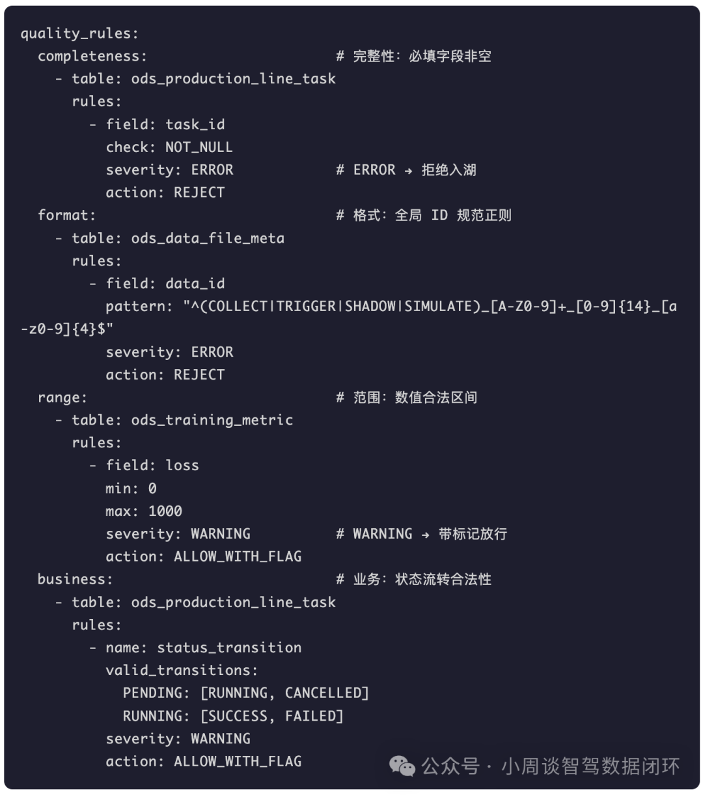
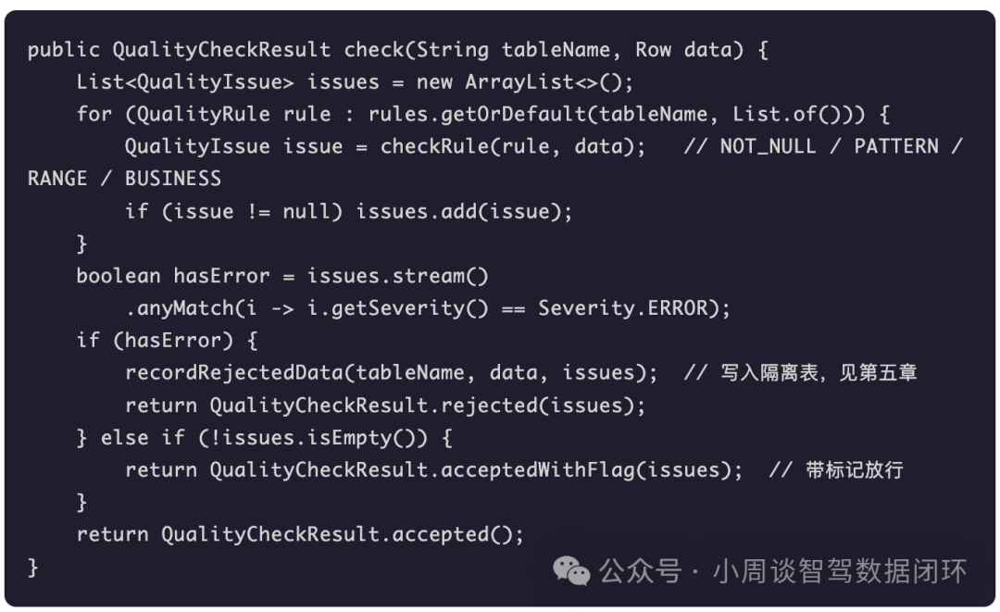
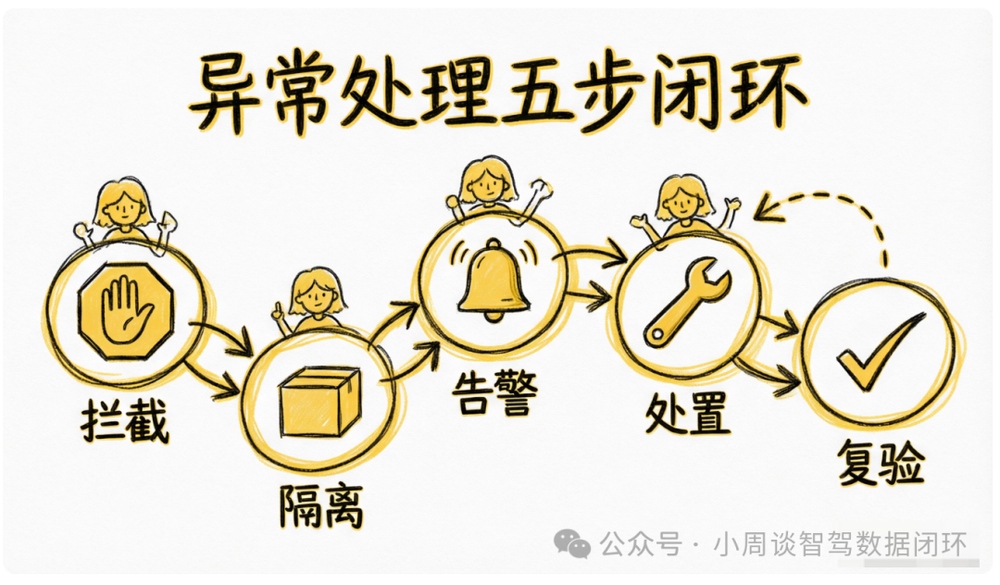
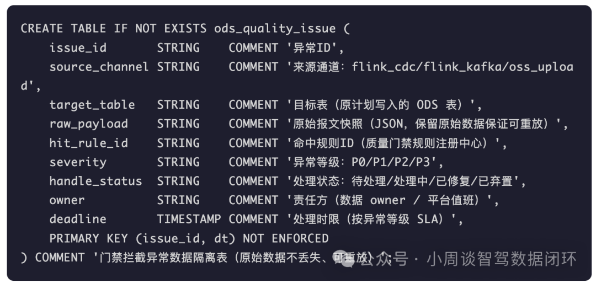

# 数据质量门禁与五步异常处理闭环

原文：[数据质量门禁设计：智驾数据入湖的五步校验链路](https://mp.weixin.qq.com/s/e7lf3LrjX9JMHMvVnu4Anw)  
作者：小周谈智驾数据闭环｜发布：2026-09-05｜系列二·湖仓实战，第 6 篇

CDC、Kafka 和文件元信息进入湖仓前，需要检查能否满足当前阶段的使用要求。硬规则不通过时阻止写入正常业务表，允许降级使用的问题则带质量标记放行；被拦下的数据保留原始证据，经过隔离、告警、处置和复验后，再决定重入湖或归档。

门禁承担接入时可执行的规则检查，图像质量评分、标注精度抽检和长期分布监控则由其他质量环节完成。

## 一、质量问题与三道防线

文章按问题产生的业务环节划分五层质量问题。

| 质量层级 | 典型问题 | 文章中的处理方向 |
| --- | --- | --- |
| L1 传感器与原始数据 | 时间同步误差、标定漂移、过曝、模糊、点云丢点和丢帧 | 对空帧、缺帧及超过硬阈值的问题拦截 |
| L2 量产车回传与筛选 | 触发偏差、片段截断、压缩或脱敏损伤、元数据缺失 | 拒绝损坏文件和关键元数据缺失，抑制近重复 |
| L3 数据标注 | 框位置误差、漏标误标、时序 ID 跳变、自动标注噪声 | 根据质检、审核结果控制准入 |
| L4 数据分布与场景 | 长尾场景不足、类别不均衡、数据漂移、Sim2Real 差距 | 监控告警，驱动挖掘和补采 |
| L5 数据工程与训练评测 | 跨集泄漏、近重复、血缘缺失、评测集偏差和真值噪声 | 拦截跨集泄漏，对血缘缺失等问题告警 |

这些问题由三道防线配合处理。

| 防线 | 检查方式 | 结果用途 |
| --- | --- | --- |
| 入湖门禁 | 规则化检查非空、格式、标记和已具备上下文的业务约束 | 拒绝、带标记放行或接受 |
| 入湖后自动质检与抽检 | 图像质量评分、标注精度检查等 | 将结论回写 `ods_qc_result` 等表 |
| 分布监控与治理 | 观察场景覆盖、漂移和长期质量趋势 | 调整采样、挖掘和补采策略 |

> [!note] 批注：为什么不能把所有质量问题都变成一条入湖规则？
> 必填 ID 是否为空，可以由当前记录直接判断；一张图片是否模糊，需要评分方法和阈值；长尾场景是否不足，则必须观察一批数据与目标分布。
>
> 门禁应使用当前已经具备的证据。某项深度质检尚未完成时，可以记录待检状态，由后续阶段控制使用，不能因为入口规则全部通过，就把数据解释为已经适合训练或评测。

> [!note] 批注：五层问题与六维检查有什么不同？
> L1～L5 按问题发生在哪个业务环节分类；下一节的完整性、有效性等维度，按具体检查什么性质分类。例如丢帧属于 L1 问题，也可以由完整性检查发现。
>
> 一条规则还要指定适用来源、使用阶段和处置方式。问题分类本身不能决定一定拦截还是一定放行，真正执行的是经过配置的具体规则。

## 二、六维检查与三种处置结果

| 维度 | 检查内容 | 文章中的处置方式 |
| --- | --- | --- |
| 完整性 | 必填字段、记录条数、批次片段和多模态帧是否齐全 | 对硬性缺失拒绝 |
| 准确性 | 数值范围、时间合理性、定位跳变等 | 按严重程度拒绝或标记 |
| 一致性 | 跨源关联、状态冲突、元信息与实际对象是否一致 | 对允许延后处理的问题带标记放行 |
| 唯一性 | 业务键、事件 ID、重复和近重复情况 | 按身份去重，重复率超限告警 |
| 有效性 | 枚举、格式、状态流转和文件可解码性 | 按规则拒绝或告警 |
| 及时性 | 入湖延迟、CDC 延迟、批次到达情况 | 监控告警 |


检查结果被归为三类：存在 `ERROR` 时执行 `REJECT`；只有 `WARNING` 时执行 `ALLOW_WITH_FLAG`；没有问题则为 `ACCEPTED`。带标记放行的数据记录 `_quality_flag`，供下游过滤或降级使用。

> [!note] 批注：同一条数据同时命中多个规则时，怎样决定出口？
> 假设教学事件 `E001` 同时缺少必填 ID，且时间有轻微偏差。前者配置为 ERROR，后者为 WARNING，那么整体结果应拒绝，同时保留两条问题，方便一次处理。
>
> 若只存在时间警告，则可以按约定带标记放行；若全部检查通过，才正常接受。分支选择依据命中问题的优先级，不应让后执行的一条通过规则覆盖前面的拒绝结果。

> [!note] 批注：ERROR、WARNING 与 P0～P3 是同一套等级吗？
> ERROR、WARNING 决定当前记录能否写入正常业务表；P0～P3 决定异常需要多快响应、通知谁。二者需要明确映射，但不宜混成一个含义不清的字段。
>
> 例如一条普通格式错误可以拒绝入湖，并按 P1 处理；短暂时间偏差可以带标记放行，并进入较低优先级告警。拒绝决定的是数据路径，响应等级决定的是处置节奏。

> [!note] 批注：带质量标记放行，怎样避免下游照常使用？
> `_quality_flag` 需要说明问题类型及所依据的规则，而下游需要约定哪些标记允许分析、哪些必须排除出训练或评测。只写一个警告字段，却没有消费规则，并没有完成分级控制。
>
> 修复后还应更新或结束对应质量状态，保留必要处理历史；否则数据可能已经恢复正常，却一直被旧标记过滤。

## 三、配置化规则与检查器

### 1. YAML：按检查类型、表和字段注册

文章展示了完整性、格式、范围和业务状态四类规则。



下方将图中配置转成文本，并合并图片换行处的正则表达式。它属于项目质量引擎的配置结构，需要配套加载和执行逻辑。

```yaml
quality_rules:
  completeness:
    - table: ods_production_line_task
      rules:
        - field: task_id
          check: NOT_NULL
          severity: ERROR
          action: REJECT

  format:
    - table: ods_data_file_meta
      rules:
        - field: data_id
          pattern: '^(COLLECT|TRIGGER|SHADOW|SIMULATE)_[A-Z0-9]+_[0-9]{14}_[a-z0-9]{4}$'
          severity: ERROR
          action: REJECT

  range:
    - table: ods_training_metric
      rules:
        - field: loss
          min: 0
          max: 1000
          severity: WARNING
          action: ALLOW_WITH_FLAG

  business:
    - table: ods_production_line_task
      rules:
        - name: status_transition
          valid_transitions:
            PENDING: [RUNNING, CANCELLED]
            RUNNING: [SUCCESS, FAILED]
          severity: WARNING
          action: ALLOW_WITH_FLAG
```

`data_id` 规则检查来源前缀、项目码、14 位时间部分和序列部分；范围规则把超出示例区间的 `loss` 标记为警告；状态规则声明允许的前后状态组合。

> [!note] 批注：ID 正则通过，是否就能证明数据身份正确？
> 例如 `COLLECT_BP_20260905143022_a3f8` 在格式上可以匹配上述规则。正则能检查字符和结构，却不能单独证明它确由采集系统签发、没有重复、对应的日期真实有效，或者与某个文件属于同一数据单元。
>
> 格式校验是身份校验的一部分，唯一性、来源与关联仍需其他检查。图中的范围阈值也只是项目示例，数值落在区间内不代表测量值或标签一定正确。正则语法可参见 [Java Pattern](https://docs.oracle.com/en/java/javase/17/docs/api/java.base/java/util/regex/Pattern.html)。

> [!note] 批注：状态流转检查为什么需要历史上下文？
> 新记录只写着 `SUCCESS`，无法单独判断它是否来自允许的 `RUNNING` 状态。检查器需要能取得前一状态、相应业务版本及事件顺序，才知道比较的是哪两次变化。
>
> 若旧消息晚到，或重放时拿当前最终状态与历史事件比较，合法变化也可能被误判。配置声明了允许关系，执行框架还要负责提供正确的状态上下文。

### 2. Java：汇总问题后选择出口



以下保留图片中的方法结构。`QualityRule`、`QualityIssue`、`Row`、`Severity`、`QualityCheckResult` 和规则加载逻辑均依赖项目实现，代码不是独立可运行程序。

```java
public QualityCheckResult check(String tableName, Row data) {
    List<QualityIssue> issues = new ArrayList<>();

    for (QualityRule rule :
            rules.getOrDefault(tableName, List.of())) {
        QualityIssue issue = checkRule(rule, data);
        // NOT_NULL / PATTERN / RANGE / BUSINESS
        if (issue != null) {
            issues.add(issue);
        }
    }

    boolean hasError = issues.stream()
            .anyMatch(i -> i.getSeverity() == Severity.ERROR);

    if (hasError) {
        recordRejectedData(tableName, data, issues);
        return QualityCheckResult.rejected(issues);
    } else if (!issues.isEmpty()) {
        return QualityCheckResult.acceptedWithFlag(issues);
    }

    return QualityCheckResult.accepted();
}
```

> [!note] 批注：没有命中规则，与规则没有成功执行有什么区别？
> `checkRule` 返回空值，在这个方法里意味着该规则没有发现问题。如果规则因字典不可用、关联查询超时或配置加载失败而没有执行，不能也悄悄返回空值，最终把记录当作全部通过。
>
> 需要把检查失败与数据不合格分开记录，并为关键规则定义等待、重试或受控拒绝等策略。没有给表注册规则时是否允许直接接受，也应是明确的接入约定。

> [!note] 批注：recordRejectedData 成功返回，需要代表什么？
> 拒绝分支必须可靠保存可追查记录，而不只是打印日志。若隔离写入失败，应让处理进入可恢复路径，避免原事件已被确认消费，却没有正常结果也没有隔离证据。
>
> 在 Flink 中，普通方法调用不会自动获得端到端 Exactly-Once。隔离输出需要与状态、读取进度及提交方式配套；故障重放时还要按稳定身份去重。参见 [Flink Checkpointing](https://nightlies.apache.org/flink/flink-docs-release-1.20/docs/dev/datastream/fault-tolerance/checkpointing/)。

## 四、三类来源采用不同的规则侧重

### 1. MySQL CDC：业务流程与使用准入

| 检查项 | 文章中的规则 | 处理方向 |
| --- | --- | --- |
| 标注质量 | 标注结果要关联通过的质检结论 | 未质检或质检不通过时拒绝相应准入 |
| 自动标注 | 大模型或离线模型预标注结果需经人工审核，再进入训练数据集 | 未审核不进入训练使用阶段 |
| 数据集划分 | 训练、验证、测试按 clip 组织，相邻帧不得分散到不同集合 | 发现跨集泄漏时拒绝 |

> [!note] 批注：未质检数据不能进训练，是否意味着原始 ODS 也不能保存？
> 需要区分原始接收、质检待处理和训练可用这些阶段。ODS 若负责保留源事实，可以保存待检记录及状态；训练准入再要求质检和审核已经完成。把“未经审核不可训练”直接等同于“原始记录不可保存”，可能让后续质检失去输入。
>
> 实际门禁应指明它控制的是哪个目标表或使用阶段。跨源质检结果暂未到达时，还应区分“已经不通过”和“证据尚未到齐”，配套等待、重试与复验。

> [!note] 批注：按 clip 划分数据集，能防住哪些泄漏？
> 同一片段中相邻帧高度相似，按帧随机分配可能让训练集与测试集共享几乎相同的内容。以 clip 为整体划分，能减少这一类泄漏。
>
> 同源切片、增强副本或相邻采集片段仍可能高度相关，需要按实际任务确定更大的分组边界，并维护稳定的集合归属。检查时比较的是数据身份与派生关系，不仅是文件名是否相同。

> [!warning] 技术边界：CDC 变化不能无条件按普通行过滤。
> CDC 输入可能包含更新前、更新后和删除记录。删除记录未必携带全部非键字段，不能因此自动被非空规则判为脏数据；一次更新的前后变化也需要按业务语义配套处理。
>
> 若旧记录已在表中，而更新后的新记录被拒绝，要明确选择保留旧值并标记、撤回旧结果或暂停该键处理，避免下游误以为旧值仍是当前有效事实。Flink 的变化种类与动态表语义见 [Dynamic Tables](https://nightlies.apache.org/flink/flink-docs-release-1.20/docs/dev/table/concepts/dynamic_tables/)。

### 2. Kafka：时间、片段上下文与重复

| 检查项 | 文章中的规则 | 处理方式 |
| --- | --- | --- |
| 时间合理性 | 不早于车辆出厂时间，不超过服务器时间加容忍窗口 | 告警并带标记放行 |
| 片段截断 | 片段覆盖触发前至少 N 秒、触发后至少 M 秒 | 不满足时标记 `truncated_flag` |
| 重复率 | 按事件 ID 幂等处理，重复率超过 5% 告警 | 去重并监控 |

> [!note] 批注：重复事件与同键更新怎样区分？
> 相同事件 ID、相同业务版本的重发，可以按约定去重；同一业务对象发生新状态变化，则是需要处理的更新。不能看到相同主键就一律丢弃。
>
> Paimon 主键表能合并同键记录，但若上游聚合已经把重复事件累计两遍，最终只有一行也仍可能是错误总量。应在相应计算之前处理事件身份，重复率的分子、分母和统计窗口也要固定。主键表语义见 [Paimon Primary Key Table](https://paimon.apache.org/docs/1.3/primary-key-table/overview/)。

### 3. OSS 文件：处理标记、模态齐全与同步偏差

| 检查项 | 文章中的规则 | 处理方式 |
| --- | --- | --- |
| 前置处理标记 | 具备车端脱敏与合规云处理的双标记 | 缺失时按 P0 拒绝 |
| 多模态完整性 | 同组相机、激光雷达、毫米波、IMU、GNSS 等预期数据齐全 | 缺帧拒绝，连续丢帧率超过 1% 升级告警 |
| 时间同步 | 采集车硬件同步参考 ±10 ms，量产车软件同步参考 ±50 ms | 超出相应范围时告警放行 |

这些数值是文章的项目阈值，落地时要与具体传感器、采集配置、任务用途和处置策略对应。

> [!note] 批注：一组多模态文件是否齐全，什么时候才能判断？
> 假设某帧组要求相机和激光雷达文件，第一条到达的是相机元信息，此时激光雷达可能只是稍后到达。需要先知道该采集配置预期哪些模态，并确定帧组或批次的完成信号、等待期限，再判断缺失。
>
> 时间同步也需要明确比较的时间来源、单位和模态对应关系。不同上下文采用的硬拒绝或软告警，应由具体规则表达，不能仅凭“属于完整性”或“属于 L1”直接决定。

> [!note] 批注：双标记与实际处理证据怎样连接？
> 标记应能关联到对应对象版本、处理任务、规则或算法版本，以及验收结果。上游仅填写一个布尔值，并不能证明对象内容已经按要求处理。
>
> 对无法确认的标记采取拒绝或隔离，是控制流程的一部分；确认实际内容、访问和留存要求，仍需依赖相应处理及验收机制。

## 五、五步异常处理闭环



1. 拦截：阻止进入正常目标表，保留原报文和命中规则 ID。
2. 隔离：写入 `ods_quality_issue`，保存恢复与审计所需内容。
3. 告警：按 P0～P3 通知数据 owner 和平台值班，匹配响应渠道。
4. 处置：可自动重传、幂等重放或续传；需要源端补数时转人工工单；确实无法修复的记录标记原因后归档。
5. 复验：重新执行适用规则，通过后写入目标表并更新处理状态；仍未通过则继续隔离，文章以超过 3 轮作为升级 P0 的示例条件。

> [!note] 批注：修复后能否直接绕过曾经失败的规则？
> 不能只把失败标记清掉就视为已经通过。修复可能改变字段、文件或关联关系，因此重入湖时应重新执行约定的完整检查。
>
> 还要记录复验使用的规则版本。如果规则已经变化，应明确采用当前准入规则还是某个批准版本，保留每次复验的结果；不能通过反复降低规则来让记录“变合格”。

### 1. 隔离表



下面转写原图字段，并补充其主键使用的 `dt` 字段，按日期分区组织。分区配置属于补充示例；假定已选择 Paimon Catalog 与数据库，DDL 未实际执行。

```sql
CREATE TABLE IF NOT EXISTS ods_quality_issue (
    issue_id STRING
        COMMENT '异常身份',
    source_channel STRING
        COMMENT '来源通道：flink_cdc/flink_kafka/oss_upload',
    target_table STRING
        COMMENT '原计划写入的目标 ODS 表',
    raw_payload STRING
        COMMENT '原始报文快照，JSON',
    hit_rule_id STRING
        COMMENT '命中规则 ID',
    severity STRING
        COMMENT '异常处置等级：P0/P1/P2/P3',
    handle_status STRING
        COMMENT '待处理/处理中/已修复/已弃置',
    owner STRING
        COMMENT '数据 owner 或平台值班',
    deadline TIMESTAMP
        COMMENT '处理时限',
    dt STRING
        COMMENT '异常首次登记日期，后续状态更新保持该身份日期',
    PRIMARY KEY (issue_id, dt) NOT ENFORCED
)
COMMENT '质量门禁异常隔离表'
PARTITIONED BY (dt);
```

`issue_id` 定位异常，`source_channel` 和 `target_table` 说明来源及目标，`raw_payload` 提供重放输入，`hit_rule_id` 说明拒绝原因，责任人与期限用于处置跟踪。

> [!note] 批注：issue_id 应标识原事件，还是每一次检查尝试？
> 两种身份都可能需要，但不应混用。一个源事件因同一规则被故障重试处理多次，可以定位到同一个问题；修复后的多轮复验则应保留各自尝试与结果。
>
> 若每次重试都生成一个完全无关的问题 ID，告警和工单可能不断膨胀；若把所有复验直接覆盖为一行，又可能丢失处理经过。可把当前问题状态与尝试历史分开组织，并记录原事件身份、规则版本和尝试信息。
>
> 示例主键包含 `dt`，同一问题后续更新时要保持它的身份日期，否则跨天写入可能变成另一个键。

> [!note] 批注：raw_payload 足够完成重放吗？
> 对事件或业务行，除字段外，可能还需要源主键、变化类型、业务版本和读取位置；对大文件，JSON 通常只含对象引用，需要确保对应文件及对象版本仍可取到。
>
> 隔离存储也要保留必要访问控制和留存策略，不能把敏感原报文复制到不受约束的位置。门禁可重放依赖证据可恢复，不能只看表里是否存在一个 JSON 字段。

> [!note] 批注：正常写入成功，但异常状态更新失败怎么办？
> 例如修复记录已经写入目标表，作业却在把问题标为“已修复”之前失败。再次执行时，需要通过稳定业务键或提交身份确认并幂等处理，不能重复产生下游业务效果。
>
> 正常目标与隔离状态若不是一次原子提交，应设计可恢复的处理状态和对账。外部告警可以根据已经持久化的问题异步发送，并用问题及等级身份控制重复通知。

### 2. 分级响应

| 级别 | 文章中的典型场景 | 通知与响应目标 |
| --- | --- | --- |
| P0 | 缺失处理标记、主键为空、Schema 无法解析、多模态整帧缺失 | 电话与钉钉，30 分钟内响应 |
| P1 | 必填缺失、ID 格式非法、文件损坏、跨集泄漏 | 钉钉与工单，2 小时内响应，当日修复 |
| P2 | 关联缺失、状态流转异常、同步超限、定位跳变 | 日报汇总，3 个工作日内闭环 |
| P3 | 延迟、重复率波动、回传分布偏离、批次轻微缺片 | 周报汇总，连续两周超标升级 P2 |

这些是文章的响应约定。响应表示开始确认与处理，修复完成则是另一个时间点；执行时应分别记录。

## 六、门禁自身的监控与规则发布

### 1. 运行监控

| 指标 | 含义 | 文章示例阈值 | 级别 |
| --- | --- | --- | --- |
| `rejected_records_count` | 被拒绝记录数量 | 大于 100 | WARNING |
| `quality_check_duration` | 质量检查耗时，毫秒 | 大于 1000 | WARNING |

拒绝量突增可能来自上游批量变化、真实异常或规则误判；检查耗时增长则可能增加接入延迟和积压。

> [!note] 批注：拒绝量升高，怎样区分门禁误判与源数据变差？
> 先按表、来源、规则版本和失败原因分组，比较相同时间窗口内的输入量与拒绝比例，再抽样检查问题。只看累计拒绝数量，无法区分流量增长和质量恶化。
>
> 检查耗时也要明确是单条还是批次、均值还是高分位，以及是否包括外部查询等待。监控要能定位具体慢规则，避免把所有延迟都归因于 Flink 或写湖任务。

### 2. 规则灰度与反馈

规则统一注册，先在部分表或小流量上观察，再扩大范围。隔离表中的异常分布、处理时效和复发情况经 DWS、ADS 加工后进入质量看板，作为后续规则调整依据。

> [!note] 批注：怎样观察一条新拒绝规则会误拦多少数据？
> 可以先让新规则只记录判断而暂不改变既有处置，比较新旧结果，再结合已核实样本判断差异。灰度时应固定规则版本、覆盖范围和回滚方式，防止同一批记录在不同实例上得到无法追查的结果。
>
> 误判率需要已核实的正确性依据，不能仅用“业务没有投诉”代替。涉及跨记录状态的规则，还要检查灰度范围是否能提供完整上下文。

文章使用以下指标衡量异常闭环。

| 指标 | 衡量内容 |
| --- | --- |
| 入湖拦截率 | 进入检查的数据中，被拒绝的比例 |
| 异常处理 SLA 达成率 | 在约定响应或处理期限内完成的情况 |
| 修复重入湖成功率 | 修复记录经复验后成功写入的情况 |
| 同类异常复发率 | 同类问题在后续批次再次发生的情况 |

> [!note] 批注：这些指标为什么不能分别追求越高或越低越好？
> 拦截率下降可能是数据改善，也可能是规则被放宽；重入湖成功率升高，也可能只是只挑容易修的问题处理。需要同时看覆盖范围、待处理积压和复发情况。
>
> 统计前要固定分母、时间窗口，以及按源记录、问题还是复验次数计数。SLA 还应分别定义响应与修复目标，避免把已接单当成已解决。

门禁把检查结果连接到实际数据路径：拒绝要留下可恢复证据，放行要带上可消费的质量状态，修复要经过复验和可靠写入。三类来源共用这一处理框架，具体规则仍要绑定数据形态、上下文和使用阶段。
