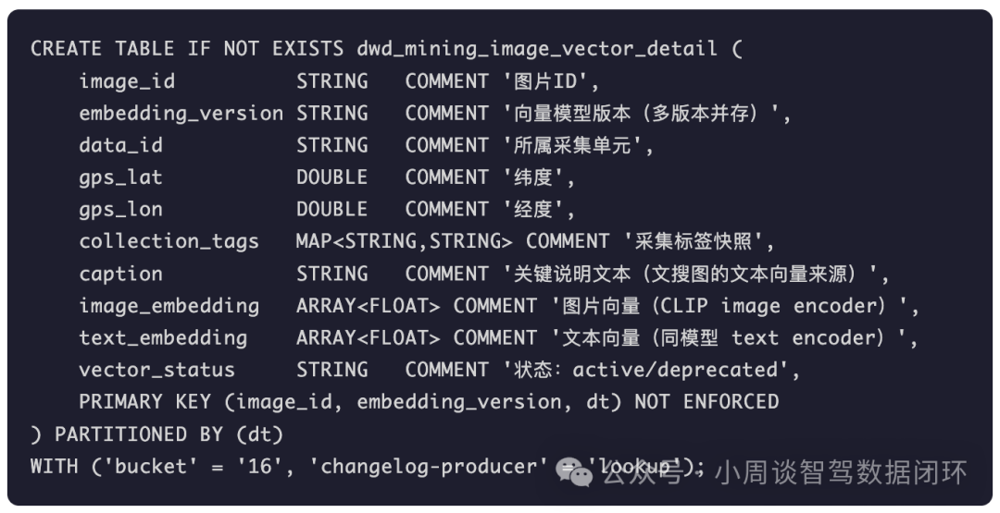
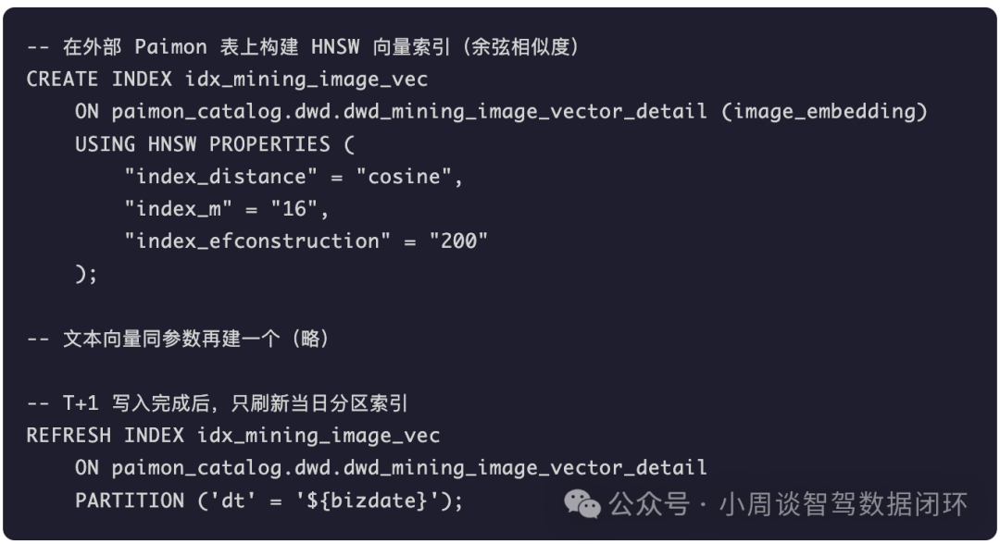
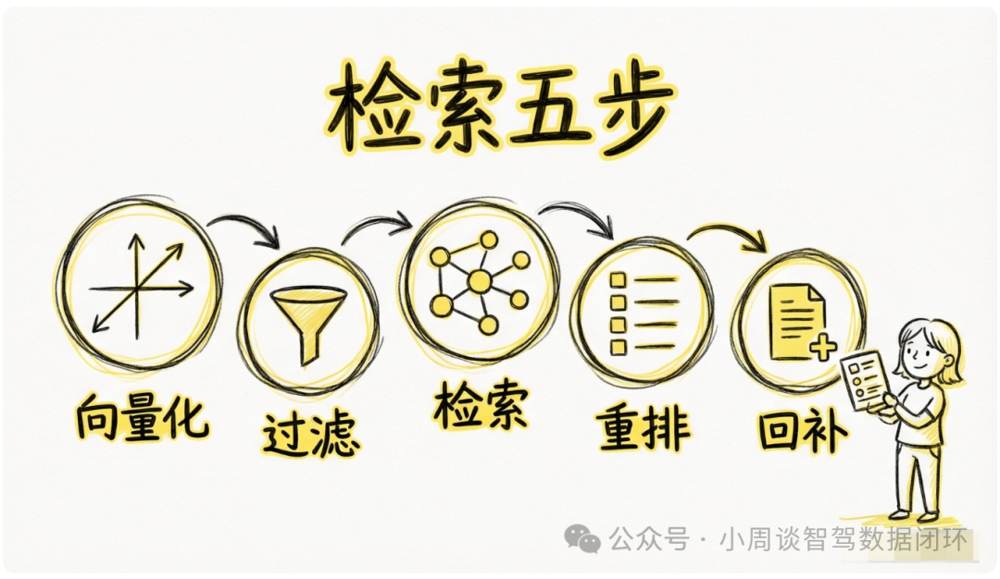
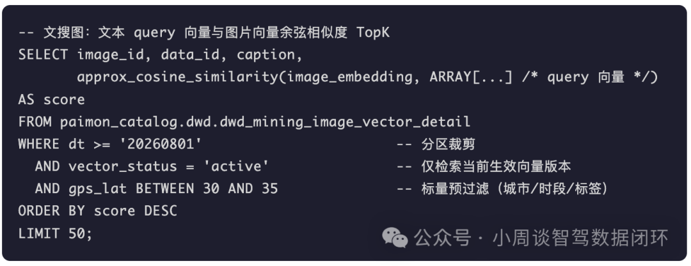

# HNSW 向量检索与 StarRocks 湖仓索引方案

原文：[数据闭环湖仓实战 HNSW 向量索引落地 StarRocks：从 Paimon 外部表到语义检索](https://mp.weixin.qq.com/s/uXsYl0yOsvKTjgUDojsFew)  
作者：小周谈智驾数据闭环｜发布：2026-09-06｜系列二·湖仓实战，第 7 篇

用一句话寻找相近驾驶场景，或拿 Badcase 图片找相似样本，需要把查询与图片转成可比较的向量。文章提出把向量结果保存到 Paimon，以 StarRocks 承担检索，并在性能不满足时维护检索内表。

其中“在 Paimon 外表建立双向量索引、按分区刷新”属于原文的能力假设，需要先确认部署产品与版本是否支持，再讨论性能验收。

## 一、方案选择：权威数据与检索加速分开管理

| 方案 | 适合承担的能力 | 需要维护的内容 |
| --- | --- | --- |
| 专用向量数据库，如 Milvus | 面向向量规模和 ANN 查询的专门能力 | 独立服务、数据同步和对账 |
| 搜索引擎，如 Elasticsearch | 全文、结构化条件与向量查询结合 | 搜索副本、索引和同步链路 |
| StarRocks 向量检索 | 在已有 SQL 查询体系中结合标量筛选与向量计算 | 核对索引支持范围，验证容量、召回与延迟 |

文章希望避免再引入一套独立数据库，并让日期、地理范围和标签条件与向量查询共用接口。向量的正式结果与版本以 Paimon 为准，其他存储或索引均按可重建的加速结果管理。

> [!note] 批注：只有一个事实源，是否意味着只能保存一份数据？
> 不一定。权威来源决定正式结果在哪里维护、差异以谁为准；副本数量描述物理存储。湖仓中的向量作为权威结果，同时维护检索副本，并不会自动变成两个事实源。
>
> 即使没有复制整张向量表，HNSW 本身也要保存图结构等索引数据，并消耗存储或内存。评估成本时要把索引、缓存、构建过程和必要副本一起算，不能把“无需另一套主数据”理解为检索加速没有额外资源开销。

> [!note] 批注：语义相近，与满足所有场景条件有什么区别？
> “雨天夜间高速行人横穿”的向量相似结果，是模型认为语义相关的候选，不保证每个条件都严格成立。日期、城市和确定标签可以作为结构化过滤，召回候选还可以经过重排或人工确认。
>
> 向量检索补充标签覆盖不足的问题，不能替代身份、权限和硬性业务条件检查。

## 二、图片向量表：身份、版本与检索字段

向量落在 `dwd_mining_image_vector_detail`，面向千万至亿级图片及高维特征。原图同时保存图片向量和 caption 文本向量。



下面保留原图字段及配置，补上主键和分区使用的 `dt` 字段。SQL 假定已选择可用的 Paimon Catalog 与数据库，未实际执行。

```sql
CREATE TABLE IF NOT EXISTS dwd_mining_image_vector_detail (
    image_id STRING COMMENT '图片 ID',
    embedding_version STRING COMMENT '向量模型版本',
    data_id STRING COMMENT '所属采集单元',
    gps_lat DOUBLE COMMENT '纬度',
    gps_lon DOUBLE COMMENT '经度',
    collection_tags MAP<STRING, STRING> COMMENT '采集标签快照',
    caption STRING COMMENT '图片说明文本',
    image_embedding ARRAY<FLOAT> COMMENT 'CLIP 图片编码结果',
    text_embedding ARRAY<FLOAT> COMMENT '同模型的 caption 编码结果',
    vector_status STRING COMMENT 'active / deprecated',
    dt STRING COMMENT '业务日期，具体格式与赋值规则需固定',
    PRIMARY KEY (image_id, embedding_version, dt) NOT ENFORCED
)
PARTITIONED BY (dt)
WITH (
    'bucket' = '16',
    'changelog-producer' = 'lookup'
);
```

图片与 caption 使用同一兼容版本的 CLIP 双编码器；`dt` 为日期管理与分批处理提供边界；`embedding_version` 进入记录身份，使新旧模型向量能够并存，`vector_status` 表达其当前使用状态。

> [!note] 批注：文搜图到底应该比较哪两个向量？
> 文本查询先经过文本编码器，若目标是直接寻找图片，应把查询向量与 `image_embedding` 比较。这利用的是 CLIP 对齐后的图文空间。
>
> 若把同一查询与 `text_embedding` 比较，得到的是 caption 文本的相近程度，再通过 caption 对应的图片返回结果；它可以作为补充通道，但与直接比较图片特征并不相同。查询使用哪个编码器，与候选使用哪一列，要分别说明。机制与编码示例见 [OpenAI CLIP](https://github.com/openai/CLIP)。

> [!note] 批注：为什么只过滤 active 还不够？
> 查询向量必须与候选向量使用兼容的模型、预处理和维度。若不同模型版本都存在 active 记录，或者有些图片尚未迁移，单独筛选 `vector_status='active'` 不能证明它们可以一起比较。
>
> 应把请求绑定到明确的 `embedding_version`，并验证维度、非空和归一化约定。余弦比较也不能接受无意义的零向量；同样长度的数组不等于来自同一个向量空间。

> [!note] 批注：分区日期为什么也影响重跑去重？
> 本表主键是 `(image_id, embedding_version, dt)`。同一图片、同一模型版本若第一次写到某天，重跑时却使用另一天作为 `dt`，就会变成另一个完整键。
>
> 因此流水线按图片和模型版本做到幂等，还需要确保分区日期赋值稳定，或明确跨日期更新的设计。日期分区提供物理组织，不能单独保证业务身份唯一。

## 三、Embedding 五步流水线

文章采用 T+1 批量处理，由 Spark、Ray 与 GPU 算子等组织计算，目标在每日凌晨 6 点前完成对应批次。


| 步骤 | 文章中的机制 | 结果 |
| --- | --- | --- |
| 增量识别 | 根据 `create_time`、`update_time` 水位发现新增或标签变化图片 | 得到本批处理范围 |
| 成本分级 | 高价值数据完整处理，普通数据抽样，利用 GPU 空闲时段 | 控制算力与覆盖成本 |
| 双路编码 | 图片与 caption 经同版本 CLIP 编码 | 获得图片、文本向量 |
| 幂等写回 | 按图片和模型版本更新，图片不变时避免不必要重算 | 保存正式向量结果 |
| 索引更新 | 数据提交后触发相应检索数据或索引更新 | 让已发布批次可检索 |

> [!note] 批注：标签、caption 和图片变化，分别需要重算什么？
> 假设图片 `I001` 的像素不变，只补上城市标签，图片特征可以复用，更新结构化筛选字段即可；若 caption 内容改变，文本向量需要按新 caption 更新；若图片内容或编码模型改变，图片向量也需要重新生成。
>
> 因此“标签变了不重算图片向量”可以成立，但不能扩展为任何元数据变更都不更新向量。增量任务需要识别变化影响的是哪一部分。

> [!note] 批注：按日期分区，是否只刷新当天就能覆盖所有变化？
> 旧日期中的 caption 修正、向量废弃或历史回补，同样可能改变检索结果。如果任务只处理今天的分区，这些变化就会漏掉。
>
> 应记录本批实际影响的分区或对象，并在写入提交、索引或副本更新、验收通过后发布就绪状态。用更新时间作水位时，还要处理同时间值、迟到和失败恢复；更新了水位却没有可靠保存结果，会造成缺失。

> [!note] 批注：T+1 与“当天能搜到”怎样对齐？
> 例如 9 月 6 日产生的图片，在 9 月 7 日凌晨批处理中完成向量化，属于下一天可见。若业务要求 9 月 6 日当天就能检索，单次次日批处理并不能满足。
>
> 应把时效定义成从图片可用到检索可见的时间，并包含排队、计算、提交与索引更新。GPU 批处理有利于吞吐，但是否满足新鲜度，要与业务目标一起确定。

## 四、HNSW 索引：先确认能力，再验证性能

文章提出为 `image_embedding`、`text_embedding` 分别建立 HNSW 索引，并只更新受到影响的日期分区。



以下是原图方案的文本转写，属于待核实的产品能力示意，不能直接作为通用 StarRocks 可执行语句。

```sql
-- 原文能力假设：在 Paimon 外表建 HNSW 索引
CREATE INDEX idx_mining_image_vec
ON paimon_catalog.dwd.dwd_mining_image_vector_detail (image_embedding)
USING HNSW PROPERTIES (
    "index_distance" = "cosine",
    "index_m" = "16",
    "index_efconstruction" = "200"
);

-- 原文提出文本向量列采用类似方式另建索引

-- 原文能力假设：仅刷新指定日期分区
REFRESH INDEX idx_mining_image_vec
ON paimon_catalog.dwd.dwd_mining_image_vector_detail
PARTITION ('dt' = '${bizdate}');
```

> [!warning] 技术边界：外表双索引与 REFRESH INDEX 不能按已支持能力使用。
> StarRocks 官方向量索引文档介绍的是 shared-nothing 集群能力，自 v3.4 起以实验功能提供；其索引按数据文件的 Segment 组织，并列明一张表只支持一个向量索引。官方示例采用 `USING VECTOR`，不使用上面的 `USING HNSW PROPERTIES`。
>
> 该文档没有给出这里的 Paimon 外表建索引和 `REFRESH INDEX ... PARTITION` 方案。因此应先核实是否使用了额外产品扩展及其支持版本；没有支持依据时，应把这条路径视为设计设想，不能等性能不达标后才发现能力前提不成立。参见 [StarRocks Vector Index](https://docs.starrocks.io/docs/table_design/indexes/vector_index/)。

### 1. 官方语法范围内的单索引内表示例

下面是补充教学示例，采用 OLAP 内表、一个图片向量索引，假定集群版本和实验开关已由管理员确认。512 维仅为示例，写入向量和查询向量必须匹配；`is_vector_normed=true` 的前提是输入已执行相应归一化。DDL 未实际执行。

```sql
CREATE TABLE image_vector_serving (
    image_id VARCHAR(128) NOT NULL,
    data_id VARCHAR(128),
    embedding_version VARCHAR(64),
    dt DATE,
    vector_status VARCHAR(16),
    gps_lat DOUBLE,
    caption STRING,
    image_embedding ARRAY<FLOAT> NOT NULL,
    INDEX idx_image_vector (image_embedding) USING VECTOR (
        "index_type" = "hnsw",
        "dim" = "512",
        "metric_type" = "cosine_similarity",
        "is_vector_normed" = "true",
        "M" = "16",
        "efconstruction" = "200"
    )
) ENGINE = OLAP
DUPLICATE KEY(image_id)
DISTRIBUTED BY HASH(image_id) BUCKETS 16;
```

> [!note] 批注：一个图片索引，能否同时服务文搜图和图搜图？
> 可以用兼容 CLIP 文本编码器生成查询，去比较图片向量；也可以用图片编码器生成查询，去比较同一列图片向量。两种入口并不天然要求给候选图片同时建立两个索引。
>
> 若还要搜索 caption，需单独设计文本候选通道并核实产品支持。上面的明细模型也不提供主键去重，不能把湖表的 Upsert 直接理解为内表同步策略；应另行设计重复处理、废弃、删除及结果发布方式。

### 2. 参数与能力验证

HNSW 通过分层图结构组织近邻搜索。`M`、`efConstruction` 影响建图及资源消耗，查询侧的搜索范围也会影响召回与延迟；这些取舍需要结合具体实现和数据评测。算法来源见 [HNSW 原论文](https://arxiv.org/abs/1603.09320)。

| 验证项 | 需要确认的内容 |
| --- | --- |
| 多向量列索引 | 同表能建立几个索引；不支持时怎样组织独立检索通道 |
| 分区更新 | 支持怎样的增量、重建和可见性机制 |
| 索引构建时间 | 目标规模下构建是否能在批次窗口内完成 |
| 新数据可见延迟 | 从湖仓结果就绪到检索发布需要多久 |
| 查询性能 | 文章的目标为千万级数据下单次检索 P95 不超过 2 秒 |

这些验证应先通过支持范围和正确性检查，再在真实维度、过滤条件、TopK、并发和资源配置下测试。

## 五、检索 API：编码、过滤、召回、重排与详情

应用通过统一检索 API 提交文本、图片和过滤条件，由服务组织下面五步。



1. 用请求绑定的 CLIP 版本生成查询向量。
2. 把时间、GPS、摄像头和标签条件编译为受控过滤条件。
3. 在已确认支持的索引或读取路径上召回 TopK 候选。
4. 合并多路候选并重排。
5. 根据图片和数据标识回湖仓补齐标签、caption、位置和时间等属性。



原文查询形状如下。`ARRAY[...]` 是完整查询向量的占位，语句不能原样执行；外表近似检索仍受上一节能力边界约束。

```sql
SELECT
    image_id,
    data_id,
    caption,
    approx_cosine_similarity(
        image_embedding,
        ARRAY[...]  -- 同版本编码器生成的完整查询向量
    ) AS score
FROM paimon_catalog.dwd.dwd_mining_image_vector_detail
WHERE dt >= '20260801'
  AND vector_status = 'active'
  AND gps_lat BETWEEN 30 AND 35
ORDER BY score DESC
LIMIT 50;
```

> [!note] 批注：SQL 写了 WHERE，是否就一定先过滤再做 ANN？
> SQL 表达结果必须满足哪些条件，具体怎样执行则由引擎和索引能力决定。某些检索路径支持前置过滤，另一些可能先取近邻再过滤；后者在条件很严格时可能返回不足的候选，或需要扩大召回范围。
>
> 应检查执行计划和 Profile，验证实际过滤位置与索引使用情况。日期比较还要求 `dt` 的格式保持一致；补充 `embedding_version` 条件，才能确保请求与候选使用同一兼容空间。

| 检索方式 | 候选路径 | 文章中的应用场景 |
| --- | --- | --- |
| 文搜图 | 文本查询与图片向量比较；可补充 caption 通道 | 用场景描述寻找图片 |
| 图搜图 | 图片查询与图片向量比较 | 从 Badcase 找近似样本 |
| 标签与向量结合 | 结构化条件与向量召回配合 | 在城市、时段或标签范围内搜索 |
| 混合检索 | 多路候选融合与重排 | 利用图片、caption 等互补信息 |

> [!note] 批注：image×w1 + text×w2 应该怎样理解？
> 如果指两路检索得分融合，应先按同一 `image_id` 对齐候选，再在可比较的分数尺度上加权；只返回某一路的候选，也要定义缺失分数怎样处理。
>
> 如果指直接加权向量，则还需要相同空间、维度和归一化等前提，并验证融合后的检索效果。两种做法不是同一操作，不能只写一个加权式就省略候选合并与重排设计。

> [!note] 批注：回湖补齐属性时，为什么还需要版本？
> 索引可能对应昨日的图片向量，湖仓的 caption 或状态今天已经更新。只按 `image_id` 读取最新属性，可能展示与当时向量不对应的内容。
>
> 命中结果应携带模型版本及必要对象版本，再按约定补齐详情；对已废弃、删除或越权的候选，还需要做最终有效性检查。

## 六、性能验收与备用检索路径

文章以“千万级数据、单次查询 P95 ≤ 2 秒”为响应目标，并从日期裁剪、标量过滤、TopK 和索引参数等方面调优。

> [!note] 批注：只测 P95，为什么可能把检索调快却调差？
> ANN 返回的是近似候选。缩小搜索范围可以变快，也可能漏掉真正相近的对象。应在同一过滤范围内准备精确搜索或已核实相关样本，观察 Recall@K、结果相关性及不足 K 的情况。
>
> 同时记录并发、冷暖缓存、向量维度和数据规模，P95 才有可比较的前提。速度目标之外，版本正确性、权限和召回质量也应成为验收条件。

如果外部路径不具备所需能力，或性能与质量不满足，就采用经过验证的内表或其他检索加速形态，通过定期同步、更新和删除处理、对账维持它与 Paimon 正式结果的对应关系。

> [!note] 批注：备用内表怎样在上层保持同一个 API？
> API 可以固定输入、过滤、版本和返回结构，内部再选择具体查询对象。但切换前需要确认备用数据已就绪、向量空间相同，且废弃和删除已经传播。
>
> 表模型、索引与刷新策略需要按实际产品重新确定，不能只因其他 ADS 表采用主键 Upsert，就假定向量服务表可以照搬。上层接口不变，不能替代切换前的正确性校验。

向量落湖提供可追查的模型结果，检索系统维护相应加速结构。实际实现应先验证产品能力，再把编码版本、增量更新、召回质量和查询时效连成可检查的服务链路。
