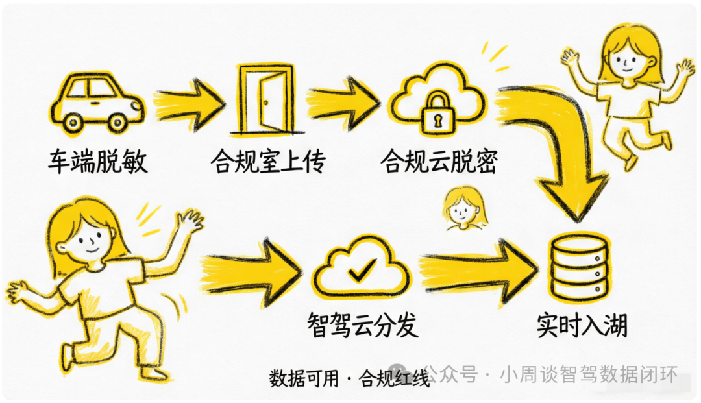
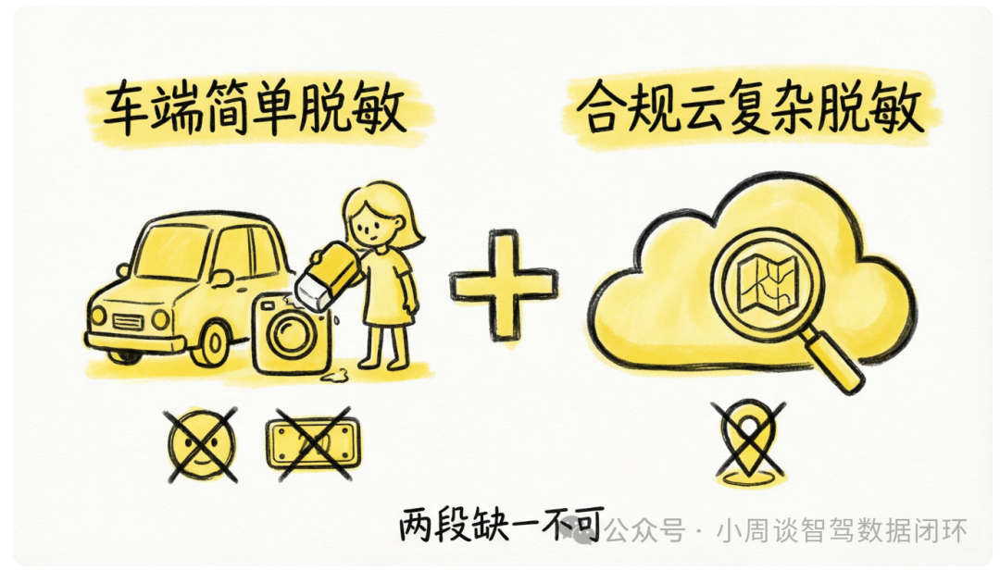
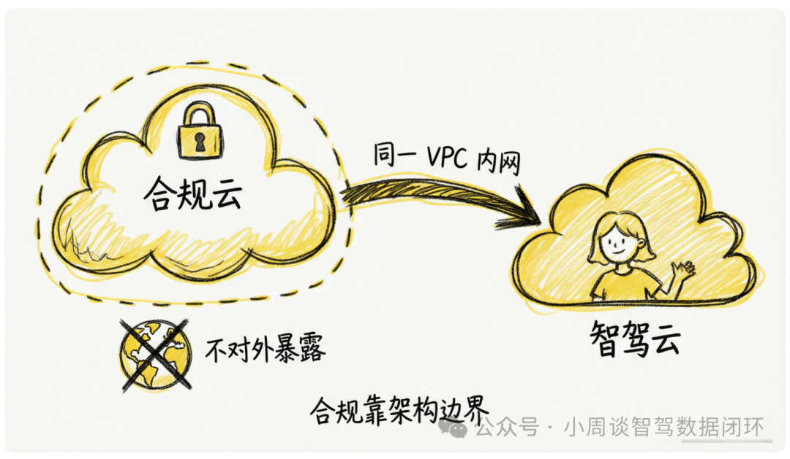
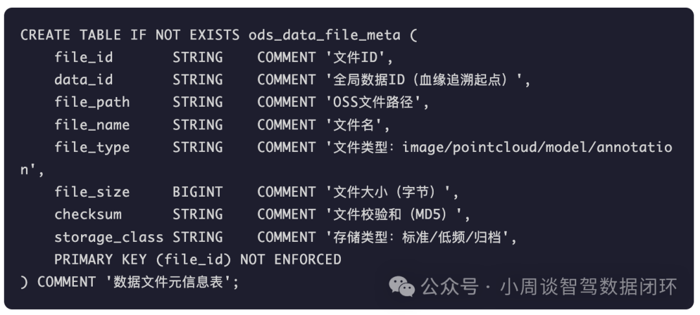

# 采集大文件的合规入湖链路

原文：[智驾数据闭环湖仓实战：采集数据的合规入湖链路](https://mp.weixin.qq.com/s/qhddTZf_P_g81s5z1RkPPA)  
作者：小周谈智驾数据闭环｜发布：2026-09-07｜系列二·湖仓实战，第 8 篇

图像、点云及 IMU、GNSS 等采集数据既有大文件传输要求，也需要限制内容暴露与后续使用。文章把文件处理组织为车端处理、专用环境上传、合规云处理、智驾云分发和元信息入湖五步：文件本体保存在 OSS，Kafka 传递完成事件与元信息，Paimon 保存可追溯的记录。

以下保留文章的项目处理方案；其中的云端部署、同 VPC 和双处理标记，应分别理解为网络、流程及验收控制，不能仅凭这些条件就认定实际内容已满足所有适用要求。

## 一、文件通道与 CDC、Kafka 的分工

| 通道 | 接收的主要内容 | 入湖方式 |
| --- | --- | --- |
| Flink CDC | 产线、标注、训练等业务库记录 | 读取 MySQL 快照与 binlog 变化 |
| Kafka | 产线埋点、训练指标、车端触发等事件 | Flink 消费后加工或写入 |
| OSS 文件通道 | 图像、点云与其他传感器文件 | 对象存储承接文件，元信息经 Kafka 入湖 |

文章的采集任务规模可达数十 TB，单帧点云可能达到几十 MB，一个任务包含大量文件。普通业务行同步与消息队列承载整批文件，容易放大网络、存储和恢复成本。

此外，采集文件含有人脸、车牌和地理相关内容，进入业务环境前需要执行指定处理；该方案采用车端硬盘、专人交接与离线上传。

> [!note] 批注：大文件不能走 Kafka，是绝对能力限制吗？
> 这里讨论的是架构职责：消息流适合传递身份、状态、路径和处理结果，对象存储更适合承接大体量文件、分片上传及后续按需读取。
>
> 不是说任何文件字节都无法写入数据库或消息队列，而是把大量采集内容当普通行或消息传输，通常不符合这条链路的成本和恢复设计。是否采用离线硬盘回传，同样是本项目的传输选择，并非所有采集系统只能使用硬盘。

三类通道最终共用质量门禁与业务数据规范，但分别保留适合自身数据形态的上传、读取与恢复方式。

## 二、从车端到湖仓的五步链路



| 步骤 | 发生位置 | 文章中的动作 |
| --- | --- | --- |
| 车端处理 | 采集车辆 | 实时处理人脸、车牌与地理相关信息，保存到车端；由指定人员提取硬盘 |
| 专用环境上传 | 合规室 | 按交接流程上传到合规云对象存储，限制直接对外访问 |
| 进一步处理 | 合规云 | 由相应处理方删除敏感 POI、模糊桥梁限高等信息 |
| 处理后数据分发 | 智驾云 | 把验收后的副本写入智驾云 OSS，并发布文件元信息 |
| 实时入湖 | 湖仓接入任务 | 消费 Kafka，经过质量检查写入 `ods_data_file_meta` |

前三步承担受控传输与内容处理，后两步承担通过验收的业务副本分发与湖仓登记。该方案限制业务环境只接收经过处理的数据副本和相应元信息。

> [!note] 批注：原文件与处理后的副本，要不要使用同一个文件身份？
> 用教学采集单元 `D001` 举例：原始对象 F001 经内容处理后生成 F002，二者仍可属于同一个 `data_id`，但文件内容和校验值可能不同，应保留各自身份及派生关系。
>
> 后续训练要能确定使用的是 F002，而不是只知道它属于 `D001`。文件路径、对象版本、处理任务与验收记录一起，才能串起“从哪里来、经过什么、最后用了什么”。

> [!note] 批注：限制业务云不接收原文件，是否等于原文件已经销毁？
> 不是。访问边界说明哪些环境能够接收哪些对象，原始硬盘、处理暂存区、备份和异常副本的留存与清理仍需分别安排。
>
> 不能因为处理后的副本已分发，就推断所有原始副本已经删除；也不能因某条业务链路没有暴露原文件，就忽略其他运维和交接路径。

## 三、车端与云端分段处理



| 处理段 | 文章安排的内容 | 作用 |
| --- | --- | --- |
| 车端前置处理 | 采集时处理人脸、车牌及地理相关内容 | 减少运输与上传阶段的原始内容暴露 |
| 云端进一步处理 | 敏感 POI 识别与删除、桥梁限高等数值处理 | 使用更完整的计算、地图知识和处理流程 |

文章将车端处理与云端处理组合使用：仅在云端处理，前面的传输和保存阶段仍会涉及原内容；仅做车端处理，也不能自动覆盖后续需要的复杂识别与验收。

> [!note] 批注：为什么不能把两段处理理解为“每段都简单模糊一次”？
> 两段处理针对的内容、执行环境和验收要求可以不同。车端及时保护明显的个人相关内容，云端再完成更复杂的识别和审核；具体动作应由处理规则与实际数据决定。
>
> 同时要检查处理对训练可用性的影响。例如模糊操作是否破坏目标边界或关联信息，需要由相应质量评估确定。多执行一道处理，并不自动意味着既完整保护内容又保留所有业务信息。

> [!warning] 技术边界：遮挡人脸和车牌，不等于必然匿名化。
> 轨迹、时间、位置或其他关联信息仍可能使对象可识别。是否达到匿名化，不能只看图像里是否打码，也不能由“车端已处理”这个字段单独证明。
>
> 《个人信息保护法》第七十三条区分了去标识化与匿名化，后者要求无法识别特定自然人且不能复原。这里应把文章的“离车即合规”理解为项目控制目标，并根据实际处理结果验收。参见 [个人信息保护法官方文本](https://www.cac.gov.cn/2021-08/20/c_1631050028355286.htm)。

## 四、处理域与业务域的访问和网络边界

文章将“合规云”描述为由相应处理方管理的独立区域，并与智驾业务环境采用同云端、同 VPC 的内网流转方案。原对象存储不开放公开访问，业务侧只获得允许分发的结果。



> [!note] 批注：同一 VPC 是否等于物理隔离？
> VPC 提供逻辑网络隔离与网络配置边界，不能据此判断底层设备是否物理专属。同一 VPC 也不意味着其中所有主机和对象都应互相可读。
>
> 应明确谁能访问原对象、谁能运行处理、谁能发布结果以及结果可以去哪里。路由、安全组、对象权限与身份授权共同实现这些边界。同 VPC 是本文的工程方案，不是由这篇文章即可推出的普遍合规必要条件。参见 [Alibaba Cloud VPC](https://www.alibabacloud.com/help/en/vpc/product-overview/what-is-a-vpc)。

> [!note] 批注：不走公网，为什么还要单独配置对象存储权限？
> 网络路径解决请求从哪里到达，存储授权解决这个请求主体能读取或写入哪个对象。请求位于内网，不代表身份与对象权限已经满足。
>
> 分发服务应只读取已批准结果并写入指定目标，业务服务不因共享内网而获得原始对象读取权限；公开访问设置与访问日志也要覆盖对象存储本身。参见 [OSS Access Control](https://www.alibabacloud.com/help/en/oss/user-guide/permissions-and-access-control-overview)。

## 五、文件外置，湖仓登记元信息

文件本体保留在智驾云 OSS，上传或分发服务在对象完成后发布元信息；Flink 消费 Kafka，将通过门禁的记录写入 `ods_data_file_meta`。下游通过 `file_path` 等字段定位实际对象。



下面保留原图核心字段。示例假定已经选择可用的 Paimon Catalog 与数据库，DDL 未实际执行。

```sql
CREATE TABLE IF NOT EXISTS ods_data_file_meta (
    file_id STRING COMMENT '文件 ID',
    data_id STRING COMMENT '所属全局数据单元',
    file_path STRING COMMENT 'OSS 对象路径',
    file_name STRING COMMENT '文件名',
    file_type STRING COMMENT 'image/pointcloud/model/annotation',
    file_size BIGINT COMMENT '文件大小，字节',
    checksum STRING COMMENT '文件内容校验值，原文采用 MD5',
    storage_class STRING COMMENT '标准/低频/归档',
    PRIMARY KEY (file_id) NOT ENFORCED
)
COMMENT '数据文件元信息表';
```

`data_id` 把文件关联到数据单元，`checksum` 用于内容完整性校验，`storage_class` 描述生命周期状态。双处理标记、处理版本和验收依据等，则需要由完整元信息或关联记录提供给门禁。

> [!note] 批注：data_id 和 file_id 为什么都需要？
> 一个采集单元可以包含多路相机、点云和其他文件，`data_id` 表达它们属于同一业务数据单元；`file_id` 区分具体文件对象。
>
> 处理生成新副本时，还应明确是新文件身份还是同一文件的受控对象版本。只靠相同文件名，不能确保训练与审计读取的是当时那份内容。

> [!note] 批注：checksum 应该怎样与对象存储响应对应？
> 校验前要固定算法及计算范围，例如对最终文件全部内容计算 MD5，再与对应对象的预期值比较。内容经过脱敏修改后，输出文件校验值通常应重新计算，不能要求它仍与原文件相同。
>
> OSS 分片上传完成后的整体 `ETag` 不等于整个文件内容的 MD5，不能直接把它填入 MD5 字段来替代校验。完整性校验也不单独证明处理流程合格。参见 [CompleteMultipartUpload](https://www.alibabacloud.com/help/en/oss/developer-reference/completemultipartupload)。

> [!note] 批注：上传了所有分片，是否就可以发布文件完成事件？
> 还要完成对象存储的合并提交，并确认业务目标位置上的对象可用。分片上传的中间状态与可供下游读取的完整对象，是不同状态。
>
> 对象完成后再可靠发布事件；若发送 Kafka 失败，服务应根据稳定上传或分发身份重试，消费端也按稳定身份幂等处理。否则容易出现“文件存在但没有湖表记录”，或“元信息已到而对象尚未完成”。机制见 [OSS 分片上传](https://www.alibabacloud.com/help/en/oss/developer-reference/v2-multipart-upload)。

> [!note] 批注：元信息写入后，是否所有下游都立刻可用？
> 还要看湖表提交是否完成、下游加工是否追上，以及请求主体能否读取实际文件。路径存在于表里，不代表对象读取已经授权。
>
> 当对象进入部分归档存储类型，还可能需要先恢复。`storage_class` 应参与读取服务的判断，不能把所有路径都当成随时可以直接下载的热文件。参见 [OSS 归档对象恢复](https://www.alibabacloud.com/help/en/oss/developer-reference/restore-files-using-ossutil2-0)。

## 六、与质量门禁衔接

文件完成事件进入湖仓前，除通用检查外，还需执行下面的通道专属规则。

| 检查项 | 验证内容 | 文章中的处置 |
| --- | --- | --- |
| 双处理标记 | 具备车端处理和合规云处理标记及相应依据 | P0 拒绝 |
| `data_id` 格式 | 格式和来源前缀符合约定 | P0 拒绝 |
| 文件可解码 | 图像、点云等完整且可按对应格式读取 | P1 拒绝 |
| 元信息与对象一致 | 路径指向指定智驾云存储范围，校验值与对象对应 | P1 拒绝 |

拒绝后进入拦截、隔离、告警、分流处置和复验流程。保留必要证据，修复后重新执行规则，再决定写入正常业务表。

> [!note] 批注：允许的 OSS 路径，应怎样判断？
> 不能只检查字符串是否以 `oss://` 开头，还要解析目标 Bucket、对象键及版本，确认属于批准范围，并验证对应身份确实能取得这个对象。
>
> 若相同路径上的内容已被覆盖，路径格式仍然合法，但原记录与实际文件可能不再一致。因此路径检查、对象身份和内容校验应配合执行。

> [!note] 批注：双标记缺失与内容验收失败，怎样保存处置依据？
> 标记缺失说明当前证据不足，验收失败说明已经执行的检查发现问题，两者应保留不同原因及处理记录。补齐一段字符串不能替代重新取得可信处理结果。
>
> 隔离记录可保存必要的元信息、错误和受控对象引用，避免把未经允许的原始文件复制到普通隔离目录。复验时仍要读取相应版本的文件，才能确认修复针对的是同一个对象。

这条文件链路通过受控内容处理和分发约束业务可见范围，再以文件身份、校验、完成事件和门禁把对象存储与湖仓连接起来。元信息能够定位文件，处理与验收记录说明它为何被允许使用，两者需要保持对应。
