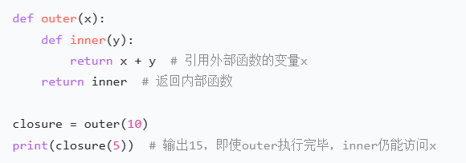
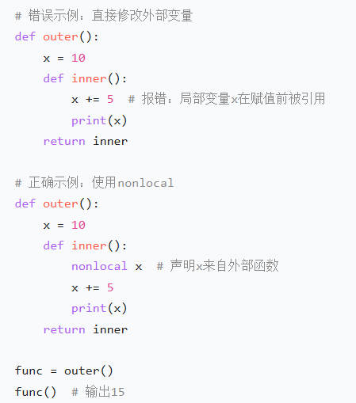
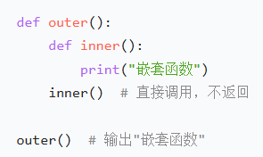
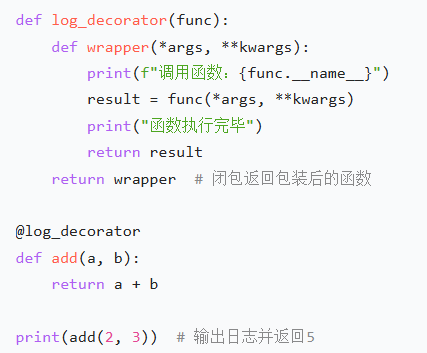
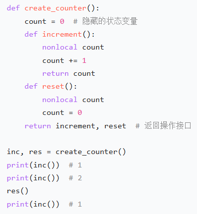
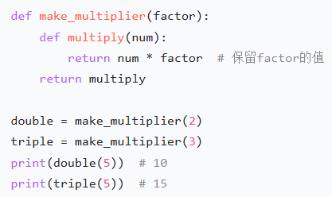

---
tags:
  - 大模型
  - 面试
source: "尚硅谷大模型技术之高频面试题-V2.1.6.docx"
source_blocks: "7-65"
reviewed: 2026-10-21
---

# Python 闭包、装饰器与异步调用

先把函数作为可携带状态的对象理解，再区分装饰器封装与异步调度。

后篇：[[知识点总结/80-资料与复习/81-面试知识库/08-大模型高频面试题/01-Python与机器学习/02-Python 内存、GIL与进程通信|Python 内存、GIL与进程通信]]

> [!note] 资料与阅读方式
> 原文：尚硅谷大模型技术之高频面试题；作者：尚硅谷研究院；版本：V2.1.6。原始 DOCX 保持不变。正文按主题拆分为 63 篇，并另附代码实验说明。每篇先给新增分析与代码，再保留对应原始问答；原文中的旧接口与案例指标由批注限定，不能直接视为当前推荐或个人经历。原文自动目录不重复变成笔记，另存为核对附件。


## 深入理解（新增）

闭包保存的是自由变量所关联的环境。外层函数返回内层函数是典型用法，却不是闭包成立的必要条件。循环中创建的函数常在调用时读取同一个变量；需要固定当次值时，可以使用默认参数或单独的工厂函数。修改外层绑定使用 nonlocal，修改对象内容与重新绑定变量不是一回事。

装饰器会改变调用边界。同步装饰器包住 async 函数时，返回协程对象不代表协程已执行；要计量实际耗时，应在异步包装器内部 await，并用 functools.wraps 保留元数据。异常、取消和超时也必须穿过包装层，不能被宽泛捕获后伪装成成功。

asyncio 的并发来自等待期间让出执行权。阻塞网络调用和长时间 CPU 运算会阻塞事件循环；并发上限、单次超时、总体期限要分别设计。下面的计数器验证闭包状态隔离，异步限流示例见代码实验中的 bounded_map。


## 核心代码（新增）

以下是可在 CPU 运行的机制或业务契约示例，完整源码与测试见 [[知识点总结/80-资料与复习/81-面试知识库/08-大模型高频面试题/06-代码实验/01-核心代码实验与验证范围|核心代码实验与验证范围]]。示例不包含完整模型训练或外部平台部署。

```python
def make_counter():
    value = 0
    def increment():
        nonlocal value
        value += 1
        return value
    return increment

left, right = make_counter(), make_counter()
assert [left(), left(), right()] == [1, 2, 1]
```

## 追问与验证（新增）

创建两个计数器，交替调用，确认各自从 1 开始；再解释把 value 放到模块全局后会改变什么。

## 官方资料与论文

- [Python 闭包与作用域 FAQ](https://docs.python.org/3/faq/programming.html)
- [asyncio 任务与超时](https://docs.python.org/3/library/asyncio-task.html)

核验日期：2026-10-21。链接中的 `stable`、`main` 或平台文档会继续变化；新增纯 Python/NumPy 实验与原文旧版框架代码已分开标注。

## 原文保留

> [!warning] 原文批注
> 闭包不要求外层函数必须返回内层函数；返回只是常见构造方式。异步函数被调用时通常只创建协程，必须由 await 或任务调度推进。

<!-- source-block:7 -->
### 核心技术

<!-- source-block:8 -->
#### Python基础

<!-- source-block:9 -->
##### 数据结构相关

<!-- source-block:10 -->
##### \*\*list 和 tuple 有什么区别？

<!-- source-block:11 -->
列表（list）是可变的，可执行添加、删除或修改元素等操作；元组（tuple）不可变，创建后内容不能更改。且元组能被哈希，可用作字典的键，但列表不行。

<!-- source-block:12 -->
##### \*\*闭包相关

<!-- source-block:13 -->
##### 什么是闭包？请简述其定义和形成条件。

<!-- source-block:14 -->
闭包是一种特殊的函数嵌套结构，指在外部函数内部定义的内部函数，引用了外部函数的变量（非全局变量），且外部函数返回该内部函数。

<!-- source-block:15 -->
形成闭包需满足三个条件：

<!-- source-block:16 -->
- 存在函数嵌套（内部函数定义在外部函数中）；

<!-- source-block:17 -->
- 内部函数引用了外部函数的变量；

<!-- source-block:18 -->
- 外部函数返回内部函数的引用。

<!-- source-block:19 -->
示例：

<!-- source-block:20 -->


<!-- source-block:21 -->
##### 闭包为什么能保留外部函数的变量？

<!-- source-block:22 -->
正常情况下，函数执行结束后，其内部变量会被销毁。但闭包中，内部函数引用了外部函数的变量，形成了 “变量捕获”，使得这些变量不会随外部函数的结束而销毁，而是被内部函数 “保留” 在内存中，直到内部函数被销毁。

<!-- source-block:23 -->
这种机制依赖 Python 的作用域链：内部函数在查找变量时，会先在自身作用域查找，若未找到则向上级（外部函数）作用域查找，闭包通过这种链式查找保留了对外部变量的引用。

<!-- source-block:24 -->
##### 闭包中如何修改外部函数的变量？nonlocal关键字的作用是什么？

<!-- source-block:25 -->
在闭包中，内部函数默认只能读取外部函数的变量，若直接修改会被 Python 判定为 “定义局部变量”，导致报错。需使用nonlocal关键字声明变量，明确其来自外部函数的作用域，允许内部函数修改。

<!-- source-block:26 -->
示例（错误与正确对比）：

<!-- source-block:27 -->


<!-- source-block:28 -->
##### 闭包与普通嵌套函数的区别是什么？

<!-- source-block:29 -->
嵌套函数：仅指在一个函数内部定义另一个函数，不要求内部函数引用外部变量，也不要求外部函数返回内部函数。例如：

<!-- source-block:30 -->


<!-- source-block:31 -->
闭包：是特殊的嵌套函数，必须满足 “内部函数引用外部变量 + 外部函数返回内部函数”，且内部函数可在外部函数执行完毕后继续访问外部变量。

<!-- source-block:32 -->
##### 闭包有哪些实际应用场景？请举例说明。

<!-- source-block:33 -->
闭包的核心价值是 “保留状态” 和 “封装数据”，常见应用场景包括：

<!-- source-block:34 -->
**装饰器（Decorator）：**

<!-- source-block:35 -->
装饰器本质是闭包，用于在不修改原函数代码的前提下，添加额外功能（如日志、计时）。

<!-- source-block:36 -->


<!-- source-block:37 -->
**数据封装与隐藏：**

<!-- source-block:38 -->
模拟类的私有变量，通过闭包隐藏内部状态，只暴露操作接口。

<!-- source-block:39 -->


<!-- source-block:40 -->
**函数工厂：**

<!-- source-block:41 -->
动态生成具有不同参数的函数，避免重复代码。

<!-- source-block:42 -->


<!-- source-block:43 -->
##### 闭包可能导致什么问题？如何避免？

<!-- source-block:44 -->
**问题：**

<!-- source-block:45 -->
闭包会保留外部函数的变量，若变量是大型对象或未及时释放，可能导致内存泄漏（变量长期占用内存不释放）。

<!-- source-block:46 -->
**避免方式：**

<!-- source-block:47 -->
- 不再使用闭包时，手动将其引用设为None（触发垃圾回收）；

<!-- source-block:48 -->
- 避免在闭包中引用过大的对象；

<!-- source-block:49 -->
- 若需频繁创建闭包，考虑用类替代（类的\_\_del\_\_方法可主动释放资源）。

<!-- source-block:50 -->
##### 函数相关

<!-- source-block:51 -->
##### 什么是 Python decorators？

<!-- source-block:52 -->
装饰器是用于修改函数或类行为的特殊函数。其接收一个函数或类作为输入，并返回新函数或类，常被用于添加日志记录、性能测量等额外功能，用 @ 语法应用于函数或类前。

<!-- source-block:53 -->
##### lambda 函数是什么？

<!-- source-block:54 -->
是一种单个表达式的匿名函数，用 lambda 关键字定义，常作为内联函数或用于简单逻辑。例如 add = lambda x, y: x + y 可实现两数相加功能。

<!-- source-block:55 -->
##### \*args，\*\*kwargs 参数是什么？

<!-- source-block:56 -->
\*args 用于向函数传入不确定数量的非关键字参数，接收为元组；\*\*kwargs 用于传入不确定数量的关键字参数，接收为字典。

<!-- source-block:57 -->
##### Python中如何完成函数的异步调用？

<!-- source-block:58 -->
Python中异步是“单线程非阻塞”的编程模型，核心解决IO密集型任务的阻塞效率问题，核心依赖“事件循环+协程”实现，底层依托生成器的暂停/恢复机制和操作系统的非阻塞IO/IO多路复用（select/epoll等）。

<!-- source-block:59 -->
**执行逻辑：**

<!-- source-block:60 -->
**用async/await定义可暂停的协程（异步任务），注册到事件循环；**

<!-- source-block:61 -->
**事件循环作为总调度，执行协程时，若遇await等待操作，协程暂停并交还执行权，事件循环调度其他可执行协程；**

<!-- source-block:62 -->
**当等待的IO任务完成，操作系统通知事件循环，协程被标记为可恢复，后续由事件循环调度继续执行；**

<!-- source-block:63 -->
**直至所有协程执行完毕，事件循环终止。**

<!-- source-block:64 -->
**特点：**

<!-- source-block:65 -->
无线程/进程创建、切换的开销，最大化利用单线程资源；仅适用于IO密集型任务，CPU密集型任务更适合多进程（突破GIL限制）。
