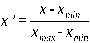
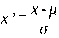
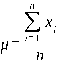
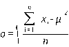

---
tags:
  - 大模型
  - 面试
source: "尚硅谷大模型技术之高频面试题-V2.1.6.docx"
source_blocks: "169-223"
reviewed: 2026-10-21
---

# 机器学习特征工程与数据泄漏

特征工程要同时回答信息是否可用、是否泄漏、能否稳定复现。

前篇：[[知识点总结/80-资料与复习/81-面试知识库/08-大模型高频面试题/01-Python与机器学习/04-Pandas 缺失值与数据处理契约|Pandas 缺失值与数据处理契约]] ｜ 后篇：[[知识点总结/80-资料与复习/81-面试知识库/08-大模型高频面试题/01-Python与机器学习/06-模型评估、梯度优化与分类指标|模型评估、梯度优化与分类指标]]

## 深入理解（新增）

训练样本只能使用预测时点之前已存在的信息。订单最终退款状态若用于支付时刻的风险预测，就是时间泄漏，即使训练和测试行完全不同也无法修复。应为特征明确 event_time、available_time 和预测时点。

标准化适合受尺度影响的距离或梯度模型；树模型主要依赖切分顺序，通常不需要相同处理。类别编码要约定未知值，目标编码必须使用折外统计，不能把同一行标签直接编码回自身。

离线与在线必须共享特征定义和版本。只保存模型权重不够，还应保存填补器、词表、缩放参数及字段顺序。特征收益需用时间外验证或分组验证确认，随机切分的提升可能只是实体记忆。

### 可编辑公式

$$z_j=\frac{x_j-\mu_j^{\mathrm{train}}}{\max(\sigma_j^{\mathrm{train}},\epsilon)}$$

实际代码对零方差列用 1 作为分母，避免除零；训练与测试共享训练统计量。

## 核心代码（新增）

以下是可在 CPU 运行的机制或业务契约示例，完整源码与测试见 [[知识点总结/80-资料与复习/81-面试知识库/08-大模型高频面试题/06-代码实验/01-核心代码实验与验证范围|核心代码实验与验证范围]]。示例不包含完整模型训练或外部平台部署。

```python
import numpy as np

def standardize_from_train(train, test):
    mean = train.mean(axis=0)
    scale = train.std(axis=0)
    scale = np.where(scale == 0, 1.0, scale)
    return (train - mean) / scale, (test - mean) / scale

train = np.array([[1., 2.], [3., 2.]])
test = np.array([[100., 2.]])
scaled_train, scaled_test = standardize_from_train(train, test)
# 第二列训练方差为零；测试集不参与统计量拟合。
```

## 追问与验证（新增）

构造同一用户多条样本，比较随机切分与按用户切分的指标差异，并说明哪种更接近目标上线场景。

## 官方资料与论文

- [scikit-learn：常见陷阱与数据泄漏](https://scikit-learn.org/stable/common_pitfalls.html)

核验日期：2026-10-21。链接中的 `stable`、`main` 或平台文档会继续变化；新增纯 Python/NumPy 实验与原文旧版框架代码已分开标注。

## 原文保留

> [!warning] 原文批注
> 先划分数据，再拟合预处理。标准化是按统计量平移缩放，不是把任意分布变成高斯分布。

<!-- source-block:169 -->
### 机器学习

<!-- source-block:170 -->
#### 机器学习基础概念

<!-- source-block:171 -->
##### 机器学习的主要分类有哪些？

<!-- source-block:172 -->
按监督方式：

<!-- source-block:173 -->
- 有监督学习：使用带标签数据训练（如分类、回归）。

<!-- source-block:174 -->
- 无监督学习：使用无标签数据，挖掘数据内在结构（如聚类、降维）。

<!-- source-block:175 -->
- 半监督学习：结合少量标签数据和大量无标签数据训练。

<!-- source-block:176 -->
- 强化学习：通过与环境交互，以 “奖励” 机制优化策略。

<!-- source-block:177 -->
##### 简述验证集和测试集的区别。

<!-- source-block:178 -->
验证集用于调整模型的超参数，并在训练过程中评估其性能；而在训练过程完成并选择了超参数之后，使用测试集来评估模型的最终性能。

<!-- source-block:179 -->
#### 数据处理与特征工程

<!-- source-block:180 -->
##### 什么是特征工程？包含哪些内容？

<!-- source-block:181 -->
特征工程指的是通过对原始数据的处理、转换和构造，生成新的特征或选择有效的特征，从而提高模型的性能。内容包括：

<!-- source-block:182 -->
- 特征选择：从原始特征中挑选出与目标变量关系最密切的特征，剔除冗余、无关或噪声特征。包括过滤法、包裹法、嵌入法等。

<!-- source-block:183 -->
- 特征转换： 对数据进行数学或统计处理，使其变得更加适合模型的输入要求。包括归一化、标准化、类别编码（独热编码、标签编码）等。

<!-- source-block:184 -->
- 特征构造：特征构造是基于现有的特征创造出新的、更有代表性的特征。包括创建交互特征（如特征乘积）、统计特征（如均值、标准差）、日期时间特征等。

<!-- source-block:185 -->
- 特征降维：在保持数据本质的情况下，减少特征维度，缓解维度灾难、避免过拟合。包括 PCA、LDA、t-SNE、自编码器等方法。

<!-- source-block:186 -->
##### 特征选择有哪些具体技术？

<!-- source-block:187 -->
**过滤法（Filter Method）**

<!-- source-block:188 -->
基于统计测试（如低方差过滤、卡方检验、相关系数、信息增益等）来评估特征与目标变量之间的关系，选择最相关的特征。

<!-- source-block:189 -->
**嵌入法（Embedded Method）**

<!-- source-block:190 -->
使用模型本身的特征选择机制（如决策树的特征重要性，L1正则化的特征选择）来选择最重要的特征。

<!-- source-block:191 -->
##### 归一化和标准化的区别及适用场景？

<!-- source-block:192 -->
归一化：将数据缩放到固定范围（如 \[0,1\]），公式：

<!-- source-block:193 -->


<!-- source-block:194 -->
适用：数据分布有明确边界（如图像像素），或模型对输入范围敏感（如 KNN、SVM）。

<!-- source-block:195 -->
标准化：将数据转换为均值为 0、标准差为 1 的分布，公式：

<!-- source-block:196 -->


<!-- source-block:197 -->
其中 是平均值， 是标准差。

<!-- source-block:198 -->
适用：数据分布未知或近似正态分布，适用于线性回归、逻辑回归等模型。

<!-- source-block:199 -->
##### \*\*类别型变量可以采用哪些编码方式？实际项目中通常采用哪种方式？

<!-- source-block:200 -->
独热编码（One-Hot Encoding）：将类别型变量转换为二进制列，常用于无序类别特征。

<!-- source-block:201 -->
标签编码（Label Encoding）：将类别型变量映射为整数，常用于有序类别特征。

<!-- source-block:202 -->
目标编码（Target Encoding）：将类别变量的每个类别替换为其对应目标变量的平均值或其他统计量。

<!-- source-block:203 -->
频率编码（Frequency Encoding）：将类别变量的每个类别替换为该类别在数据集中的出现频率。

<!-- source-block:204 -->
在实际项目中，最常见的编码方式是独热编码（One-Hot Encoding），可将类别特征转换为二元向量，消除虚假的顺序关系。

<!-- source-block:205 -->
##### \*\*如何处理高维特征？

<!-- source-block:206 -->
当特征维度增加时，会导致模型复杂度剧增、计算的复杂度呈指数级增长、过拟合风险升高，这种现象被称为“维度灾难”。

<!-- source-block:207 -->
处理高维特征，可以通过特征选择剔除无关特征；采用PCA、LDA或t-SNE等方法对特征进行降维处理；采用正则化技术（L1、L2、弹性网络）约束模型复杂度；还可以选择更适合高维数据的模型，例如 SVM，或者支持特征重要性评估的抗噪声模型（比如随机森林、XGBoost）。

<!-- source-block:208 -->
##### 数据中有噪声如何处理？

<!-- source-block:209 -->
首先进行噪声检查，比较常见的方法：

<!-- source-block:210 -->
距离检测：通过寻找数据集中与其他观测值及均值差距最大的点作为异常点。

<!-- source-block:211 -->
聚类方法检测：将类似的取值组织成“群”或“簇”，落在“簇”集合之外的值被视为离群点。

<!-- source-block:212 -->
在进行噪声检查后，通常采用分箱、聚类、回归、计算机检查和人工检查结合等方法“光滑”数据，去掉数据中的噪声。

<!-- source-block:213 -->
##### 在训练模型前，一般会将高度相关的特征去掉，原因是什么？

<!-- source-block:214 -->
去掉高度相关的特征，可以让模型的可解释性更好。

<!-- source-block:215 -->
可以提高训练速度。高度相关的特征属于冗余数据，特征多了，就会增加训练的时间。

<!-- source-block:216 -->
可以让模型更容易收敛。如果模型中有很多特征高度相关，可能导致即使损失函数本身收敛了，实际上参数却并没有收敛。

<!-- source-block:217 -->
##### \*\*如何解决数据不平衡问题？

<!-- source-block:218 -->
采样：对小样本加噪声采样，对大样本进行下采样

<!-- source-block:219 -->
调整数据权重：对某类数据进行特殊的加权，比如Adaboost

<!-- source-block:220 -->
采用对不平衡数据集不敏感的算法

<!-- source-block:221 -->
改变评价标准：用AUC-PR来进行评价

<!-- source-block:222 -->
采用集成学习：如Bagging、Boosting等方法

<!-- source-block:223 -->
考虑数据的先验分布
