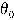
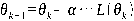
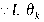
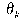
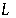
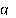

---
tags:
  - 大模型
  - 面试
source: "尚硅谷大模型技术之高频面试题-V2.1.6.docx"
source_blocks: "224-304"
reviewed: 2026-10-21
---

# 模型评估、梯度优化与分类指标

先固定评估问题和样本单位，再选择指标及阈值。

前篇：[[知识点总结/80-资料与复习/81-面试知识库/08-大模型高频面试题/01-Python与机器学习/05-机器学习特征工程与数据泄漏|机器学习特征工程与数据泄漏]] ｜ 后篇：[[知识点总结/80-资料与复习/81-面试知识库/08-大模型高频面试题/01-Python与机器学习/07-近邻、线性回归与概率分类|近邻、线性回归与概率分类]]

## 深入理解（新增）

Precision 回答预测为正的样本有多少是真的，Recall 回答真实正样本找回了多少；二者都依赖阈值。F1 把两者合成一个数，但不体现所有业务代价。低基率告警应同时报告每千次请求误报数和漏报成本。

ROC-AUC 衡量排序，不能证明概率已校准，也不能直接代替固定阈值下的服务质量。AUC 小于 0.5 应排查标签方向、分数方向、数据偏移与抽样误差；不能看完测试集后反转分数再把它当成独立测试结果。

比较两个版本要保持测试集、预处理、阈值选择规则一致。按用户聚合或时间块重采样往往比逐行抽样更合理，因为同一实体的样本并不独立。生成任务还要分开评估语义、事实、格式和拒答，单一自动分数不能覆盖全部。

### 可编辑公式

$$P=\frac{TP}{TP+FP},\quad R=\frac{TP}{TP+FN},\quad F_1=\frac{2PR}{P+R}$$

分母为零时必须约定处理策略；实验代码返回 0，同时应单独报告没有预测正例等特殊情形。

## 核心代码（新增）

以下是可在 CPU 运行的机制或业务契约示例，完整源码与测试见 [[知识点总结/80-资料与复习/81-面试知识库/08-大模型高频面试题/06-代码实验/01-核心代码实验与验证范围|核心代码实验与验证范围]]。示例不包含完整模型训练或外部平台部署。

```python
def binary_metrics(truth, prediction):
    if len(truth) != len(prediction) or not truth:
        raise ValueError("non-empty equal-length inputs required")
    tp = sum(y == 1 and p == 1 for y, p in zip(truth, prediction))
    fp = sum(y == 0 and p == 1 for y, p in zip(truth, prediction))
    fn = sum(y == 1 and p == 0 for y, p in zip(truth, prediction))
    precision = tp / (tp + fp) if tp + fp else 0.0
    recall = tp / (tp + fn) if tp + fn else 0.0
    f1 = 2 * precision * recall / (precision + recall) if precision + recall else 0.0
    return {"precision": precision, "recall": recall, "f1": f1}

print(binary_metrics([1, 1, 0, 0], [1, 0, 1, 0]))
# precision=recall=f1=0.5
```

## 追问与验证（新增）

在 1% 正样本数据上计算“全预测为负”的准确率与 Recall，解释为什么高准确率仍不能满足召回目标。

## 官方资料与论文

- [scikit-learn：常见陷阱与数据泄漏](https://scikit-learn.org/stable/common_pitfalls.html)

核验日期：2026-10-21。链接中的 `stable`、`main` 或平台文档会继续变化；新增纯 Python/NumPy 实验与原文旧版框架代码已分开标注。

## 原文保留

> [!warning] 原文批注
> AUC 低于 0.5 不是逻辑上不可能；在测试集上选择反转方向会污染最终评估。

<!-- source-block:224 -->
### 模型评估与模型选择

<!-- source-block:225 -->
#### 什么是过拟合和欠拟合？产生的原因是什么？如何解决？

<!-- source-block:226 -->
**过拟合：**

<!-- source-block:227 -->
模型在训练集表现好，但测试集表现差（高方差）。

<!-- source-block:228 -->
产生原因：模型复杂度过高，训练数据不足，特征过多，训练过长。

<!-- source-block:229 -->
解决方法：简化模型或者降维降低模型复杂度，增加训练数据，使用正则化，交叉验证，早停。

<!-- source-block:230 -->
**欠拟合：**

<!-- source-block:231 -->
模型在训练集和测试集表现都很差（高偏差）。

<!-- source-block:232 -->
产生原因：模型复杂度不足 ，特征不足，训练不充分，过强的正则化。

<!-- source-block:233 -->
解决方法：增加模型复杂度，增加特征或者改进特征工程，增加训练时间，减少正则化强度。

<!-- source-block:234 -->
#### 什么是正则化？简述其常见类型。

<!-- source-block:235 -->
正则化（Regularization）是一种在训练机器学习模型时，在损失函数中添加额外项，来惩罚过大的参数，进而限制模型复杂度、避免过拟合，提高模型泛化能力的技术。

<!-- source-block:236 -->
类型：

<!-- source-block:237 -->
- L1 正则化（Lasso 回归）：惩罚参数绝对值之和，使部分参数为 0，实现特征选择。

<!-- source-block:238 -->
- L2 正则化（Ridge 回归）：惩罚参数平方和，使参数值普遍较小，提高模型稳定性。

<!-- source-block:239 -->
- ElasticNet：结合 L1 和 L2 正则化，平衡稀疏性和稳定性。

<!-- source-block:240 -->
#### 什么是交叉验证？有什么作用？

<!-- source-block:241 -->
交叉验证是通过多次划分数据集（训练集 + 验证集），反复进行训练和验证，来评估模型泛化能力的方法，减少数据划分随机性的影响。

<!-- source-block:242 -->
通过交叉验证能更可靠地估计型在未知数据上的表现，亦能避免因单次数据划分不合理导致的模型过拟合或欠拟合；在实际工程应用中，通常可以结合网格搜索来确定超参数。

<!-- source-block:243 -->
注意：任何基于全局数据分布的操作（如时间序列数据，特征工程特征选择，标准化等）都应该在每折训练集上独立进行，否则会发生数据泄露，严重高估模型性能。

<!-- source-block:244 -->
#### 常用的交叉验证方法有哪些？

<!-- source-block:245 -->
- k 折交叉验证：将数据分为 k 份，每次用 k-1 份训练，1 份验证，取平均性能。

<!-- source-block:246 -->
- 留一交叉验证：每次留 1 个样本作为验证集，适用于小数据集。

<!-- source-block:247 -->
- 简单交叉验证（Hold-Out）：一次划分训练集和验证集，结果较粗糙。

<!-- source-block:248 -->
#### K折交叉验证的K如何选择？

<!-- source-block:249 -->
k越大，不一定效果越好，而且越大的k会加大训练时间；

<!-- source-block:250 -->
在选择k时，一般需要考虑最小化数据集之间的方差。比如对于2分类任务，如果采用2折交叉验证，即将原始数据集对半分，若此时训练集中都是A类别，验证集中都是B类别，则交叉验证效果会非常差。

<!-- source-block:251 -->
#### 什么是网格搜索？

<!-- source-block:252 -->
网格搜索（Grid Search）是一种系统化的超参数调优方法，通过遍历预定义的超参数组合，找到使模型性能最优的参数配置。通过自动化调参避免手动试错，提高效率。

<!-- source-block:253 -->
网格搜索通常嵌套交叉验证，与交叉验证结合以提高调参的可靠性。

<!-- source-block:254 -->
### 模型求解和优化

<!-- source-block:255 -->
#### 有哪些常见的损失函数？常见的损失函数有：

<!-- source-block:256 -->
**分类任务损失函数：**

<!-- source-block:257 -->
**基础二分类**

<!-- source-block:258 -->
二元交叉熵（BCE/对数损失）：最常用，配合sigmoid输出0-1概率；

<!-- source-block:259 -->
拓展（可不记）：合页损失（Hinge）：SVM专用，不关注概率，只关注分类边界；

<!-- source-block:260 -->
**多分类：**

<!-- source-block:261 -->
多分类交叉熵（CE）：配合softmax输出，强制类别互斥（但标签，多选一），常规多分类首选。

<!-- source-block:262 -->
多标签交叉熵：配合sigmoid，每个类别独立判断（多标签），适合一个样本对应多个类别的场景。

<!-- source-block:263 -->
**回归任务损失函数：**

<!-- source-block:264 -->
均方误差（MSE）：最常用，计算预测真实值之间方差均值。

<!-- source-block:265 -->
平方绝对误差（MAE）：计算绝对差的均值。

<!-- source-block:266 -->
平滑L1损失（Huber）：MSE+MAE，小误差使用MSE（平滑），大误差使用MAE（抗异常）。

<!-- source-block:267 -->
#### 什么是梯度下降法？写出梯度下降法的更新公式。

<!-- source-block:268 -->
梯度下降法（gradient descent）是一种常用的一阶优化方法，是求解无约束优化问题最简单、最经典的方法之一。梯度下降法是迭代算法，基本思路就是先选取一个适当的初始值 ，然后沿着梯度方向或者负梯度方向，不停地更新参数，最终取到极小值。

<!-- source-block:269 -->


<!-- source-block:270 -->
这里的 是参数取值为 时损失函数  的梯度；  是每次迭代的“步长”，被称为“学习率”。

<!-- source-block:271 -->
#### 什么是BGD、SGD、MBGD？描述各自的优缺点。

<!-- source-block:272 -->
**批量梯度下降（Batch Gradient Descent，BGD）**

<!-- source-block:273 -->
每次迭代使用全部训练数据计算梯度。

<!-- source-block:274 -->
优点：稳定收敛。

<!-- source-block:275 -->
缺点：计算开销大。

<!-- source-block:276 -->
**随机梯度下降（Stochastic Gradient Descent，SGD）**

<!-- source-block:277 -->
每次迭代随机选取一个样本计算梯度。

<!-- source-block:278 -->
优点：速度快，适合大规模数据。

<!-- source-block:279 -->
缺点：梯度更新方向不稳定，优化过程震荡较大，可能难以收敛。

<!-- source-block:280 -->
**小批量梯度下降（Mini-batch Gradient Descent，MBGD）**

<!-- source-block:281 -->
每次迭代使用一小批样本（如32、64个）计算梯度。

<!-- source-block:282 -->
平衡了BGD的稳定性和SGD的速度，是最常用的方法。

<!-- source-block:283 -->
#### \*\*梯度下降法有哪些主要问题？如何解决？

<!-- source-block:284 -->
**特征量纲不一致，导致收敛速度慢**

<!-- source-block:285 -->
解决方案：通常需要提前对特征进行缩放（如标准化或归一化），以加快收敛速度。

<!-- source-block:286 -->
**局部极小值、鞍点问题**

<!-- source-block:287 -->
可能陷入局部极小值（非全局最优解），或遇到鞍点（梯度为零但非极值点）。

<!-- source-block:288 -->
解决方案：使用优化方法，如动量法（Momentum）、自适应优化器（如Adam）或二阶方法（如牛顿法）。

<!-- source-block:289 -->
### 模型评价指标

<!-- source-block:290 -->
#### 回归任务的常用评价指标有哪些？

<!-- source-block:291 -->
- 均方误差（MSE）：预测值与真实值差的平方均值。重视大误差惩罚严重错误。

<!-- source-block:292 -->
- 平均绝对误差（MAE）：预测值与真实值差的绝对值均值。追求稳健，避免异常值影响。

<!-- source-block:293 -->
- R²（决定系数）：衡量模型整体对目标变量的解释能力，越接近 1 越好。

<!-- source-block:294 -->
#### 分类任务有哪些常用的评价指标？

<!-- source-block:295 -->
- 准确率（Accuracy）：正确预测样本占比。

<!-- source-block:296 -->
- 精确率（Precision）：预测为正例的样本中实际为正例的比例。

<!-- source-block:297 -->
- 召回率（Recall）：实际为正例的样本中被正确预测的比例。

<!-- source-block:298 -->
- F1 分数：精确率和召回率的调和平均。

<!-- source-block:299 -->
- ROC 曲线与 AUC：ROC 曲线以 FPR 为横轴、TPR 为纵轴，AUC 为曲线下面积，衡量模型区分正负类的能力。全面评估模型整体排序能力，对类别比例不敏感，适合评估和比较模型本身性能。

<!-- source-block:300 -->
- AUC-PR曲线：描述不同阈值下精确率和召回率的曲线，特别适用于高度不平衡的数据（异常检测），此时AUC-PR曲线比ROC曲线更具参考性。

<!-- source-block:301 -->
#### \*\*如何利用ROC曲线判断模型的好坏？

<!-- source-block:302 -->
从图像上看，ROC曲线越“陡”，即TPR 越高，同时 FPR 越低时，模型的性能就越好。

<!-- source-block:303 -->
一般会结合AUC来看：AUC 表示ROC曲线下的面积，用于量化模型性能。AUC值越大，模型区分正负类的能力越强，模型性能越好。AUC值=0.5表示模型接近随机猜测，AUC值=1代表完美模型。

<!-- source-block:304 -->
AUC如果小于0.5，说明预测诊断比随机性猜测还差，实际情况中不应该出现这种情况；可能是设置的状态变量标准有误，需要查看设置；对于这种情况，只需要将预测结果翻转就可以得到AUC &gt; 0.5的更好的模型。
