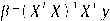
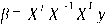
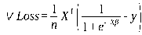
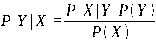
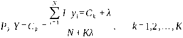
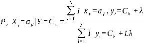

---
tags:
  - 大模型
  - 面试
source: "尚硅谷大模型技术之高频面试题-V2.1.6.docx"
source_blocks: "305-383"
reviewed: 2026-10-21
---

# 近邻、线性回归与概率分类

把距离假设、线性假设和概率输出的含义分别说清。

前篇：[[知识点总结/80-资料与复习/81-面试知识库/08-大模型高频面试题/01-Python与机器学习/06-模型评估、梯度优化与分类指标|模型评估、梯度优化与分类指标]] ｜ 后篇：[[知识点总结/80-资料与复习/81-面试知识库/08-大模型高频面试题/01-Python与机器学习/08-决策树、SVM与集成学习|决策树、SVM与集成学习]]

## 深入理解（新增）

KNN 的核心假设是距离接近意味着标签相近。因此尺度、距离度量和高维噪声会直接改变邻居。增大 K 能平滑噪声，却可能抹去少数类局部结构；预测时需要访问训练向量，成本不能只看训练阶段。

线性回归拟合的是特征的线性组合，不要求输入特征本身没有非线性变换。正规方程的显式求逆在共线或病态数据上不稳；用 QR、SVD 或 lstsq 解最小二乘更合适。加正则化改变的是估计目标，不只是数值修补。

逻辑回归输出的 sigmoid 数值在训练分布与模型条件下可解释为概率估计，但类别重采样、分布偏移会改变校准。朴素贝叶斯的条件独立假设也不是现实断言，应通过留出集验证其近似是否足够。

### 可编辑公式

$$\hat w\in\arg\min_w\|Xw-y\|_2^2$$

只有在设计矩阵满足相应满秩条件时，才可写成唯一解 $(X^\top X)^{-1}X^\top y$；数值实现优先使用稳定分解。

## 核心代码（新增）

以下是可在 CPU 运行的机制或业务契约示例，完整源码与测试见 [[知识点总结/80-资料与复习/81-面试知识库/08-大模型高频面试题/06-代码实验/01-核心代码实验与验证范围|核心代码实验与验证范围]]。示例不包含完整模型训练或外部平台部署。

```python
import numpy as np

def least_squares(x, y):
    design = np.column_stack([np.ones(len(x)), x])
    # lstsq also handles rank-deficient matrices; avoid an explicit matrix inverse.
    return np.linalg.lstsq(design, y, rcond=None)[0]

def cosine_similarity(query, vectors):
    query = np.asarray(query, dtype=float)
    vectors = np.asarray(vectors, dtype=float)
    denom = np.linalg.norm(query) * np.linalg.norm(vectors, axis=1)
    return np.divide(vectors @ query, denom, out=np.zeros(len(vectors)), where=denom != 0)

x = np.array([[1., 1.], [2., 2.], [3., 3.]])
coef = least_squares(x, np.array([3., 5., 7.]))
assert np.allclose(np.column_stack([np.ones(3), x]) @ coef, [3, 5, 7])

scores = cosine_similarity([1, 0], [[1, 0], [0, 1], [0, 0]])
assert np.allclose(scores, [1, 0, 0])
```

## 追问与验证（新增）

构造两列完全相同的特征，比较显式求逆与 lstsq；说明参数不唯一时为什么预测仍可能稳定。

## 官方资料与论文

- [scikit-learn：常见陷阱与数据泄漏](https://scikit-learn.org/stable/common_pitfalls.html)

核验日期：2026-10-21。链接中的 `stable`、`main` 或平台文档会继续变化；新增纯 Python/NumPy 实验与原文旧版框架代码已分开标注。

## 原文保留

> [!warning] 原文批注
> 线性回归的求解不应把矩阵可逆当成默认条件；相似度高也不代表概率或置信度高。
>
> 原文有几处需要限定：最小二乘最小化的是给定设计矩阵下的残差平方和，普通线性回归通常指 y 方向残差，并非到超平面的最短几何距离；误差正态不是求最小二乘估计的必要条件；MSE 对参数凸不保证最优参数唯一，唯一性还需要设计矩阵满列秩等条件。

<!-- source-block:305 -->
### KNN

<!-- source-block:306 -->
#### 简述KNN算法的原理。

<!-- source-block:307 -->
K近邻算法（K-Nearest Neighbors，KNN）是一种基本的分类与回归方法，属于监督学习算法。其核心思想是通过计算给定样本与数据集中所有样本的距离，找到距离最近的K个样本，然后根据这K个样本的类别或值来预测当前样本的类别或值。

<!-- source-block:308 -->
该算法涉及的3个主要因素是：k值选择，距离度量，分类/回归决策（投票/平均）。

<!-- source-block:309 -->
#### KNN中有哪些距离度量方法？

<!-- source-block:310 -->
常见的距离度量方法有：欧式距离、曼哈顿距离、切比雪夫距离、闵可夫斯基距离，除此之外，还可以用余弦相似度来度量两个向量的距离。

<!-- source-block:311 -->
在KNN分类任务中，一般采用欧式距离。

<!-- source-block:312 -->
#### 不平衡的样本会给KNN的预测结果造成哪些问题，有没有什么好的解决方式？

<!-- source-block:313 -->
输入实例的K邻近点中，大数量类别的点会比较多，但其实可能都离实例较远，这样会影响最后的分类。

<!-- source-block:314 -->
可以使用权值（weights）来改进，距实例较近的点赋予较高的权值，较远的赋予较低的权值。

<!-- source-block:315 -->
### 线性回归

<!-- source-block:316 -->
#### 什么是线性回归？

<!-- source-block:317 -->
线性回归（Linear Regression）是一种用于建模两个或多个变量之间线性关系的统计方法。它通过拟合一条直线（或超平面）来描述自变量（输入特征）与因变量（输出目标）之间的关联，并可用于预测或分析变量间的影响关系。

<!-- source-block:318 -->
#### 线性回归适用于哪些情况？

<!-- source-block:319 -->
- 目标变量与特征（自变量）呈线性关系

<!-- source-block:320 -->
- 目标变量满足高斯假设（误差近似正态分布）

<!-- source-block:321 -->
- 特征数量较少，且特征之间相互独立

<!-- source-block:322 -->
#### \*\*线性回归为什么选择均方误差作为损失函数？

<!-- source-block:323 -->
均方误差是回归任务中最常用的损失函数，均方误差对应了欧氏距离。

<!-- source-block:324 -->
- 均方误差是凸函数，存在全局的唯一最小值，平方项又使损失函数处处可导，便于求解最优参数。

<!-- source-block:325 -->
- 最小二乘法（最小化MSE）的解析解可通过矩阵运算直接求出（如 ）。

<!-- source-block:326 -->
- 若误差服从正态分布，则均方误差对应极大似然估计，是最优的损失函数。

<!-- source-block:327 -->
#### 什么是最小二乘法？核心思想是什么？

<!-- source-block:328 -->
基于均方误差（MSE）最小化来进行模型最优参数θ求解的方法称为“最小二乘法”。在线性回归中，最小二乘法就是试图找到一条直线（或超平面），使所有样本到直线（或超平面）上的欧氏距离之和最小；它通过最小化误差的平方和寻找数据的最佳函数匹配。

<!-- source-block:329 -->
#### 什么是正规方程法？它和最小二乘法的关系是什么？有什么优缺点？

<!-- source-block:330 -->
正规方程法（Normal Equation）是一种用于求解线性回归的解析解的方法。它基于最小二乘法，通过求解矩阵方程来直接获得参数值。最小二乘法是优化思想，正规方程法是解析求解方法。

<!-- source-block:331 -->


<!-- source-block:332 -->
正规方程法适用于特征数量较少的情况。当特征数量较大时，计算逆矩阵的复杂度会显著增加，此时梯度下降法更为适用。

<!-- source-block:333 -->
**优点：**

<!-- source-block:334 -->
无需迭代，一步求解；无偏估计。

<!-- source-block:335 -->
**缺点：**

<!-- source-block:336 -->
**必须计算矩阵的逆，如果不可逆（多重共线性/特征数&gt;样本数），则无法直接求解。就需要先做特征降维/共线性处理；**

<!-- source-block:337 -->
**时间负责度很高，当特征维度很高的时候，计算非常慢；**

<!-- source-block:338 -->
**对特征尺度敏感，特征量纲不一致会影响矩阵运算效率，所以要先做标准化归一化。**

<!-- source-block:339 -->
#### 最小二乘法对比梯度下降法：

<!-- source-block:340 -->
| 维度 | 最小二乘法（正规方程法） | 梯度下降法（批量/随机） |
| --- | --- | --- |
| 求解方式 | 解析解，一步算出最优解 | 数值解，迭代逼近最优解 |
| 超参数 | 无需调参 | 需调整学习率，迭代次数、批次等 |
| 计算复杂度 | O(d3)，高维特征极慢 | O(nd)(n样本d特征)，高维友好 |
| 矩阵逆要求 | 要求XTX可逆，需处理共线性 | 无需计算矩阵逆，无此限制 |
| 适用场景 | 小数据集、特征维度(d&lt;1000) | 大数据集、高特征维度（大模型） |

<!-- source-block:341 -->
### 逻辑回归

<!-- source-block:342 -->
#### 什么是逻辑回归？它主要用于分类还是回归？

<!-- source-block:343 -->
逻辑回归（Logistic Regression）是一种用于解决分类问题的统计方法，尤其适用于二分类问题。尽管名称中有“回归”，但它主要用于分类任务。

<!-- source-block:344 -->
#### 逻辑回归和线性回归有什么关系？有什么区别？

<!-- source-block:345 -->
逻辑回归通过将线性回归的输出映射到\[0,1\]区间，来表示某个类别的概率。

<!-- source-block:346 -->
常用的映射函数是sigmoid函数：

<!-- source-block:347 -->
和线性回归最核心的区别就是任务和输出不同。需要注意的是逻辑回归是线性分类模型，决策边界是线性的，只有输出层适用sigmoid做了非线性映射，然后线性回归的损失函数是MSE，逻辑回归是BCE/CE。

<!-- source-block:348 -->
#### 为什么逻辑回归要使用sigmoid作为映射函数？

<!-- source-block:349 -->
- 由广义模型推导所得，满足统计的最大熵模型：采用二元交叉熵损失函数，进行最大似然估计

<!-- source-block:350 -->
- 性质优秀，方便使用：Sigmoid函数是平滑的，而且任意阶可导，一阶二阶导数可以直接由函数值得到不用进行求导，这在实现中计算非常方便

<!-- source-block:351 -->
#### \*\*为什么逻辑回归用交叉熵损失而不是平方损失（MSE）？

<!-- source-block:352 -->
逻辑回归的损失函数来源于最大似然估计（MLE），用于衡量模型输出的概率分布与真实标签之间的差距。交叉熵损失和sigmoid函数结合使用，有非常好的求导特性：

<!-- source-block:353 -->


<!-- source-block:354 -->
这个梯度与sigmoid函数值（预测概率值）有关，且真实值与预测值差别越大，梯度越大，更新的速度也就越快。

<!-- source-block:355 -->
与之对应，如果用MSE，计算梯度时还需要对sigmoid函数求导；不仅计算复杂，而且由于sigmoid函数导数的范围是(0, 0.25\]，会导致收敛速度变慢。

<!-- source-block:356 -->
#### 极大似然估计（MLE）的思想是什么？

<!-- source-block:357 -->
极大似然估计是通过已知观测数据反推最可能生成该数据的模型参数，即使似然函数L(θ∣X)=P(X∣θ)最大化。核心思想是 “已发生的事件概率最大”，广泛用于逻辑回归等模型的参数求解。

<!-- source-block:358 -->
#### 逻辑回归能否解决非线性分类问题？

<!-- source-block:359 -->
可以，只要使用kernel trick（核技巧）。需要注意的是此时逻辑回归依然是一个线性模型，因为它的决策边界在高维空间体现为一个超平面，映射到低维空间就是一个非线性的决策边界。

<!-- source-block:360 -->
通过特征变换的方式从低维空间映射到高维空间，从而使得在低维空间线性不可分的数据，在高维空间中线性可分。具体方法就是利用核函数，如：高斯核，多项式核等等。

<!-- source-block:361 -->
#### 逻辑回归如何进行多类别分类任务。

<!-- source-block:362 -->
逻辑回归通常用于二分类问题，但可以通过一对多（One-vs-Rest，OvR）以及Softmax回归（Multinomial Logistic Regression，多项逻辑回归）来扩展到多分类任务。

<!-- source-block:363 -->
**一对多（OVR）**

<!-- source-block:364 -->
若有C个类别，则训练C个二分类逻辑回归分类器。

<!-- source-block:365 -->
每个分类器将一个类别作为正例、所有其他类别作为反例；预测时，计算C个分类器的输出概率，选取概率最高的类别。

<!-- source-block:366 -->
**Softmax回归（多项逻辑回归）**

<!-- source-block:367 -->
直接扩展逻辑回归到多分类问题，使用Softmax函数将模型输出转化为概率分布。

<!-- source-block:368 -->
只需训练1个逻辑回归模型；预测时用1个模型计算所有类别的概率，选择最大值。

<!-- source-block:369 -->
### 朴素贝叶斯

<!-- source-block:370 -->
#### 什么是朴素贝叶斯？

<!-- source-block:371 -->
朴素贝叶斯（naive Bayes）法基于贝叶斯定理+特征条件独立假设的生成式概率分类模型；对于给定的待分类项X，通过学习到的模型最大化后验概率分布，即：在此项出现的条件下各个目标类别出现的概率，将后验概率最大的类作为X所属的类别。训练仅靠统计估计，适配高维稀疏数据（如文本分类）

<!-- source-block:372 -->
#### 贝叶斯定理的公式及在机器学习中的应用？

<!-- source-block:373 -->
公式：

<!-- source-block:374 -->


<!-- source-block:375 -->
其中P(Y)为先验概率，P(X∣Y)为似然概率（条件概率），P(Y∣X)为后验概率。

<!-- source-block:376 -->
应用：朴素贝叶斯分类器（如垃圾邮件检测）、贝叶斯优化、概率模型推断等。

<!-- source-block:377 -->
#### 在估计条件概率P(X\|Y)时，出现概率为0的情况怎么办？

<!-- source-block:378 -->
采用贝叶斯估计。

<!-- source-block:379 -->
**先验概率的贝叶斯估计：**

<!-- source-block:380 -->


<!-- source-block:381 -->
**条件概率的贝叶斯估计：**

<!-- source-block:382 -->


<!-- source-block:383 -->
即引入λ，当λ=1时，就是普通的极大似然估计；λ=1时称为拉普拉斯平滑。
