---
tags:
  - 大模型
  - 面试
source: "尚硅谷大模型技术之高频面试题-V2.1.6.docx"
source_blocks: "384-455"
reviewed: 2026-10-21
---

# 决策树、SVM与集成学习

用分裂、间隔和误差纠正理解模型的归纳偏置。

前篇：[[知识点总结/80-资料与复习/81-面试知识库/08-大模型高频面试题/01-Python与机器学习/07-近邻、线性回归与概率分类|近邻、线性回归与概率分类]] ｜ 后篇：[[知识点总结/80-资料与复习/81-面试知识库/08-大模型高频面试题/01-Python与机器学习/09-聚类、降维与表示空间|聚类、降维与表示空间]]

## 深入理解（新增）

决策树依据节点内标签分布选择切分。信息增益可能偏向取值多的特征，深树又容易把偶然模式当规律；限制叶子样本量和深度是在控制模型容量。示例中的熵只展示节点不纯度，不等于完整建树算法。

随机森林通过样本和特征随机化降低树之间的相关性；Boosting 逐步拟合当前目标的不足，学习率与树数需要一起调节。二者不是只差“并行和串行”，还涉及优化目标、偏差方差和噪声敏感性。

SVM 的间隔依赖特征尺度与核函数。核技巧避免显式构造某些高维特征，却不保证大数据下训练便宜。对于可解释要求，应检查重要性是否受相关特征和高基数偏置影响，不直接把排序当作因果贡献。

### 可编辑公式

$$H(Y)=-\sum_c p_c\log_2 p_c$$

熵描述节点标签不确定性；选择切分还需计算分裂前后加权不纯度差，并受停止条件约束。

## 核心代码（新增）

以下是可在 CPU 运行的机制或业务契约示例，完整源码与测试见 [[知识点总结/80-资料与复习/81-面试知识库/08-大模型高频面试题/06-代码实验/01-核心代码实验与验证范围|核心代码实验与验证范围]]。示例不包含完整模型训练或外部平台部署。

```python
import numpy as np

def entropy(labels):
    _, counts = np.unique(labels, return_counts=True)
    if not len(counts):
        return 0.0
    p = counts / counts.sum()
    return float(-(p * np.log2(p)).sum())

assert entropy([1, 1, 1]) == 0
assert np.isclose(entropy([0, 1]), 1)
```

## 追问与验证（新增）

计算纯节点与正负各半节点的熵，再解释为何训练熵持续下降不代表泛化指标持续提高。

## 官方资料与论文

- [scikit-learn：常见陷阱与数据泄漏](https://scikit-learn.org/stable/common_pitfalls.html)

核验日期：2026-10-21。链接中的 `stable`、`main` 或平台文档会继续变化；新增纯 Python/NumPy 实验与原文旧版框架代码已分开标注。

## 原文保留

> [!warning] 原文批注
> 随机森林与 Boosting 的区别包含训练目标和误差机制，不能仅用并行/串行概括。

<!-- source-block:384 -->
### 决策树

<!-- source-block:385 -->
#### 什么是决策树？如何构造决策树？

<!-- source-block:386 -->
**决策树（Decision Tree）**

<!-- source-block:387 -->
决策树是一种基于树形结构的算法，根据一系列条件判断逐步划分数据，缩小范围，最终得出预测结果。决策树由4部分组成：

<!-- source-block:388 -->
- 根节点：树的节点，包含所有数据。

<!-- source-block:389 -->
- 内部节点：表示特征上的判断条件。

<!-- source-block:390 -->
- 分支：根据判断条件分出的路径。

<!-- source-block:391 -->
- 叶节点：最终分类或回归的结果。

<!-- source-block:392 -->
**构造决策树：**

<!-- source-block:393 -->
- 选优特征：用划分准则（信息增益/增益比/基尼指数）选最优划分，让子节点样本纯度最高。

<!-- source-block:394 -->
- 递归划分：以最优特征划分子节点，递归重复选择特征-划分，直到满足停止条件（同类别/无特征/样本数不足）

<!-- source-block:395 -->
- 剪枝优化：溢出冗余分支（预/后剪枝），防止过拟合/提泛化能力。

<!-- source-block:396 -->
#### 简要描述信息熵和条件熵。

<!-- source-block:397 -->
**信息熵（Entropy）**

<!-- source-block:398 -->
信息熵（Entropy）是表示随机变量不确定性的度量，设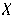 是一个取有限个值的离散随机变量，其概率分布为：

<!-- source-block:399 -->
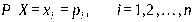

<!-- source-block:400 -->
随机变量 的熵定义为：

<!-- source-block:401 -->
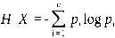

<!-- source-block:402 -->
**条件熵(H(Y∣X))：**

<!-- source-block:403 -->
条件熵(H(Y∣X))表示在已知随机变量X的条件下随机变量Y的不确定性，其定义为X在给定条件下Y的条件概率分布的熵对X的数学期望：

<!-- source-block:404 -->
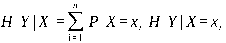

<!-- source-block:405 -->
#### 什么是ID3算法？

<!-- source-block:406 -->
ID3算法在决策树各个节点上应用信息增益选择特征，递归地构建决策树。具体方法是：从根节点开始，计算所有可能的信息增益，选择信息增益最大的特征作为节点特征，由该特征的不同取值建立子节点，再依次对子节点进行上述操作，直到所有特征信息增益均很小或无特征可选为止，最终生成一颗决策树。

<!-- source-block:407 -->
信息增益：定义为集合D的经验熵H(D)与特征A给定条件下D的经验条件熵H(D\|A)之差，表示由于特征A使得对数据集D的分类的不确定性减少的程度。

<!-- source-block:408 -->
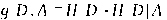

<!-- source-block:409 -->
#### \*\*什么是信息增益率？它比信息增益的优势在哪？

<!-- source-block:410 -->
特征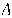 对训练数据集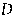 的信息增益率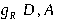 定义为信息增益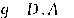 与训练数据集 关于特征 的值的熵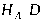 之比：

<!-- source-block:411 -->
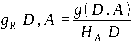

<!-- source-block:412 -->
在使用信息增益的时候，如果某个特征有很多取值，使用这个取值多的特征会的大的信息增益，这个问题是出现很多分支，将数据划分更细，模型复杂度高，出现过拟合的机率更大。使用信息增益比就是为了解决偏向于选择取值较多的特征的问题。使用信息增益比对取值多的特征加上的惩罚，对这个问题进行了校正。

<!-- source-block:413 -->
#### 什么是CART算法？

<!-- source-block:414 -->
CART决策树是一棵二叉树，根据基尼指数生成决策树，对训练数据集 的每个特征 的每一个可能的取值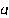 ，计算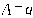 时的基尼指数，选择基尼指数最小的特征及其对应的切分点作为最优特征与最优切分点，并生成两个子节点，将训练数据集依特征分配到两个子节点中。重复上述过程，直到节点中样本数小于阈值、或样本集的基尼指数小于阈值、或没有个更多特征。

<!-- source-block:415 -->
基尼指数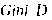 表示集合 的不确定性，基尼指数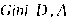 表示经 划分后集合 的不确定性。如果样本集合 根据特征 是否取某一可能值 被划分为两个子集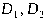 ，则在特征 的条件下，集合 的基尼指数：

<!-- source-block:416 -->
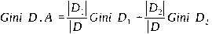

<!-- source-block:417 -->
#### 决策树怎么剪枝？

<!-- source-block:418 -->
为了避免过拟合，可以对已生成的决策树进行剪枝：从决策树上裁掉一些子树或叶节点，并将其根节点或父节点作为新的叶节点，从而简化模型，使模型在测试数据上变现良好，更加鲁棒。

<!-- source-block:419 -->
决策树的剪枝通常分为预剪枝（Pre-Pruning）和后剪枝（Post-Pruning）。

<!-- source-block:420 -->
预剪枝是在决策树生成过程中，通过设置一些限制条件提前停止树的生长，避免过度分裂。

<!-- source-block:421 -->
后剪枝是在决策树完全生成之后，基于某种评估准则从底部向上逐步判断是否移除分支。

<!-- source-block:422 -->
### 支持向量机

<!-- source-block:423 -->
#### 什么是SVM？简述其原理。

<!-- source-block:424 -->
支持向量机（Support Vector Machines，SVM）是一种二分类模型。其核心目标是寻找一个“间隔最大”的超平面将不同类别的数据点分隔开。这个超平面在二维空间中是一条直线，在三维空间中是一个平面，在更高维空间中则是一个超平面。

<!-- source-block:425 -->
间隔最大代表该超平面与最近的数据点之间的距离最大，这使得支持向量机有较强的泛化能力。

<!-- source-block:426 -->
#### SVM 为什么采用间隔最大化

<!-- source-block:427 -->
当训练数据线性可分时，存在无穷个分离超平面可以将两类数据正确分开。感知机利用误分类最小策略，求得分离超平面，不过此时的解有无穷多个。线性可分支持向量机利用间隔最大化求得最优分离超平面，这时，解是唯一的。另一方面，此时的分隔超平面所产生的分类结果是最鲁棒的，对未知实例的泛化能力最强。

<!-- source-block:428 -->
#### 什么是SVM中的硬间隔、软间隔？

<!-- source-block:429 -->
**硬间隔**

<!-- source-block:430 -->
当训练样本线性可分时，此时可以通过最大化硬间隔来学习线性可分支持向量机。硬间隔是指超平面能够将不同类的样本完全划分开。距离超平面最近的几个样本点称为支持向量，它们直接决定超平面的位置和方向，只要支持向量不变，超平面就不会变。

<!-- source-block:431 -->
定义函数间隔，令所有样本点满足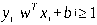 ，找到具有最大间隔的超平面。相应的分类函数称为线性可分支持向量机。

<!-- source-block:432 -->
**软间隔**

<!-- source-block:433 -->
对于线性不可分的样本点，可以对每个样本点引进一个松弛变量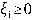 ，使得函数间隔加上松弛变量≥1。这时约束条件变为：

<!-- source-block:434 -->
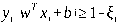

<!-- source-block:435 -->
这时的间隔约束条件被放宽，被称为“软间隔”。相应的分类函数称为（软间隔）线性支持向量机。

<!-- source-block:436 -->
#### \*\*为什么 SVM 要引入核函数？

<!-- source-block:437 -->
原始空间线性不可分，可以使用一个非线性映射将原始数据变换到另一个高维特征空间，在这个空间中，样本变得线性可分，将原本的非线性问题转换为线性问题。

<!-- source-block:438 -->
使用核技巧学习非线性支持向量机，等价于隐式地在高维特征空间中学习线性支持向量机。

<!-- source-block:439 -->
### 集成学习

<!-- source-block:440 -->
#### 什么是集成学习？

<!-- source-block:441 -->
集成学习（Ensemble Learning）通过某种策略组合多个个体学习器的预测结果来提高整体的预测能力。

<!-- source-block:442 -->
只包含同种类型的个体学习器的集成称为同质集成，同质集成中的个体学习器亦称基学习器，相应的学习算法称为基学习算法。包含不同类型的个体学习器的集成称为异质集成。

<!-- source-block:443 -->
#### 什么是Boosting，有哪些常见的Boosting方法？

<!-- source-block:444 -->
Boosting（提升方法）按顺序训练模型，每一步产生一个弱预测模型（如决策树），并加权累加到总模型中加权累加到总模型中；可以用于回归和分类问题，主要关注于降低偏差。

<!-- source-block:445 -->
经典Boosting算法包括：

<!-- source-block:446 -->
- AdaBoost：通过给错分的样本更大的权重，逐步改进；

<!-- source-block:447 -->
- 梯度提升树（GBDT）：用梯度下降法优化损失函数；

<!-- source-block:448 -->
- XGBoost和LightGBM：高效的梯度提升树变种。

<!-- source-block:449 -->
#### 什么是自适应提升（AdaBoost）？

<!-- source-block:450 -->
AdaBoost（Adaptive Boosting，自适应提升）是一种提升方法，将多个弱分类器，组合成强分类器。 Adaboost既可以用作分类，也可以用作回归。

<!-- source-block:451 -->
具体方法是，提高被前一轮弱分类器错误分类的样本的权重，降低被正确分类的样本的权重。这样一来后一轮弱学习器会更加关注那些没有被正确分类的数据。同时采用加权多数表决的方法，加大分类误差率小的弱分类器的权重，减小分类误差率大的弱分类器的权重。

<!-- source-block:452 -->
#### 什么是Bagging方法？

<!-- source-block:453 -->
Bagging（Bootstrap Aggregating，自助聚合）从原始数据集中通过有放回的对样本采样生成多个子数据集，分别训练多个独立模型，最后通过投票（分类）或平均（回归）得到结果。Bagging主要关注于降低方差。

<!-- source-block:454 -->
#### 什么是随机森林？

<!-- source-block:455 -->
随机森林是Bagging的一个变体，在以决策树为基学习器构建Bagging集成的基础上，进一步在决策树训练过程中引入了随机属性（特征）选择。
