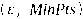
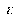
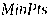
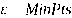

---
tags:
  - 大模型
  - 面试
source: "尚硅谷大模型技术之高频面试题-V2.1.6.docx"
source_blocks: "456-489"
reviewed: 2026-10-21
---

# 聚类、降维与表示空间

聚类结果来自距离与密度假设，降维结果来自保留信息的目标。

前篇：[[知识点总结/80-资料与复习/81-面试知识库/08-大模型高频面试题/01-Python与机器学习/08-决策树、SVM与集成学习|决策树、SVM与集成学习]] ｜ 后篇：[[知识点总结/80-资料与复习/81-面试知识库/08-大模型高频面试题/02-模型原理与训练/01-神经网络、激活函数与训练过程|神经网络、激活函数与训练过程]]

## 深入理解（新增）

K-Means 倾向找到欧氏空间中的近球形簇，初始化与异常点会影响结果；DBSCAN 依赖密度阈值，密度差异较大或高维空间中不一定可靠。“不需要标签”不等于“不需要业务验证”。

PCA 用训练集中心化后的最大方差方向建立线性子空间。最大方差不等于最大预测信息：低方差特征也可能决定标签。因此应把降维放入完整验证流程，并保存均值与投影基供新样本使用。

t-SNE 的二维邻近关系适合探索局部结构，不能随意把图中簇间距离解释为语义距离，也不能默认得到可稳定服务新样本的变换。可视化看起来分开，与检索或分类效果提升是两种证据。


## 核心代码（新增）

以下是可在 CPU 运行的机制或业务契约示例，完整源码与测试见 [[知识点总结/80-资料与复习/81-面试知识库/08-大模型高频面试题/06-代码实验/01-核心代码实验与验证范围|核心代码实验与验证范围]]。示例不包含完整模型训练或外部平台部署。

```python
import numpy as np

def fit_pca(train, components=2):
    mean = train.mean(axis=0)
    _, singular_values, vt = np.linalg.svd(train - mean, full_matrices=False)
    basis = vt[:components].T
    return mean, basis, singular_values

train = np.array([[1., 2.], [2., 4.], [3., 6.]])
mean, basis, singular_values = fit_pca(train, components=1)
projection = (train - mean) @ basis
```

## 追问与验证（新增）

改变训练集均值但固定测试集，观察投影变化；再解释为什么不能用完整数据先拟合 PCA 再切分。

## 官方资料与论文

- [scikit-learn：常见陷阱与数据泄漏](https://scikit-learn.org/stable/common_pitfalls.html)

核验日期：2026-10-21。链接中的 `stable`、`main` 或平台文档会继续变化；新增纯 Python/NumPy 实验与原文旧版框架代码已分开标注。

## 原文保留

> [!warning] 原文批注
> PCA 保留方差而非保证保留任务信息；t-SNE 图的视觉分离不能直接证明模型泛化。

<!-- source-block:456 -->
### 聚类方法

<!-- source-block:457 -->
#### \*\*简述聚类的原理和常见算法。

<!-- source-block:458 -->
聚类（Clustering）旨在将数据集中的样本分成若干个簇，使得同一个簇内的对象彼此相似，不同簇间的对象差异较大。聚类是一种无监督学习算法，不需要预先标记数据的标签，完全依赖数据本身内在结构和特征来进行分组，最终簇所对应的概念语义需由使用者来把握和命名。

<!-- source-block:459 -->
常见的聚类算法有：

<!-- source-block:460 -->
- 均值聚类：如K-means

<!-- source-block:461 -->
- 层次聚类：聚合聚类和分裂聚类

<!-- source-block:462 -->
- 密度聚类：如DBSCAN

<!-- source-block:463 -->
#### 什么是K-means？

<!-- source-block:464 -->
**K均值聚类（K-means）**

<!-- source-block:465 -->
K均值聚类（K-means）是无监督学习中最经典的聚类算法，核心是将样本划分为K个簇，使簇内样本相似度高，簇间相似度低，基于欧式距离衡量相似度，目标是最小化簇内样本到其簇中心的距离平方和（SSE）。

<!-- source-block:466 -->
**K-means步骤：**

<!-- source-block:467 -->
**初始化：随机选取数据集中K个样本作为初始簇中心（质心）。**

<!-- source-block:468 -->
**样本分配：计算所有样本到K个质心的欧式距离，将每个样本分配到最近的簇。**

<!-- source-block:469 -->
**质心更新：计算每个簇内所有样本的特征均值，作为簇的新的质心。**

<!-- source-block:470 -->
**停止迭代：重复步骤2-3次，若质心无变化/变化小于设定的阈值，或达到最大迭代次数，停止迭代。**

<!-- source-block:471 -->
#### K-means的K值的如何选取？

<!-- source-block:472 -->
K-means算法要求事先知道数据集能分为几群，主要有两种方法定义K。

<!-- source-block:473 -->
- 肘部法：通过绘制K和损失函数（聚类质量指标）的关系图，选拐点处的K值。

<!-- source-block:474 -->
- 经验选取：人工根据经验先定几个K，多次随机初始化中心选经验上最适合的。

<!-- source-block:475 -->
应用通常都是经验选取，因为实际操作中拐点往往不明显，且肘部法效率不高。

<!-- source-block:476 -->
#### 简述密度聚类算法DBSCAN。

<!-- source-block:477 -->
DBSCAN 是 一 种 著 名 的 密 度 聚 类 算 法 ， 基 于 一 组 邻 域 参 数 进行刻画，核心概念包括 邻域，核心对象（邻域内至少包含 个对象），密度直达，密度可达，密度相连。

<!-- source-block:478 -->
基于这些概念，DBSCAN将簇定义为由密度可达关系导出的最大密度相连样本集合。DBSCAN先根据邻域参数（ ）找出所有核心对象，再以任一核心对象为出发点找出由其密度可达的样本生成一个簇，直到所有核心对象均被访问过为止。

<!-- source-block:479 -->
### 降维方法

<!-- source-block:480 -->
#### 什么是降维？

<!-- source-block:481 -->
把一个多因素问题转化成一个较少因素（降低问题的维数）问题，而且较容易进行合理安排，找到最优点或近似最优点，以期达到满意结果的方法。

<!-- source-block:482 -->
在特征工程中，当数据集的特征数量非常大时，特征降维可以帮助减少计算复杂度并避免过拟合。通过降维方法，可以在保持数据本质的情况下减少特征的数量。

<!-- source-block:483 -->
#### 降维的作用是什么？

<!-- source-block:484 -->
- 降维可以缓解维度灾难问题

<!-- source-block:485 -->
- 降维可以在压缩数据的同时，让信息损失最小化

<!-- source-block:486 -->
- 降维后的数据，可解释性更强，对于2、3维的数据可以通过可视化直观理解

<!-- source-block:487 -->
#### 什么是主成分分析（PCA）？

<!-- source-block:488 -->
PCA 是一种无监督降维方法，通过线性变换将高维数据映射到低维空间，同时保留数据中方差最大的方向（主成分）。其原理是最大化投影后的方差，同时去除冗余特征，减少计算复杂度。主成分彼此正交并且能够最大化地保留原始数据的方差信息。主成分分析主要用于降维和发现数据的基本结构。

<!-- source-block:489 -->
传统的主成分分析通过协方差矩阵或相关矩阵的特征值分解进行；现在常用的方法是通过奇异值分解（SVD）进行主成分分析，可以避免计算协方差矩阵或相关矩阵，可以提高计算效率。
