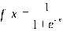
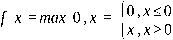
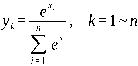

---
tags:
  - 大模型
  - 面试
source: "尚硅谷大模型技术之高频面试题-V2.1.6.docx"
source_blocks: "490-545"
reviewed: 2026-10-21
---

# 神经网络、激活函数与训练过程

训练是计算图上的数值优化，推理是使用确定参数执行前向计算。

前篇：[[知识点总结/80-资料与复习/81-面试知识库/08-大模型高频面试题/01-Python与机器学习/09-聚类、降维与表示空间|聚类、降维与表示空间]] ｜ 后篇：[[知识点总结/80-资料与复习/81-面试知识库/08-大模型高频面试题/02-模型原理与训练/02-学习率、正则化与泛化能力|学习率、正则化与泛化能力]]

## 深入理解（新增）

线性层、非线性激活与损失共同决定模型能表达什么、梯度如何流动。多个没有非线性的线性层仍可合并为一个线性变换；深度本身不自动带来更强表达。

反向传播计算损失对各参数的导数，优化器据此更新参数。梯度累计会把多个 micro batch 的梯度合并，但需按实际有效样本或 token 数归一化；只按固定步数平均在变长序列上可能改变权重。

Softmax 应先减去每行最大值，避免指数溢出。训练时通常直接使用接受 logits 的交叉熵，而非手动 softmax 后再取对数。Dropout、BatchNorm 等层的训练和推理行为不同，评估时必须切换模式。


## 核心代码（新增）

以下是可在 CPU 运行的机制或业务契约示例，完整源码与测试见 [[知识点总结/80-资料与复习/81-面试知识库/08-大模型高频面试题/06-代码实验/01-核心代码实验与验证范围|核心代码实验与验证范围]]。示例不包含完整模型训练或外部平台部署。

```python
import numpy as np

def softmax(logits):
    maximum = np.max(logits, axis=-1, keepdims=True)
    if not np.all(np.isfinite(maximum)):
        raise ValueError("every row must have an unmasked finite value")
    weights = np.exp(logits - maximum)
    return weights / weights.sum(axis=-1, keepdims=True)

assert np.allclose(softmax(np.array([1., 2.])),
                   softmax(np.array([10001., 10002.])))
```

## 追问与验证（新增）

给 logits 整体加 10000，确认概率不变；解释为什么这也是 softmax 数值稳定实现应满足的不变量。

## 官方资料与论文

- [Attention Is All You Need](https://arxiv.org/abs/1706.03762)

核验日期：2026-10-21。链接中的 `stable`、`main` 或平台文档会继续变化；新增纯 Python/NumPy 实验与原文旧版框架代码已分开标注。

## 原文保留

> [!warning] 原文批注
> 激活函数选择需要结合梯度、数值范围和架构验证；不存在对所有网络都最优的一种激活函数。

<!-- source-block:490 -->
### 深度学习

<!-- source-block:491 -->
#### 深度学习基础概念

<!-- source-block:492 -->
##### 什么是深度学习？与传统机器学习的核心区别是什么？

<!-- source-block:493 -->
深度学习是机器学习的子领域，通过多层神经网络（深度神经网络）自动提取数据的多层次特征，处理图像、文本等复杂非结构化数据。

<!-- source-block:494 -->
核心区别：传统机器学习依赖人工设计特征，而深度学习通过多层网络自动学习特征；深度学习对数据量和计算资源需求更高，擅长处理高维非结构化数据。

<!-- source-block:495 -->
##### 神经网络的基本构成是什么？

<!-- source-block:496 -->
由神经元、层和连接权重组成：

<!-- source-block:497 -->
- 神经元：接收输入信号，加权求和后通过激活函数输出。

<!-- source-block:498 -->
- 层：输入层（接收原始数据）、隐藏层（特征转换）、输出层（输出预测结果）。

<!-- source-block:499 -->
- 连接权重：层间神经元的可学习参数，决定信号传递强度。

<!-- source-block:500 -->
#### 激活函数

<!-- source-block:501 -->
##### \*\*激活函数的作用是什么？为什么必须是非线性的？

<!-- source-block:502 -->
作用：为神经网络引入非线性，使模型能拟合复杂的非线性关系。

<!-- source-block:503 -->
必要性：若激活函数为线性，多层网络会退化为单层线性模型，无法学习复杂模式。

<!-- source-block:504 -->
##### Sigmoid 函数的公式及优缺点是什么？

<!-- source-block:505 -->
公式：

<!-- source-block:506 -->


<!-- source-block:507 -->
- 优点：平滑可导，输出映射到 (0,1)，适合二分类输出层。

<!-- source-block:508 -->
- 缺点：易梯度消失（输入绝对值较大时导数接近 0）；输出非零中心，导致后续层的输入始终为正，影响后续梯度更新方向。

<!-- source-block:509 -->
##### ReLU 函数的公式及优缺点是什么？

<!-- source-block:510 -->
公式：

<!-- source-block:511 -->


<!-- source-block:512 -->
- 优点：计算高效，缓解梯度消失；引入稀疏性，减少过拟合风险。

<!-- source-block:513 -->
- 缺点：输入为负时，会出现“神经元死亡”问题（输出恒为 0）。

<!-- source-block:514 -->
##### Softmax 函数的公式及作用是什么？

<!-- source-block:515 -->
公式：

<!-- source-block:516 -->


<!-- source-block:517 -->
作用：将一个任意的实数向量转换为一个概率分布，确保输出值的总和为1,是二分类激活函数Sigmoid在多分类上的推广。Softmax常用于多分类问题的输出层，用来表示类别的预测概率。

<!-- source-block:518 -->
##### 实际任务中应该如何选择激活函数？

<!-- source-block:519 -->
- 二分类输出层：Sigmoid；

<!-- source-block:520 -->
- 多分类输出层：Softmax；

<!-- source-block:521 -->
- 卷积/浅层网络：ReLU。

<!-- source-block:522 -->
##### ReLU 在 0 处不可导，为什么还能使用？

<!-- source-block:523 -->
0 处不可导是因为存在多个可能的切线，但实际中输入为 0 的概率极低。通常默认取一个梯度值（如0），不影响整体训练。

<!-- source-block:524 -->
##### \*\*为什么神经网络常用 ReLU 作为激活函数？

<!-- source-block:525 -->
- 计算效率高于 Sigmoid、Tanh；

<!-- source-block:526 -->
- 有效避免梯度消失（正区间导数为 1）；

<!-- source-block:527 -->
- 引入稀疏性，缓解过拟合，提升了模型的泛化性能。

<!-- source-block:528 -->
- 有助于随机梯度下降方法收敛。

<!-- source-block:529 -->
#### 神经网络的训练

<!-- source-block:530 -->
##### 损失函数的作用是什么？神经网络中，分类和回归任务常用的损失函数有哪些？

<!-- source-block:531 -->
作用：衡量预测值与真实值的差异，是参数优化的目标函数。

<!-- source-block:532 -->
- 分类任务：二元交叉熵（BCE，二分类）、多分类交叉熵（CrossEntropy，多分类）。

<!-- source-block:533 -->
- 回归任务：均方误差（MSE）、平均绝对误差（MAE）、Smooth L1。

<!-- source-block:534 -->
##### \*\*反向传播算法的原理是什么？

<!-- source-block:535 -->
基于微积分的链式法则，从输出层到输入层反向计算损失函数对各参数的梯度：

<!-- source-block:536 -->
- 首先前向传播：计算输入经各层后的输出及损失。

<!-- source-block:537 -->
- 然后反向传播：从输出层开始，逐层反向传递梯度，并更新参数（权重和偏置）。

<!-- source-block:538 -->
该算法存储了计算某些参数梯度时所需的任何中间变量。

<!-- source-block:539 -->
核心目的：高效计算梯度，为参数优化提供依据。

<!-- source-block:540 -->
##### 如何评估深度学习模型的性能？

<!-- source-block:541 -->
- 分类任务：准确率、精确率、召回率、F1 分数、ROC-AUC。

<!-- source-block:542 -->
- 回归任务：均方误差（MSE）、平均绝对误差（MAE）、R²。

<!-- source-block:543 -->
评价模型的泛化能力：在测试集上的表现，结合交叉验证。

<!-- source-block:544 -->
##### 什么是早停法（Early Stopping）？作用是什么？

<!-- source-block:545 -->
当验证集损失不再下降时停止训练，避免模型过度拟合训练数据，节省计算资源。
