---
tags:
  - 大模型
  - 面试
source: "尚硅谷大模型技术之高频面试题-V2.1.6.docx"
source_blocks: "546-652"
reviewed: 2026-10-21
---

# 学习率、正则化与泛化能力

区分降低训练损失、控制更新幅度和改善泛化这三个目标。

前篇：[[知识点总结/80-资料与复习/81-面试知识库/08-大模型高频面试题/02-模型原理与训练/01-神经网络、激活函数与训练过程|神经网络、激活函数与训练过程]] ｜ 后篇：[[知识点总结/80-资料与复习/81-面试知识库/08-大模型高频面试题/02-模型原理与训练/03-文本表示、序列模型与Attention|文本表示、序列模型与Attention]]

## 深入理解（新增）

学习率决定参数更新的尺度。Warmup 可减轻训练初期梯度统计尚不稳定的问题，但不能修复错误标签、错误损失或过大的数据偏差。比较调度器时应固定训练 token 预算，而不只比较 epoch 数。

L2 惩罚与解耦权重衰减在某些优化器下并不等价。Dropout、早停和数据增强也通过不同机制作用，叠加更多正则化可能造成欠拟合。应同时检查训练曲线、验证曲线和不同数据切片。

梯度裁剪限制梯度范数，用于抑制异常更新；它不能保证每个参数的更新都小，也不能替代数值溢出排查。混合精度时通常应先 unscale 再 clip，否则裁剪阈值作用在放大后的梯度上。


## 核心代码（新增）

以下是可在 CPU 运行的机制或业务契约示例，完整源码与测试见 [[知识点总结/80-资料与复习/81-面试知识库/08-大模型高频面试题/06-代码实验/01-核心代码实验与验证范围|核心代码实验与验证范围]]。示例不包含完整模型训练或外部平台部署。

```python
import numpy as np

def causal_lm_loss(logits, labels):
    # Input shape: [batch, tokens, vocab]; prompt/pad labels are already -100.
    shifted_logits, shifted_labels = logits[:, :-1, :], labels[:, 1:]
    valid = shifted_labels != -100
    if not valid.any():
        raise ValueError("no supervised response tokens")
    selected_logits, targets = shifted_logits[valid], shifted_labels[valid]
    log_z = np.logaddexp.reduce(selected_logits, axis=-1)
    selected = selected_logits[np.arange(len(targets)), targets]
    return float((log_z - selected).mean())

logits = np.zeros((1, 4, 5))
labels = np.array([[-100, -100, 2, 3]])
assert np.isclose(causal_lm_loss(logits, labels), np.log(5))
```

## 追问与验证（新增）

对相同样本分别加不同数量的 padding，使用 -100 掩码后比较损失，确认损失没有被无效 token 稀释。

## 官方资料与论文

- [PyTorch AMP 官方示例](https://docs.pytorch.org/tutorials/recipes/recipes/amp_recipe.html)

核验日期：2026-10-21。链接中的 `stable`、`main` 或平台文档会继续变化；新增纯 Python/NumPy 实验与原文旧版框架代码已分开标注。

## 原文保留

> [!warning] 原文批注
> AdamW 的解耦权重衰减不应简单等同于把 L2 项加入任意优化器的损失。
>
> 下面 loss 用于说明有效 token 归一化，不是学习率调度器或 AdamW 的完整实现。

<!-- source-block:546 -->
### 神经网络的超参数

<!-- source-block:547 -->
#### 神经网络中包含哪些超参数？

<!-- source-block:548 -->
通常可以将超参数分为三类：网络参数、优化参数、正则化参数。

<!-- source-block:549 -->
- 网络参数：可以包括网络层与层之间的交互方式（相加、相乘或者串接等）、卷积核数量和卷积核尺寸、网络层数（也称深度）和激活函数等。

<!-- source-block:550 -->
- 优化参数：一般指学习率、批样本数量（batch size）、不同优化器的参数以及部分损失函数的可调参数。

<!-- source-block:551 -->
- 正则化：权重衰减系数，随机失活（dropout）丢弃比例

<!-- source-block:552 -->
#### 学习率过大或过小会有什么问题？如何设置学习率？

<!-- source-block:553 -->
**学习率过大过小问题**

<!-- source-block:554 -->
- 过大：可能在最小值附近震荡，甚至不收敛（损失爆炸）。

<!-- source-block:555 -->
- 过小：收敛速度极慢，可能陷入局部最优。

<!-- source-block:556 -->
**设置学习率方法：**

<!-- source-block:557 -->
- 基于经验调整：初始尝试 0.1、0.01、0.001 等，根据损失变化调整，可以通过交叉验证确认；

<!-- source-block:558 -->
- 基于策略调整：使用学习率衰减策略（如指数衰减、阶梯衰减）。

<!-- source-block:559 -->
#### \*\*batch size 的选择对模型训练有何影响？

<!-- source-block:560 -->
- 过小：梯度估计噪声大，训练不稳定，可能难以收敛。

<!-- source-block:561 -->
- 过大：梯度估计稳定，但内存消耗高，可能陷入局部最优。

<!-- source-block:562 -->
常用值：32、64、128，需平衡内存和训练效果。

<!-- source-block:563 -->
#### \*\*神经网络调参，具体有哪些方向？

<!-- source-block:564 -->
- 训练样本数据是否均衡，是否处理完成。

<!-- source-block:565 -->
- 超参数：如学习率，batch\_size，epochs等。

<!-- source-block:566 -->
- 损失函数以及激活函数选择。

<!-- source-block:567 -->
- 是否选择合适的优化器以及是否做归一化。

<!-- source-block:568 -->
- 是否做预防过拟合措施如：早停等。

<!-- source-block:569 -->
### 神经网络的优化（学习的技巧）

<!-- source-block:570 -->
#### \*\*什么是梯度消失和梯度爆炸？如何解决？

<!-- source-block:571 -->
**什么是梯度消失和梯度爆炸？**

<!-- source-block:572 -->
- 梯度消失：深层网络中，梯度反向传播时经多层传递后趋近于 0，导致浅层参数难以更新，学习无法进行。

<!-- source-block:573 -->
- 梯度爆炸：梯度反向传播时经多层传递后急剧增大，导致网络不稳定。

<!-- source-block:574 -->
**解决方法：**

<!-- source-block:575 -->
使用 ReLU 激活函数、梯度裁剪（针对梯度爆炸）、合理初始化权重、改变网络结构（如引入BN层、残差连接、LSTM等）。

<!-- source-block:576 -->
#### 如何判断出现了梯度爆炸？

<!-- source-block:577 -->
- 模型不稳定，导致更新过程中的损失出现显著变化；

<!-- source-block:578 -->
- 训练过程中模型梯度快速变大；

<!-- source-block:579 -->
- 训练过程中模型权重变成 NaN 值；

<!-- source-block:580 -->
- 训练过程中，每个节点和层的误差梯度值持续超过 1.0。

<!-- source-block:581 -->
#### \*\*梯度下降法（优化器）合集！！！

<!-- source-block:582 -->
**SGD**

<!-- source-block:583 -->
随机使用单个样本计算梯度，速度快但震荡剧烈。

<!-- source-block:584 -->
更新公式：

<!-- source-block:585 -->
- 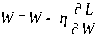

<!-- source-block:586 -->
W 是要更新的权重参数，损失函数关于L的梯度就是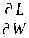 ，η是学习率。

<!-- source-block:587 -->
**Momentum**

<!-- source-block:588 -->
引入历史梯度加权和，缓解震荡，加速收敛。

<!-- source-block:589 -->
更新公式：

<!-- source-block:590 -->
- 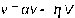

<!-- source-block:591 -->
- 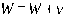

<!-- source-block:592 -->
- v:历史（负）梯度的加权和

<!-- source-block:593 -->
- α:历史梯度的权重

<!-- source-block:594 -->
- ▽：当前梯度，即

<!-- source-block:595 -->
**AdaGrad**

<!-- source-block:596 -->
引入历史梯度平方和作为衰减系数，为每个参数自适应调整学习率，适合稀疏数据。

<!-- source-block:597 -->
更新公式：

<!-- source-block:598 -->
- 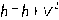 （h:表示历史梯度的平方和）

<!-- source-block:599 -->
- 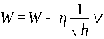

<!-- source-block:600 -->
**RMSProp**

<!-- source-block:601 -->
改进 AdaGrad，对历史梯度做指数移动平均，避免学习率过早衰减。

<!-- source-block:602 -->
更新公式：

<!-- source-block:603 -->
- 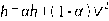

<!-- source-block:604 -->
- 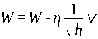

<!-- source-block:605 -->
- h:历史梯度平方和的指数移动加权平均；

<!-- source-block:606 -->
- α：权重。

<!-- source-block:607 -->
**Adam**

<!-- source-block:608 -->
融合 Momentum 和 RMSProp，动态调整学习率，适用于多数场景。

<!-- source-block:609 -->
更新公式：

<!-- source-block:610 -->
- 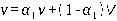

<!-- source-block:611 -->
- 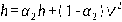

<!-- source-block:612 -->
- 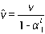

<!-- source-block:613 -->
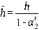

<!-- source-block:614 -->
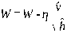

<!-- source-block:615 -->
- 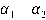 ：一次动量系数和二次动量系数

<!-- source-block:616 -->
- 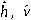 ：分别是二阶矩估计矫正和一阶矩估计矫正

<!-- source-block:617 -->
#### 为什么 Adam 在实际中常用？与 SGD 相比有何优势？

<!-- source-block:618 -->
Adam 结合了动量（Momentum）和自适应学习率（RMSProp），收敛稳定且速度快，对超参数敏感低；SGD 需精细调参，但在精调后可能取得更好的最终性能。

<!-- source-block:619 -->
#### 为什么 Adam + L2正则化效果不好？AdamW是如何解决的？

<!-- source-block:620 -->
**Adam + L2问题**

<!-- source-block:621 -->
直接把 L2 正则化项 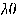 加入梯度，梯度会被二阶矩估计（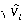 ）缩放，导致正则化强度不再固定，而是随训练过程动态衰减，从而失去“稳定收缩权重”的作用。

<!-- source-block:622 -->
**AdamW解决方案**

<!-- source-block:623 -->
AdamW把权重衰减不作用于损失函数，在参数更新阶段额外加上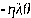 ，不再依赖二阶矩缩放，更加稳定。

<!-- source-block:624 -->
AdamW对比Adam最大的改动就是将权重衰减于自适应学习率机制正确解耦。

<!-- source-block:625 -->
Adam权重衰减位置被整合到梯度计算，而AdamW权重衰减被施加到真正的权重本身。

<!-- source-block:626 -->
#### 权重初始化的重要性是什么？为什么不能将权重初始化为 0？

<!-- source-block:627 -->
重要性：合理初始化可避免梯度消失 / 爆炸，加速收敛。

<!-- source-block:628 -->
零初始化问题：导致所有神经元更新一致（对称权重），网络失去表达能力。

<!-- source-block:629 -->
#### 常用的权重初始化方法有哪些？

<!-- source-block:630 -->
- 随机正态分布初始化；

<!-- source-block:631 -->
- 均匀分布初始化；

<!-- source-block:632 -->
- Xavier 初始化（针对 Sigmoid/Tanh）；

<!-- source-block:633 -->
- He 初始化（针对 ReLU）。

<!-- source-block:634 -->
#### \*\*Xavier 初始化和 He 初始化的适用场景是什么？

<!-- source-block:635 -->
Xavier 初始化：适用于 Sigmoid、Tanh 等激活函数，使输入和输出方差相近。

<!-- source-block:636 -->
He 初始化：适用于 ReLU 及其变体，考虑 ReLU 对负输入的抑制，初始化方差更大。

<!-- source-block:637 -->
#### 神经网络中有哪些正则化技术？

<!-- source-block:638 -->
神经网络中，用来抑制过拟合的技术都被称为正则化技术，包括：批量标准化（Batch Normalization，BN）、权值衰减（L1或L2正则化）、Dropout、早停法、数据增强等。

<!-- source-block:639 -->
#### 什么是批量标准化（Batch Normalization，BN）？作用是什么？

<!-- source-block:640 -->
批量标准化（BN，也称批量归一化），就是对每批数据标准化（均值 0、方差 1），再通过可学习参数缩放和平移。

<!-- source-block:641 -->
作用：稳定各层输入分布，允许更高学习率；减少过拟合；降低对初始化的敏感度。

<!-- source-block:642 -->
#### BN 层在训练和测试时有何区别？

<!-- source-block:643 -->
训练时：使用当前批次的均值和方差。

<!-- source-block:644 -->
测试时：使用训练过程中累积的移动均值和方差，确保结果稳定（没有数据泄露）。

<!-- source-block:645 -->
#### \*\*Dropout 的原理及作用是什么？训练和测试时有何区别？

<!-- source-block:646 -->
原理：训练时随机 “关闭” 部分神经元（如概率 0.5），迫使模型不依赖特定神经元。

<!-- source-block:647 -->
作用：增强模型鲁棒性，减少过拟合；近似集成学习的效果。

<!-- source-block:648 -->
训练时随机丢弃神经元，输出按存活概率缩放；测试时不丢弃，所有神经元参与计算。

<!-- source-block:649 -->
#### \*\*数据增强的目的是什么？常用方法有哪些？

<!-- source-block:650 -->
数据增强是一种通过对现有数据应用一系列操作来人为地增加数据集大小的技术。

<!-- source-block:651 -->
目的：增加数据多样性，减少过拟合，提升模型泛化能力。

<!-- source-block:652 -->
方法：图像（翻转、旋转、缩放、裁剪、平移、加噪声）、文本（同义词替换、句子重排）。
