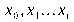
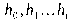
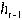
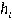
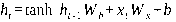

---
tags:
  - 大模型
  - 面试
source: "尚硅谷大模型技术之高频面试题-V2.1.6.docx"
source_blocks: "653-716"
reviewed: 2026-10-21
---

# 文本表示、序列模型与Attention

从词向量过渡到上下文表示，核心是表示会随什么信息变化。

前篇：[[知识点总结/80-资料与复习/81-面试知识库/08-大模型高频面试题/02-模型原理与训练/02-学习率、正则化与泛化能力|学习率、正则化与泛化能力]] ｜ 后篇：[[知识点总结/80-资料与复习/81-面试知识库/08-大模型高频面试题/02-模型原理与训练/04-Transformer、预训练与生成评估|Transformer、预训练与生成评估]]

## 深入理解（新增）

静态词向量把同一词映射到固定向量，无法直接区分多义词在不同语境中的含义；序列模型与 Attention 则让表示依赖上下文。分词方式会改变序列长度、实体边界和训练样本，不能只看模型层数。

Attention 的 Q 表示当前检索需求，K 提供匹配地址，V 提供汇聚内容。这是理解计算的类比，不表示三者有天然固定语义。缩放点积后沿 key 轴归一化，mask 决定哪些位置可以被看到。

因果模型训练时每个位置只能读取当前及过去的输入，防止偷看预测目标。训练阶段可以并行算所有位置，但生成仍通常逐 token 推进。下面代码保留三角 mask，可直接检查未来位置权重是否为零。

### 可编辑公式

$$\operatorname{Attention}(Q,K,V)=\operatorname{softmax}\left(\frac{QK^\top}{\sqrt{d_k}}+M\right)V$$

因果掩码 $M_{ij}=0$ 当 $j\le i$，否则为 $-\infty$；softmax 沿 key 位置归一化。

## 核心代码（新增）

以下是可在 CPU 运行的机制或业务契约示例，完整源码与测试见 [[知识点总结/80-资料与复习/81-面试知识库/08-大模型高频面试题/06-代码实验/01-核心代码实验与验证范围|核心代码实验与验证范围]]。示例不包含完整模型训练或外部平台部署。

```python
import numpy as np

def softmax(logits):
    maximum = np.max(logits, axis=-1, keepdims=True)
    if not np.all(np.isfinite(maximum)):
        raise ValueError("every row must have an unmasked finite value")
    weights = np.exp(logits - maximum)
    return weights / weights.sum(axis=-1, keepdims=True)

def causal_attention(q, k, v):
    if q.shape != k.shape or len(k) != len(v):
        raise ValueError("this teaching example uses equal-length Q and K")
    scores = q @ k.T / np.sqrt(q.shape[-1])
    causal = np.tril(np.ones(scores.shape, dtype=bool))
    weights = softmax(np.where(causal, scores, -np.inf))
    return weights @ v, weights

assert np.allclose(softmax(np.array([1., 2.])),
                   softmax(np.array([10001., 10002.])))

q = np.eye(3)
out, weights = causal_attention(q, q, q)
assert np.all(weights[np.triu_indices(3, k=1)] == 0)
```

## 追问与验证（新增）

修改未来位置的 V，确认前面位置输出不变；这是比仅检查输出形状更强的因果性验证。

## 官方资料与论文

- [Attention Is All You Need](https://arxiv.org/abs/1706.03762)
- [PyTorch scaled_dot_product_attention](https://docs.pytorch.org/docs/stable/generated/torch.nn.functional.scaled_dot_product_attention)

核验日期：2026-10-21。链接中的 `stable`、`main` 或平台文档会继续变化；新增纯 Python/NumPy 实验与原文旧版框架代码已分开标注。

## 原文保留

> [!warning] 原文批注
> Attention 中 softmax 的轴、padding mask 和 causal mask 都是语义约束，形状正确不足以证明实现正确。

<!-- source-block:653 -->
### NLP

<!-- source-block:654 -->
#### 基础概念与任务

<!-- source-block:655 -->
##### \*\*抽取式摘要和生成式摘要存在哪些问题

<!-- source-block:656 -->
抽取式摘要在语法、信息保真度上有一定的保证，在抽取速度、复杂度上面也有一定的优势。但是也面临了一定的问题，例如：内容选择错误、连贯性差、灵活性差等问题。

<!-- source-block:657 -->
生成式摘要优点是相比于抽取式而言用词更加灵活，因为所产生的词可能从未在原文中出现过。但存在以下问题：

<!-- source-block:658 -->
**事实一致性问题：可能产生于原文不符的事实错误**

<!-- source-block:659 -->
**可控性挑战：难以精确控制摘要的风格，长度和重点**

<!-- source-block:660 -->
**长文本摘要生成难度大。对于机器翻译来说，NLG的输入和输出的语素长度大致都在一个量级上，因此NLG在其之上的效果较好。但是对摘要来说，源文本的长度与目标文本的长度通常相差很大，此时就需要encoder很好的将文档的信息总结归纳并传递给decoder，decoder需要完全理解并生成句子。**

<!-- source-block:661 -->
抽取式摘要更适合于新闻报道、法律文件等需要高度忠实原文的场合。而生成式摘要适合于博客文章、社交媒体帖子等需要流畅表达的场合。

<!-- source-block:662 -->
#### 文本表示方法

<!-- source-block:663 -->
##### \*\*Word2Vec 的核心思想？两种模型是什么？

<!-- source-block:664 -->
**核心思想：**

<!-- source-block:665 -->
基于“分布假设”（一个词的含义由其周围词决定），通过神经网络学习稠密词向量，使语义相近的词在向量空间中距离更近。

<!-- source-block:666 -->
**两种模型：**

<!-- source-block:667 -->
- CBOW：输入上下文词，预测中间目标词。

<!-- source-block:668 -->
Skip-gram：输入中心词，预测其上下文词。

<!-- source-block:669 -->
##### 什么是上下文相关词表示？与静态词向量有何区别？

<!-- source-block:670 -->
**上下文相关词表示：**

<!-- source-block:671 -->
词向量随其所在句子的上下文动态变化（如 “苹果” 在 “吃苹果” 和 “苹果公司” 中表示不同），能捕捉多义性和语境差异。

<!-- source-block:672 -->
**区别：**

<!-- source-block:673 -->
静态词向量（如 Word2Vec）为每个词分配固定向量，无法区分多义词；

<!-- source-block:674 -->
上下文相关词表示能动态捕捉词义变化。

<!-- source-block:675 -->
#### 传统序列模型

<!-- source-block:676 -->
##### 什么是词嵌入（Word Embedding）？

<!-- source-block:677 -->
词向量是用于表示单词意义的向量，也可以看作词的特征向量。将词映射到向量的技术就称为词嵌入（Word Embedding）。

<!-- source-block:678 -->
##### 什么是RNN？

<!-- source-block:679 -->
循环神经网络（Recurrent Neural Network，RNN）是一种具有环路结构的神经网络，通过环路数据可以在层内循环。将时序数据 输入层中，相应的会输出 。

<!-- source-block:680 -->
各个时刻的RNN层接收传给该层的输入 和前一个时刻RNN层的输出 ，据此计算当前时刻RNN层的输出 ：

<!-- source-block:681 -->


<!-- source-block:682 -->
##### \*\*RNN 与前馈神经网络的主要区别是什么？适用于什么场景？

<!-- source-block:683 -->
区别：RNN 通过隐藏状态保存历史信息，能处理时序数据；前馈网络无记忆，仅能处理静态数据。

<!-- source-block:684 -->
场景：自然语言处理（文本生成、翻译）、时间序列预测（股价、天气）。

<!-- source-block:685 -->
##### RNN中为什么会出现梯度消失？

<!-- source-block:686 -->
基于链式法则，在反向传播计算梯度时，会导致激活函数导数的累乘，如果取tanh或sigmoid函数作为激活函数的话，由于导数值恒小于1，结果就会越来越小。随着时间序列的不断深入，累乘效应就会导致梯度越来越小直到接近于0，从而出现“梯度消失”。

<!-- source-block:687 -->
实际使用中，RNN会优先选择tanh函数，原因是tanh函数相对于sigmoid函数来说梯度较大，收敛速度更快且引起梯度消失更慢。

<!-- source-block:688 -->
##### 如何解决RNN中的梯度消失问题？

<!-- source-block:689 -->
- 选取更好的激活函数，如Relu激活函数。ReLU函数的左侧导数为0，右侧导数恒为1，这就避免了“梯度消失“的发生。但恒为1的导数又容易导致“梯度爆炸”，通过设定合适的阈值，可以解决这个问题。

<!-- source-block:690 -->
- 加入BN层：其优点是加速收敛，控制过拟合，可以少用或不用Dropout；降低对权重初始值的敏感度，且能允许使用较大的学习率。

<!-- source-block:691 -->
- 改变网络结构：如LSTM结构可以有效解决这个问题。

<!-- source-block:692 -->
##### \*\*LSTM 如何解决 RNN 的长期依赖问题？

<!-- source-block:693 -->
LSTM 引入记忆单元（Memory Cell）和三个门控机制（遗忘门、输入门、输出门）：

<!-- source-block:694 -->
- 遗忘门：控制忘记多少历史信息。

<!-- source-block:695 -->
- 输入门：控制存入多少新信息到记忆单元。

<!-- source-block:696 -->
- 输出门：控制从记忆单元读取多少信息作为当前隐藏状态。

<!-- source-block:697 -->
记忆单元为梯度提供稳定传播路径，缓解梯度消失，从而捕捉长期依赖。

<!-- source-block:698 -->
##### \*\*GRU 与 LSTM 的区别是什么？

<!-- source-block:699 -->
GRU 简化了 LSTM 的结构，取消独立记忆单元，仅保留两个门（重置门，更新门）：

<!-- source-block:700 -->
- 重置门：控制上一时刻的隐藏状态，对当前候选隐藏状态的影响程度。

<!-- source-block:701 -->
- 更新门：控制当前隐藏状态中，上一时刻隐藏状态和候选隐藏状态间的比重。

<!-- source-block:702 -->
优势：参数更少，训练效率更高；在多数任务中性能接近 LSTM。

<!-- source-block:703 -->
#### Seq2Seq 与 Attention 机制

<!-- source-block:704 -->
##### \*\*Seq2Seq 模型结构？有什么缺陷？

<!-- source-block:705 -->
**结构：**

<!-- source-block:706 -->
由编码器（Encoder）和解码器（Decoder）组成。

<!-- source-block:707 -->
编码器一般使用双向RNN等模型，将输入序列压缩为固定长度的上下文向量。

<!-- source-block:708 -->
解码器可基于单向RNN等模型，并结合编码器所输出的上下文向量，生成目标序列。

<!-- source-block:709 -->
**核心问题：**

<!-- source-block:710 -->
固定长度的上下文向量难以承载长序列信息，容易导致信息丢失；

<!-- source-block:711 -->
训练过程无法并行，效率低。

<!-- source-block:712 -->
##### \*\*Attention 机制的工作原理是什么？

<!-- source-block:713 -->
Atttention本质是在解码器在生成序列时，不再仅依靠编码器输出的固定长度的上下文向量，而是动态计算与编码器各时间步隐藏状态的相关性（注意力权重），并加权求和得到上下文向量，实现 “有选择地关注” 输入序列的关键信息。步骤包括：

<!-- source-block:714 -->
- 计算相关性（评分函数：点积、通用点积、拼接）。

<!-- source-block:715 -->
- 归一化得到注意力权重（Softmax）。

<!-- source-block:716 -->
- 加权求和得到上下文向量。
