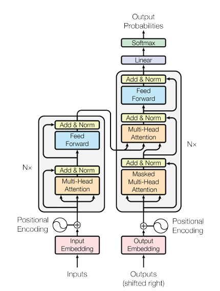
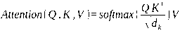

---
tags:
  - 大模型
  - 面试
source: "尚硅谷大模型技术之高频面试题-V2.1.6.docx"
source_blocks: "717-798"
reviewed: 2026-10-21
---

# Transformer、预训练与生成评估

架构、预训练目标和生成策略分别决定模型看见什么、学什么、如何输出。

前篇：[[知识点总结/80-资料与复习/81-面试知识库/08-大模型高频面试题/02-模型原理与训练/03-文本表示、序列模型与Attention|文本表示、序列模型与Attention]] ｜ 后篇：[[知识点总结/80-资料与复习/81-面试知识库/08-大模型高频面试题/02-模型原理与训练/05-大模型架构、归一化与激活层|大模型架构、归一化与激活层]]

## 深入理解（新增）

Encoder 常使用双向上下文，Decoder 自回归部分使用因果上下文；Encoder-Decoder 还通过交叉注意力读取源序列。不要仅凭模型名称判断目标函数，应检查 attention mask、labels 和是否执行 next-token shift。

教师强制训练把真实历史 token 输入模型，而生成时读到的是自身历史输出，二者分布不同。贪心、束搜索、温度采样改变生成策略，并不会改变已经学到的参数；beam 更大也不保证更事实准确。

BLEU、ROUGE 等词面指标有助于固定任务比较，但同义改写、事实错误和多解性会影响解释。摘要任务应额外检查日期、金额、主体与因果关系是否被保留，并用独立样本检验。


## 核心代码（新增）

以下是可在 CPU 运行的机制或业务契约示例，完整源码与测试见 [[知识点总结/80-资料与复习/81-面试知识库/08-大模型高频面试题/06-代码实验/01-核心代码实验与验证范围|核心代码实验与验证范围]]。示例不包含完整模型训练或外部平台部署。

```python
import numpy as np

def softmax(logits):
    maximum = np.max(logits, axis=-1, keepdims=True)
    if not np.all(np.isfinite(maximum)):
        raise ValueError("every row must have an unmasked finite value")
    weights = np.exp(logits - maximum)
    return weights / weights.sum(axis=-1, keepdims=True)

def causal_attention(q, k, v):
    if q.shape != k.shape or len(k) != len(v):
        raise ValueError("this teaching example uses equal-length Q and K")
    scores = q @ k.T / np.sqrt(q.shape[-1])
    causal = np.tril(np.ones(scores.shape, dtype=bool))
    weights = softmax(np.where(causal, scores, -np.inf))
    return weights @ v, weights

assert np.allclose(softmax(np.array([1., 2.])),
                   softmax(np.array([10001., 10002.])))

q = np.eye(3)
out, weights = causal_attention(q, q, q)
assert np.all(weights[np.triu_indices(3, k=1)] == 0)
```

## 追问与验证（新增）

对同一问题固定随机种子比较贪心与采样输出；分别记录事实正确率和文本多样性，不把流畅度当准确率。

## 官方资料与论文

- [Attention Is All You Need](https://arxiv.org/abs/1706.03762)
- [Transformers 生成流程](https://huggingface.co/docs/transformers/main/en/llm_tutorial)

核验日期：2026-10-21。链接中的 `stable`、`main` 或平台文档会继续变化；新增纯 Python/NumPy 实验与原文旧版框架代码已分开标注。

## 原文保留

> [!warning] 原文批注
> 词面重合指标不能单独证明生成文本忠实于原文；生成策略优劣必须绑定具体任务和评估口径。

<!-- source-block:717 -->
### Transformer 模型

<!-- source-block:718 -->
#### \*\*Transformer 的核心创新是什么？与 RNN 相比有何优势？

<!-- source-block:719 -->
**核心创新：**

<!-- source-block:720 -->
- 完全基于自注意力机制建模序列依赖，摒弃 RNN 的循环结构；

<!-- source-block:721 -->
- 使用位置编码注入位置信息；

<!-- source-block:722 -->
- 多头注意力从不同子空间捕捉多种语义关系。

<!-- source-block:723 -->
**优势：**

<!-- source-block:724 -->
- 支持并行计算，训练效率更高；

<!-- source-block:725 -->
- 通过多头注意力捕捉多种语义关系，建模能力更强；

<!-- source-block:726 -->
- 直接建模任意位置的依赖，增强长依赖建模能力；

<!-- source-block:727 -->
- 易于堆叠深层网络。

<!-- source-block:728 -->
#### \*\*Transformer 的编码器和解码器结构分别是什么？

<!-- source-block:729 -->


<!-- source-block:730 -->
**编码器：**

<!-- source-block:731 -->
由 N 个编码器层堆叠而成，每个层包含：

<!-- source-block:732 -->
- 多头自注意力子层（捕捉输入序列内部依赖）。

<!-- source-block:733 -->
- 前馈网络子层（对每个位置独立映射，增加非线性能力）。

<!-- source-block:734 -->
- 残差连接和层归一化（稳定训练）。

<!-- source-block:735 -->
**解码器：**

<!-- source-block:736 -->
由 N 个解码器层堆叠而成，每个层包含：

<!-- source-block:737 -->
- 掩码多头自注意力子层（防止关注未来信息）。

<!-- source-block:738 -->
- 编码器-解码器注意力子层（解码器在生成每个目标词时，动态访问编码器对原始输入序列的全局表示，选择最相关的信息）。

<!-- source-block:739 -->
- 前馈网络子层。

<!-- source-block:740 -->
- 残差连接和层归一化。

<!-- source-block:741 -->
#### \*\*Transformer 中位置编码的作用和实现方式是什么？

<!-- source-block:742 -->
**作用：**

<!-- source-block:743 -->
Transformer 无循环结构。自注意力机制中序列中每个token并行计算，获取到与序列中其他token之间的相关性，无法捕捉到序列相对位置关系，因此需通过位置编码注入词的位置信息，使模型感知序列顺序。

<!-- source-block:744 -->
**实现方式：**

<!-- source-block:745 -->
使用正弦和余弦函数生成位置向量，偶数维用正弦，奇数维用余弦。

<!-- source-block:746 -->
#### \*\*Transformer中自注意层计算公式（新增问题）

<!-- source-block:747 -->
计算公式如下：

<!-- source-block:748 -->


<!-- source-block:749 -->
- Query: 表示当前词的用于发起注意力匹配的向量

<!-- source-block:750 -->
- Key: 表示序列中每个位置的内容标识，用于与 Query 进行匹配

<!-- source-block:751 -->
- Value: 表示该位置携带的信息，用于加权汇总得到新的表示

<!-- source-block:752 -->
- d\_k: key向量的维度。高维空间中，点积的数值可能过大，会影响 softmax 的稳定性，因此在实际计算中对结果进行了缩放

<!-- source-block:753 -->
### 预训练模型

<!-- source-block:754 -->
#### \*\*GPT的结构和预训练目标是什么？

<!-- source-block:755 -->
**结构：**

<!-- source-block:756 -->
基于 Transformer 解码器做了精简调整，移除了编码器和解码器注意力子层（因为模型中不存在编码器）仅保留自注意力和前馈网络子层，堆叠多层。

<!-- source-block:757 -->
**预训练目标：**

<!-- source-block:758 -->
自回归语言建模（给定前文预测下一个词），学习语言统计规律、上下文依赖和语义信息。

<!-- source-block:759 -->
#### \*\*BERT的结构和预训练目标是什么？

<!-- source-block:760 -->
**结构：**

<!-- source-block:761 -->
基于 Transformer 编码器，实现双向语言建模，能同时融合左右上下文信息。

<!-- source-block:762 -->
**预训练目标：**

<!-- source-block:763 -->
掩码语言模型（MLM）：随机遮盖 15% 的词，预测被遮盖的词。

<!-- source-block:764 -->
下一句预测（NSP）：判断两个句子是否为连续的上下文，捕捉句间关系，以学习句间的语义和逻辑关系。

<!-- source-block:765 -->
#### \*\*T5的结构和预训练目标是什么？

<!-- source-block:766 -->
**结构：**

<!-- source-block:767 -->
基于完整 Encoder-Decoder Transformer，编码器将输入文本序列编码成上下文表示，解码器根据编码器输出生成目标文本序列。

<!-- source-block:768 -->
输入任务描述 + 原始文本，输出目标文本（如翻译、摘要、问答）。统一任务为文本到文本（text-to-text）形式，方便多任务训练。

<!-- source-block:769 -->
**预训练目标：**

<!-- source-block:770 -->
填空式文本生成：随机掩盖输入文本的连续片段，用特殊标记替换，模型学习生成被遮挡的文本片段。

<!-- source-block:771 -->
#### \*\*预训练模型的 “预训练 + 微调” 范式是什么？

<!-- source-block:772 -->
**预训练：**

<!-- source-block:773 -->
在海量通用语料上训练通用语言模型，学习通用表示能力（词汇、语法、语义、上下文关系）。

<!-- source-block:774 -->
**微调：**

<!-- source-block:775 -->
在下游特定任务上（如分类、问答），用少量标注数据进一步训练模型。调整模型参数，适配特定任务。

<!-- source-block:776 -->
### 评估指标

<!-- source-block:777 -->
#### NLP 任务中常用的评估指标有哪些？

<!-- source-block:778 -->
**分类任务：准确率、精确率（查准率，找出来的正样本对了多少）、召回率（查全率、正样本有多少被找出来）、F1分数（精确率和召回率调和平均）。**

<!-- source-block:779 -->
**机器翻译：BLEU（n-gram 精确匹配评分）。**

<!-- source-block:780 -->
**文本摘要：ROUGE（召回为主，衡量生成摘要与参考摘要重叠程度）。**

<!-- source-block:781 -->
#### 介绍一下 BLEU 指标

<!-- source-block:782 -->
BLEU（Bilingual Evaluation Understudy）是一种衡量机器翻译质量的常用指标，通过比较机器译文和参考译文中的 n-gram（通常是1到4个词）来评估翻译的准确性。BLEU 的得分介于 0 到 1 之间，得分越高，表示机器翻译质量越好。

<!-- source-block:783 -->
BLEU 有两个关键组成部分：

<!-- source-block:784 -->
n-gram ：统计机器翻译结果中出现在参考翻译中的n-gram的比例。

<!-- source-block:785 -->
简洁性惩罚（Brevity Penalty）：防止模型通过生成极短的句子来获得高n-gram精度（例如只翻译几个高频词）。

<!-- source-block:786 -->
#### 介绍一下ROUGE指标

<!-- source-block:787 -->
ROUGE（Recall-Oriented Understudy for Gisting Evaluation）将待审摘要和参考摘要的 n-gram 共现统计量作为评价依据。

<!-- source-block:788 -->
**ROUGE-N：**

<!-- source-block:789 -->
ROUGE-1：基于单词 unigram 重叠。反映基础词汇覆盖率。

<!-- source-block:790 -->
ROUGE-2：基于 bigram 重叠。衡量局部短语覆盖率。

<!-- source-block:791 -->
生成文本与参考文本 n-gram 的重叠数量 / 参考文本 n-gram 总数。

<!-- source-block:792 -->
**ROUGE-L：**

<!-- source-block:793 -->
计算最长公共子序列的匹配率，L是LCS（Longest Common Subsequence）的首字母，LCS(R,C) 表示参考文本R与生成文本C的最长公共子序列长度。如果两个句子包含的最长公共子序列越长，说明两个句子越相似。能捕捉长距离语义/结构匹配，兼顾短句和长文本连贯性。

<!-- source-block:794 -->
#### BLEU和ROUGE有什么不同？

<!-- source-block:795 -->
BLEU 主要用于机器翻译任务，关注生成文本与参考文本的精确 n-gram 匹配，精确率为主。BLEU 无法评估翻译的语义、流畅性、语法正确性或句法结构。

<!-- source-block:796 -->
ROUGE 主要用于摘要、文本重述等生成任务，关注生成文本是否包含参考文本中的关键信息，召回率为主。

<!-- source-block:797 -->
#### \*\*分类任务怎么处理类别不平衡？

<!-- source-block:798 -->
处理类别不平衡需要系统化方案。评估指标是前提，必须选用F1、PR-AUC等。算法层面，代价敏感学习是当下首选算法，它比简单重采样更稳健。重采样技术（如SMOTE）可以作为补充，但需警惕过拟合，常与Tomek Links等清洗方法联用。集成学习则应选择内置代价敏感或动态加权机制的先进框架。最终，所有技术选择都应与业务损失函数对齐。
