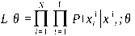
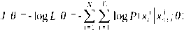
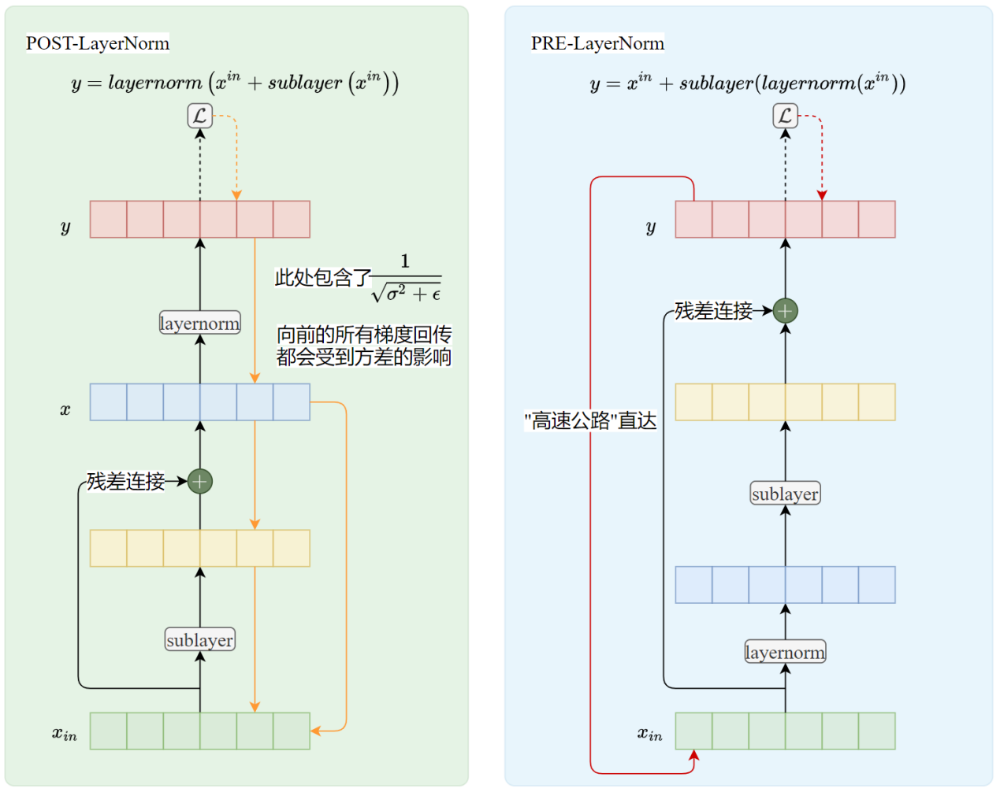
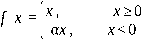
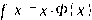
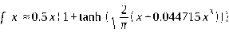
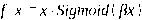

---
tags:
  - 大模型
  - 面试
source: "尚硅谷大模型技术之高频面试题-V2.1.6.docx"
source_blocks: "799-844"
reviewed: 2026-10-21
---

# 大模型架构、归一化与激活层

归一化的轴和统计量决定它作用在哪里。

前篇：[[知识点总结/80-资料与复习/81-面试知识库/08-大模型高频面试题/02-模型原理与训练/04-Transformer、预训练与生成评估|Transformer、预训练与生成评估]] ｜ 后篇：[[知识点总结/80-资料与复习/81-面试知识库/08-大模型高频面试题/02-模型原理与训练/06-位置编码、注意力头与MoE|位置编码、注意力头与MoE]]

## 深入理解（新增）

对形状 [batch, tokens, hidden] 的隐藏状态，LayerNorm 通常在最后一维计算均值与方差。每个 token 独立归一化，不需要跨 batch 统计，因此与 BatchNorm 的训练/推理统计机制不同。

RMSNorm 用均方根缩放而不减均值，不能把它解释为“把均值归零”。下面实现暂不包含可学习缩放与偏置，目的是让两种统计量的区别可见；实际模型还需匹配 eps、精度与参数设置。

Pre-Norm 与 Post-Norm 改变残差路径上的梯度传播，不能只把 LayerNorm 移动位置就宣称模型等价。修改归一化结构通常需要训练或微调验证，而不是直接替换已经训练好的权重。

### 可编辑公式

$$\mathrm{LN}(x)=\gamma\odot\frac{x-\mu}{\sqrt{\sigma^2+\epsilon}}+\beta$$

$$\mathrm{RMSNorm}(x)=\gamma\odot\frac{x}{\sqrt{\frac1d\sum_{j=1}^d x_j^2+\epsilon}}$$

代码为便于观察统计量，省略可学习参数 $\gamma,\beta$。

## 核心代码（新增）

以下是可在 CPU 运行的机制或业务契约示例，完整源码与测试见 [[知识点总结/80-资料与复习/81-面试知识库/08-大模型高频面试题/06-代码实验/01-核心代码实验与验证范围|核心代码实验与验证范围]]。示例不包含完整模型训练或外部平台部署。

```python
import numpy as np

def layer_norm(x, eps=1e-6):
    mean = x.mean(axis=-1, keepdims=True)
    var = ((x - mean) ** 2).mean(axis=-1, keepdims=True)
    return (x - mean) / np.sqrt(var + eps)

def rms_norm(x, eps=1e-6):
    return x / np.sqrt((x * x).mean(axis=-1, keepdims=True) + eps)

x = np.array([[1., 2., 3.]])
assert np.allclose(layer_norm(x), layer_norm(x + 100))

x = np.array([[1., 2., 3.]])
assert not np.allclose(rms_norm(x), rms_norm(x + 100))
```

## 追问与验证（新增）

给输入加常数，比较两种归一化的输出；解释为什么 LayerNorm 的平移不变性不应直接套给 RMSNorm。

## 官方资料与论文

- [Attention Is All You Need](https://arxiv.org/abs/1706.03762)
- [RMSNorm 原论文](https://arxiv.org/abs/1910.07467)

核验日期：2026-10-21。链接中的 `stable`、`main` 或平台文档会继续变化；新增纯 Python/NumPy 实验与原文旧版框架代码已分开标注。

## 原文保留

> [!warning] 原文批注
> RMSNorm 不执行均值中心化；代码为统计量教学版，省略可学习仿射参数。

<!-- source-block:799 -->
### 大模型框架原理

<!-- source-block:800 -->
#### 大模型基础

<!-- source-block:801 -->
##### 什么是大模型？它与传统深度学习模型的区别在哪里？

<!-- source-block:802 -->
大模型是指参数规模巨大（通常十亿到千亿级）、训练数据庞大、能力强大的深度神经网络。相比传统模型，它的参数量、训练数据量和跨任务泛化能力都显著更高。

<!-- source-block:803 -->
##### 什么是生成式大模型？

<!-- source-block:804 -->
生成式大模型（一般简称大模型LLMs）是指能用于创作新内容，例如文本、图片、音频以及视频的一类深度学习模型。相比普通深度学习模型，主要有两点不同：

<!-- source-block:805 -->
模型参数量更大，都在Billion级别。

<!-- source-block:806 -->
可通过条件或上下文引导，生成内容。

<!-- source-block:807 -->
##### 自回归大语言模型的训练目标是什么？

<!-- source-block:808 -->
根据已有词预测下一个词，训练目标为最大化最大似然函数：

<!-- source-block:809 -->


<!-- source-block:810 -->
等价于最小化损失函数

<!-- source-block:811 -->


<!-- source-block:812 -->
##### 大模型（LLMs）的缺点？

<!-- source-block:813 -->
- 计算资源消耗巨大

<!-- source-block:814 -->
- 数据需求量大

<!-- source-block:815 -->
- 可能产生偏见或错误（幻觉）

<!-- source-block:816 -->
- 推理延迟和部署难度

<!-- source-block:817 -->
- 可解释性差

<!-- source-block:818 -->
##### 为什么Transformer架构适合用于大语言模型？

<!-- source-block:819 -->
Transformer的自注意力机制可以高效建模长距离依赖关系，支持并行训练，易于扩展规模，适合海量数据和参数的训练。

<!-- source-block:820 -->
#### 模型架构-LayerNorm

<!-- source-block:821 -->
##### Pre-LayerNorm vs Post-LayerNorm

<!-- source-block:822 -->
在GPT-1和原版Transformer中使用的都是Post-LayerNorm，即后归一化。GPT-2转而使用Pre-LayerNorm，这是为了解决训练深层Transformer模型时的梯度不稳定和收敛困难问题。

<!-- source-block:823 -->
**Post-LN的问题**

<!-- source-block:824 -->
在深层Transformer中（层数很多时），原始的Post-LN结构会导致梯度在反向传播时变得非常不稳定，尤其是在靠近输入侧的层。

<!-- source-block:825 -->
**Pre-LN的解决方案**

<!-- source-block:826 -->
将归一化移至传入子层之前。

<!-- source-block:827 -->
**Pre-LN的效果**

<!-- source-block:828 -->
梯度更稳定，信息流动更高效，使用 Pre-LN 的模型通常在相同训练步数下能达到比 Post-LN 模型更低的损失或更高的性能。

<!-- source-block:829 -->


<!-- source-block:830 -->
#### 模型架构-激活函数相关

<!-- source-block:831 -->
##### 补充：其他常用ReLU变体

<!-- source-block:832 -->
**Leaky ReLU**

<!-- source-block:833 -->
公式： (α为固定小常数,如0.01)

<!-- source-block:834 -->
特点：负区间保留微小梯度，避免神经元失活。

<!-- source-block:835 -->
**GELU（高斯误差线性单元，Transformer核心）**

<!-- source-block:836 -->
公式： , Φ(x)是标准正态分布的累积分布函数

<!-- source-block:837 -->
近似式：

<!-- source-block:838 -->
特点：融合随机正则，平滑非线性，0均值；bert/GPT等Transformer架构的标配激活函数。

<!-- source-block:839 -->
**Swish**

<!-- source-block:840 -->
公式： (β为常数/可学习参数 ，β=1时为默认版也叫SwiGLU)

<!-- source-block:841 -->
特点：处处平滑，性能优于ReLU；β→∞时近似ReLU，β=0时为0.5x。

<!-- source-block:842 -->
##### 为什么大模型的FFN层倾向于使用SwiGLU而不是ReLU？

<!-- source-block:843 -->
梯度与稳定性：ReLU的硬截断（负值为零）可能导致“神经元死亡”。而SwiGLU/GELU具有平滑非线性和非单调特性，能提供全域非零梯度，更利于深层网络训练。

<!-- source-block:844 -->
稀疏性：ReLU是强制稀疏（负值直接归零），可能导致信息损失。SwiGLU通过门控（Sigmoid）实现动态稀疏，能保留部分负值信息，平衡表达与效率。
