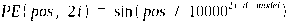
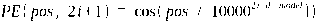
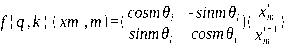
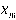
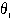
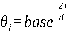
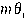

---
tags:
  - 大模型
  - 面试
source: "尚硅谷大模型技术之高频面试题-V2.1.6.docx"
source_blocks: "845-899"
reviewed: 2026-10-21
---

# 位置编码、注意力头与MoE

位置、头共享和专家路由分别改变计算中的三个不同部分。

前篇：[[知识点总结/80-资料与复习/81-面试知识库/08-大模型高频面试题/02-模型原理与训练/05-大模型架构、归一化与激活层|大模型架构、归一化与激活层]] ｜ 后篇：[[知识点总结/80-资料与复习/81-面试知识库/08-大模型高频面试题/02-模型原理与训练/07-学习率调度、SFT、对齐与蒸馏|学习率调度、SFT、对齐与蒸馏]]

## 深入理解（新增）

RoPE 对 Q、K 的成对维度执行位置相关旋转，使点积包含相对位置信息。旋转保留向量范数，但长上下文外推还受训练长度、频率缩放和实现约定影响，不能只放宽长度参数就保证效果。

MHA、MQA、GQA 的重要差别在 K/V 头是否被多个 query 头共享。KV Cache 预算必须使用 kv_heads 而不是一律使用 query_heads；节省缓存不等于注意力计算和通信都按同样比例下降。

MoE 路由只激活部分专家，因此每 token 激活参数量小于总参数量，但未激活专家仍需存储或调度。负载不均会造成容量溢出与跨设备通信瓶颈；总参数量不能直接拿来估算每 token FLOPs。

### 可编辑公式

$$q_m=R_mq,\quad k_n=R_nk,\quad q_m^\top k_n=q^\top R_{n-m}k$$

这在匹配频率和维度配对的旋转定义下揭示相对位置结构；不代表任意长度外推都可靠。

## 核心代码（新增）

以下是可在 CPU 运行的机制或业务契约示例，完整源码与测试见 [[知识点总结/80-资料与复习/81-面试知识库/08-大模型高频面试题/06-代码实验/01-核心代码实验与验证范围|核心代码实验与验证范围]]。示例不包含完整模型训练或外部平台部署。

```python
import numpy as np

def rope(x, position, theta=10000.0):
    if x.shape[-1] % 2:
        raise ValueError("head dimension must be even")
    frequency = theta ** (-np.arange(0, x.shape[-1], 2) / x.shape[-1])
    angle = position * frequency
    out = np.empty_like(x, dtype=float)
    a, b = x[..., 0::2], x[..., 1::2]
    out[..., 0::2] = a * np.cos(angle) - b * np.sin(angle)
    out[..., 1::2] = a * np.sin(angle) + b * np.cos(angle)
    return out

def kv_cache_bytes(batch, layers, tokens, kv_heads, head_dim, bytes_per_element=2):
    return 2 * batch * layers * tokens * kv_heads * head_dim * bytes_per_element

x = np.array([1., 2., 3., 4.])
assert np.isclose(np.linalg.norm(rope(x, 10)), np.linalg.norm(x))

size = kv_cache_bytes(1, 32, 4096, 8, 128)
assert size == 512 * 1024**2
print(size / 1024**2, "MiB")
```

## 追问与验证（新增）

验证同位置旋转前后点积不变，再验证同时平移两个位置时相对位置点积保持一致。

## 官方资料与论文

- [Attention Is All You Need](https://arxiv.org/abs/1706.03762)
- [Transformers 推理内存优化](https://huggingface.co/docs/transformers/llm_tutorial_optimization)
- [RoFormer 与 RoPE](https://arxiv.org/abs/2104.09864)
- [Switch Transformers](https://arxiv.org/abs/2101.03961)

核验日期：2026-10-21。链接中的 `stable`、`main` 或平台文档会继续变化；新增纯 Python/NumPy 实验与原文旧版框架代码已分开标注。

## 原文保留

> [!warning] 原文批注
> RoPE 的频率与维度配对必须和模型权重约定一致；GQA 缓存估算应使用 K/V 头数。

<!-- source-block:845 -->
### 模型架构-位置编码

<!-- source-block:846 -->
#### 常见位置编码

<!-- source-block:847 -->
**正余弦位置编码**

<!-- source-block:848 -->
原理：核心在于使用不同频率的正弦和余弦波组合，为序列中每个位置生成一个独一无二（确定性）、且蕴含相对位置关系的向量

<!-- source-block:849 -->
公式：

<!-- source-block:850 -->


<!-- source-block:851 -->


<!-- source-block:852 -->
- pos:词在序列中的位置（从0开始）

<!-- source-block:853 -->
- i:位置编码向量的维度索引（从0到d\_model/2 - 1）

<!-- source-block:854 -->
- d\_model:模型的嵌入维度

<!-- source-block:855 -->
缺点：

<!-- source-block:856 -->
长度外推能力实际表现不加（核心缺陷）；（原因：处理未见过的位置时，点积注意力会变得不稳定，导致模型混乱）

<!-- source-block:857 -->
相对位置建模“间接”且“低效”；

<!-- source-block:858 -->
与模型参数割裂，是静态信息。

<!-- source-block:859 -->
**可学习的位置编码**

<!-- source-block:860 -->
原理：将序列中每个位置都关联一个可训练的向量参数，并与词嵌入相加后一同送入模型学习。本质就是将位置信心换成可学习模型参数（矩阵），随机初始化，训练更新。

<!-- source-block:861 -->
优点：就是灵活，自适应能从数据中学到最优的位置表达；

<!-- source-block:862 -->
缺点：就是无法处理超长序列，缺乏相对位置的明确引导。

<!-- source-block:863 -->
**RoPE**

<!-- source-block:864 -->
原理：不将位置信息作为静态的“附加物”加在词向量上，而是将其视为一种“旋转操作”，动态地对词向量本身进行变换。

<!-- source-block:865 -->
公式：

<!-- source-block:866 -->
RoPE将词嵌入的每个维度视为一对复数坐标。对于位置m的词向量，在维度 i上的变换为：

<!-- source-block:867 -->


<!-- source-block:868 -->
-  ：位置m处的词向量（或其对应的查询q、键k向量）。

<!-- source-block:869 -->
-  ：预设的频率基数（一般是10000-500000）， ，控制不同维度的旋转速度。

<!-- source-block:870 -->
这个旋转矩阵的作用是：将向量在二维平面上，旋转一个由位置m决定的 .

<!-- source-block:871 -->
效果：经过旋转后，同一个词在不同位置会有不同的向量表示，这编码了绝对位置。

<!-- source-block:872 -->
### 模型架构-自注意力模块

<!-- source-block:873 -->
#### 传统Attention存在哪些问题？

<!-- source-block:874 -->
**计算时间长**

<!-- source-block:875 -->
**显存占用大**

<!-- source-block:876 -->
#### Attention优化方向

<!-- source-block:877 -->
**改进多头机制：如MQA、GQA。**

<!-- source-block:878 -->
**控制注意力感受野：如稀疏注意力机制。**

<!-- source-block:879 -->
#### MHA、MQA和GQA/MLA

<!-- source-block:880 -->
**传统的多头注意力机制**

<!-- source-block:881 -->
Multi-Head Attention，简称MHA。

<!-- source-block:882 -->
每个头有独立的Q、K、V。资源开销大。

<!-- source-block:883 -->
**多查询注意力机制**

<!-- source-block:884 -->
Multi-Query Attention，简称MQA。

<!-- source-block:885 -->
所有查询共用同一组K、V。

<!-- source-block:886 -->
主要目的是为了优化推理阶段K、V占用内存过多的问题，但所有查询公用一组K、V会导致模型表达能力下降。

<!-- source-block:887 -->
**分组查询注意力机制**

<!-- source-block:888 -->
Grouped-Query Attention，简称GQA。

<!-- source-block:889 -->
介于MHA和MQA之间，将查询头分为g组，每组内的所有查询头共用一组K、V，在节约内存的同时，又一定程度上减轻了表达能力的削弱，是一种折中的方案。

<!-- source-block:890 -->
**MLA**

<!-- source-block:891 -->
原理：MLA是基于GQA思想的一种具体的高效的实现。完全继承了GQA的分组共享思想，并增加了潜在的KV缓存，原理是将序列中所有位置的KV状态压缩融合成一组固定的潜在向量，无需随序列长度线性增长。

<!-- source-block:892 -->
优点：在GQA的基础上彻底解决了长序列的KV缓存内存瓶颈。

<!-- source-block:893 -->
#### LLMs采用的注意力机制变体

<!-- source-block:894 -->
| GPT-1、GPT-2 | 传统的注意力机制 |
| --- | --- |
| GPT-3、Instruct-GPT | 局部带状稀疏注意力机制 |
| Llama1 | 传统注意力机制 |
| Llama2、Llama3.1 | GQA |
| Qwen3 | GQA |

<!-- source-block:895 -->
### 模型架构-稠密模型和MOE模型

<!-- source-block:896 -->
#### 稠密模型

<!-- source-block:897 -->
在稠密模型中，每个输入样本都会激活（用到）模型的所有参数。

<!-- source-block:898 -->
#### 混合专家模型

<!-- source-block:899 -->
在前馈网络部分引入多个专家和一个门控网络。对于每一个token，动态选择一小部分最相关的“专家”来处理该输入，而其他专家保持非活跃状态。这是一种稀疏激活的机制。
