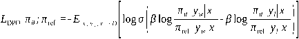

---
tags:
  - 大模型
  - 面试
source: "尚硅谷大模型技术之高频面试题-V2.1.6.docx"
source_blocks: "900-967"
reviewed: 2026-10-21
---

# 学习率调度、SFT、对齐与蒸馏

把格式学习、能力学习与偏好对齐放在不同训练目标下理解。

前篇：[[知识点总结/80-资料与复习/81-面试知识库/08-大模型高频面试题/02-模型原理与训练/06-位置编码、注意力头与MoE|位置编码、注意力头与MoE]] ｜ 后篇：[[知识点总结/80-资料与复习/81-面试知识库/08-大模型高频面试题/02-模型原理与训练/08-分布式训练、混合精度与显存预算|分布式训练、混合精度与显存预算]]

## 深入理解（新增）

SFT 用监督样本提高目标回答的条件概率。对聊天数据，应使用模型对应的 chat template，并确认角色边界、结束 token 和响应起点。仅在 answer 区域计算损失时，prompt 与 padding 的 labels 应设置为忽略值。

因果语言模型的预测与标签有一位偏移：位置 t 的 logits 预测位置 t+1 的 token。某些框架模型会内部 shift，手动再次 shift 会造成错位。下面代码显式完成一次 shift，用于独立检查数据管线，不应再叠加到自动 shift 的模型损失之上。

蒸馏既可使用教师生成的硬标签，也可使用软概率分布。学生结果受教师错误、温度与训练覆盖影响。偏好对齐不是对所有能力同时增强，需用保留集检查格式提升是否以知识、拒答或长度失控为代价。

### 可编辑公式

$$\mathcal L_{\mathrm{SFT}}=-\frac{\sum_t m_t\log p_\theta(x_t\mid x_{<t})}{\sum_t m_t}$$

$m_t$ 表示目标 token 是否参与监督；回答掩码和 next-token 对齐必须同时正确。

## 核心代码（新增）

以下是可在 CPU 运行的机制或业务契约示例，完整源码与测试见 [[知识点总结/80-资料与复习/81-面试知识库/08-大模型高频面试题/06-代码实验/01-核心代码实验与验证范围|核心代码实验与验证范围]]。示例不包含完整模型训练或外部平台部署。

```python
import numpy as np

def causal_lm_loss(logits, labels):
    # Input shape: [batch, tokens, vocab]; prompt/pad labels are already -100.
    shifted_logits, shifted_labels = logits[:, :-1, :], labels[:, 1:]
    valid = shifted_labels != -100
    if not valid.any():
        raise ValueError("no supervised response tokens")
    selected_logits, targets = shifted_logits[valid], shifted_labels[valid]
    log_z = np.logaddexp.reduce(selected_logits, axis=-1)
    selected = selected_logits[np.arange(len(targets)), targets]
    return float((log_z - selected).mean())

logits = np.zeros((1, 4, 5))
labels = np.array([[-100, -100, 2, 3]])
assert np.isclose(causal_lm_loss(logits, labels), np.log(5))
```

## 追问与验证（新增）

打印一条 token、label 对齐表，确认第一个回答 token 正好由前一位置预测；再检查截断后是否仍有有效回答标签。

## 官方资料与论文

- [Transformers 生成流程](https://huggingface.co/docs/transformers/main/en/llm_tutorial)
- [TRL DPOTrainer](https://huggingface.co/docs/trl/dpo_trainer)

核验日期：2026-10-21。链接中的 `stable`、`main` 或平台文档会继续变化；新增纯 Python/NumPy 实验与原文旧版框架代码已分开标注。

## 原文保留

> [!warning] 原文批注
> 仅把问答拼接为字符串不等于正确 SFT 数据。模板、结束标记、损失掩码和 shift 都需要显式核验。

<!-- source-block:900 -->
### 训练-学习率调度策略

<!-- source-block:901 -->
#### 为什么在大模型训练中需要预热（Warmup）

<!-- source-block:902 -->
一开始模型参数是随机初始化的，如果直接使用一个较大学习率，参数更新会过大，容易出现梯度爆炸或者训练崩溃。

<!-- source-block:903 -->
#### 学习率退火（Annealing）对模型收敛和泛化的作用是什么

<!-- source-block:904 -->
在训练的中后期，当模型的损失逐渐接近某个极小值区域时，如果学习率还很大，参数会在最优点附近来回震荡，甚至跳出去，导致无法真正收敛。

<!-- source-block:905 -->
退火通过逐步降低学习率，让参数更新的步伐越来越小。

<!-- source-block:906 -->
#### Warmup和Annealing通常如何配合使用

<!-- source-block:907 -->
Warmup和Annealing一般是配套使用的，训练过程可以分为三个阶段：“先预热 → 中间稳定 → 后期退火”

<!-- source-block:908 -->
**预热阶段**

<!-- source-block:909 -->
刚开始训练，学习率从0逐步升到峰值，确保训练能平稳启动。

<!-- source-block:910 -->
**稳定阶段**

<!-- source-block:911 -->
维持在峰值学习率一段时间，让模型快速学习到主要的特征和模式。

<!-- source-block:912 -->
**退火阶段**

<!-- source-block:913 -->
随着训练进入中后期，逐步降低学习率，让参数在接近最优解时收敛得更细致，提升最终性能和泛化能力。

<!-- source-block:914 -->
### 训练-SFT

<!-- source-block:915 -->
#### 什么是监督微调？它与预训练有什么区别？

<!-- source-block:916 -->
**训练数据**

<!-- source-block:917 -->
预训练数据：海量、无标注，SFT数据：少量、高质量、有标注。

<!-- source-block:918 -->
**损失函数**

<!-- source-block:919 -->
预训练阶段计算所有token的损失，SFT不计算Prompt部分的损失

<!-- source-block:920 -->
**训练目标**

<!-- source-block:921 -->
预训练：获得通用语言理解和生成能力，SFT：获得特定任务执行能力、指令遵循能力和对话能力。

<!-- source-block:922 -->
### 训练-RLHF

<!-- source-block:923 -->
#### 请详细描述Instruct-GPT RLHF的整体流程及各阶段作用

<!-- source-block:924 -->
**监督微调（SFT）阶段**

<!-- source-block:925 -->
使用高质量指令-响应对对预训练模型进行微调

<!-- source-block:926 -->
目标：获得基础对话能力。

<!-- source-block:927 -->
**奖励模型（Reward Model, RM）训练阶段**

<!-- source-block:928 -->
基于上一步的模型替换最终线性层（输出标量分数），使用人类偏好数据训练RM。

<!-- source-block:929 -->
**强化学习优化阶段**

<!-- source-block:930 -->
基于可训练的SFT模型和参数冻结的SFT模型。

<!-- source-block:931 -->
目标是最大化RM打分的同时，尽可能接近冻结SFT的分布

<!-- source-block:932 -->
#### 什么是DPO

<!-- source-block:933 -->
直接偏好优化（Direct Preference Optimization，DPO）是Rafael Rafailov等人在《Direct Preference Optimization：Your Language Model is Secretly a Reward Model》中提出的一种非传统强化学习算法。

<!-- source-block:934 -->
不同于传统的RLHF方法，DPO无需奖励模型，其训练数据包含成对的“好回答”和“差回答”，训练目标是在确保模型稳定的前提下，拉开“好回答”和“差回答”之间的差距。

<!-- source-block:935 -->
DPO的损失函数如下

<!-- source-block:936 -->


<!-- source-block:937 -->
### 训练-蒸馏

<!-- source-block:938 -->
#### 什么是知识蒸馏（Knowledge Distillation），核心思想是什么

<!-- source-block:939 -->
知识蒸馏是一种通过将大模型（教师模型）的知识迁移到小模型（学生模型）的方法，让小模型在保持轻量化的同时接近大模型性能。

<!-- source-block:940 -->
#### 什么是强-弱蒸馏（Teacher-Student Distillation）

<!-- source-block:941 -->
强-弱蒸馏是知识蒸馏的一种，核心思想完全相同。

<!-- source-block:942 -->
#### Qwen3强弱蒸馏的流程

<!-- source-block:943 -->
蒸馏分为两个阶段：

<!-- source-block:944 -->
**离策略蒸馏**

<!-- source-block:945 -->
将教师模型通过思考和非思考两种模式生成的输出结果与查询进行整合，对学生模型进行监督微调。损失函数分为学生模型预测思维链（如果有的话）+教师模型响应的交叉熵损失。

<!-- source-block:946 -->
**同策略蒸馏**

<!-- source-block:947 -->
学生模型和教师对于相同的查询生成概率分布，这一阶段的损失函数是学生模型和教师模型的KL散度。

<!-- source-block:948 -->
### 大模型结构演进

<!-- source-block:949 -->
主线：从循环序列模型 → 奠基性的Transformer → 任务特化的编码器/解码器 → 走向统一的自回归解码器，并通过稀疏化、新架构和多模态融合持续突破效率与能力边界。

<!-- source-block:950 -->
#### 前Transformer时代：序列瓶颈

<!-- source-block:951 -->
- 核心：RNN/LSTM/GRU循环处理，顺序计算。

<!-- source-block:952 -->
- 问题：无法并行，难以学习长程依赖，严重限制了模型规模和能力。

<!-- source-block:953 -->
#### 2. 革命基石：Transformer (2017)

<!-- source-block:954 -->
- 核心创新：自注意力机制 + 完全并行化。

<!-- source-block:955 -->
- 意义：一举解决并行与长程依赖问题，成为所有现代大模型的基础组件。

<!-- source-block:956 -->
#### 3. 分道扬镳：两大预训练范式 (2018)

<!-- source-block:957 -->
- BERT (编码器)：双向理解。擅长文本理解类任务（如分类、问答）。

<!-- source-block:958 -->
- GPT (解码器)：自回归生成。擅长文本生成，并逐步展现出通过提示学习的潜力。

<!-- source-block:959 -->
#### 4. 王者之路：规模化与Decode-only统一 (2020-)

<!-- source-block:960 -->
- 核心事件：GPT-3 出现。（卷参数量）

<!-- source-block:961 -->
- 关键结论：将解码器模型规模扩大至极高水平（千亿参数），配合海量数据，能涌现出强大的通用能力和上下文学习。

<!-- source-block:962 -->
- 结果：纯解码器架构因其强大的生成通用性，成为大语言模型的绝对主流。

<!-- source-block:963 -->
- 核心优化：旋转位置编码（ROPE），SwiGLU，预归一化。

<!-- source-block:964 -->
#### 5. 当下趋势：效率与能力突破

<!-- source-block:965 -->
- 混合专家（MOE）：在总参数量巨大的同时，只激活部分参数进行计算，实现更经济的超大规模模型（如Mixtral）。

<!-- source-block:966 -->
- 超越Transformer：为克服Transformer处理长文本的计算瓶颈，出现更高效的架构（如Mamba），追求线性复杂度和更优的推理性能。

<!-- source-block:967 -->
- 多模态统一：将图像、音频等信号转换为类似文本的“词元”，输入给单一Transformer模型处理，迈向通用多模态AI（如GPT-4V）。
