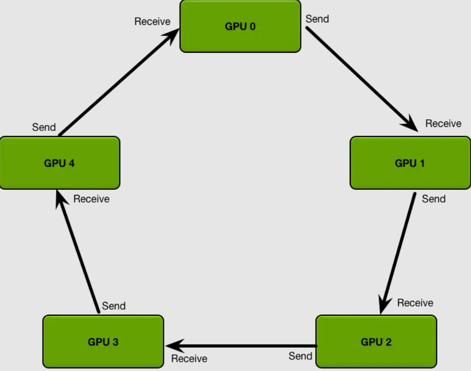

---
tags:
  - 大模型
  - 面试
source: "尚硅谷大模型技术之高频面试题-V2.1.6.docx"
source_blocks: "968-1045"
reviewed: 2026-10-21
---

# 分布式训练、混合精度与显存预算

先列显存组成，再判断应采用哪种并行或精度策略。

前篇：[[知识点总结/80-资料与复习/81-面试知识库/08-大模型高频面试题/02-模型原理与训练/07-学习率调度、SFT、对齐与蒸馏|学习率调度、SFT、对齐与蒸馏]] ｜ 后篇：[[知识点总结/80-资料与复习/81-面试知识库/08-大模型高频面试题/02-模型原理与训练/09-PEFT、LoRA与微调数据集|PEFT、LoRA与微调数据集]]

## 深入理解（新增）

显存包含参数、梯度、优化器状态、激活、临时工作区及通信缓冲。量化权重只减少其中一部分；训练显存不能用“参数量乘每参数字节数”概括。激活还会随序列长度、micro batch 和 checkpoint 策略变化。

数据并行复制模型并同步梯度，模型或状态分片减少每卡存储，却增加参数收集与通信。梯度累计减少 micro batch 需求，但不自动减少总训练计算；通信是否与计算重叠会改变实际收益。

混合精度让不同算子使用不同数值格式。FP16 常需要梯度缩放，BF16 的指数范围更宽，但并非所有算子都适合低精度。应记录 tokens/s、峰值显存、溢出次数和验证损失，而不是只报告单步更快。


## 核心代码（新增）

以下是可在 CPU 运行的机制或业务契约示例，完整源码与测试见 [[知识点总结/80-资料与复习/81-面试知识库/08-大模型高频面试题/06-代码实验/01-核心代码实验与验证范围|核心代码实验与验证范围]]。示例不包含完整模型训练或外部平台部署。

```python
def kv_cache_bytes(batch, layers, tokens, kv_heads, head_dim, bytes_per_element=2):
    return 2 * batch * layers * tokens * kv_heads * head_dim * bytes_per_element

size = kv_cache_bytes(1, 32, 4096, 8, 128)
assert size == 512 * 1024**2
print(size / 1024**2, "MiB")
```

### PyTorch 混合精度训练步（未实跑框架模板）

下面使用 `torch.autocast` 与 `torch.amp.GradScaler`，需要 CUDA 环境及可用模型。依赖未在本次安装；只完成 Python 语法与官方接口核对。数据标签应由任务管线准备，`batch` 已放到模型设备。

```python
import torch

dtype = torch.bfloat16 if torch.cuda.is_bf16_supported() else torch.float16
scaler = torch.amp.GradScaler("cuda", enabled=(dtype == torch.float16))

def amp_step(model, batch, optimizer):
    model.train()
    optimizer.zero_grad(set_to_none=True)
    with torch.autocast(device_type="cuda", dtype=dtype):
        loss = model(**batch).loss
    scaler.scale(loss).backward()  # backward 在 autocast 上下文之外。
    scaler.unscale_(optimizer)    # 裁剪真实梯度，而不是放大后的梯度。
    torch.nn.utils.clip_grad_norm_(model.parameters(), max_norm=1.0)
    scaler.step(optimizer)
    scaler.update()
    return float(loss.detach())
```

这里只展示单卡训练步，未加入梯度累计、DDP/FSDP、调度和恢复。多卡时还需要处理梯度同步时机与全局有效 token 归一化；不能把单步函数包一层循环就视为完整分布式训练器。

## 追问与验证（新增）

分别按参数、优化器状态、激活估算显存，再与实测峰值比较；把差额归因到工作区和缓冲，不直接认为估算公式失效。

## 官方资料与论文

- [PyTorch AMP 官方示例](https://docs.pytorch.org/tutorials/recipes/recipes/amp_recipe.html)
- [Transformers 推理内存优化](https://huggingface.co/docs/transformers/llm_tutorial_optimization)

核验日期：2026-10-21。链接中的 `stable`、`main` 或平台文档会继续变化；新增纯 Python/NumPy 实验与原文旧版框架代码已分开标注。

## 原文保留

> [!warning] 原文批注
> 量化权重、混合精度、状态分片与激活重计算减少的是不同显存项，不能把它们的比例直接相乘。
>
> 新增代码中的 KV 公式只估算推理缓存，不估算完整训练显存；用来帮助区分显存项，不能替代训练峰值测量。

<!-- source-block:968 -->
### 大模型微调理论

<!-- source-block:969 -->
#### 分布式训练技术

<!-- source-block:970 -->
##### 分布式训练及显存优化技术有哪些

<!-- source-block:971 -->
**数据并行（Data Parallelism，DP）**

<!-- source-block:972 -->
**流水线并行（Pipeline Parallelism，PP）**

<!-- source-block:973 -->
**张量并行（Tensor Parallelism，TP）**

<!-- source-block:974 -->
**3D并行（DP、PP、TP混合）**

<!-- source-block:975 -->
**ZeRO（零冗余优化器）**

<!-- source-block:976 -->
**专家并行**

<!-- source-block:977 -->
##### 什么是数据并行？

<!-- source-block:978 -->
数据并行就是把同一个模型复制到多个设备上，每个设备处理不同的数据子集，各设备独立计算前向和反向传播，然后通过通信（如AllReduce）把梯度聚合，最后同步更新模型参数。

<!-- source-block:979 -->
一句话总结：模型相同，数据切分，梯度同步。

<!-- source-block:980 -->
##### 数据并行（中的梯度聚合）如何提升通信效率

<!-- source-block:981 -->
Ring AllReduce：[https://www.jianshu.com/p/8c0e7edbefb9](https://www.jianshu.com/p/8c0e7edbefb9)

<!-- source-block:982 -->
##### 介绍RingAllReduce

<!-- source-block:983 -->


<!-- source-block:984 -->
RingAllReduce是一种高效的分布式通信算法，用于数据并行训练中同步梯度。它将每个节点的梯度拆分为N份，节点按环形结构依次发送和接收梯度块，经过N‑1轮通信完成全局求和（Reduce-Scatter），再经过N‑1轮广播（All-Gather）让每个节点获得完整的全局梯度。

<!-- source-block:985 -->
RingAllReduce将通信压力均衡到所有节点，避免了瓶颈的出现。

<!-- source-block:986 -->
##### 数据并行中计算与通信如何协同

<!-- source-block:987 -->
每个GPU计算自己批次的梯度，然后通过Ring-AllReduce同步：

<!-- source-block:988 -->
每个GPU先计算本地梯度 → 通过AllReduce汇总并同步所有GPU梯度 → 每个GPU用汇总梯度更新本地模型。

<!-- source-block:989 -->
##### 什么是流水线并行

<!-- source-block:990 -->
把模型分段（Stage），每段交给不同的GPU，数据串行经过不同的模型分段。

<!-- source-block:991 -->
##### 流水线并行优缺点

<!-- source-block:992 -->
- 优点：降低显存压力；提高计算资源利用率 ；适合超大模型

<!-- source-block:993 -->
- 缺点：通信/同步复杂，流水线气泡（Pipeline Bubble），难以负载均衡

<!-- source-block:994 -->
##### 什么是张量并行

<!-- source-block:995 -->
张量并行的做法是将模型单层内部的张量计算拆分到多个设备上并行执行，每个设备仅持有部分权重和中间结果。其目标仍是突破单设备显存和计算能力的限制，使超大模型的单层也能在多设备上协同完成。

<!-- source-block:996 -->
##### 张量并行优缺点

<!-- source-block:997 -->
- 优点：减少单卡显存占用，可训练更大模型；加速前向和反向计算。

<!-- source-block:998 -->
- 缺点：跨设备通信频繁，带宽成为瓶颈；实现和调试复杂；扩展性受层结构限制。

<!-- source-block:999 -->
##### 什么是 3D并行

<!-- source-block:1000 -->
同时结合数据并行、张量并行和流水线并行的分布式训练策略。

<!-- source-block:1001 -->
##### 什么是专家并行？

<!-- source-block:1002 -->
专家并行的做法是将 Mixture-of-Experts（MoE）模型中的多个专家（Expert）分配到不同的设备上，每个设备仅存储和计算部分专家。

<!-- source-block:1003 -->
MoE 结构天然适合并行化：每个专家本质上是一个独立的前馈网络（FFN），彼此之间没有共享参数或依赖关系，因此可直接将不同专家切分并分布到多个设备上。

<!-- source-block:1004 -->
##### 什么是DeepSpeed ZeRO

<!-- source-block:1005 -->
DeepSpeed ZeRO（Zero Redundancy Optimizer，零冗余优化器）是一种显存优化技术，目的是解决数据并行多个实例冗余存储的问题。

<!-- source-block:1006 -->
分三个阶段（三种优化级别）

<!-- source-block:1007 -->
**ZeRO-Stage 1：拆分优化器状态。**

<!-- source-block:1008 -->
**ZeRO-Stage 2：拆分优化器状态和梯度。**

<!-- source-block:1009 -->
**ZeRO-Stage 3：拆分优化器状态、梯度和模型参数。**

<!-- source-block:1010 -->
这里的拆分是指存储到不同的DP实例。

<!-- source-block:1011 -->
##### 什么是DeepSpeed Offload？优缺点？

<!-- source-block:1012 -->
DeepSpeed Offload（卸载）是一种显存优化策略，将部分计算或数据从GPU移到CPU或NVMe（硬盘）上，以减轻GPU显存压力。

<!-- source-block:1013 -->
主要类型：

<!-- source-block:1014 -->
**卸载权重。**

<!-- source-block:1015 -->
**卸载优化器状态。**

<!-- source-block:1016 -->
**卸载梯度。**

<!-- source-block:1017 -->
可以训练显存远大于GPU容量的模型，但带来额外的通信开销。

<!-- source-block:1018 -->
#### AMP混合精度训练

<!-- source-block:1019 -->
##### 什么是AMP

<!-- source-block:1020 -->
AMP（Automatic Mixed Precision）是一种自动混合精度训练技术。

<!-- source-block:1021 -->
在训练时部分计算用半精度（FP16）进行，关键计算保持单精度（FP32），既保证数值稳定性，又减少显存占用并加速计算。

<!-- source-block:1022 -->
##### 混合精度训练的优缺点

<!-- source-block:1023 -->
- 优点：显存占用降低、训练速度加快。

<!-- source-block:1024 -->
- 缺点：数据溢出（通常是下溢）、舍入误差。

<!-- source-block:1025 -->
##### 如何避免AMP的下溢和舍入误差

<!-- source-block:1026 -->
- 损失缩放：在反向传播前乘以缩放因子，反向传播后除以相同因子再更新权重。

<!-- source-block:1027 -->
- FP32主权重副本：维护FP32精度的主权重副本用于权重更新。

<!-- source-block:1028 -->
#### 显存相关

<!-- source-block:1029 -->
##### 如何估计训练推理阶段的显存占用（全参微调）？

<!-- source-block:1030 -->
显存占用公式（以FP16/混合精度为例）：

<!-- source-block:1031 -->
总显存 ≈ 模型参数显存 + 梯度显存 + 优化器状态显存 + 激活值显存 + 临时缓冲区

<!-- source-block:1032 -->
各个部分显存占用估算：

<!-- source-block:1033 -->
**模型参数：对于参数为Φ的模型**

<!-- source-block:1034 -->
- FP32存储:4Φ字节

<!-- source-block:1035 -->
- FP16/BF16存储：2Φ字节

<!-- source-block:1036 -->
**梯度：通常与参数保持同等精度**

<!-- source-block:1037 -->
- FP32存储:4Φ字节

<!-- source-block:1038 -->
- FP16/BF16存储：2Φ字节

<!-- source-block:1039 -->
**优化器状态：**

<!-- source-block:1040 -->
- Adam优化器：为每个参数存储一阶矩和二阶矩-8Φ字节

<!-- source-block:1041 -->
- SGD优化器（或者只有一阶矩（动量））：4Φ

<!-- source-block:1042 -->
**激活值：最复杂，变化最大的的部分，与批次大小，序列长度，模型结构（注意力头数，隐藏层大小）强相关。**

<!-- source-block:1043 -->
- 粗略估算（Transform为例）：一个前向传播的激活值大概是2 \* batch\_size \* seq\_len \* hidden\_dim

<!-- source-block:1044 -->
不同优化手段对应的提升

<!-- source-block:1045 -->
| 优化技术 | 减少哪部分显存（效果） |
| --- | --- |
| 混合精度训练 | 模型参数、梯度减半，优化器状态不变 |
| 梯度检查点 | 大幅减少激活值显存（时间换空间） |
| ZeRO-Stage 1 | 减少一半优化器状态占用 |
| ZeRO-Stage 2 | 在stage1基础上再减少梯度占用 |
| ZeRO-Stage 3 | 在stage2基础上，再减少参数占用 |
| 激活重计算/Offloading | 不用的激活值卸载到CPU，减少激活值显存 |
| 梯度累积 | 允许使用更小的per\_device\_batch\_size，从而降低激活值显存 |
| 模型并行/流水线并行 | 每张卡只存储部分模型，从而减少单卡参数、梯度、优化器状态。 |
