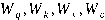
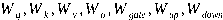
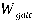
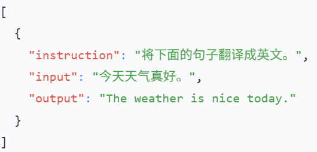
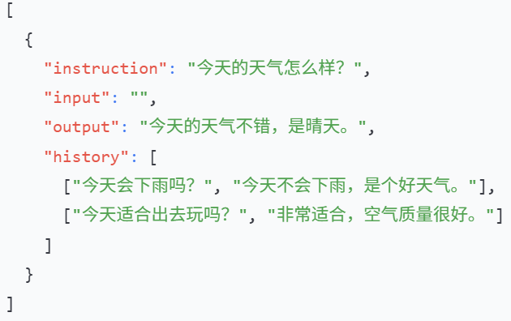
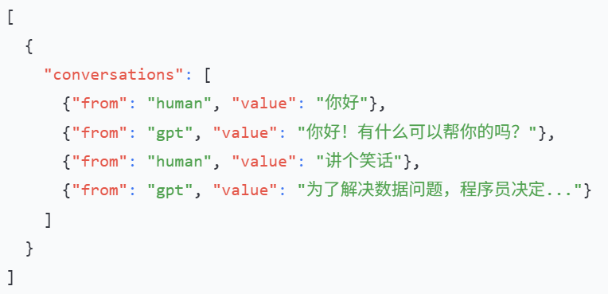
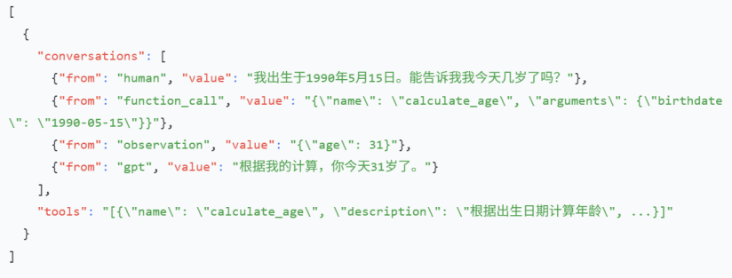

---
tags:
  - 大模型
  - 面试
source: "尚硅谷大模型技术之高频面试题-V2.1.6.docx"
source_blocks: "1046-1120"
reviewed: 2026-10-21
---

# PEFT、LoRA与微调数据集

低秩更新减少可训练参数，但不会消除基础模型的前向计算。

前篇：[[知识点总结/80-资料与复习/81-面试知识库/08-大模型高频面试题/02-模型原理与训练/08-分布式训练、混合精度与显存预算|分布式训练、混合精度与显存预算]] ｜ 后篇：[[知识点总结/80-资料与复习/81-面试知识库/08-大模型高频面试题/02-模型原理与训练/10-KV Cache 的计算收益与容量边界|KV Cache 的计算收益与容量边界]]

## 深入理解（新增）

设线性层 W 为 [d_out,d_in]，LoRA 用 B@A 表达增量，其中 A=[r,d_in]、B=[d_out,r]。可训练参数由 d_out*d_in 变为 r*(d_in+d_out)，再按 alpha/r 缩放；这并不意味着总模型存储或推理计算同比下降。

如果推理权重保持同一精度与线性结构，可把增量合并到 W。量化基座、多个适配器动态切换或特定层实现会改变合并流程，不能把 NumPy 代数示例直接当作框架保存格式。

QLoRA 的核心之一是量化冻结基座并训练低秩适配器；激活、梯度和优化器状态并非全都变为 4bit。选择 target_modules 应先检查真实模块名和结构，训练后核验可训练参数数目，防止适配器没有注入预期层。

### 可编辑公式

$$W'=W+\frac{\alpha}{r}BA,\quad A\in\mathbb R^{r\times d_{in}},\ B\in\mathbb R^{d_{out}\times r}$$

$$N_{\mathrm{trainable}}=r(d_{in}+d_{out})$$

该参数计数针对一个不额外训练偏置的线性层，不能直接当作整模型参数量。

## 核心代码（新增）

以下是可在 CPU 运行的机制或业务契约示例，完整源码与测试见 [[知识点总结/80-资料与复习/81-面试知识库/08-大模型高频面试题/06-代码实验/01-核心代码实验与验证范围|核心代码实验与验证范围]]。示例不包含完整模型训练或外部平台部署。

```python
import numpy as np

def lora_forward(x, weight, a, b, alpha):
    rank = a.shape[0]
    return x @ weight.T + (alpha / rank) * ((x @ a.T) @ b.T)

x = np.ones((1, 3)); w = np.ones((4, 3))
a = np.ones((2, 3)); b = np.ones((4, 2)); alpha = 4
assert np.allclose(lora_forward(x, w, a, b, alpha),
                   x @ (w + alpha / 2 * b @ a).T)
```

### PEFT 适配器注入与训练步（未实跑框架模板）

这里展示真实框架的关键调用。需要自行准备兼容的本地模型、PyTorch、Transformers、PEFT 与 GPU；本次没有安装这些框架或执行训练。`batch` 必须已经按对应聊天模板完成 padding、回答掩码和标签对齐。模型内部执行 shift，下面不再手工 shift。

```python
import torch
from transformers import AutoModelForCausalLM
from peft import LoraConfig, get_peft_model

def prepare_model(local_model_dir):
    base = AutoModelForCausalLM.from_pretrained(
        local_model_dir, local_files_only=True, trust_remote_code=False
    )
    config = LoraConfig(
        task_type="CAUSAL_LM", r=8, lora_alpha=16,
        lora_dropout=0.05, target_modules="all-linear",
    )
    model = get_peft_model(base, config)
    model.print_trainable_parameters()  # 检查实际注入范围，而非只看配置。
    return model

def train_one_step(model, batch, optimizer):
    model.train()
    optimizer.zero_grad(set_to_none=True)
    loss = model(**batch).loss
    loss.backward()
    torch.nn.utils.clip_grad_norm_(
        [p for p in model.parameters() if p.requires_grad], 1.0
    )
    optimizer.step()
    return float(loss.detach())
```

这是完整训练循环中的一步：尚需数据整理、设备放置、调度、评估及保存恢复。`all-linear` 的实际适配范围取决于模型和 PEFT 版本；量化模型还需按对应文档准备，不能直接套用此加载代码。

## 追问与验证（新增）

比较显式 LoRA 前向与合并 W 后的输出；再统计 r=8 与 r=16 的参数量变化，说明容量和预算的关系。

## 官方资料与论文

- [LoRA 原论文](https://arxiv.org/abs/2106.09685)
- [QLoRA 原论文](https://arxiv.org/abs/2305.14314)
- [PEFT 0.21.0 LoRA 文档](https://huggingface.co/docs/peft/v0.21.0/package_reference/lora)

核验日期：2026-10-21。链接中的 `stable`、`main` 或平台文档会继续变化；新增纯 Python/NumPy 实验与原文旧版框架代码已分开标注。

## 原文保留

> [!warning] 原文批注
> LoRA 不是只增加一个矩阵；QLoRA 的“4bit”不表示整个训练过程中所有张量都为 4bit。

<!-- source-block:1046 -->
### PEFT

<!-- source-block:1047 -->
#### 什么是PEFT

<!-- source-block:1048 -->
PEFT（Parameter Efficient Fine-Tuning，参数高效微调）是一种只更新少量参数（模型小部分或少量额外参数）微调大模型的高效微调方式。

<!-- source-block:1049 -->
#### 为什么需要PEFT

<!-- source-block:1050 -->
全参数微调成本太高，PEFT大量节省资源。

<!-- source-block:1051 -->
#### PEFT优缺点

<!-- source-block:1052 -->
- 优点：大幅减少资源占用；更新参数少，训练效率高；多任务灵活。

<!-- source-block:1053 -->
- 缺点：比全量微调性能略低；适用范围有限；依赖基础模型。

<!-- source-block:1054 -->
### PEFT-LoRA及变种

<!-- source-block:1055 -->
#### 介绍一下LoRA

<!-- source-block:1056 -->
LoRA（Low-Rank Adaptation，低秩矩阵适配）是一种PEFT方法，

<!-- source-block:1057 -->
核心思想是：只在部分权重上添加低秩矩阵，学习任务特定的变化，而保留原模型权重不动。

<!-- source-block:1058 -->
#### LoRA的矩阵怎么初始化？为什么？

<!-- source-block:1059 -->
A采用随机正态分布初始化，B初始化为零。

<!-- source-block:1060 -->
**B初始化为零确保训练稳定：训练起点与原始模型一致。**

<!-- source-block:1061 -->
**A随机初始化确保高效学习：每个LoRA神经元在训练初期可以接收到不同的梯度信号。**

<!-- source-block:1062 -->
#### LoRA可以作用于哪个参数矩阵

<!-- source-block:1063 -->
原论文可以作用于四个权重矩阵 。

<!-- source-block:1064 -->
主流实践可作用于七个权重矩阵 。如果没有用SwiGLU则没有 。

<!-- source-block:1065 -->
#### Rank如何选取

<!-- source-block:1066 -->
Rank（秩）的选取没有绝对标准，是一个需要权衡和实验的超参数。

<!-- source-block:1067 -->
核心原则是“从小开始，逐步增加”。

<!-- source-block:1068 -->
**低Rank：参数少训练快，过拟合风险低，但模型容量和表达能力可能不足。**

<!-- source-block:1069 -->
**高Rank：参数多容量大，可能逼近全量微调的性能，但成本高，过拟合风险增加。**

<!-- source-block:1070 -->
#### alpha参数如何选取

<!-- source-block:1071 -->
alpha/r的比值用于控制BA对权重的影响幅度。

<!-- source-block:1072 -->
alpha通常设置为r的倍数，常见选择是alpha = 2r。关键不是alpha或r单独的值，而是它们的比值。一般通过网格搜索调整alpha/r（如1、2、4），找到使验证集性能最优的组合。

<!-- source-block:1073 -->
#### LoRA高效微调如何避免过拟合

<!-- source-block:1074 -->
减小r或增加数据集大小可以帮助减少过拟合。还可以尝试增加优化器的权重衰减率或 LoRA层的dropout值。

<!-- source-block:1075 -->
#### LoRA权重是否可以合并，优缺点

<!-- source-block:1076 -->
可以。

<!-- source-block:1077 -->
**优点**

<!-- source-block:1078 -->
**推理速度快：没有额外延迟。**

<!-- source-block:1079 -->
**显存占用低：不需要存储额外的LoRA矩阵。**

<!-- source-block:1080 -->
**缺点**

<!-- source-block:1081 -->
**失去灵活性：合并后无法再单独调整LoRA参数或切换不同任务微调。**

<!-- source-block:1082 -->
**不利于多任务管理：如果想用同一基础模型切换多个LoRA微调任务，必须保存多份合并权重。**

<!-- source-block:1083 -->
#### LoRA微调有哪些超参数

<!-- source-block:1084 -->
- r

<!-- source-block:1085 -->
- alpha

<!-- source-block:1086 -->
- AB矩阵初始化方式

<!-- source-block:1087 -->
#### 简要介绍Q-LoRA

<!-- source-block:1088 -->
Q-LoRA是一种基于LoRA的参数高效微调（PEFT）技术，通过引入4-bit NF4量化、双重量化和分页优化器，显著降低了大模型微调的显存需求。它将基础模型权重量化为4-bit NF4格式，在冻结的量化模型上训练低秩适配矩阵（LoRA），并通过双重量化压缩量化常数、利用分页优化器应对显存峰值，从而实现在有限资源下高效微调大模型。

<!-- source-block:1089 -->
#### NF4量化核心原理是什么？如何实现NF4量化？

<!-- source-block:1090 -->
NF4量化的核心原理是：利用神经网络权重的统计先验（近似正态分布），通过分位数量化的方法，为非均匀分布的权重分配非均匀的量化电平，使得有限的4比特空间能更精确地表示出现概率更高的数值区域（0附近），从而在极低的比特宽度下实现极高的精度保留率。

<!-- source-block:1091 -->
**实现步骤：**

<!-- source-block:1092 -->
**准备理论NF4值集： 基于标准正态分布的分位数预计算16个最优量化值，确保包含精确零值。**

<!-- source-block:1093 -->
**分块归一化： 将权重张量分割为小块，每块独立计算缩放因子以隔离异常值影响。**

<!-- source-block:1094 -->
**聚类量化： 将每块归一化后的值映射到最近的理论NF4值，记录4比特索引。**

<!-- source-block:1095 -->
**压缩存储： 将每两个4比特索引打包为一个字节，与缩放因子一同存储。**

<!-- source-block:1096 -->
**动态反量化： 推理时根据索引查表获取NF4值，乘以缩放因子恢复为浮点数进行计算。**

<!-- source-block:1097 -->
### 微调技术选择

<!-- source-block:1098 -->
#### 该选什么微调方法，全参数微调/Lora？

<!-- source-block:1099 -->
资源紧张或数据较少用LoRA，数据量大、资源充足或需极致性能用全参数微调。

<!-- source-block:1100 -->
### 数据集

<!-- source-block:1101 -->
#### SFT（有监督微调）的数据集常见格式？

<!-- source-block:1102 -->
Alpaca（指令）示例：

<!-- source-block:1103 -->


<!-- source-block:1104 -->
单轮对话

<!-- source-block:1105 -->


<!-- source-block:1106 -->
模拟多轮对话（带历史）

<!-- source-block:1107 -->
ShareGPT（多轮对话）示例：

<!-- source-block:1108 -->


<!-- source-block:1109 -->
多轮对话

<!-- source-block:1110 -->


<!-- source-block:1111 -->
带函数调用

<!-- source-block:1112 -->
#### 数据集哪里找

<!-- source-block:1113 -->
开源数据：Huggingface、ModelScope、GitHub等。

<!-- source-block:1114 -->
私有数据：根据不同业务场景，一般有企业内部文档，客户反馈数据，专有数据库等。

<!-- source-block:1115 -->
#### 什么是温度超参数（Temperature）？它有什么作用？

<!-- source-block:1116 -->
**定义**

<!-- source-block:1117 -->
温度是一个用于调节语言模型输出概率分布的超参数，主要应用于softmax层之前，控制生成文本的随机性与确定性。

<!-- source-block:1118 -->
**作用**

<!-- source-block:1119 -->
**温度越高，输出的token不确定性越大，类比丹炉的温度越高，反应越剧烈，产物越随机。**

<!-- source-block:1120 -->
**温度越低，输出的token不确定性越小，类比丹炉的温度越低，反应越缓慢，产物更加确定。**
