---
tags:
  - 大模型
  - 面试
source: "尚硅谷大模型技术之高频面试题-V2.1.6.docx"
source_blocks: "1266-1374"
reviewed: 2026-10-21
---

# PPO、DPO与GRPO的目标和实现

PPO、DPO、GRPO都涉及偏好或奖励，但优化对象和采样要求不同。

前篇：[[知识点总结/80-资料与复习/81-面试知识库/08-大模型高频面试题/03-Agent与RAG/02-Agent短期记忆、长期记忆与恢复|Agent短期记忆、长期记忆与恢复]] ｜ 后篇：[[知识点总结/80-资料与复习/81-面试知识库/08-大模型高频面试题/02-模型原理与训练/12-思维链、推理训练与验证边界|思维链、推理训练与验证边界]]

## 深入理解（新增）

PPO 用新旧策略概率比和裁剪代理目标约束更新，优势估计与参考策略 KL 约束不是同一项。负优势样本也必须按 min 形式处理，不能把概率比单独裁剪后就视为完整 PPO。

DPO 用 chosen/rejected 的策略对数概率差，再减去参考模型的同一差值。它直接优化偏好目标，不要求训练一个独立奖励模型；长度归一化和 token 掩码必须与所选目标一致，不能随意替换。

GRPO 对同一 prompt 的多个 completion 形成组内相对优势。若整组奖励相同，标准化后的优势为零，奖励项失去区分信号；实现中的 KL 等其他项仍可能产生更新。On-policy/off-policy 描述数据与当前策略的关系，不等于在线/离线部署方式。

### 可编辑公式

$$\mathcal L_{DPO}=-\log\sigma\left(\beta\left[\log\frac{\pi_\theta(y^+\mid x)}{\pi_\theta(y^-\mid x)}-\log\frac{\pi_{ref}(y^+\mid x)}{\pi_{ref}(y^-\mid x)}\right]\right)$$

$$A_i=\frac{r_i-\mathrm{mean}(r_{1:G})}{\mathrm{std}(r_{1:G})+\epsilon}$$

$$L_{clip}=\mathbb E\left[\min\left(\rho_t A_t,\operatorname{clip}(\rho_t,1-\epsilon,1+\epsilon)A_t\right)\right]$$

三式分别展示 DPO 成对损失、常见 GRPO 组内标准化和 PPO 裁剪代理目标；实际算法还包含采样、掩码与其他约束项。

## 核心代码（新增）

以下是可在 CPU 运行的机制或业务契约示例，完整源码与测试见 [[知识点总结/80-资料与复习/81-面试知识库/08-大模型高频面试题/06-代码实验/01-核心代码实验与验证范围|核心代码实验与验证范围]]。示例不包含完整模型训练或外部平台部署。

```python
import numpy as np

def dpo_loss(chosen_logp, rejected_logp, ref_chosen_logp, ref_rejected_logp, beta=0.1):
    margin = beta * ((chosen_logp - rejected_logp) - (ref_chosen_logp - ref_rejected_logp))
    return float(np.logaddexp(0.0, -margin).mean())

def grpo_advantages(rewards, eps=1e-8):
    rewards = np.asarray(rewards, dtype=float)
    if rewards.ndim != 2:
        raise ValueError("shape must be [prompts, completions_per_prompt]")
    return (rewards - rewards.mean(axis=1, keepdims=True)) / (rewards.std(axis=1, keepdims=True) + eps)

def ppo_surrogate(ratio, advantage, epsilon=0.2):
    unclipped = ratio * advantage
    clipped = np.clip(ratio, 1 - epsilon, 1 + epsilon) * advantage
    return float(np.minimum(unclipped, clipped).mean())

base = dpo_loss(np.array([-2.]), np.array([-2.]),
                np.array([-2.]), np.array([-2.]))
better = dpo_loss(np.array([-1.]), np.array([-3.]),
                  np.array([-2.]), np.array([-2.]))
assert better < base

a = grpo_advantages([[0, 1, 2], [1, 1, 1]])
assert np.allclose(a[1], 0)  # 全组奖励相同，没有相对区分信号。

ratio = np.array([1.5, 1.5]); advantage = np.array([1., -1.])
print(ppo_surrogate(ratio, advantage))  # -0.15
```

## 追问与验证（新增）

固定参考模型，增大 chosen 相对 rejected 的对数概率优势，观察 DPO loss；再给 GRPO 输入全相同奖励。

## 官方资料与论文

- [Direct Preference Optimization](https://arxiv.org/abs/2305.18290)
- [DeepSeekMath：GRPO](https://arxiv.org/abs/2402.03300)
- [TRL DPOTrainer](https://huggingface.co/docs/trl/dpo_trainer)
- [PPO 原论文](https://arxiv.org/abs/1707.06347)

核验日期：2026-10-21。链接中的 `stable`、`main` 或平台文档会继续变化；新增纯 Python/NumPy 实验与原文旧版框架代码已分开标注。

## 原文保留

> [!warning] 原文批注
> DPO 中 chosen 和 rejected 的隐式奖励一起下降不自动证明训练失败，应检查相对间隔、KL、生成质量及长度变化。
>
> 代码仅展示各目标的数学核心，未包括 rollout、token-level mask、KL、优化器与分布式训练；不能将这些函数称为完整强化学习训练器。

<!-- source-block:1266 -->
### 强化学习

<!-- source-block:1267 -->
#### RLHF

<!-- source-block:1268 -->
##### on-policy和off-policy有什么区别？

<!-- source-block:1269 -->
**翻译**

<!-- source-block:1270 -->
on-policy：在策略，同策略，在线策略

<!-- source-block:1271 -->
off-policy：离策略，异策略，离线策略

<!-- source-block:1272 -->
**定义及区别**

<!-- source-block:1273 -->
**on-policy：智能体和环境进行实时交互，实时获得反馈并更新策略。**

<!-- source-block:1274 -->
小明边下棋边学习下棋就是同策略学习。

<!-- source-block:1275 -->
所以原始策略梯度法就是同策略学习。

<!-- source-block:1276 -->
**off-policy：智能体与环境无实时交互，通过事先收集的离线数据集学习。**

<!-- source-block:1277 -->
小明通过看别人下棋来学习下棋。就是异策略学习。

<!-- source-block:1278 -->
- PPO：使用旧的策略采样的数据来学习新的策略，但由于旧的策略和新的策略偏差不大，所以PPO算是同策略学习。

<!-- source-block:1279 -->
- DPO：使用了偏好数据集，是不是强化学习都有争议。

<!-- source-block:1280 -->
- GRPO：针对PPO的改进，所以是同策略学习。

<!-- source-block:1281 -->
##### 主流的强化学习算法及其核心公式

<!-- source-block:1282 -->
**近端策略优化PPO**

<!-- source-block:1283 -->
目标函数：

<!-- source-block:1284 -->
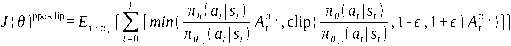

<!-- source-block:1285 -->
**直接偏好优化DPO**

<!-- source-block:1286 -->
目标函数：

<!-- source-block:1287 -->
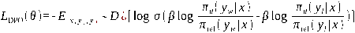

<!-- source-block:1288 -->
- 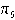 为待优化的策略（模型），

<!-- source-block:1289 -->
- 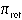 为参考模型（通常为初始模型），

<!-- source-block:1290 -->
-  为超参数，控制与参考策略的偏离程度，

<!-- source-block:1291 -->
- 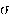 为 sigmoid 函数。

<!-- source-block:1292 -->
**组相对策略优化GRPO**

<!-- source-block:1293 -->
目标函数：

<!-- source-block:1294 -->
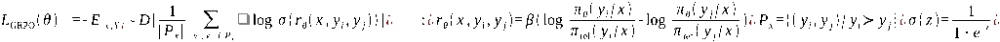

<!-- source-block:1296 -->
##### 有哪些PPO算法的调参经验？

<!-- source-block:1297 -->
**PPO关键参数设置**

<!-- source-block:1298 -->
**裁剪范围 (ε)**

<!-- source-block:1299 -->
通常设为 0.1-0.3，如原始论文建议 ε=0.2，用于限制策略更新幅度，平衡稳定性与收敛速度。

<!-- source-block:1300 -->
**折扣因子 (γ) 和 λ**

<!-- source-block:1301 -->
- γ（长期回报折扣）：常取 0.99-0.995

<!-- source-block:1302 -->
- λ（GAE偏差-方差权衡）：常取 0.95-0.98

<!-- source-block:1303 -->
两者共同影响信用分配和优势估计的平滑度。

<!-- source-block:1304 -->
**其他重要参数**

<!-- source-block:1305 -->
- 学习率：需随训练衰减（如 3e-4 → 1e-5）

<!-- source-block:1306 -->
- 批量大小：足够大以保证优势估计稳定

<!-- source-block:1307 -->
- 训练轮数（epoch）：每批数据训练 3-10 轮

<!-- source-block:1308 -->
**奖励模型的训练（PPO主要难点）**

<!-- source-block:1309 -->
PPO依赖奖励模型，但奖励模型训练面临三大挑战：

<!-- source-block:1310 -->
**目标定义困难**

<!-- source-block:1311 -->
奖励需同时兼顾多个维度（如推理准确性、安全性、有用性），目标难以量化统一。

<!-- source-block:1312 -->
**数据收集成本高**

<!-- source-block:1313 -->
依赖大量人类标注的偏好数据，成本高昂且难以规模化。

<!-- source-block:1314 -->
**模型设计权衡**

<!-- source-block:1315 -->
- 参数量太小：奖励准确性不足

<!-- source-block:1316 -->
- 参数量太大：推理计算开销过高

<!-- source-block:1317 -->
奖励模型损失函数为：

<!-- source-block:1318 -->
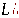

<!-- source-block:1319 -->
其中人类偏好回答A优于B。

<!-- source-block:1320 -->
**算法演进方向**

<!-- source-block:1321 -->
正是由于上述原因，后续DPO、GRPO等算法才试图绕过显式奖励模型训练，直接通过偏好数据优化策略，简化训练流程并降低对奖励模型的依赖。

<!-- source-block:1322 -->
##### DPO训练时，chosen和rejected的reward一起下降的可能原因？

<!-- source-block:1323 -->
如果数据没有标注好，那么可能出现下面的数据标注，偏好为

```text
A>B>C>A
{
	"chosen":A,
	"rejected":B,
}

{
	"chosen":B,
	"rejected":C,
}

{
	"chosen":C,
	"rejected":A,
}
```

<!-- source-block:1339 -->
这样的数据偏好，直接把dpo整懵了。不知道该提高输出哪个回答的概率了。

<!-- source-block:1340 -->
##### 如何看待各种PPO的平替算法dpo/kto/rrhf/slic/orpo/samug/remax等算法号称性能等能超过PPO？

<!-- source-block:1341 -->
我们注意到RewardModel有个很有意思的点，当使用大模型来搭建rewardmodel时，我们获得的可能不仅仅是人类标注中蕴含的那部分知识，同时还激发了模型在预训练过程中学到的一部分能力来做判别，这是我认为PPO和DPO一个比较重要的区别，甚至我们还可以对rewardmodel做一些提示词工程。举一个具体例子，可能我们给的所有标注都是没有长度偏好的，但是rewardmodel在预训练过程中就理解到详细的回答可能是更专业，更受人喜欢的，这样的知识就会通过PPO传导给policy模型，而DPO没有这样的效果。

<!-- source-block:1342 -->
##### 在PPO过程中，reward model的效果上会有什么问题？

<!-- source-block:1343 -->
rewardmodel的数据本身是有限标注的，那么在PPO训练过程中，模型产生的新样本可能是分布外的（OOD问题，outofdistribution），那么rewardmodel的准确率可能会降低；更极端的情况下，policy模型可能找到一些hacking解，虽然可能毫无意义，但是获得了很高的reward；这里可能可以用多个奖励模型投票的方式来增强鲁棒性。

<!-- source-block:1344 -->
##### 奖励模型应该如何选择？

<!-- source-block:1345 -->
奖励模型的选择应该注意一下几点：

<!-- source-block:1346 -->
- 数据质量 &gt; 模型大小

<!-- source-block:1347 -->
- “对齐目标”必须明确

<!-- source-block:1348 -->
- 考虑鲁棒性和对抗性测试

<!-- source-block:1349 -->
- 重视可解释性与校准度

<!-- source-block:1350 -->
- 与策略模型规模匹配

<!-- source-block:1351 -->
- 考虑效率与成本

<!-- source-block:1352 -->
总结：关键在于用高质量数据精确、鲁棒地定义你希望强化的行为，并警惕其被欺骗。它是整个对齐过程中最易出现偏差的环节。

<!-- source-block:1353 -->
##### DPO训练可能会出现什么问题？

<!-- source-block:1354 -->
梯度爆炸或消失：由于DPO更直接地优化策略目标函数，可能导致策略更新过快或过剧，从而导致梯度爆炸或消失的问题。

<!-- source-block:1355 -->
收敛性问题：DPO没有像PPO那样的机制来限制策略更新，因此可能在训练过程中出现不稳定或策略崩溃的情况。

<!-- source-block:1356 -->
探索和利用之间的平衡问题:由于DPO直接最小化目标函数，可能会倾向于过早地进行利用，导致探索不足，从而无法找到全局最优解。

<!-- source-block:1357 -->
##### 对比一下PPO，DPO，GRPO

<!-- source-block:1358 -->
| 维度 | PPO | DPO | GRPO |
| --- | --- | --- | --- |
| 核心概念 | 通过复杂的多模型协作，对每个生成步骤提供精细的奖励和优化 | 绕过复杂的奖励建模，直接利用“好-坏”答案对优化模型偏好 | 在单批次样本内进行相对比较，使用组内归一化的优势函数进行优化 |
| 关键组件 | 需同时训练和加载策略模型、奖励模型、评论家模型、参考模型 | 仅需策略模型和一个冻结的参考模型，无需显式的奖励或评论家模型 | 去除了评论家模型，仅需策略模型和参考模型，通过组内统计量计算优势 |
| 资源消耗 | 极高 | 很低 | 中等 |
| 数据需求 | 需要标注员对不同答案进行排序，以训练奖励模型，数据需求量大 | 对配对偏好数据质量要求极高，数据质量直接影响最终效果 | 要求相对较低。可使用规则（如数学正确性）或轻量评分模型为单个答案打分，无需复杂的配对标注 |
| 优势 | 优化精度高，能实现精细控制；<br> 在复杂、主观性任务上潜力大 | 训练极其稳定、简单，不易发散；<br>计算效率高，易于落地 | 在资源与效果间取得平衡，显著降低了PPO的显存门槛；<br> 特别适合有明确评判标准的客观任务（如数学、代码） |
| 劣势 | 实现复杂，训练不稳定。<br>计算和显存成本过高 | 严重依赖高质量偏好数据。<br>缺乏逐Token的精细优化能力 | 不适合高度主观的创意任务（需额外奖励模型）。<br> 多次采样增加了推理开销 |

<!-- source-block:1359 -->
##### PPO的缺点是什么？

<!-- source-block:1360 -->
在训练PPO的过程中，需要4个模型同时加载到GPU中，策略模型（要微调的大模型），冻结的参考模型，价值函数模型（value head，线性层），以及奖励模型。需要很大的算力。

<!-- source-block:1361 -->
##### DPO的偏好数据集长什么样子

```text
{
	"prompt":"....",
	"chosen":"....",
	"rejected":"....",
}
```

<!-- source-block:1367 -->
三元组。

<!-- source-block:1368 -->
##### 在什么情况下，DPO在数学上等价于PPO？

<!-- source-block:1369 -->
DPO的一个关键特性是，当Bradley-Terry模型完美拟合我们的偏好数据，并且RLHF学习到最优奖励函数时，RLHF和DPO的全局优化器是相同的。

<!-- source-block:1370 -->
这是一个重要的等价结果；然而在实践中：

<!-- source-block:1371 -->
**Bradley-Terry模型通常不能完美地拟合偏好数据。**

<!-- source-block:1372 -->
**RLHF学习到的奖励函数不会是最优的奖励函数。**

<!-- source-block:1373 -->
**在高度非凸的损失景观（例如LLM）上进行梯度下降找不到全局优化器。**

<!-- source-block:1374 -->
例如，偏好循环会导致Bradley-Terry模型无法完美拟合数据。Bradley-Terry模型假设偏好具有传递性。例如，如果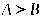 和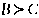 成立，则模型预期结果为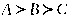 。但如果结果为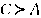 ，则存在循环，传递性被破坏。
