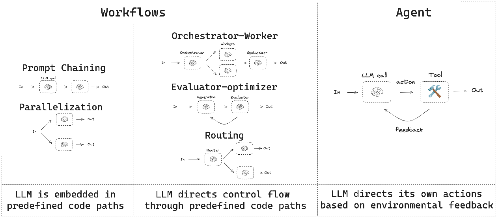

---
tags:
  - 大模型
  - 面试
source: "尚硅谷大模型技术之高频面试题-V2.1.6.docx"
source_blocks: "1131-1207"
reviewed: 2026-10-21
---

# Function Calling 与Agent执行闭环

工具调用是受约束的程序执行协议，模型只负责提出调用意图。

前篇：[[知识点总结/80-资料与复习/81-面试知识库/08-大模型高频面试题/02-模型原理与训练/10-KV Cache 的计算收益与容量边界|KV Cache 的计算收益与容量边界]] ｜ 后篇：[[知识点总结/80-资料与复习/81-面试知识库/08-大模型高频面试题/03-Agent与RAG/02-Agent短期记忆、长期记忆与恢复|Agent短期记忆、长期记忆与恢复]]

## 深入理解（新增）

一个完整闭环包含模型生成工具名与参数、应用校验、权限检查、执行、结构化返回和继续推理。JSON 可解析仅说明语法合法，不能证明订单属于当前用户，或这次操作被授权。

读工具可重试，写工具必须明确幂等键、执行结果和重复提交语义。模型请求“取消订单”时，应由业务服务核验订单状态与调用身份；不能把自然语言中的订单号直接拼进 SQL 或命令。

终止条件包括明确完成、最大步数、预算耗尽和不可恢复错误。工具返回失败后，应把失败状态交回编排器，避免模型把“已提交请求”说成“已执行成功”。下面示例仅校验调用结构，身份授权仍是执行层责任。


## 核心代码（新增）

以下是可在 CPU 运行的机制或业务契约示例，完整源码与测试见 [[知识点总结/80-资料与复习/81-面试知识库/08-大模型高频面试题/06-代码实验/01-核心代码实验与验证范围|核心代码实验与验证范围]]。示例不包含完整模型训练或外部平台部署。

```python
import json

def validate_tool_call(payload):
    data = json.loads(payload)
    if not isinstance(data, dict) or set(data) != {"tool", "args"}:
        raise ValueError("invalid envelope")
    if data["tool"] != "get_order" or not isinstance(data["args"], dict):
        raise ValueError("tool not allowed")
    order_id = data["args"].get("order_id")
    if set(data["args"]) != {"order_id"} or not isinstance(order_id, str) or not order_id.isdecimal():
        raise ValueError("invalid order_id")
    return data

call = validate_tool_call(
    '{"tool":"get_order","args":{"order_id":"123"}}')
assert call["args"]["order_id"] == "123"
# 接下来由执行服务核验调用者身份与订单归属；此函数未实现授权。
```

## 追问与验证（新增）

提交未知工具、额外参数和非数字订单号，确认被拒绝；再指出即使校验通过，仍需检查哪项用户权限。

## 官方资料与论文

- [LangGraph 工作流](https://docs.langchain.com/oss/python/langgraph/overview)
- [LangGraph 人工介入与恢复](https://docs.langchain.com/oss/python/langgraph/interrupts)

核验日期：2026-10-21。链接中的 `stable`、`main` 或平台文档会继续变化；新增纯 Python/NumPy 实验与原文旧版框架代码已分开标注。

## 原文保留

> [!warning] 原文批注
> Function Calling 不会自行赋予权限，也不保证工具一定执行成功；结构校验与业务授权是不同关卡。

<!-- source-block:1131 -->
### 大模型应用（Agent）

<!-- source-block:1132 -->
#### Function Call相关

<!-- source-block:1133 -->
##### 为什么需要函数调用？

<!-- source-block:1134 -->
LLM的能力是有边界的：如无法操作数据库、无法使用搜索引擎，在实际开发中，我们又需要大模型具备边界之外的能力，因此引入了函数调用（Function Call）机制。

<!-- source-block:1135 -->
##### 函数调用的定义和流程

<!-- source-block:1136 -->
**定义**

<!-- source-block:1137 -->
函数调用（Function Call）是大语言模型的一种能力：模型不仅返回文本，还能按照约定的格式返回需要调用的外部函数/工具的名称和参数信息。

<!-- source-block:1138 -->
**流程**

<!-- source-block:1139 -->
将用户请求转化为结构化的函数名和参数，由程序执行具体逻辑，再把结果返回给用户。

<!-- source-block:1140 -->
**用户输入请求并提供可用函数说明。**

<!-- source-block:1141 -->
**模型判断是直接回复文本还是输出特定格式的函数调用请求。**

<!-- source-block:1142 -->
**程序接收调用请求，执行对应函数并将返回结果发送给模型。**

<!-- source-block:1143 -->
**模型结合函数执行结果，生成最终答复或继续调用工具。**

<!-- source-block:1144 -->
##### 函数调用的目的

<!-- source-block:1145 -->
让模型与外部世界交互，调用工具来获取其自身无法直接获取的信息或执行特定操作，从而增强模型的能力，突破模型本身知识和能力的限制，完成更复杂、更准确的任务。

<!-- source-block:1146 -->
#### Agent相关

<!-- source-block:1147 -->
##### 什么是大模型Agent

<!-- source-block:1148 -->
大模型Agent（智能体）是一个将大语言模型（LLM）作为“大脑”的自主系统。它能够通过自然语言理解任务，进行复杂推理、制定计划并结合记忆功能、利用工具来执行任务，并能多次迭代，最终实现用户设定的目标。

<!-- source-block:1149 -->
##### 结合Langchain说明大模型Agent由哪些部分组成

<!-- source-block:1150 -->
**计划（Planning）**

<!-- source-block:1151 -->
计划模块是Agent的“大脑”，具备思维链、自我反思能力，负责任务分解、策略制定和决策推理。在LangChain中，计划能力主要通过Prompt Engineering + LLM推理和反思机制（Reflection）实现

<!-- source-block:1152 -->
**记忆（Memory）**

<!-- source-block:1153 -->
包括短期和长期记忆，用于存储上下文和历史信息。

<!-- source-block:1154 -->
- 短期记忆：主要依赖于对话缓冲区（Conversation Buffer）+窗口缓冲区（Conversation Buffer Window）

<!-- source-block:1155 -->
- 长期记忆：向量存储（Vector Stores）+摘要记忆（Conversation Summary Memory）+混合记忆（Combined Memory）

<!-- source-block:1156 -->
**工具（Tools）**

<!-- source-block:1157 -->
智能体可以调用的外部API、函数或服务。

<!-- source-block:1158 -->
**Langchain提供了一系列内置工具，常见的有**

<!-- source-block:1159 -->
- DuckDuckGoSearchRun：网络搜索工具。

<!-- source-block:1160 -->
- RequestsToolKit：HTTP请求工具集。

<!-- source-block:1161 -->
**并支持用户通过@tool装饰器或StructuredTool的from\_function()注册自定义工具。**

<!-- source-block:1162 -->
**行动（Action）**

<!-- source-block:1163 -->
执行模型决策，输出指令或与环境交互。

<!-- source-block:1164 -->
LangChain的Agen会解析LLM输出中的action和action\_input，自动调用对应工具。

<!-- source-block:1165 -->
工具执行后返回observation，再送回LLM决策下一步，形成“Thought → Action → Observation”循环。

<!-- source-block:1166 -->
##### Langchain Agent类型

<!-- source-block:1167 -->


<!-- source-block:1168 -->
工作流和agent

<!-- source-block:1169 -->
**两种工具调用方式：**

<!-- source-block:1170 -->
Function Call Agent：这类Agent基于结构化函数调用直接生成工具调用参数，效率更高，适合工具明确的场景。

<!-- source-block:1171 -->
ReAct Agent：基于文本推理的链式思考（Reasoning + Acting），具备反思和自我纠错能力。取第一个单词的前两个字母和第二个单词的前三个字母，合称ReAct。

<!-- source-block:1172 -->
**推理（Reasoning）：分析当前状态，决定下一步行动。**

<!-- source-block:1173 -->
**行动（Acting）：调用工具并返回结果。**

<!-- source-block:1174 -->
通过自然语言描述决策过程，适合需要明确推理步骤的场景。

<!-- source-block:1175 -->
**Zero-shot ReAct Agent（上图最右边那类：大模型基于环境反馈自己决策）**

<!-- source-block:1176 -->
特点：

<!-- source-block:1177 -->
- 不需要示例，直接根据工具描述推理并执行动作。

<!-- source-block:1178 -->
- 使用ReAct框架。

<!-- source-block:1179 -->
- 每次调用LLM决定下一步使用哪个推理工具。

<!-- source-block:1180 -->
适用场景：通用任务，如问答、调用工具、多步推理等。

<!-- source-block:1181 -->
**Conversational Agent（中间那类：大模型根据预定义的代码路径控制流程）**

<!-- source-block:1182 -->
特点：

<!-- source-block:1183 -->
- 专为对话场景设计，能记住历史消息。

<!-- source-block:1184 -->
- 可结合工具使用，适合聊天机器人、客服助手。

<!-- source-block:1185 -->
适用场景：需要连续对话且可能调用工具的场景。

<!-- source-block:1186 -->
**Self-ask with Search Agent（图中Evaluator-optimizer 或 Router）**

<!-- source-block:1187 -->
特点：

<!-- source-block:1188 -->
- 自动提出中间问题并调用搜索工具。

<!-- source-block:1189 -->
- 适合需要多步检索的任务。

<!-- source-block:1190 -->
适用场景：复杂事实查询、多源信息检索。

<!-- source-block:1191 -->
**Plan-and-execute Agent（图中Prompt Chaining + Routing）**

<!-- source-block:1192 -->
特点：

<!-- source-block:1193 -->
- 先规划整个任务步骤，再逐步执行。

<!-- source-block:1194 -->
- 适合复杂、多步、可分解的任务。

<!-- source-block:1195 -->
适用场景：项目拆解、多工具协作任务。

<!-- source-block:1196 -->
Langchain Agent核心其实就是一个循环：

<!-- source-block:1197 -->
输入 → LLM 选择工具 → 执行工具 → 观察结果 → 判断是否继续 → 输出

<!-- source-block:1198 -->
##### 什么是AgentExecutor

<!-- source-block:1199 -->
AgentExecutor是执行Agent的调度器，是其运行控制器。

<!-- source-block:1200 -->
它负责接收输入、驱动Agent进行推理决策、调用相应工具、处理观测结果，并管理整个执行流程。

<!-- source-block:1201 -->
在 LangChain 中，Agent 无法直接运行，必须通过 AgentExecutor 来驱动和执行。

<!-- source-block:1202 -->
##### 大模型Agent实现思路

<!-- source-block:1203 -->
设置秘钥→初始化LLM→初始化工具并封装为工具实例（可以省略）→创建Agent和AgentExecutor→执行查询

<!-- source-block:1204 -->
##### 如何给LLM注入领域知识

<!-- source-block:1205 -->
**Langchain的记忆模块：从相关记忆对象中获取领域知识（短期记忆）**

<!-- source-block:1206 -->
**RAG：从包含领域知识的向量数据库中检索相关信息（长期记忆）。**

<!-- source-block:1207 -->
**领域知识微调LLM（永久记忆）。**
