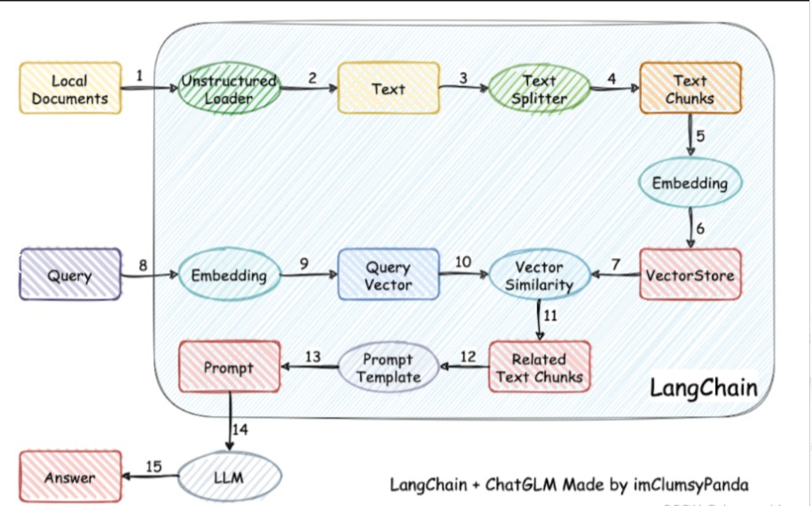

---
tags:
  - 大模型
  - 面试
source: "尚硅谷大模型技术之高频面试题-V2.1.6.docx"
source_blocks: "1391-1457"
reviewed: 2026-10-21
---

# RAG 文档解析、分块与索引

摄入链路必须让答案能够回溯到具体版本和具体位置。

前篇：[[知识点总结/80-资料与复习/81-面试知识库/08-大模型高频面试题/02-模型原理与训练/12-思维链、推理训练与验证边界|思维链、推理训练与验证边界]] ｜ 后篇：[[知识点总结/80-资料与复习/81-面试知识库/08-大模型高频面试题/03-Agent与RAG/04-混合召回、RRF、重排与HyDE|混合召回、RRF、重排与HyDE]]

## 深入理解（新增）

建议每个 chunk 保存 doc_id、version、chunk_id、页码或字符偏移、租户权限和内容哈希。解析、清洗、分块、嵌入是不同步骤；若解析把表头和单元格拆散，后续换更强 embedding 也无法恢复原始关系。

分块长度以 token 预算为主，字符数只能作为粗略代理。父子块策略可用小块召回、大块补上下文，但扩展父块时仍需权限过滤和预算裁剪，不能把不相关内容无限拼入提示词。

更新文档时应先生成新版本索引，再切换可见版本并清理旧块。只按文件名覆盖会留下旧 chunk，造成同一问题同时检索到相互矛盾的政策。下面字符分块代码保留偏移，适合验证追溯契约。


## 核心代码（新增）

以下是可在 CPU 运行的机制或业务契约示例，完整源码与测试见 [[知识点总结/80-资料与复习/81-面试知识库/08-大模型高频面试题/06-代码实验/01-核心代码实验与验证范围|核心代码实验与验证范围]]。示例不包含完整模型训练或外部平台部署。

```python
def chunk_with_offsets(text, size=100, overlap=20):
    if not 0 <= overlap < size:
        raise ValueError("require 0 <= overlap < size")
    result = []
    start = 0
    while start < len(text):
        end = min(len(text), start + size)
        result.append({"start": start, "end": end, "text": text[start:end]})
        if end == len(text):
            break
        start = end - overlap
    return result

source = "订单退款规则：申请后进入审核，审核完成后返回结果。"
chunks = chunk_with_offsets(source, size=12, overlap=3)
assert all(source[c["start"]:c["end"]] == c["text"] for c in chunks)
```

## 追问与验证（新增）

切分后逐块断言 text[start:end] 等于保存内容，再更新源文档，检查索引是否仍混入旧版本。

## 官方资料与论文

- [Retrieval-Augmented Generation](https://arxiv.org/abs/2005.11401)
- [BGE-M3 原论文](https://arxiv.org/abs/2402.03216)

核验日期：2026-10-21。链接中的 `stable`、`main` 或平台文档会继续变化；新增纯 Python/NumPy 实验与原文旧版框架代码已分开标注。

## 原文保留

> [!warning] 原文批注
> 分块不是简单截断字符串；语义边界、表格结构、来源版本和访问控制会共同决定检索质量。

<!-- source-block:1391 -->
### RAG

<!-- source-block:1392 -->
#### 基本概念

<!-- source-block:1393 -->
##### 为什么大模型需要外挂(向量)知识库?

<!-- source-block:1394 -->
- 解决 “知识时效性” 问题

<!-- source-block:1395 -->
- 解决 “知识领域局限性” 问题

<!-- source-block:1396 -->
- 解决 “事实准确性与幻觉” 问题

<!-- source-block:1397 -->
- 降低 “模型训练 / 微调成本”

<!-- source-block:1398 -->
##### RAG工作流程

<!-- source-block:1399 -->


<!-- source-block:1400 -->
#### 索引阶段

<!-- source-block:1401 -->
##### 怎么解析pdf？

<!-- source-block:1402 -->
**使用langchain的UnstructuredPDFLoader，模型目标检测（YOLOX） + OCR文字识别（Tesseract）**

<!-- source-block:1403 -->
YOLOX：基于深度学习的实时目标检测模型。定位并分类 PDF 中的视觉元素（Text、Title、Table、Image 等），并确定坐标。

<!-- source-block:1404 -->
OCR：识别并转换为文字。

<!-- source-block:1405 -->
**MinerU**

<!-- source-block:1406 -->
MinerU是一款由上海人工智能实验室OpenDataLab团队开发的智能数据提取工具，尤其擅长处理PDF等复杂格式的文档。它的核心目标是高效地将文档转换为高质量、结构化的机器可读格式（如Markdown和JSON），为后续的数据分析、知识库构建或大模型训练提供支持。

<!-- source-block:1407 -->
##### 扩展-关于以上两种解析pdf方法缺点对比以及如何选择

<!-- source-block:1408 -->
**UnstructuredPDFLoader的核心问题：**

<!-- source-block:1409 -->
- 信息提取不完整：它主要是一个文本提取工具，在处理包含超链接、复杂表格、数学公式的文档时能力不足，常导致关键信息丢失。

<!-- source-block:1410 -->
- 依赖环境复杂：作为封装工具，其正常运作严重依赖unstructured库及其底层组件（如pdfplumber、poppler），安装过程容易出现依赖缺失或版本冲突问题。

<!-- source-block:1411 -->
**MinerU的局限性：**

<!-- source-block:1412 -->
- 部署与运行成本高：其基于深度学习的模型需要GPU以获得最佳性能，且安装部署比纯Python库复杂，对只想进行简单文本提取的用户来说门槛较高。

<!-- source-block:1413 -->
- 处理扫描件时可能能力受限：对于纯图像格式的PDF，其OCR能力依赖于集成或额外的OCR引擎，并非其核心优势。

<!-- source-block:1414 -->
**如何选择：**

<!-- source-block:1415 -->
如果你的首要任务是构建RAG系统或处理简单文档，希望快速上手，应选择UnstructuredPDFLoader；如果你的核心需求是深度解析含复杂表格、公式、版面的专业文档，并追求极致精度，则应选择MinerU。

<!-- source-block:1416 -->
##### pdf解析存在哪些问题？ 可以怎么优化？

<!-- source-block:1417 -->
**问题：**

<!-- source-block:1418 -->
- 内容提取：扫描件/图片文字需OCR识别（可能出错）；非嵌入字体、加密或损坏的文件会导致提取失败或乱码。

<!-- source-block:1419 -->
- 结构还原：复杂多栏排版、表格、公式、页眉页脚/水印等，难以还原阅读顺序和逻辑层级。

<!-- source-block:1420 -->
- 批量与性能：大量或超大文件处理耗时耗资源。

<!-- source-block:1421 -->
- 格式标准化：不同来源PDF质量/格式各异，输出结构不一，难直接利用。

<!-- source-block:1422 -->
**优化手段：**

<!-- source-block:1423 -->
**选用专业工具：**

<!-- source-block:1424 -->
- MinerU等AI驱动工具：擅长解析复杂版面、表格、公式。

<!-- source-block:1425 -->
- 多模态大模型（如GPT-4V）：理解文档整体布局与内容。

<!-- source-block:1426 -->
- 专用OCR引擎（如Tesseract）：提高扫描件文字识别率。

<!-- source-block:1427 -->
**优化处理流程：**

<!-- source-block:1428 -->
- 分阶段处理：先做版面分析（识别区域），再分区域提取内容。

<!-- source-block:1429 -->
- 规则与AI结合：用AI识别，再用规则（如靠近原则）校正顺序。

<!-- source-block:1430 -->
- 文档预处理：合并、压缩、去水印以提升输入质量。

<!-- source-block:1431 -->
**强化集成与后处理：**

<!-- source-block:1432 -->
- 用正则表达式、模板等后处理规则清洗和结构化数据。

<!-- source-block:1433 -->
- 部署健壮的错误处理与重试机制，应对异常文件。

<!-- source-block:1434 -->
##### 为什么需要对文本分块?

<!-- source-block:1435 -->
**模型上下文窗口限制**

<!-- source-block:1436 -->
嵌入模型：如如 BGE-base-zh-v1.5 的上下文窗口为 512 token，若直接处理超过此长度的文本，会导致语义截断，生成的信息不够精确或者有所缺失。

<!-- source-block:1437 -->
LLM：目前主流大模型上下文长度支持超过32k，但更消耗资源

<!-- source-block:1438 -->
**检索精度优化**

<!-- source-block:1439 -->
提高检索相关性的准确性（更少的无关内容，向量相似度计算更精准）

<!-- source-block:1440 -->
避免噪声信息干扰（无关内容会"稀释"相关内容的权重，影响检索效果）

<!-- source-block:1441 -->
**保持语义完整性**

<!-- source-block:1442 -->
通过合理的分块策略（如RecursiveCharacterTextSplitter），可以在保持语义完整性的前提下将长文档切分为合适大小的块。

<!-- source-block:1443 -->
##### 能不能介绍一下常见的文本分块方法？

<!-- source-block:1444 -->
固定长度分块：固定字符数 chunk\_size 切分文本。

<!-- source-block:1445 -->
递归字符分块：按层次化分隔符列表进行递归切分，结合滑动窗口。

<!-- source-block:1446 -->
基于模型的分块：在语义发生突变（相似度低）的位置进行切分，或主题模型（如LDA）按主题划分。

<!-- source-block:1447 -->
小-大分块：维护两套向量数据库。一个按照句子粒度切块，一个按照段落粒度切块。检索时：query-&gt;句子，句子-》段落。

<!-- source-block:1448 -->
基于LLM分块：利用一个LLM Agent来模拟人类的阅读理解过程，动态决定分块边界。

<!-- source-block:1449 -->
注：加载文档时，用Unstructured库（包括langchain的封装），已可感知文本层次结构，所以不讨论按照文档结构分块。

<!-- source-block:1450 -->
##### 常用向量数据库介绍

<!-- source-block:1451 -->
Milvus：专为AI设计的云原生开源向量数据库，功能全面，从轻量级到企业级一应俱全，尤其擅长处理十亿级大规模数据。

<!-- source-block:1452 -->
Pinecone：完全托管、无需运维的向量数据库，提供最简单的API，能让你最快地构建和上线应用。

<!-- source-block:1453 -->
Weaviate：模块化设计的AI原生数据库，内置强大的向量与关键词混合检索能力，并支持多租户。

<!-- source-block:1454 -->
PGvector：PostgreSQL的扩展插件，让你能在熟悉的SQL生态中直接进行向量搜索，集成成本最低。

<!-- source-block:1455 -->
Faiss：Facebook推出的高性能向量检索库（非数据库），在纯向量相似性搜索上速度极快。

<!-- source-block:1456 -->
Elasticsearch：传统的全文搜索引擎巨头，通过扩展插件支持向量检索，擅长处理文本与向量的混合查询。

<!-- source-block:1457 -->
一般轻量级可以使用 Milvus Lite和 PGvector进行快速验证，企业级RAG一般使用Milvus居多。传统搜索引擎一般用的是Elasticsearch。
