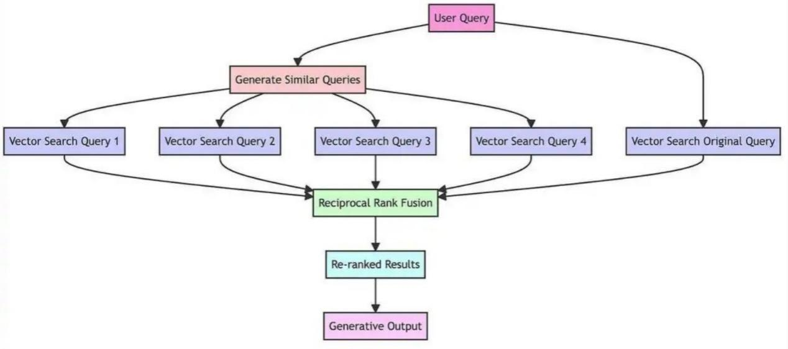
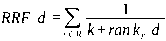

---
tags:
  - 大模型
  - 面试
source: "尚硅谷大模型技术之高频面试题-V2.1.6.docx"
source_blocks: "1458-1500"
reviewed: 2026-10-21
---

# 混合召回、RRF、重排与HyDE

召回负责覆盖候选，融合与重排负责重新分配有限阅读预算。

前篇：[[知识点总结/80-资料与复习/81-面试知识库/08-大模型高频面试题/03-Agent与RAG/03-RAG 文档解析、分块与索引|RAG 文档解析、分块与索引]] ｜ 后篇：[[知识点总结/80-资料与复习/81-面试知识库/08-大模型高频面试题/03-Agent与RAG/05-RAG 检索评估、生成评估与回归测试|RAG 检索评估、生成评估与回归测试]]

## 深入理解（新增）

稠密向量擅长语义相近，词项检索擅长型号、专名与精确短语。RRF 按名次而非原始分数融合，避免把不同检索器的分数量纲直接相加。融合前应统一 chunk 标识，并在每条榜单内去重。

Reranker 只能重排已经召回的候选，不能把从未出现的证据找回来。先看 Recall@候选数，再看重排后的 MRR 或 nDCG，才能判断瓶颈位于覆盖还是排序。

HyDE 生成的假想文档是检索查询的辅助表示，不是事实证据，不能作为答案引用来源。查询改写还可能删掉否定词、时间与权限条件，应保留原始查询分支并记录改写效果。

### 可编辑公式

$$\mathrm{RRF}(d)=\sum_j\frac{\mathbf 1[d\in R_j]}{k+\mathrm{rank}_{R_j}(d)}$$

同一路结果内相同文档仅计一次；$k$ 是平滑常数，与最终输出 Top-K 数量不是同一参数。

## 核心代码（新增）

以下是可在 CPU 运行的机制或业务契约示例，完整源码与测试见 [[知识点总结/80-资料与复习/81-面试知识库/08-大模型高频面试题/06-代码实验/01-核心代码实验与验证范围|核心代码实验与验证范围]]。示例不包含完整模型训练或外部平台部署。

```python
from collections import defaultdict
import numpy as np

def rrf_fuse(rankings, constant=60):
    if constant <= 0:
        raise ValueError("constant must be positive")
    scores = defaultdict(float)
    for ranking in rankings:
        seen = set()
        for rank, doc_id in enumerate(ranking, start=1):
            if doc_id in seen:
                continue
            seen.add(doc_id)
            scores[doc_id] += 1 / (constant + rank)
    return sorted(scores.items(), key=lambda item: (-item[1], item[0]))

def cosine_similarity(query, vectors):
    query = np.asarray(query, dtype=float)
    vectors = np.asarray(vectors, dtype=float)
    denom = np.linalg.norm(query) * np.linalg.norm(vectors, axis=1)
    return np.divide(vectors @ query, denom, out=np.zeros(len(vectors)), where=denom != 0)

ranked = rrf_fuse([["sku-A", "sku-B"], ["sku-B", "sku-C"]])
assert ranked[0][0] == "sku-B"

scores = cosine_similarity([1, 0], [[1, 0], [0, 1], [0, 0]])
assert np.allclose(scores, [1, 0, 0])
```

## 追问与验证（新增）

为同一相关 chunk 设计“关键词排第一、向量排很后”的榜单，比较 RRF 与原始分数相加，并检查去重效果。

## 官方资料与论文

- [Retrieval-Augmented Generation](https://arxiv.org/abs/2005.11401)
- [BGE-M3 原论文](https://arxiv.org/abs/2402.03216)

核验日期：2026-10-21。链接中的 `stable`、`main` 或平台文档会继续变化；新增纯 Python/NumPy 实验与原文旧版框架代码已分开标注。

## 原文保留

> [!warning] 原文批注
> BGE-M3 的 M3 指多语言、多功能和多粒度，它是文本嵌入模型；不能据此称其原生支持图片多模态嵌入。

<!-- source-block:1458 -->
### 高级RAG优化

<!-- source-block:1459 -->
#### 针对通用的RAG，你觉得还有哪些改进点?

<!-- source-block:1460 -->
**检索前：**

<!-- source-block:1461 -->
- 文本切块：选择合适的切分策略（递归字符切分+合适的chunk\_size\\chunnk\_overlap）

<!-- source-block:1462 -->
- 查询重述：query 的纠错、改写，规范化和扩展（多查询）

<!-- source-block:1463 -->
- query和检索答案语义偏差较大，使用HyDE

<!-- source-block:1464 -->
**检索时：**

<!-- source-block:1465 -->
- 混合检索（关键词检索+向量检索）

<!-- source-block:1466 -->
**检索后：**

<!-- source-block:1467 -->
- 如果有多个检索器或多次检索，使用rrf算法重排

<!-- source-block:1468 -->
- 检索结果进行rerank（bge-rerank或者qwen3-rerank），按照查询和结果的语义评分排序

<!-- source-block:1469 -->
**缓存加速：对query的Embedding结果缓存、对检索结果缓存**

<!-- source-block:1470 -->
#### RAG 如何提升索引数据的质量?

<!-- source-block:1471 -->
做好数据清洗：

<!-- source-block:1472 -->
去重、去除特殊字符。

<!-- source-block:1473 -->
实体对齐、歧义消解（对多义词进行上下文标注，如 “苹果” 标注为 “水果” 或 “公司”）。

<!-- source-block:1474 -->
#### 查询重述(QueryTransformations)

<!-- source-block:1475 -->
在某些情况下，用户的 query 可能出现表述不清、口语化、内容无关等问题。

<!-- source-block:1476 -->
利用LLM的强大能力，将原始的用户问题转换或重写为更合适的、能够更准确地返回所需结果的查询。

<!-- source-block:1477 -->
#### 如何通过 混合检索 提升 RAG 效果?

<!-- source-block:1478 -->
向量相似度检索+关键词检索（BM25）。

<!-- source-block:1479 -->
对两种检索结果进行rrf重排。

<!-- source-block:1480 -->
#### 如何通过重新排名提升RAG效果?

<!-- source-block:1481 -->
向量数据库的相似度评分（如余弦相似度）本质是向量空间的距离匹配，但无法解决 “语义匹配偏差” 和 “复杂意图理解” 问题。

<!-- source-block:1482 -->
使用rerank模型（如bge-reranker-base） 模型来对检索结果进行语义相关性评分，按照评分重新排序。

<!-- source-block:1483 -->
#### 什么是RAG Fusion？工作流程？

<!-- source-block:1484 -->
多查询+RRF（逆向排名融合算法）+按评分重排序

<!-- source-block:1485 -->


<!-- source-block:1486 -->
#### 为什么RAG Fusion需要生成多个查询？

<!-- source-block:1487 -->
单一查询可能无法完全捕捉用户感兴趣的全部范围，或者可能过于狭窄而无法产生全面的结果。

<!-- source-block:1488 -->
从不同角度生成多个查询，不仅与原始查询相似，还提供不同的视角或角度。

<!-- source-block:1489 -->
#### RAG Fusion为什么使用RRF

<!-- source-block:1490 -->
RRF是一种将多个搜索结果列表的排名结合起来产生单一统一排名的技术。

<!-- source-block:1491 -->
核心思想：一个文档如果在多个检索方法中都排在靠前的位置，那么它应该在最终的融合排名中获得更高的权重。

<!-- source-block:1492 -->


<!-- source-block:1493 -->
结合不同查询的排名，增加了最相关文档出现在最终列表顶部的机会。

<!-- source-block:1494 -->
#### 介绍一下HYDE思路?

<!-- source-block:1495 -->
HyDE解决检索阶段可能遇到的 “查询 - 文档” 语义鸿沟问题。

<!-- source-block:1496 -->
**使用 LLM 根据查询先生成假设性文档**

<!-- source-block:1497 -->
**再使用文档（嵌入成向量）去进行检索。**

<!-- source-block:1498 -->
#### 介绍一下HYDE问题?

<!-- source-block:1499 -->
假答案质量依赖 LLM 能力，易引入噪声。（如果是专业领域知识，LLM还需要经过领域知识微调）

<!-- source-block:1500 -->
需要额外调用 LLM 生成假答案，增加系统开销。
