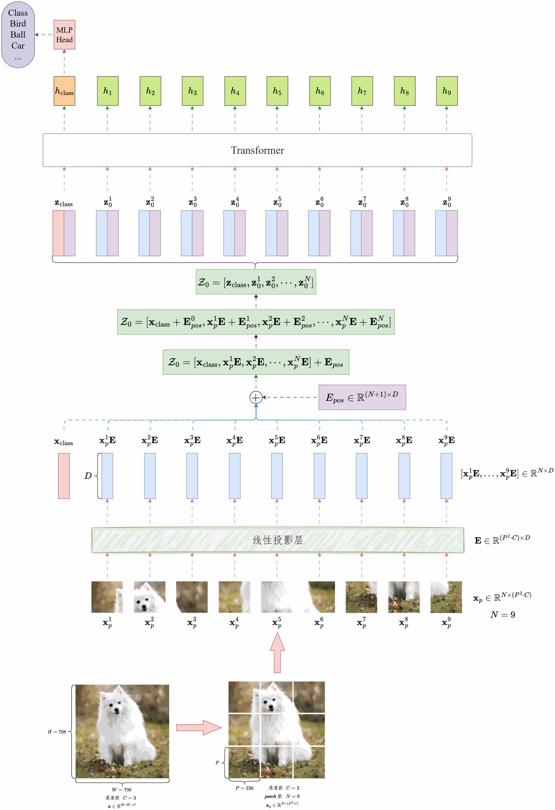
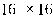
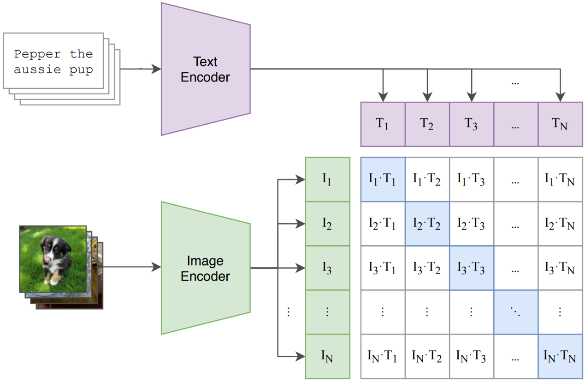

---
tags:
  - 大模型
  - 面试
source: "尚硅谷大模型技术之高频面试题-V2.1.6.docx"
source_blocks: "1523-1568"
reviewed: 2026-10-21
---

# ViT、CLIP与跨模态检索

跨模态对齐通过训练配对关系建立，向量相似不等于事实正确。

前篇：[[知识点总结/80-资料与复习/81-面试知识库/08-大模型高频面试题/03-Agent与RAG/05-RAG 检索评估、生成评估与回归测试|RAG 检索评估、生成评估与回归测试]] ｜ 后篇：[[知识点总结/80-资料与复习/81-面试知识库/08-大模型高频面试题/04-多模态/02-扩散模型、条件控制与图文对齐|扩散模型、条件控制与图文对齐]]

## 深入理解（新增）

ViT 把图像切成 patch 并映射为序列，位置编码提供空间信息；分辨率变大会增加 token 数及注意力成本。CLIP 则训练图像与文本编码器，让正确配对在批内相似矩阵中排得更高。

CLIP 常用图到文、文到图两个方向的对比交叉熵。图像向量与文本向量先归一化，再用可学习尺度调节 logits。下面实现把温度相关的尺度当作直接输入，实际模型若保存 logit_scale 的对数参数，需要先取 exp。

同商品的不同描述可能互相成为假负例；零样本分类也受提示模板、候选标签和领域偏移影响。检索相似度是排序信号，不是“商品同款概率”，应以独立业务标注校准阈值。

### 可编辑公式

$$S_{ij}=s\frac{v_i^\top t_j}{\|v_i\|\|t_j\|},\quad\mathcal L=\frac{\mathrm{CE}(S,\mathrm{diag})+\mathrm{CE}(S^\top,\mathrm{diag})}{2}$$

对角线表示一一配对标签。多正例数据需要调整目标，不能直接套用一对一假设。

## 核心代码（新增）

以下是可在 CPU 运行的机制或业务契约示例，完整源码与测试见 [[知识点总结/80-资料与复习/81-面试知识库/08-大模型高频面试题/06-代码实验/01-核心代码实验与验证范围|核心代码实验与验证范围]]。示例不包含完整模型训练或外部平台部署。

```python
import numpy as np

def clip_contrastive_loss(image_features, text_features, logit_scale=1.0):
    def normalize(x):
        return x / np.maximum(np.linalg.norm(x, axis=1, keepdims=True), 1e-12)
    logits = logit_scale * normalize(image_features) @ normalize(text_features).T
    image_logp = logits - np.logaddexp.reduce(logits, axis=1, keepdims=True)
    text_logp = logits.T - np.logaddexp.reduce(logits.T, axis=1, keepdims=True)
    return float(-(np.diag(image_logp).mean() + np.diag(text_logp).mean()) / 2)

image = np.eye(3); text = np.eye(3)
assert clip_contrastive_loss(image, text, 10) < \
       clip_contrastive_loss(image, text[::-1], 10)
```

## 追问与验证（新增）

打乱文本与图像的配对顺序，确认对比损失上升；然后加入同义描述，讨论批内负例假设的局限。

## 官方资料与论文

- [CLIP 原论文](https://arxiv.org/abs/2103.00020)

核验日期：2026-10-21。链接中的 `stable`、`main` 或平台文档会继续变化；新增纯 Python/NumPy 实验与原文旧版框架代码已分开标注。

## 原文保留

> [!warning] 原文批注
> CLIP 相似度并非概率；图文配对、向量归一化和尺度参数的定义都会影响损失与阈值。

<!-- source-block:1523 -->
### 多模态

<!-- source-block:1524 -->
#### Vit架构

<!-- source-block:1525 -->


<!-- source-block:1526 -->
**整体思路**

<!-- source-block:1527 -->
Vision Transformer，简称 ViT，就是把图像识别问题转化成类似 NLP 的序列建模问题。原来我们处理句子是把句子拆成单词，ViT 就是把一张图拆成小块（patch），再用 Transformer 去理解这些块之间的关系。

<!-- source-block:1528 -->
**具体流程**

<!-- source-block:1529 -->
**切图&向量化**

<!-- source-block:1530 -->
一张图会先被切成很多小块，比如16×16的patch。每个patch都会被拉直，再映射成一个向量，相当于给它一个“词向量”。

<!-- source-block:1531 -->
**加入位置信息**

<!-- source-block:1532 -->
因为Transformer不像卷积那样天然有位置信息，所以我们要给每个patch加上位置编码，让模型知道这个patch在图里是哪里来的。

<!-- source-block:1533 -->
**加一个分类token**

<!-- source-block:1534 -->
在所有patch前面，加一个特殊的&lt;CLS&gt; token，专门用来聚合整张图的信息。最后分类的时候，就用它的输出。

<!-- source-block:1535 -->
**Transformer编码器**

<!-- source-block:1536 -->
接下来就是一堆标准的Transformer层：多头自注意力、前馈网络、残差连接和归一化。这样模型就能学习到图像中任意两个patch之间的全局关系。

<!-- source-block:1537 -->
**分类头**

<!-- source-block:1538 -->
最后，拿到&lt;CLS&gt; token的表示，送到一个小的全连接网络里，输出类别。

<!-- source-block:1539 -->
**特点和优势**

<!-- source-block:1540 -->
**ViT的最大特点是它不再像CNN那样只关注局部，而是通过自注意力直接建模全局关系。**

<!-- source-block:1541 -->
**它在小数据集上不如CNN，但在大规模数据上训练后，往往能超过CNN的表现。**

<!-- source-block:1542 -->
**而且它的扩展性很好，模型越大、数据越多，效果提升越明显。**

<!-- source-block:1543 -->
##### Vit图像补丁嵌入是什么

<!-- source-block:1544 -->
在 ViT 里面，图像补丁嵌入就是把原始图像切成小块，再把这些小块转换成向量表示的过程。

<!-- source-block:1545 -->
具体来说，一张图像会被均匀切分成很多小patch，比如常见的是 大小。每个小patch就像是NLP里的“一个词”。但是模型不能直接处理原始像素，所以会先把每个 patch 展平，再用一个线性映射（其实就是全连接层）把它转成固定维度的向量。这个步骤就叫做 补丁嵌入（Patch Embedding）。

<!-- source-block:1546 -->
这样，整张图就被表示成一串向量序列，可以直接送进Transformer去做自注意力建模。

<!-- source-block:1547 -->
其实patch embedding和CNN的卷积很像，如果把卷积核的大小和步幅设置得跟patch一样，就能达到相同效果。CLIP源码中就是这样实现的。

<!-- source-block:1548 -->
##### 讲一讲ViT的图像是怎么输入模型的，class token的作用是什么

<!-- source-block:1549 -->
ViT把图像切成小块做embedding，加上位置信息，再在前面拼一个\[CLS\] token输入模型。最后分类就是用这个token的输出，因为它在自注意力机制中相当于收集了全图的语义。

<!-- source-block:1550 -->
#### CLIP架构

<!-- source-block:1551 -->


<!-- source-block:1552 -->
CLIP的架构就是一个图像编码器+文本编码器+投影层的双塔结构，在同一个嵌入空间里通过对比学习实现图文对齐。

<!-- source-block:1553 -->
**双塔结构（Two-Tower）**

<!-- source-block:1554 -->
**图像编码器（Image Encoder）：可以是ResNet或Vision Transformer(ViT)，输入图像后得到一个全局图像特征向量。**

<!-- source-block:1555 -->
**文本编码器（Text Encoder）：是Transformer（类似GPT/BERT的结构），输入tokenized的文本后，取最后的\[EOS\]向量作为整句的表示。**

<!-- source-block:1556 -->
**共同嵌入空间（Joint Embedding Space）**

<!-- source-block:1557 -->
两个编码器输出的特征会通过一个线性投影层（Projection Head）映射到同一个维度空间。这样图像和文本就可以直接比较相似度。

<!-- source-block:1558 -->
**对比学习训练目标（InfoNCE Loss）**

<!-- source-block:1559 -->
在一个batch内，模型会计算所有图像和文本之间的相似度（点积/cosine similarity）。正确的图文对被拉近，错误的被推远。

<!-- source-block:1560 -->
##### 投影层的作用是什么

<!-- source-block:1561 -->
在CLIP里，图像编码器和文本编码器出来的特征，原本不在同一个空间：

<!-- source-block:1562 -->
**图像特征可能来自CNN/ViT，分布和尺度不同；**

<!-- source-block:1563 -->
**文本特征来自Transformer，也有自己的分布。**

<!-- source-block:1564 -->
如果直接拿它们比相似度，效果会很差。

<!-- source-block:1565 -->
投影层（Projection Layer）的作用就是：

<!-- source-block:1566 -->
- 统一维度：把图像和文本特征映射到相同的维度空间，方便对齐。

<!-- source-block:1567 -->
- 对齐表征空间：通过可学习的线性变换，让两种模态的特征在一个共享语义空间里可比较。

<!-- source-block:1568 -->
- 简化训练目标：投影之后，可以直接用点积或余弦相似度计算图文对的相似性，再配合对比损失来优化。
