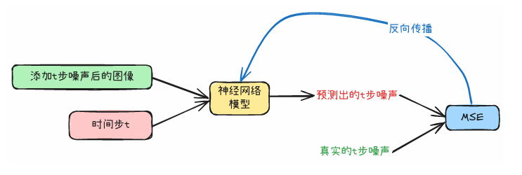
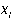
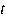
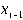
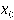
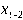
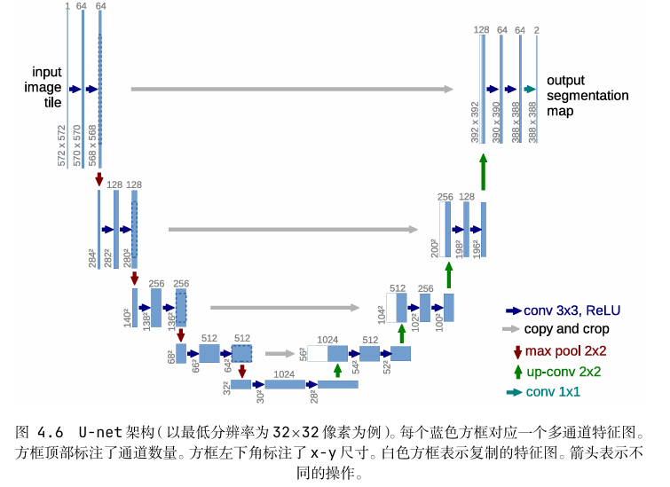

---
tags:
  - 大模型
  - 面试
source: "尚硅谷大模型技术之高频面试题-V2.1.6.docx"
source_blocks: "1569-1626"
reviewed: 2026-10-21
---

# 扩散模型、条件控制与图文对齐

先区分已知加噪过程和学出来的反向去噪过程。

前篇：[[知识点总结/80-资料与复习/81-面试知识库/08-大模型高频面试题/04-多模态/01-ViT、CLIP与跨模态检索|ViT、CLIP与跨模态检索]] ｜ 后篇：[[知识点总结/80-资料与复习/81-面试知识库/08-大模型高频面试题/05-项目实战/01-地址实体抽取与标准地址对齐|地址实体抽取与标准地址对齐]]

## 深入理解（新增）

DDPM 前向过程可直接采样 x_t=sqrt(alpha_bar_t)*x_0+sqrt(1-alpha_bar_t)*noise。alpha_bar 是多步保留系数的乘积，不应与单步 alpha 混用。训练随机采样 t，让网络预测噪声或所选参数化目标。

反向生成还需要时间调度、去噪网络和采样器，下面的一行加噪公式并不是完整生成器。Classifier-free guidance 用条件与无条件预测的差进行引导，过强引导可能牺牲多样性或图像质量。

ControlNet 等空间控制和文本提示作用不同。比较效果应固定初始噪声、采样器、步数和分辨率，再分别改变控制条件；不能把随机种子改变带来的差异归因到模型改进。

### 可编辑公式

$$x_t=\sqrt{\bar\alpha_t}x_0+\sqrt{1-\bar\alpha_t}\,\epsilon,\quad\epsilon\sim\mathcal N(0,I)$$

$$\mathcal L_{noise}=\mathbb E_{x_0,t,\epsilon}\left[\|\epsilon-\epsilon_\theta(x_t,t,c)\|_2^2\right]$$

第一式是前向采样，第二式是一种噪声预测训练目标；实际模型也可能使用其他参数化。

## 核心代码（新增）

以下是可在 CPU 运行的机制或业务契约示例，完整源码与测试见 [[知识点总结/80-资料与复习/81-面试知识库/08-大模型高频面试题/06-代码实验/01-核心代码实验与验证范围|核心代码实验与验证范围]]。示例不包含完整模型训练或外部平台部署。

```python
import numpy as np

def diffusion_forward(x0, noise, alpha_bar):
    if not 0 <= alpha_bar <= 1:
        raise ValueError("alpha_bar must be in [0,1]")
    return np.sqrt(alpha_bar) * x0 + np.sqrt(1 - alpha_bar) * noise

x = np.array([1., 2.]); noise = np.array([-1., 1.])
assert np.allclose(diffusion_forward(x, noise, 1), x)
assert np.allclose(diffusion_forward(x, noise, 0), noise)
```

## 追问与验证（新增）

检查 alpha_bar=1 返回原图、alpha_bar=0 返回噪声；再解释为何中间步仍不能靠减去任意噪声恢复原图。

## 官方资料与论文

- [DDPM 原论文](https://arxiv.org/abs/2006.11239)

核验日期：2026-10-21。链接中的 `stable`、`main` 或平台文档会继续变化；新增纯 Python/NumPy 实验与原文旧版框架代码已分开标注。

## 原文保留

> [!warning] 原文批注
> 前向可直接按闭式公式加噪，反向必须估计对应条件下的噪声或其他目标；两者不是简单逐像素互逆。

<!-- source-block:1569 -->
### 扩散模型

<!-- source-block:1570 -->


<!-- source-block:1571 -->
扩散模型架构一般分为前向扩散和逆向扩散：

<!-- source-block:1572 -->
前向扩散（Forward Diffusion）指的是：在训练阶段，我们从一张干净的原始图像开始，按照预设的噪声调度表，一步一步往图像里加高斯噪声。

<!-- source-block:1573 -->
一开始，图像还很清晰；

<!-- source-block:1574 -->
随着步数增加，噪声越来越多，图像内容逐渐模糊；

<!-- source-block:1575 -->
直到最后几步，图像几乎完全变成随机噪声。

<!-- source-block:1576 -->
这样做的目的，是构造一个“破坏过程”，让模型学会如何在反向过程中把噪声去掉、逐步恢复出清晰的图像。

<!-- source-block:1577 -->
逆向扩散（Reverse Diffusion）：在推理或采样阶段，模型从一张几乎完全是噪声的图像开始，一步一步去掉噪声，逐渐还原出清晰的图像。

<!-- source-block:1578 -->
每一步，模型都会根据输入的带噪图像 和时间步 ，预测出当初加进去的噪声。

<!-- source-block:1579 -->
然后把噪声减掉，得到更干净的 。

<!-- source-block:1580 -->
这样不断迭代，噪声逐渐减少，图像内容越来越清晰。

<!-- source-block:1581 -->
最终，经过多步去噪，就能从随机噪声生成出符合分布的真实图像。

<!-- source-block:1582 -->
#### 扩散模型在训练模型时，预测目标是什么

<!-- source-block:1583 -->
在扩散模型的训练里，预测的目标其实就是加在原始图像上的噪声。

<!-- source-block:1584 -->
具体来说：

<!-- source-block:1585 -->
我们从一张干净的图像 出发，逐步往里面加高斯噪声，得到不同噪声水平的 。

<!-- source-block:1586 -->
模型的任务就是：给定 和时间步 ，预测出当初加进去的噪声 。

<!-- source-block:1587 -->
这样在反向采样的时候，我们就能通过“减掉这个噪声”一步一步把图像还原回来。

<!-- source-block:1588 -->
所以总结一下：

<!-- source-block:1589 -->
训练阶段：预测噪声，用L2损失去拟合。

<!-- source-block:1590 -->
生成阶段：用预测的噪声把带噪图像逐步去噪，直到得到清晰图像。

<!-- source-block:1591 -->
#### 为什么扩散模型要对X0步加上的噪声算L2损失？这和Xt-1步的状态有什么联系

<!-- source-block:1592 -->
在扩散模型里，我们的目标是学会“从噪声逐步还原出原始图像 ”。训练时会给 加噪声，得到带噪声的图像 。模型的任务就是在已知 的情况下，去预测当初加上的噪声 。

<!-- source-block:1593 -->
**为什么用L2损失？**

<!-- source-block:1594 -->
因为我们假设加的噪声是高斯分布。对高斯分布来说，最大似然推导的结果就是等价于一个L2（均方误差）损失。

<!-- source-block:1595 -->
换句话说，用L2去拟合噪声，就是在做“最大化真实噪声分布的似然”。

<!-- source-block:1596 -->
**这和 有什么关系？**

<!-- source-block:1597 -->
在采样的时候，我们不是直接预测 ，而是一步一步从 还原出 ，再从 还原 ，直到走到原图。

<!-- source-block:1598 -->
这里关键在于：如果模型能准确预测噪声，那就能把 去噪成一个更干净的图像，即得到 。

<!-- source-block:1599 -->
所以说，学习预测噪声（并用L2来训练）和一步步生成 是直接挂钩的。预测噪声准确，去噪过程才能稳定，最终才能生成清晰的 。

<!-- source-block:1600 -->
#### Unet网络结构

<!-- source-block:1601 -->


<!-- source-block:1602 -->
U-Net是一种最早用在医学图像分割上的神经网络结构，它的名字来自它的形状，像字母U。核心思想是：

<!-- source-block:1603 -->
编码器部分（左边下采样）：逐层卷积+池化，把图像分辨率降下来，提取越来越抽象的语义特征。

<!-- source-block:1604 -->
解码器部分（右边上采样）：逐层上采样，把低分辨率的特征图恢复成高分辨率，逐步还原空间信息。

<!-- source-block:1605 -->
跳跃连接（skip connections）：编码器的特征会直接传给对应层的解码器，这样既能利用全局语义信息，也不会丢掉局部细节。

<!-- source-block:1606 -->
因为有这种“下采样提语义+上采样还原细节+跳跃连接补充信息”的设计，U-Net在处理需要同时关注全局和局部的任务时特别有效。

<!-- source-block:1607 -->
#### Unet在扩散模型中的作用

<!-- source-block:1608 -->
在扩散模型里，U-Net常作为核心网络来预测噪声：

<!-- source-block:1609 -->
**编码器负责理解带噪图像的全局特征；**

<!-- source-block:1610 -->
**解码器逐步恢复图像结构；**

<!-- source-block:1611 -->
**跳跃连接保证了模型能同时保留细节和语义。**

<!-- source-block:1612 -->
### 如何处理prompt和生成的图像不对齐的问题

<!-- source-block:1613 -->
在扩散模型里，prompt和生成图像不对齐，本质上是语言条件没有被很好地映射到图像生成过程。常见的解决思路有几类：

<!-- source-block:1614 -->
**加强文本编码**

<!-- source-block:1615 -->
如果prompt的语义没有被准确理解，模型就会偏离。

<!-- source-block:1616 -->
可以用更强的文本编码器（比如更大的Transformer、或者经过图文对比学习的CLIP编码器），让模型更清楚地理解prompt的含义。

<!-- source-block:1617 -->
**优化条件注入方式**

<!-- source-block:1618 -->
现在主流方法是用交叉注意力把文本特征融入到图像生成。

<!-- source-block:1619 -->
如果对齐度不够，可以在更多层次、或者更细粒度上注入条件，让模型在生成的每一步都能参考prompt。

<!-- source-block:1620 -->
**增加训练时的对齐约束**

<!-- source-block:1621 -->
在训练过程中，可以引入额外的损失函数，比如CLIP对比损失，让生成结果和prompt在语义空间里更接近。

<!-- source-block:1622 -->
这样不仅学会生成图像，还强制学会“和文字对上号”。

<!-- source-block:1623 -->
**采样和后处理技巧**

<!-- source-block:1624 -->
在推理阶段，用classifier-freeguidance（CFG）增强条件的影响力，让模型更听prompt。

<!-- source-block:1625 -->
或者生成多个候选图像，再用CLIPscore筛选出和prompt更贴合的结果。

<!-- source-block:1626 -->
总之，处理prompt和图像不对齐的问题，核心就是四步：文本要理解准→条件要注入好→训练要加对齐约束→推理要有调控和筛选。这样才能保证文字和图像一致。
