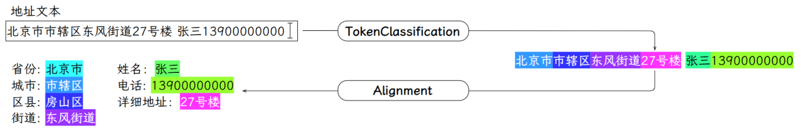
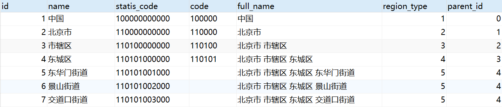
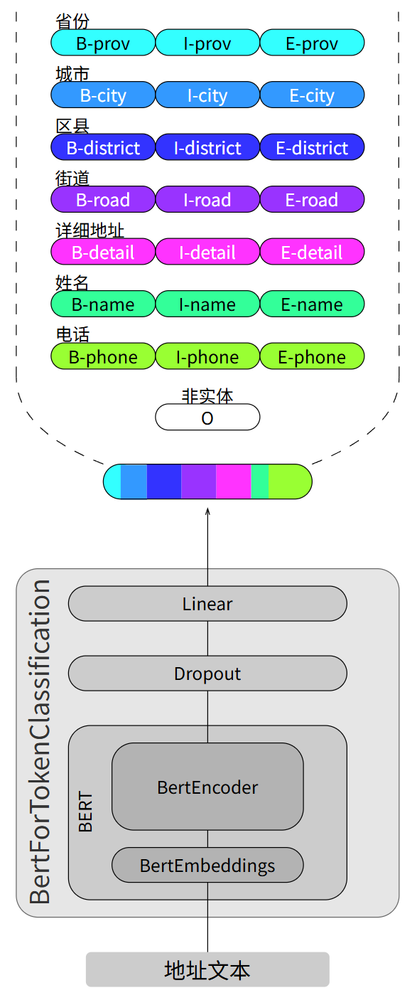
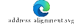
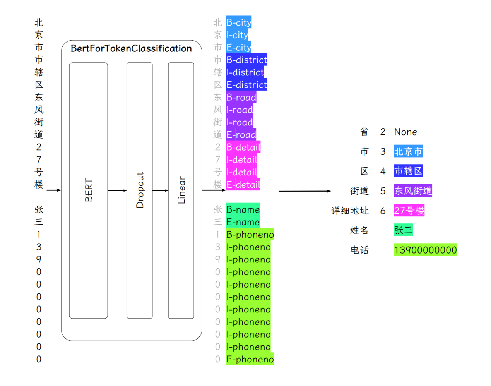
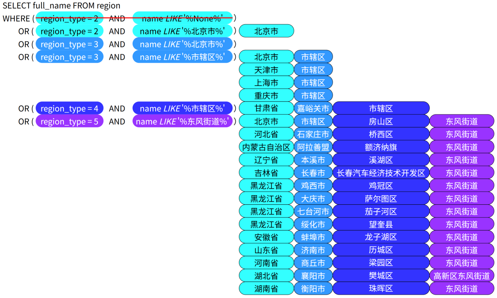
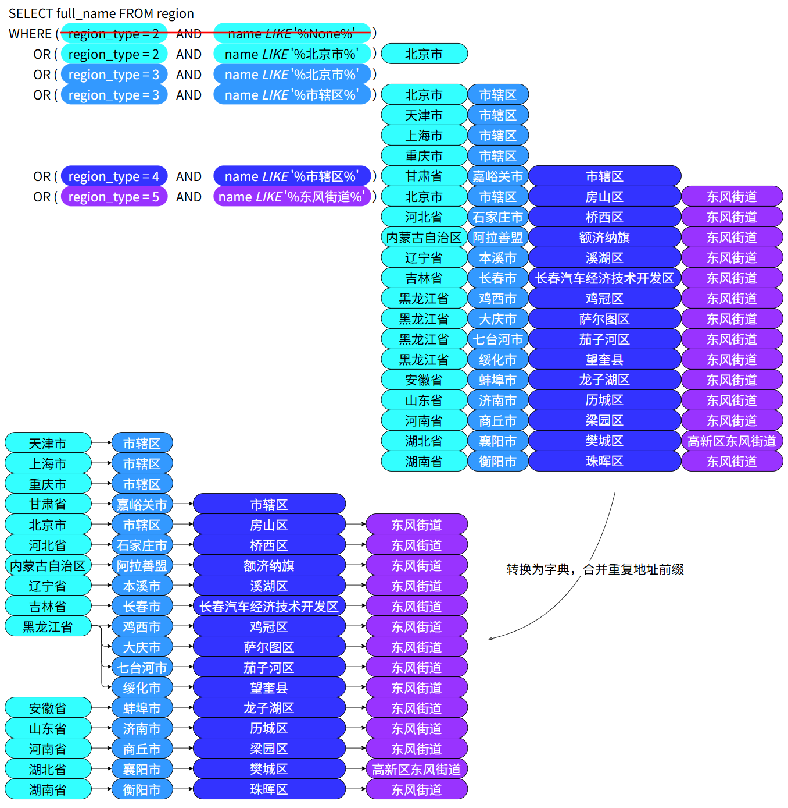
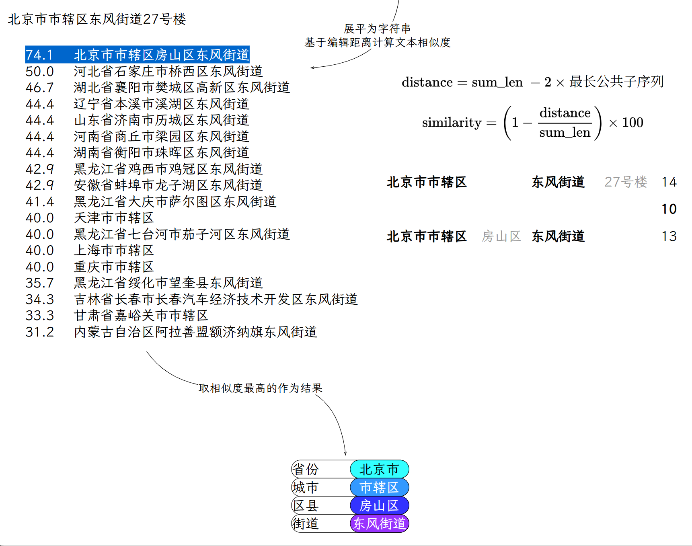

---
tags:
  - 大模型
  - 面试
source: "尚硅谷大模型技术之高频面试题-V2.1.6.docx"
source_blocks: "1627-1713"
reviewed: 2026-10-21
---

# 地址实体抽取与标准地址对齐

先抽取地址片段，再做层级消歧与标准地址对齐，不能把两者混成一个分类任务。

前篇：[[知识点总结/80-资料与复习/81-面试知识库/08-大模型高频面试题/04-多模态/02-扩散模型、条件控制与图文对齐|扩散模型、条件控制与图文对齐]] ｜ 后篇：[[知识点总结/80-资料与复习/81-面试知识库/08-大模型高频面试题/05-项目实战/02-BART 周报摘要的训练与事实一致性|BART 周报摘要的训练与事实一致性]]

## 深入理解（新增）

NER 负责识别省、市、区、道路等文本跨度，标准化负责把这些跨度映射到规范实体。NER F1 很高仍可能把同名道路对齐到错误城市，因此要分别报告实体跨度 F1、标准地址命中率和最终可用率。

BIO 标签必须与字符或 tokenizer 的子词对齐。一个词拆成多个 subword 后，要明确后续子词是继续标 I、忽略损失还是使用其他策略；训练和解码不一致会制造看似合理的错位实体。

层级词典应保留版本，行政区划变更不能仅靠字符串替换。低置信度或层级冲突时返回候选并要求补充信息，比强行生成不存在的完整地址更可靠。下面解码器严格拒绝非法 I 标签，方便暴露标注问题。


## 核心代码（新增）

以下是可在 CPU 运行的机制或业务契约示例，完整源码与测试见 [[知识点总结/80-资料与复习/81-面试知识库/08-大模型高频面试题/06-代码实验/01-核心代码实验与验证范围|核心代码实验与验证范围]]。示例不包含完整模型训练或外部平台部署。

```python
def decode_bio(tokens, labels):
    if len(tokens) != len(labels):
        raise ValueError("tokens and labels must align")
    result, active, start = [], None, None
    for i, label in enumerate(labels + ["O"]):
        prefix, _, kind = label.partition("-")
        if active is not None and not (prefix == "I" and kind == active):
            result.append((active, start, i, "".join(tokens[start:i])))
            active, start = None, None
        if prefix == "B":
            active, start = kind, i
        elif prefix == "I" and active != kind:
            raise ValueError("invalid BIO transition")
    return result

entities = decode_bio(list("北京市"), ["B-CITY", "I-CITY", "I-CITY"])
assert entities == [("CITY", 0, 3, "北京市")]
```

## 追问与验证（新增）

用同一道路名对应两个城市的样例，分别验证实体抽取与标准地址消歧；不要用一个总体准确率掩盖错误层级。

## 官方资料与论文

- [Python 闭包与作用域 FAQ](https://docs.python.org/3/faq/programming.html)

核验日期：2026-10-21。链接中的 `stable`、`main` 或平台文档会继续变化；新增纯 Python/NumPy 实验与原文旧版框架代码已分开标注。

## 原文保留

> [!warning] 原文批注
> 原文中的模型选择与效果属于案例表述；实体识别成功不代表标准地址已经正确对齐。
>
> 原文的团队人数、业务规模、效果百分比、硬件与成本均保留为教材案例陈述；本次未独立复现这些项目指标。

<!-- source-block:1627 -->
### 地址抽取&对齐（序列标注）

<!-- source-block:1628 -->
#### 项目周期

<!-- source-block:1629 -->
- 1人团队，总计约1个多月。

<!-- source-block:1630 -->
- 需求分析与技术选型3天

<!-- source-block:1631 -->
- 数据准备与预处理1周

<!-- source-block:1632 -->
- 模型开发与训练1周

<!-- source-block:1633 -->
- 地址对齐模块开发1周

<!-- source-block:1634 -->
- 系统集成与后端对接1周

<!-- source-block:1635 -->
- 部署上线3天

<!-- source-block:1636 -->
#### 功能介绍

<!-- source-block:1637 -->
输入一整段收货地址文本，系统自动识别地址信息和用户信息，具体如下

<!-- source-block:1638 -->
地址信息：省、市、区/县、街道/乡镇、详细地址等

<!-- source-block:1639 -->
用户信息：收货人姓名，联系电话

<!-- source-block:1640 -->
输出可直接入库的标准化收货地址与收货人信息。

<!-- source-block:1641 -->


<!-- source-block:1642 -->
#### 实现流程

<!-- source-block:1643 -->
##### 抽取实体

<!-- source-block:1644 -->
使用BertForTokenClassification从用户输入的文本中抽取实体信息，包括地址信息（省、市、区/县、街道/乡镇、详细地址）和用户信息（收货人姓名，联系电话）。

<!-- source-block:1645 -->
##### 地址对齐

<!-- source-block:1646 -->
考虑到用户输入地址可能不规范，因此需要和数据库中的标准地址进行对齐，数据库中的标准地址如下：

<!-- source-block:1647 -->


<!-- source-block:1648 -->
需要处理的不规范行为具体如下：

<!-- source-block:1649 -->
**缺失补全：对用户输入中缺失的部分信息进行补全**

<!-- source-block:1650 -->
比如用户只输入了市和区，自动补全省份信息。

<!-- source-block:1651 -->
**错误修正：如果地址链路存在部分错误，修正错误部分**

<!-- source-block:1652 -->
比如用户输入的省和区能匹配，而市不能与省和区匹配上，自动修正市的地址。

<!-- source-block:1653 -->
**剔除无法匹配的信息：对无法与数据库匹配的信息进行剔除**

<!-- source-block:1654 -->
比如用户输入无法匹配或在现实中不存在的区或街道，将其剔除。

<!-- source-block:1655 -->
#### 技术细节

<!-- source-block:1656 -->
##### 地址抽取

<!-- source-block:1657 -->
##### 模型

<!-- source-block:1658 -->
采用bert-base-chinese模型，具体结构如下图所示：

<!-- source-block:1659 -->


<!-- source-block:1660 -->
##### 数据集

<!-- source-block:1661 -->
**数据来源**

<!-- source-block:1662 -->
**开源数据集：清洗过滤，保留符合自身业务规范的数据，统一标签。**

<!-- source-block:1663 -->
**业务数据库地址信息表：取出数据脱敏拼接成完整地址信息并添加标注。**

<!-- source-block:1664 -->
**AI生成：通过脚本调用大模型批量生成数据，人工抽检确保每批次数据质量。**

<!-- source-block:1665 -->
**数据量**

<!-- source-block:1666 -->
共20万条数据。

<!-- source-block:1667 -->
训练集：16万条

<!-- source-block:1668 -->
验证集：2万条

<!-- source-block:1669 -->
测试集：2万条

<!-- source-block:1670 -->
**标签**

<!-- source-block:1671 -->
包括姓名、电话、省、市、区、街道、详细地址、非实体8类22个标签。

<!-- source-block:1672 -->
##### 模型训练

<!-- source-block:1673 -->
| 预训练模型 | bert-base-chinese |  |
| --- | --- | --- |
| 模型架构 | BERT+Dropout+Linear(BertForTokenClassification) |  |
| 超参数 | 最大序列长度 | 128 |
| 训练轮次 | 5 |  |
| 批次大小 | 256 |  |
| 学习率 | 2e-5 |  |
| 优化器 | AdamW |  |
| Dropout概率 | 0.1 |  |
| 训练策略 | 全参数微调 |  |
| 混合精度训练 |  |  |
| Warmup | 总步数的10% |  |
| 学习率衰减 | 线性衰减，逐渐衰减至0 |  |
| 早停 | 连续3轮验证集F1分数不提升则停止 |  |
| 训练环境 | 设备 | V100 32GB |
| 框架 | Transformers+Pytorch |  |
| 训练时长 | 1小时 |  |
| 评估结果 | 精确率 | 94.5% |
| 召回率 | 93.8% |  |
| F1分数 | 94.1% |  |

<!-- source-block:1674 -->


[原文嵌入附件：oleObject1.bin](../assets/原始附件/oleObject1.bin)

[原文嵌入附件：oleObject1.svg](../assets/原始附件/oleObject1.svg)

<!-- source-block:1675 -->
##### 地址对齐

<!-- source-block:1676 -->
**提取各个实体**

<!-- source-block:1677 -->
根据序列标注结果从原始文本中提取出各个实体，如下图所示

<!-- source-block:1678 -->


<!-- source-block:1679 -->
**根据抽取出的实体查询获选结果**

<!-- source-block:1680 -->
考虑到用户输入的地址可能不规范（部分缺失、部分错误），以及模型识别错误（例如将北京市识别为市级、将市辖区识别为区级）。

<!-- source-block:1681 -->
此处的候选地址选择逻辑如下图所示：

<!-- source-block:1682 -->


<!-- source-block:1683 -->
**合并前缀相同的候选地址**

<!-- source-block:1684 -->
可以利用如下数据结构实现合并：

<!-- source-block:1685 -->
{

<!-- source-block:1686 -->
prov1:{

<!-- source-block:1687 -->
city1:{

<!-- source-block:1688 -->
dist1:\[road1,road2\]

<!-- source-block:1689 -->
city2:...

<!-- source-block:1690 -->
}

<!-- source-block:1691 -->
prov2:...

<!-- source-block:1692 -->
}

<!-- source-block:1693 -->
}

<!-- source-block:1694 -->
结果如下图所示：

<!-- source-block:1695 -->


<!-- source-block:1696 -->
**选取最终结果**

<!-- source-block:1697 -->
将每个候选结果以及抽取出的实体，各自拼接位完整的地址字符串，然后根据抽取结果和候选结果的相似度得分，得到最终的对齐结果。

<!-- source-block:1698 -->
具体操作如下图所示：

<!-- source-block:1699 -->


<!-- source-block:1700 -->
编辑距离是指将字符串A变成字符串B所需要的插入/删除/替换的操作次数。

<!-- source-block:1701 -->
rapidfuzz.fuzz.ratio():

<!-- source-block:1702 -->
sum\_len = len(str1) + len(str2)

<!-- source-block:1703 -->
distance = sum\_len - 2 \* longest\_common\_subsequence

<!-- source-block:1704 -->
similarity = (1 - distance / sum\_len) \* 100

<!-- source-block:1705 -->
#### 面试串讲

<!-- source-block:1706 -->
这个地址抽取项目，主要用于实现用户收货地址的智能录入，具体功能就是从用户输入的一段收货地址文本中，抽取出规范化的地址信息，包括省市区等，以及用户信息，包括姓名和电话号码。

<!-- source-block:1707 -->
这其实就是一个典型的NER任务，所以我们首先基于bert-base-chinese训练了一个序列标注模型，用于从文本中识别并抽取上述的地址信息实体和用户信息实体。

<!-- source-block:1708 -->
不过这个项目的难点其实并不在于抽取，而是在于规范化，因为用户输入的文本中所包含的地址信息可能并不完整，甚至是不准确，这自然就会导致模型的抽取结果不完整或者不准确，因此不能直接使用。所以在完成实体抽取之后，我们还设计了一个地址对齐模块，用于将抽取结果与数据库中的标准地址进行匹配，从而得到完整并且规范的地址。

<!-- source-block:1709 -->
下面我分别介绍一下地址的抽取和对齐这两部分工作。

<!-- source-block:1710 -->
地址抽取主要就是训练了一个基于bert的序列标注模型，训练数据是一个BIO格式的开源数据集，大约有20万个样本，一共训练了5个Epoch，训练完使用seqeval进行评估，F1评分达到了94.1%

<!-- source-block:1711 -->
然后是地址对齐，这个地址对齐需要考虑的情况非常复杂，比如用户输入的地址可能缺少某个实体，此时我们就需要根据已有的实体推断缺少的实体，再比如地址中的某个实体有可能是错误的，此时我们就需要识别出错误的实体并对其进行纠正，可想而知，这个对齐规则的编写会非常复杂。

<!-- source-block:1712 -->
所以这个对齐，我们并未采用基于规则的方案，而是选择了基于文本相似度的方案。接下来我说一下具体思路，首先我们假设抽取到的地址实体是存在问题的，也就说没有哪个实体是可以百分之百信任的，所以我们会以每个实体作为查询条件，从标准数据库中查询以该实体作为最细粒度的完整地址，比如根据省份实体查询省份，根据城市实体查询省份-城市，根据区县实体查询省份-城市-区县，得到的这些地址都会作为候选地址，正常情况下，这些候选地址可能会有重合的部分，所以我们会先合并这些重合的路径，之后再计算这些获选地址和抽取出的地址之间的相似度得分，最后取得分最高的候选地址，作为最终的地址。补充一点，这个相似度得分我们使用的是编辑距离。

<!-- source-block:1713 -->
以上就是这项目的全部内容。
