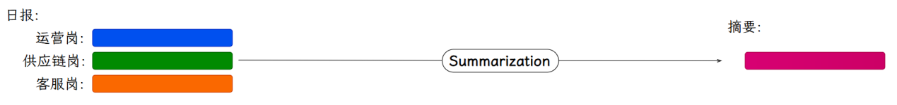
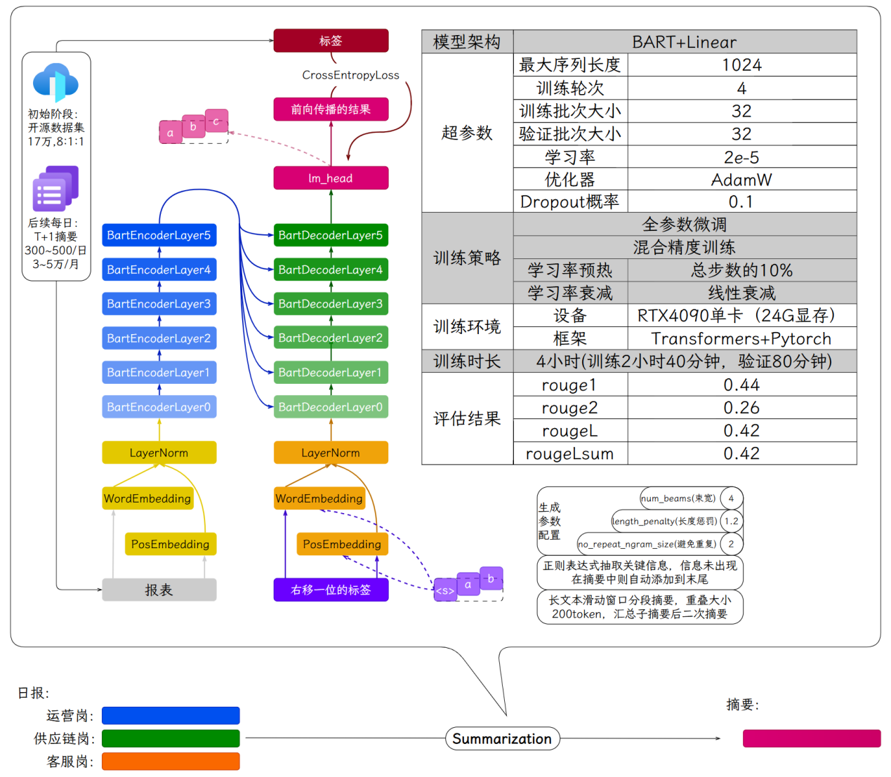

---
tags:
  - 大模型
  - 面试
source: "尚硅谷大模型技术之高频面试题-V2.1.6.docx"
source_blocks: "1714-1759"
reviewed: 2026-10-21
---

# BART 周报摘要的训练与事实一致性

摘要训练先保证输入输出事实一致，再优化压缩与表达。

前篇：[[知识点总结/80-资料与复习/81-面试知识库/08-大模型高频面试题/05-项目实战/01-地址实体抽取与标准地址对齐|地址实体抽取与标准地址对齐]] ｜ 后篇：[[知识点总结/80-资料与复习/81-面试知识库/08-大模型高频面试题/05-项目实战/03-Qwen 周报摘要的微调与生成链路|Qwen 周报摘要的微调与生成链路]]

## 深入理解（新增）

BART 的源文本由 Encoder 读取，Decoder 生成摘要。摘要标签的 padding 要忽略，但不能把 Decoder 的目标对齐方式照搬为所有因果模型的同一种手动 shift；具体由框架数据整理器与模型实现共同决定。

长周报可以先按项目或时间聚合，再抽取事实表并生成摘要。层层摘要会累积信息损失，尤其是“未完成”“延期至”等否定或时间词；应保留原段落 ID，使每条结论能够回查。

ROUGE 提高可能来自更接近参考措辞，未必减少事实错误。可把日期、金额、负责人、进度状态单独抽取并对账，统计每类遗漏与新增错误。下面字符偏移示例展示如何保留证据位置，而非完整 BART 训练器。


## 核心代码（新增）

以下是可在 CPU 运行的机制或业务契约示例，完整源码与测试见 [[知识点总结/80-资料与复习/81-面试知识库/08-大模型高频面试题/06-代码实验/01-核心代码实验与验证范围|核心代码实验与验证范围]]。示例不包含完整模型训练或外部平台部署。

```python
def chunk_with_offsets(text, size=100, overlap=20):
    if not 0 <= overlap < size:
        raise ValueError("require 0 <= overlap < size")
    result = []
    start = 0
    while start < len(text):
        end = min(len(text), start + size)
        result.append({"start": start, "end": end, "text": text[start:end]})
        if end == len(text):
            break
        start = end - overlap
    return result

source = "订单退款规则：申请后进入审核，审核完成后返回结果。"
chunks = chunk_with_offsets(source, size=12, overlap=3)
assert all(source[c["start"]:c["end"]] == c["text"] for c in chunks)
```

## 追问与验证（新增）

加入“计划完成”和“实际完成”不同的周报，检查摘要是否把计划当成结果，并记录对应来源位置。

## 官方资料与论文

- [Transformers 生成流程](https://huggingface.co/docs/transformers/main/en/llm_tutorial)

核验日期：2026-10-21。链接中的 `stable`、`main` 或平台文档会继续变化；新增纯 Python/NumPy 实验与原文旧版框架代码已分开标注。

## 原文保留

> [!warning] 原文批注
> BART 与因果语言模型的数据目标不同；不能在不了解框架内部逻辑时重复移动标签。
>
> 原文的团队人数、业务规模、效果百分比、硬件与成本均保留为教材案例陈述；本次未独立复现这些项目指标。

<!-- source-block:1714 -->
### 周报摘要-1.0（BART）

<!-- source-block:1715 -->
#### 项目周期

<!-- source-block:1716 -->
1人团队，总计约3周。

<!-- source-block:1717 -->
需求分析与技术选型2天

<!-- source-block:1718 -->
数据准备与预处理3天

<!-- source-block:1719 -->
模型训练与评估3天

<!-- source-block:1720 -->
摘要生成模块开发5天

<!-- source-block:1721 -->
部署与测试3天

<!-- source-block:1722 -->
#### 功能介绍

<!-- source-block:1723 -->
日报/周报/月报/季报摘要总结一键生成。

<!-- source-block:1724 -->
员工可直接修改生成的摘要。

<!-- source-block:1725 -->


<!-- source-block:1726 -->
#### 实现流程

<!-- source-block:1727 -->
在摘要任务上微调BART模型。

<!-- source-block:1728 -->
使用模型生成员工汇报的摘要。

<!-- source-block:1729 -->
员工可修改生成的摘要，收集修改后的摘要用于继续训练模型。

<!-- source-block:1730 -->
夜间自动使用前一天修正后的摘要重新训练模型，热更新到线上。

<!-- source-block:1731 -->
#### 技术细节

<!-- source-block:1732 -->
##### 数据来源

<!-- source-block:1733 -->
**起步阶段：**

<!-- source-block:1734 -->
开源摘要数据集：17万条数据，8：1：1划分训练集、验证集、测试集。

<!-- source-block:1735 -->
**后续：**

<!-- source-block:1736 -->
收集前一天修正后的摘要用于训练模型。

<!-- source-block:1737 -->
##### 摘要模型训练

<!-- source-block:1738 -->
| 预训练模型 | bart-base-chinese |  |
| --- | --- | --- |
| 模型架构 | BART+Linear(BartForConditionalGeneration) |  |
| 超参数 | 最大序列长度 | 1024 |
| 训练轮次 | 4 |  |
| 训练批次大小 | 32 |  |
| 验证批次大小 | 32 |  |
| 学习率 | 2e-5 |  |
| 优化器 | AdamW |  |
| Dropout概率 | 0.1 |  |
| 训练策略 | 全参数微调 |  |
| 混合精度训练 |  |  |
| Warmup | 总步数的10% |  |
| 学习率衰减 | 线性衰减 |  |
| 训练环境 | 设备 | V100 32GB |
| 框架 | Transformers+Pytorch |  |
| 训练时长 | 4小时（训练2小时40分钟，验证80分钟） |  |
| 评估结果 | rouge1 | 0.44 |
| rouge2 | 0.26 |  |
| rougeL | 0.42 |  |
| rougeLsum | 0.42 |  |

<!-- source-block:1739 -->


<!-- source-block:1740 -->
##### 摘要生成

<!-- source-block:1741 -->
**生成参数**

<!-- source-block:1742 -->
num\_beams束宽：4

<!-- source-block:1743 -->
length\_penalty长度惩罚：1.2

<!-- source-block:1744 -->
no\_repeat\_ngram\_size避免n元重复：2

<!-- source-block:1745 -->
**关键信息强制保留**

<!-- source-block:1746 -->
用正则抽取金额、百分比、日期等关键信息，若未出现在摘要，则强制追加到摘要末尾。

<!-- source-block:1747 -->
**处理超出长度上限的文本**

<!-- source-block:1748 -->
按段落或句子分段，每段有200 token重叠。为每段生成摘要拼接成最终摘要，或对段摘要二次生成摘要。

<!-- source-block:1749 -->
##### 配合发布接口

<!-- source-block:1750 -->
使用FastAPI将模型封装为RESTful API。

<!-- source-block:1751 -->
#### 总结

<!-- source-block:1752 -->
这个项目实现了一键生成日报、周报、月报、季报摘要的功能，还支持员工直接修改生成的摘要以优化模型性能。

<!-- source-block:1753 -->
项目主要包括摘要生成模型训练和摘要生成流程两部分。

<!-- source-block:1754 -->
首先，基于 bart-base-chinese 预训练模型，采用 BART+Linear 架构（BartForConditionalGeneration），训练了一个摘要生成模型。

<!-- source-block:1755 -->
训练数据初期来源于17万条开源摘要数据集。数据预处理后，在V100 32GB单卡上进行训练。训练4轮。最终模型评估rougeL 大约0.4左右。

<!-- source-block:1756 -->
摘要生成流程中，我们是使用束搜索（num\_beams=4，length\_penalty=1.2，no\_repeat\_ngram\_size=2）生成摘要。

<!-- source-block:1757 -->
对于一些关键信息，比如金额、百分比、日期等，使用正则表达式进行抽取，如果摘要中不存在则添加到末尾，确保其出现在摘要中。

<!-- source-block:1758 -->
对于超长文本，采用分段处理（每段200 token重叠），生成段摘要后拼接或二次生成最终摘要。

<!-- source-block:1759 -->
后续也是通过收集员工修正后的摘要持续优化模型。每天收集员工修改后的摘要，用于夜间自动重新训练模型并热更新到线上。
