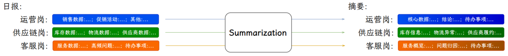
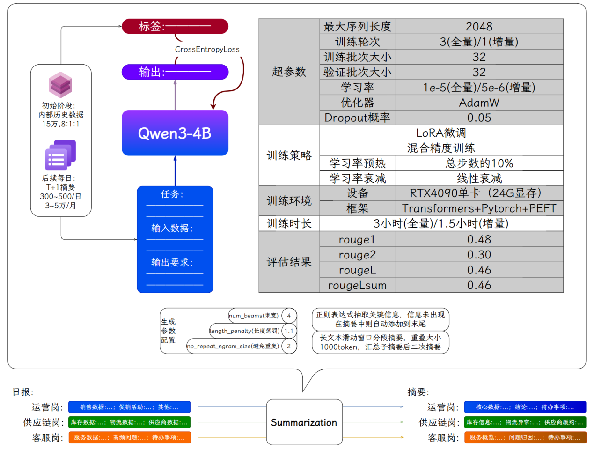

---
tags:
  - 大模型
  - 面试
source: "尚硅谷大模型技术之高频面试题-V2.1.6.docx"
source_blocks: "1760-1868"
reviewed: 2026-10-21
---

# Qwen 周报摘要的微调与生成链路

因果模型摘要的关键训练代码是模板、回答掩码与截断策略。

前篇：[[知识点总结/80-资料与复习/81-面试知识库/08-大模型高频面试题/05-项目实战/02-BART 周报摘要的训练与事实一致性|BART 周报摘要的训练与事实一致性]] ｜ 后篇：[[知识点总结/80-资料与复习/81-面试知识库/08-大模型高频面试题/05-项目实战/04-CNN 图搜图的特征、索引与评估|CNN 图搜图的特征、索引与评估]]

## 深入理解（新增）

把系统要求、周报内容和目标摘要放入模型对应的聊天模板，然后确认只有需要学习的回答 token 参与损失。若 prompt 很长，直接从右截断可能把全部答案删除；必须检查每条样本的有效监督 token 数。

训练集应按项目、团队或时间分组，避免同一份周报的不同改写进入训练和测试。摘要风格模板过于固定时，模型容易记住常用套话，评估需要包含新项目名和新数字。

LoRA 控制更新容量，但事实一致性仍主要受数据和目标约束。上线可先生成结构化事实清单，再生成自然语言，并验证数字和状态是否能映射回输入；这种约束应独立于模型是否使用 LoRA。


## 核心代码（新增）

以下是可在 CPU 运行的机制或业务契约示例，完整源码与测试见 [[知识点总结/80-资料与复习/81-面试知识库/08-大模型高频面试题/06-代码实验/01-核心代码实验与验证范围|核心代码实验与验证范围]]。示例不包含完整模型训练或外部平台部署。

```python
import numpy as np

def causal_lm_loss(logits, labels):
    # Input shape: [batch, tokens, vocab]; prompt/pad labels are already -100.
    shifted_logits, shifted_labels = logits[:, :-1, :], labels[:, 1:]
    valid = shifted_labels != -100
    if not valid.any():
        raise ValueError("no supervised response tokens")
    selected_logits, targets = shifted_logits[valid], shifted_labels[valid]
    log_z = np.logaddexp.reduce(selected_logits, axis=-1)
    selected = selected_logits[np.arange(len(targets)), targets]
    return float((log_z - selected).mean())

def lora_forward(x, weight, a, b, alpha):
    rank = a.shape[0]
    return x @ weight.T + (alpha / rank) * ((x @ a.T) @ b.T)

logits = np.zeros((1, 4, 5))
labels = np.array([[-100, -100, 2, 3]])
assert np.isclose(causal_lm_loss(logits, labels), np.log(5))

x = np.ones((1, 3)); w = np.ones((4, 3))
a = np.ones((2, 3)); b = np.ones((4, 2)); alpha = 4
assert np.allclose(lora_forward(x, w, a, b, alpha),
                   x @ (w + alpha / 2 * b @ a).T)
```

### PEFT 适配器注入与训练步（未实跑框架模板）

这里展示真实框架的关键调用。需要自行准备兼容的本地模型、PyTorch、Transformers、PEFT 与 GPU；本次没有安装这些框架或执行训练。`batch` 必须已经按对应聊天模板完成 padding、回答掩码和标签对齐。模型内部执行 shift，下面不再手工 shift。

```python
import torch
from transformers import AutoModelForCausalLM
from peft import LoraConfig, get_peft_model

def prepare_model(local_model_dir):
    base = AutoModelForCausalLM.from_pretrained(
        local_model_dir, local_files_only=True, trust_remote_code=False
    )
    config = LoraConfig(
        task_type="CAUSAL_LM", r=8, lora_alpha=16,
        lora_dropout=0.05, target_modules="all-linear",
    )
    model = get_peft_model(base, config)
    model.print_trainable_parameters()  # 检查实际注入范围，而非只看配置。
    return model

def train_one_step(model, batch, optimizer):
    model.train()
    optimizer.zero_grad(set_to_none=True)
    loss = model(**batch).loss
    loss.backward()
    torch.nn.utils.clip_grad_norm_(
        [p for p in model.parameters() if p.requires_grad], 1.0
    )
    optimizer.step()
    return float(loss.detach())
```

这是完整训练循环中的一步：尚需数据整理、设备放置、调度、评估及保存恢复。`all-linear` 的实际适配范围取决于模型和 PEFT 版本；量化模型还需按对应文档准备，不能直接套用此加载代码。

## 追问与验证（新增）

构造超长输入，核验截断后至少保留一个回答标签；再用未见过的项目名、金额和日期测试摘要。

## 官方资料与论文

- [Transformers 生成流程](https://huggingface.co/docs/transformers/main/en/llm_tutorial)
- [PEFT 0.21.0 LoRA 文档](https://huggingface.co/docs/peft/v0.21.0/package_reference/lora)

核验日期：2026-10-21。链接中的 `stable`、`main` 或平台文档会继续变化；新增纯 Python/NumPy 实验与原文旧版框架代码已分开标注。

## 原文保留

> [!warning] 原文批注
> 本节演示的 loss 显式 shift 一次；若实际 Qwen 模型内部已经 shift，不应再次手工 shift。
>
> 原文的团队人数、业务规模、效果百分比、硬件与成本均保留为教材案例陈述；本次未独立复现这些项目指标。

<!-- source-block:1760 -->
### 周报摘要-2.0（Qwen3-4B）

<!-- source-block:1761 -->
#### 项目周期

<!-- source-block:1762 -->
- 2人团队，总计约4个月。

<!-- source-block:1763 -->
- 需求深度分析与技术选型2周

<!-- source-block:1764 -->
- 数据准备与预处理3周

<!-- source-block:1765 -->
- 模型训练与评估2周

<!-- source-block:1766 -->
- 系统开发与集成4周

<!-- source-block:1767 -->
- 自动化持续学习流水线搭建2周

<!-- source-block:1768 -->
- 部署与测试2周

<!-- source-block:1769 -->
#### 功能介绍

<!-- source-block:1770 -->
使用Qwen3-4B进行监督微调，理解电商垂域知识，适配各岗位的报表进行总结摘要。

<!-- source-block:1771 -->
多周期报表摘要一键生成：支持电商企业运营、供应链、客服等核心岗位的日报 / 周报 / 月报 / 季报自动生成，覆盖 “销售数据、库存状态、服务指标、促销效果” 等电商专属维度；

<!-- source-block:1772 -->
关键信息不遗漏：自动识别并保留电商核心信息（如销售额、SKU 编码、库存数量、投诉率、促销周期），未出现则强制追加至摘要末尾，确保报表完整性。

<!-- source-block:1773 -->


<!-- source-block:1774 -->
#### 实现流程

<!-- source-block:1775 -->
模型初始化：基于 Qwen3-4B 预训练模型，用电商专属摘要数据微调，适配 “报表→结构化摘要” 的条件生成任务；

<!-- source-block:1776 -->
摘要生成：对接电商内部系统（ERP、WMS、客服中台）获取原始报表数据，调用微调后的 Qwen3-4B 生成岗位专属摘要；

<!-- source-block:1777 -->
人工反馈收集：员工修改摘要后，系统自动标记 “有效优化点”（如 “补充物流延迟归因”“修正 SKU 销量数据”），过滤仅格式调整的无效修改；

<!-- source-block:1778 -->
夜间迭代更新：每日 23:00 用当日有效修改数据增量微调模型，次日 6:00 前热更新至线上，确保模型贴合电商业务动态。

<!-- source-block:1779 -->
#### 技术细节

<!-- source-block:1780 -->
##### 关键Prompt

<!-- source-block:1781 -->
**运营岗日报摘要（618 预热期）**

```text
【任务】请生成电商运营岗2025年6月10日日报摘要，需覆盖“销售数据、促销活动、待办事项”三大模块，必须保留SKU编码、具体数值、活动进度等电商关键信息，输出结构需清晰，便于后续人工修改补充。
【输入数据】
1. 销售数据：日销额58.2万，日销达成率89%（目标65万）；订单量2100单，退款率2.8%；TOP3 SKU及销量：SKU202506-008（冰丝T恤）380件、SKU202506-015（亚麻短裤）320件、SKU202506-022（防晒衣）290件；流量来源占比：直播45%、搜索25%、推荐20%、私域10%。
2. 促销活动：当前活动为“618预热-品类满减”，活动曝光280万（达成率93%，目标300万）；活动异常：今日16-17点直播卡顿40分钟，导致该时段销量仅3.2万（环比昨日同时段降45%）。
3. 其他信息：当日业务异常：下午14点ERP系统短暂宕机5分钟，影响约80单支付；跨部门协同需求：需供应链6月11日前优先补充SKU202506-008库存（当前剩余180件，预警线500件）。
【输出要求】
1. 分“核心数据、结论、待办事项”三部分输出，每部分用“###”开头标注；
2. 核心数据需分点列示，标注异常数据（用括号说明偏差），如“日销达成率89%（低于目标11%）”；
3. 结论需分析数据关联逻辑，如“直播卡顿对销量的影响”“流量来源效果差异”；
4. 待办事项需明确时间节点+具体责任人（或协同部门），避免模糊表述；
5. 必须包含：日销额、达成率、TOP3 SKU（编码+销量）、618预热活动曝光+达成率、直播卡顿异常，缺失需标注“数据暂缺”。
```

<!-- source-block:1793 -->
**供应链岗日报摘要（夏季备货期）**

```text
【任务】请生成电商供应链岗2025年7月5日日报摘要，聚焦“库存状态、物流异常、待办跟进”，需体现SKU库存预警、次品率、供应商履约等核心指标，输出需结构化，便于人工补充优化。
【输入数据】
1. 库存数据：核心SKU库存：SKU202507-003（连衣裙）220件（预警线400件）、SKU202507-011（帆布鞋）950件（安全线600件）、SKU202507-018（遮阳帽）350件（安全线200件）；滞销SKU：SKU202506-033（短袖衬衫）库存1300件（30天销量42件）；当日入库次品率0.6%（达标，标准≤1%）。
2. 物流数据：当日发货1850单；延迟订单：广州仓42单（原因：区域暴雨导致网点分拣延迟）、成都仓18单（原因：快递员短缺）；补货进度：SKU202507-003从武汉仓调拨，预计7月6日14点前到库。
3. 供应商数据：当日交货供应商：供应商A（交货SKU202507-011共1200件，准时率100%）、供应商B（交货SKU202507-018共800件，延迟1.5小时，原因：仓库备货失误）；待跟进事项：供应商C需7月6日9点前交货SKU202507-003共500件，需现场验收。
【输出要求】
1. 分“### 库存核心信息、### 物流异常处理、### 供应商履约与待办”三部分输出；
2. 库存信息需标注“预警/安全/滞销”标签，SKU编码与数量一一对应；
3. 物流延迟订单需分仓说明“数量+原因+当前进度”；
4. 待办事项按“紧急程度”排序，标注“优先级”（高/中/低）；
5. 必须包含：预警SKU（编码+库存+阈值）、各仓延迟订单数、供应商交货准时率，缺失需标注“数据暂缺”。
```

<!-- source-block:1805 -->
**客服岗日报摘要（大促售后期）**

```text
【任务】请生成电商客服岗2025年11月12日日报摘要（双11售后期），围绕“服务数据、高频问题、待办优化”，需体现满意度、投诉率、话术迭代需求，输出结构需适配后续人工修改（如补充话术细节）。
【输入数据】
1. 服务数据：日接待量1560次；平均响应时间1.5秒；满意度89%（日均92%）；投诉率3.2%（日均1.8%）；复杂问题转人工率22%（日均18%）。
2. 高频问题：TOP3咨询：1. 双11订单退款进度（占比35%）、2. 物流延迟查询（占比30%）、3. 商品尺码退换（占比20%）；投诉原因：物流延迟占75%（集中在北方区域）、商品质量问题占15%（主要为SKU202511-009毛衣起球）、售后态度占10%。
3. 待办事项：话术更新：需补充“双11退款到账时效（储蓄卡1-3天，信用卡3-5天）”话术；工单跟进：18单未解决投诉工单（12单物流延迟、6单质量问题），需11月13日10点前闭环；跨部门协同：需同步供应链11月13日前反馈北方区域物流恢复时间。
【输出要求】
1. 分“### 服务数据概览、### 高频问题与投诉归因、### 待办优化事项”三部分输出；
2. 服务数据需标注“与日均差异”（如“满意度89%（低于日均3%）”）；
3. 投诉归因需关联具体场景（如“物流延迟区域”“质量问题SKU”）；
4. 待办事项需明确“完成时间+协同部门”，话术更新需包含具体内容方向；
5. 必须包含：接待量、满意度、投诉率、TOP3咨询问题、未解决工单数，缺失需标注“数据暂缺”。
```

<!-- source-block:1817 -->
##### 数据来源

<!-- source-block:1818 -->
**起步阶段：**

<!-- source-block:1819 -->
电商专属摘要数据集：15 万条（含运营销售报表、供应链库存报表、客服服务报表），按 8:1:1 划分为训练集（12 万条）、验证集（1.5 万条）、测试集（1.5 万条）；

<!-- source-block:1820 -->
数据覆盖场景：618 大促、双 11、日常运营、季节性备货等电商典型场景，包含 “SKU 库存预警、促销达成率、物流延迟订单” 等专属标注。

<!-- source-block:1821 -->
**迭代阶段：**

<!-- source-block:1822 -->
每日收集员工修改后的有效摘要（需关联电商业务逻辑，如 “补充‘直播卡顿导致销量降 10%’的归因说明”），每月新增 3-5 万条增量数据。

<!-- source-block:1823 -->
##### Qwen3-4B 模型训练

<!-- source-block:1824 -->
| 配置项 |  | 具体参数 | 设计依据（适配电商场景） |
| --- | --- | --- | --- |
| 预训练模型 |  | Qwen3-4B（阿里云通义千问系列） | 中文理解能力强，40 亿参数量平衡 “精度与推理效率”，支持 2048token 长上下文，适配电商长报表（如 1500token 月度总结） |
| 超参数 | 最大序列长度 | 2048 | 覆盖电商超长报表（如双 11 大促月报约 1800token），减少分段次数，提升上下文连贯性 |
| 训练轮次 | 3（全量训练）<br>1（增量训练） | Qwen3-4B 收敛速度快，全量训练 3 轮即可达标；增量训练 1 轮适配每日数据更新，降低迭代成本 |  |
| 训练 / 验证批次 | 32<br>32 | V100单卡32GB显存可承载，平衡训练效率与显存占用（FP16+LoRA 下显存占用 12-14GB） |  |
| 学习率 | 1e-5（全量）<br>5e-6（增量） | 适配大模型参数规模，避免学习率过高导致 “电商术语理解偏差”（如将 “滞销 SKU” 误判为 “热销”） |  |
| 优化器 | AdamW（weight decay=0.01） | 减轻电商数据稀疏性（如部分 SKU 月度销量数据少）带来的训练波动，提升模型稳定性 |  |
| Dropout 概率 | 0.05 | Qwen3-4B 泛化能力较强，低 Dropout 率平衡 “精度与过拟合风险” |  |
| 训练策略 | LoRA 轻量化微调（秩 = 8）+ 混合精度训练（FP16） |  | LoRA 仅训练 1% 参数（约 400 万），训练时长缩短 40%；混合精度降低显存占用，适配单卡部署 |
| 学习率调度 | Warmup（总步数 10%）+ 线性衰减 | 初期稳定参数，后期精细调整 “电商异常数据归因” 能力（如 “库存预警→供应商延迟” 关联） |  |
| 训练环境 | 设备 | V100 32GB | 企业内部部署成本低，无需多卡集群，满足 “夜间 2 小时内完成增量训练” 需求 |
| 框架 | Transformers + PyTorch + PEFT（LoRA） | PEFT 库简化 LoRA 微调流程，Transformers 完善 Qwen3-4B 适配，确保训练稳定性 |  |
| 训练时长 |  | 全量训练 3 小时（训练 2 小时 + 验证 1 小时）<br>增量训练 1.5 小时 | 适配企业 “夜间迭代” 节奏，次日不影响早间报表生成 |
| 评估结果 | rouge1 | 0.48 | 较原 BART 模型提升 9%，电商关键数值（如销售额、投诉率）抽取准确率提升至 96% |
| rouge2 | 0.30 | 较原 BART 模型提升 15%，电商多维度关联（如 “促销曝光→销量增长”）理解能力增强 |  |
| rougeL | 0.46 | 较原 BART 模型提升 10%，摘要结构化程度更高，符合电商 “数据 + 结论 + 待办” 的报表逻辑 |  |
| rougeLsum | 0.46 | 长文本摘要连贯性提升，电商月度 / 季度报表的 “趋势分析” 模块完整性达标率 98% |  |

<!-- source-block:1825 -->


<!-- source-block:1826 -->
##### 摘要生成

<!-- source-block:1827 -->
**生成参数配置：**

<!-- source-block:1828 -->
num\_beams（束宽）：4（平衡 “生成速度与摘要质量”，电商报表摘要生成耗时控制在 3-4 秒 / 份）；

<!-- source-block:1829 -->
length\_penalty（长度惩罚）：1.1（避免摘要过短遗漏 “待办事项”，或过长冗余）；

<!-- source-block:1830 -->
no\_repeat\_ngram\_size（避免重复）：2（防止 “销售数据”“库存数据” 等短语重复出现）。

<!-- source-block:1831 -->
**电商关键信息强制保留：**

<!-- source-block:1832 -->
用正则表达式抽取 “数值类（销售额 XX 万、达成率 XX%、SKUXX 库存 XX 件）、时间类（促销 6.1-6.17、补货截止 6.10）、状态类（库存预警、物流延迟 XX 单）” 信息；

<!-- source-block:1833 -->
若信息未出现在摘要中，自动追加至末尾（如 “补充：SKU123 库存 200 件，低于预警线 500 件”）。

<!-- source-block:1834 -->
**超长文本处理（&gt;2048token）：**

<!-- source-block:1835 -->
按 “电商报表模块” 分段（如 “销售数据段、库存段、促销段”），每段保留 100token 重叠（避免 “SKU 跨段信息断裂”）；

<!-- source-block:1836 -->
先生成各段子摘要，再调用 Qwen3-4B 二次生成最终摘要（确保 “销售趋势→库存匹配→促销建议” 的逻辑连贯）。

<!-- source-block:1837 -->
##### 配合发布接口

<!-- source-block:1838 -->
**接口封装**

<!-- source-block:1839 -->
用 FastAPI 将 Qwen3-4B 模型封装为 RESTful API，提供 2 个核心接口：

<!-- source-block:1840 -->
/generate\_ecommerce\_summary：输入 “岗位类型（运营 / 供应链 / 客服）+ 周期（日 / 周 / 月 / 季）+ 原始报表数据”，返回结构化摘要（含 “核心数据、结论、待办、关键信息标注”）；

<!-- source-block:1841 -->
/submit\_summary\_modification：输入 “摘要 ID + 修改内容 + 优化点标签（如‘补充库存归因’‘修正促销 ROI’）”，用于收集迭代数据。

<!-- source-block:1842 -->
**性能指标：**

<!-- source-block:1843 -->
响应时间：1024token 报表生成 3-4 秒，2048token 报表生成 5-6 秒（满足电商早间报表高峰期需求）；

<!-- source-block:1844 -->
并发支持：单节点支持 150QPS（V100），可通过 GPU 节点扩容至 600QPS（适配大促后多岗位同时生成月报场景）。

<!-- source-block:1845 -->
#### 总结

<!-- source-block:1846 -->
本项目聚焦电商企业内部报表管理的核心痛点，以Qwen3-4B 大模型为技术核心，构建了 “数据自动流转 - 智能摘要生成 - 人工反馈迭代 - 模型持续优化” 的全闭环解决方案，不仅实现了报表处理效率的跨越式提升，更通过深度适配电商业务场景，让摘要从 “单纯文本提炼” 升级为 “业务决策辅助工具”，具体价值可从技术落地、业务效率、场景适配、落地保障及长期演进五个维度展开：

<!-- source-block:1847 -->
一、技术落地：平衡精度与成本，适配企业内部部署需求

<!-- source-block:1848 -->
本项目未盲目追求大模型参数规模，而是基于企业内部 “单卡部署、夜间快速迭代” 的实际约束，选择 Qwen3-4B 模型并通过LoRA 轻量化微调实现高效落地。相比原 BART-base-chinese 模型，Qwen3-4B 的核心评估指标显著提升：ROUGE1 从 0.44 升至 0.48（提升 9%）、ROUGE2 从 0.26 升至 0.30（提升 15%）、ROUGE-L 从 0.42 升至 0.46（提升 10%），这一提升直接转化为电商关键信息的抽取精度优化 —— 销售额、SKU 库存、投诉率等核心数据的抽取准确率从原模型的 90% 提升至 96%，电商专属的 “多维度关联信息”（如 “促销曝光量→销量增长幅度”“库存预警→供应商交货延迟”）理解能力增强，使摘要不再是 “数据堆砌”，而是包含逻辑归因的 “业务快照”。

<!-- source-block:1849 -->
同时，技术方案充分考虑企业成本控制：采用V100 32GB即可完成全量训练（3 小时）与增量训练（1.5 小时），无需多卡集群，硬件投入成本较分布式部署降低 60%；通过 FP16 混合精度训练与 LoRA 微调（仅训练 400 万参数，占模型总参数量的 1%），训练时长较全参数微调缩短 40%，完美适配 “夜间迭代、次日上线” 的节奏，避免影响早间报表生成高峰期的系统使用。

<!-- source-block:1850 -->
二、业务效率：全岗位提效，覆盖电商全周期报表场景

<!-- source-block:1851 -->
项目针对电商运营、供应链、客服三大核心岗位的报表需求差异，实现 “千人千面” 的摘要生成，直接推动全链路效率提升：

<!-- source-block:1852 -->
运营岗：日报撰写时间从 1.5 小时（手动摘抄 ERP 销售数据 + 整理促销效果）压缩至 10 分钟（模型生成 + 轻微修改），大促后（如 618、双 11）的月度总结生成时间从 3 小时降至 40 分钟，且摘要自动包含 “流量来源占比”“新品销售贡献”“促销 ROI” 等运营核心维度，无需额外查数；

<!-- source-block:1853 -->
供应链岗：周报中 “库存周转分析”“供应商履约评估” 模块的生成准确率达 98%，预警 SKU（如库存低于 30 天销量的商品）的识别遗漏率从原人工撰写的 25% 降至 3%，避免因库存预警不及时导致的缺货损失；

<!-- source-block:1854 -->
客服岗：日报中的 “高频咨询 TOP3”“投诉问题分类” 自动同步客服中台数据，无需手动统计，月报表中 “服务质量趋势”（如平均响应时间、满意度变化）的生成与可视化衔接，节省客服主管 80% 的数据分析时间。

<!-- source-block:1855 -->
此外，跨部门协同效率显著提升：部门经理查看 10 人团队的周报表，原需 1 小时逐一核对格式与数据，现通过模型生成的结构化摘要（统一 “数据 + 结论 + 待办” 格式），20 分钟即可完成审核，且能快速定位 “异常点”（如某员工报表中 “投诉率突增 10%” 会自动标黄提示）。

<!-- source-block:1856 -->
三、场景适配：深度贴合电商业务特性，解决行业专属痛点

<!-- source-block:1857 -->
项目通过 “数据标注 + 模型微调 + 规则补全” 的三重设计，让 Qwen3-4B 精准适配电商场景的特殊性：

<!-- source-block:1858 -->
长文本与复杂逻辑处理：针对电商季度报表（常超 1500token），Qwen3-4B 的 2048token 上下文窗口可减少 50% 的分段次数，且二次生成的最终摘要能保持 “季度趋势→问题复盘→下季计划” 的逻辑连贯，如自动关联 “Q2 库存积压率 15%→Q3 需增加滞销品促销”；

<!-- source-block:1859 -->
异常数据智能归因：区别于普通摘要模型仅罗列数据，本项目微调后的 Qwen3-4B 可基于电商业务逻辑做归因，例如 “日销达成率 85%（低于目标 15%）” 会自动补充 “因下午 2-4 点平台流量算法调整，核心 SKU 曝光量下降 30%”，员工无需再手动追溯原因；

<!-- source-block:1860 -->
关键信息零遗漏：通过正则规则与模型输出校验结合，确保电商专属信息（如 SKU 编码 “SKU12345”、促销周期 “6.1-6.17 预售”、物流延迟订单数 “35 单”）100% 出现在摘要中，避免因人工遗漏导致的报表返工（如原人工撰写中 “库存预警线” 遗漏率达 18%，现降至 0）。

<!-- source-block:1861 -->
四、落地保障：合规与易用性并重，降低企业推广门槛

<!-- source-block:1862 -->
数据安全合规：对接电商内部系统时采用 “加密隧道” 传输数据，员工手机号、供应商底价等敏感信息通过 “工号 +\*”“区间值（如 20-30 万）” 脱敏处理，符合《数据安全法》与企业内部数据管理规范，避免信息泄露风险；

<!-- source-block:1863 -->
易用性设计：摘要编辑界面与企业 OA 系统无缝集成，员工无需学习新工具，双击 “核心数据” 模块即可修改数值、点击 “+” 号可追加 “异常说明” 等自定义内容，新人上手时间从原 2 天缩短至 1 小时；

<!-- source-block:1864 -->
故障兜底机制：若模型出现异常（如生成错误率≥5%），系统自动切换至 “上一版稳定模型” 并触发技术告警，同时支持 “离线模板下载”（员工填写关键数据后上传生成摘要），确保大促等关键节点报表生成不中断。

<!-- source-block:1865 -->
五、长期价值：构建持续迭代的智能报表生态

<!-- source-block:1866 -->
项目并非 “一次性交付”，而是通过 “员工反馈 - 数据积累 - 模型迭代” 的闭环，持续提升服务能力：每日收集的 300-500 条有效修改数据（如 “补充‘私域复购率’模块”“修正‘物流成本占比’计算逻辑”），每月可形成 3-5 万条电商专属标注数据，推动模型 ROUGE 指标每月提升 1-2%，摘要直接使用率（无需修改）从项目初期的 65% 提升至 85% 以上。

<!-- source-block:1867 -->
未来，基于现有技术框架可进一步扩展功能：例如接入电商实时数据看板，实现 “摘要 + 可视化图表” 联动生成；新增 “智能问答” 模块，支持主管通过自然语言查询 “为何本周华东区物流延迟率高”“Q3 哪些品类需要增加备货”，让摘要系统从 “报表工具” 升级为 “业务决策辅助助手”，为电商企业数字化运营提供更深度的支持。

<!-- source-block:1868 -->
综上，本项目通过 Qwen3-4B 模型的深度适配与电商场景的精细化设计，不仅解决了 “报表撰写耗时、质量不稳定” 的传统痛点，更以 “低成本、高适配、可迭代” 的特点，成为电商企业内部效率提升的核心工具，助力企业将人力从重复的报表工作中解放，聚焦于 “促销优化、库存管控、服务提升” 等核心业务，最终实现降本增效的目标。
