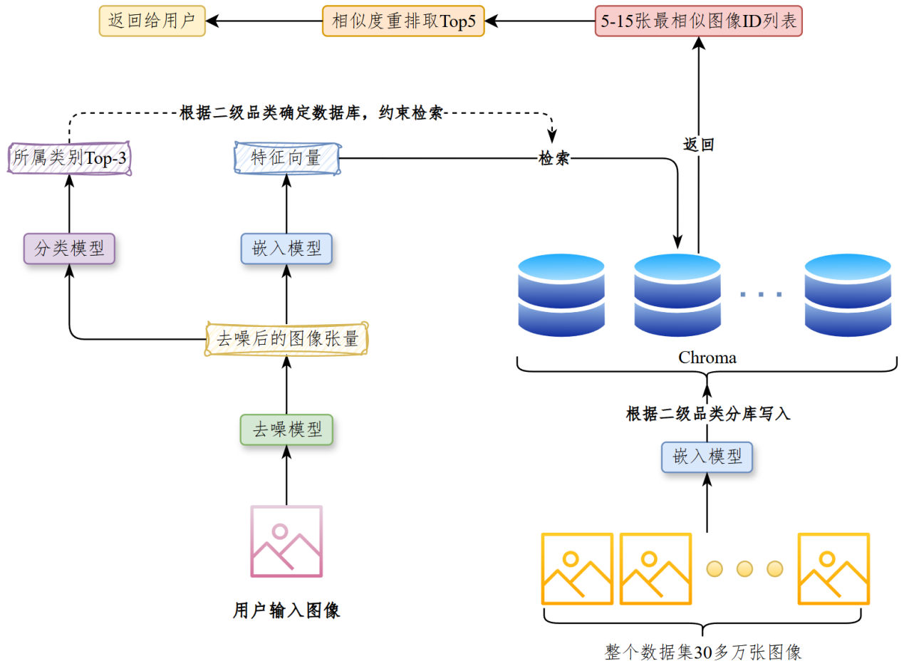
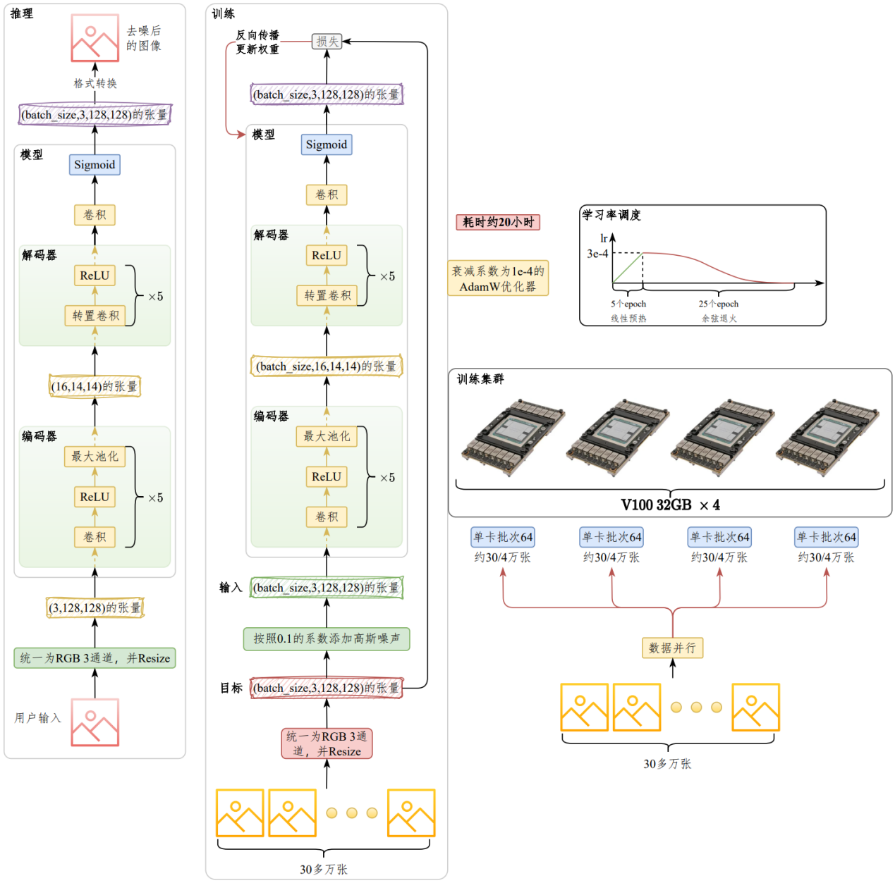
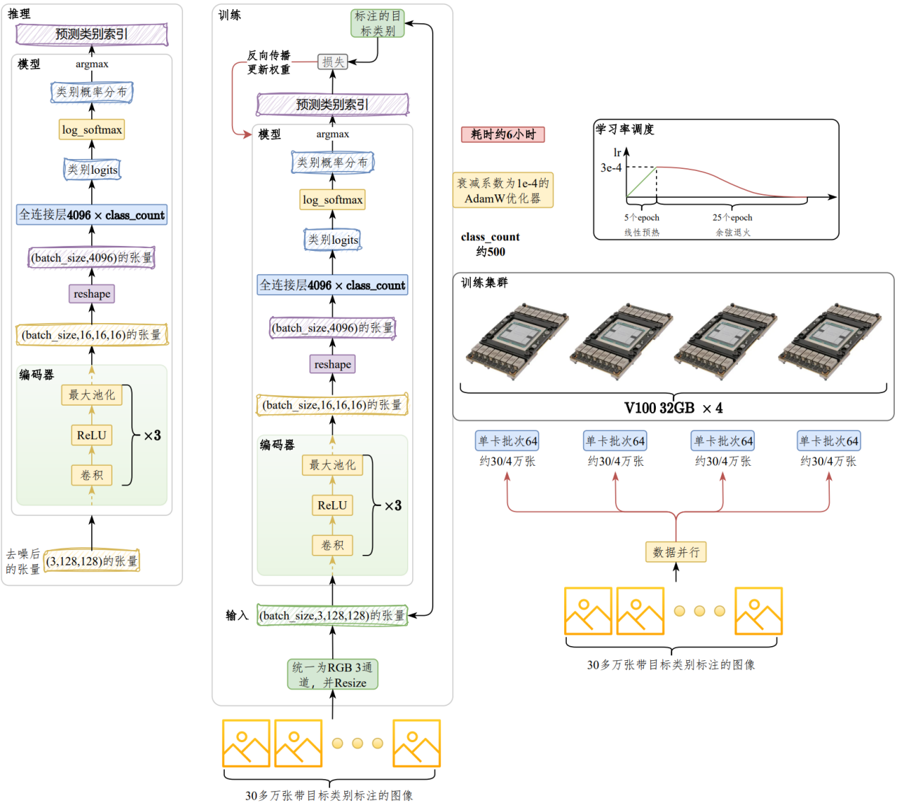
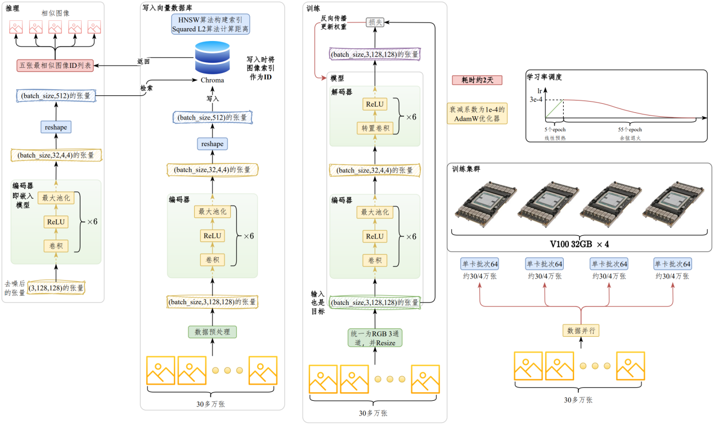

---
tags:
  - 大模型
  - 面试
source: "尚硅谷大模型技术之高频面试题-V2.1.6.docx"
source_blocks: "1869-1968"
reviewed: 2026-10-21
---

# CNN 图搜图的特征、索引与评估

图搜图需要区分特征提取、近似索引与业务同款定义。

前篇：[[知识点总结/80-资料与复习/81-面试知识库/08-大模型高频面试题/05-项目实战/03-Qwen 周报摘要的微调与生成链路|Qwen 周报摘要的微调与生成链路]] ｜ 后篇：[[知识点总结/80-资料与复习/81-面试知识库/08-大模型高频面试题/05-项目实战/05-CLIP 文搜图的训练与检索|CLIP 文搜图的训练与检索]]

## 深入理解（新增）

CNN 分类头前的向量可以作为检索特征，但分类训练未必让同款商品的多角度图片距离最小。应根据同款、相似款、同类目的业务区分，构造正负样本，尤其覆盖背景相似但商品不同的难负例。

向量归一化后，余弦与内积排序在特定条件下等价；未经归一化时，向量模长会影响内积结果。索引近似误差应与暴力全量检索比较，不把 ANN 漏召回误认为编码器能力不足。

商品有多张图时，可以按图片召回后再聚合商品，但最终 Top-K 应按商品去重，否则一个商品占满列表。离线指标还需覆盖上下架、重复图、图片损坏和新商品冷启动。


## 核心代码（新增）

以下是可在 CPU 运行的机制或业务契约示例，完整源码与测试见 [[知识点总结/80-资料与复习/81-面试知识库/08-大模型高频面试题/06-代码实验/01-核心代码实验与验证范围|核心代码实验与验证范围]]。示例不包含完整模型训练或外部平台部署。

```python
import numpy as np

def cosine_similarity(query, vectors):
    query = np.asarray(query, dtype=float)
    vectors = np.asarray(vectors, dtype=float)
    denom = np.linalg.norm(query) * np.linalg.norm(vectors, axis=1)
    return np.divide(vectors @ query, denom, out=np.zeros(len(vectors)), where=denom != 0)

def retrieval_metrics(retrieved, relevant, k=5):
    if not relevant:
        raise ValueError("no-answer cases must be evaluated separately")
    top = list(dict.fromkeys(retrieved))[:k]
    hit = set(top) & set(relevant)
    reciprocal_rank = next((1 / rank for rank, doc in enumerate(top, 1) if doc in relevant), 0.0)
    return {"recall_at_k": len(hit) / len(set(relevant)), "mrr": reciprocal_rank}

def aggregate_product_hits(hits, top_k=5):
    """hits: iterable of {product_id, image_id, score}; higher score is better."""
    best = {}
    for hit in hits:
        key = hit["product_id"]
        if key not in best or hit["score"] > best[key]["score"]:
            best[key] = dict(hit)
    return sorted(best.values(), key=lambda h: (-h["score"], h["product_id"]))[:top_k]

scores = cosine_similarity([1, 0], [[1, 0], [0, 1], [0, 0]])
assert np.allclose(scores, [1, 0, 0])

m = retrieval_metrics(["c2", "c1", "c1"], {"c1", "c3"}, k=3)
assert m == {"recall_at_k": 0.5, "mrr": 0.5}

hits = [
    {"product_id":"A", "image_id":"A1", "score":.9},
    {"product_id":"A", "image_id":"A2", "score":.8},
    {"product_id":"B", "image_id":"B1", "score":.7},
]
assert [h["product_id"] for h in aggregate_product_hits(hits)] == ["A", "B"]
```

## 追问与验证（新增）

构造背景相同、主体不同的两张图作为难负例；分别记录图片级和商品去重后的 Recall@K。

## 官方资料与论文

- [CLIP 原论文](https://arxiv.org/abs/2103.00020)

核验日期：2026-10-21。链接中的 `stable`、`main` 或平台文档会继续变化；新增纯 Python/NumPy 实验与原文旧版框架代码已分开标注。

## 原文保留

> [!warning] 原文批注
> 向量相似度衡量模型空间中的接近程度，不能直接当作“同款概率”。
>
> 原文的团队人数、业务规模、效果百分比、硬件与成本均保留为教材案例陈述；本次未独立复现这些项目指标。

<!-- source-block:1869 -->
### 商品检索-图搜图（CNN）

<!-- source-block:1870 -->
#### 项目周期

<!-- source-block:1871 -->
- 1人团队，总计约2.5个月。

<!-- source-block:1872 -->
- 需求分析与技术选型1周

<!-- source-block:1873 -->
- 数据准备与预处理2周

<!-- source-block:1874 -->
- 模型开发与训练4周

<!-- source-block:1875 -->
- 系统集成与后端对接2周

<!-- source-block:1876 -->
- 部署上线1周

<!-- source-block:1877 -->
#### 功能介绍

<!-- source-block:1878 -->
根据用户输入的图片搜索相似的商品。

<!-- source-block:1879 -->
#### 实现流程

<!-- source-block:1880 -->
对图片去噪-&gt;提取图片的特征表示-&gt;使用特征进行相似度检索

<!-- source-block:1881 -->
（为保证结果的准确性，又根据图片预测所属品类，用品类在相似度检索前约束其结果）

<!-- source-block:1882 -->
#### 技术细节

<!-- source-block:1883 -->
##### 去噪

<!-- source-block:1884 -->
使用CNN自编码器-1（展开模型架构，训练过程（数据量、集群算力、训练时长、超参数、模型内部参数、数据预处理））

<!-- source-block:1885 -->
输入带噪点图片，使用自编码器处理，输出完整图片。

<!-- source-block:1886 -->
##### 提取待检索图片的特征表示

<!-- source-block:1887 -->
使用CNN自编码器-2（展开模型架构，训练过程（数据量、集群算力、训练时长、超参数、模型内部参数、数据预处理））。

<!-- source-block:1888 -->
存储图片计算后的向量（使用向量数据库（底层检索算法（可选））），存储模型权重。

<!-- source-block:1889 -->
##### 计算用户输入的图片的特征表示

<!-- source-block:1890 -->
使用CNN自编码器-2-编码器（展开模型架构，训练过程（数据量、集群算力、训练时长、超参数、模型内部参数、数据预处理））。

<!-- source-block:1891 -->
##### 相似度检索

<!-- source-block:1892 -->
向量数据库提供的检索算法。

<!-- source-block:1893 -->
根据向量数据库记录的唯一索引定位相似图片。

<!-- source-block:1894 -->
##### 分类

<!-- source-block:1895 -->
基于CNN，添加线性层，并进行分类（为什么不用前面训好的自编码器？内部结构和层数不一样，出于资源考虑。单独做了下实验，发现单独重新训练效果更好）。

<!-- source-block:1896 -->
训练过程（数据量、集群算力、训练时长、超参数、模型内部参数、数据预处理）。

<!-- source-block:1897 -->
##### 配合发布接口

<!-- source-block:1898 -->
需要提供代码调用文档，配合后端同事发布接口。

<!-- source-block:1899 -->
#### 总结

<!-- source-block:1900 -->
智图寻宝项目的功能是：根据用户输入的图片检索相似商品。

<!-- source-block:1901 -->
实现流程主要包含三个步骤：图片去噪-&gt;分类-&gt;相似度检索

<!-- source-block:1902 -->
**首先，我们基于CNN构建了自编码器用于去噪。自编码器由编码器和解码器构成。**

<!-- source-block:1903 -->
**训练之前，我们首先对图像进行预处理，统一为RGB 3通道格式，统一尺寸为128\*128，并转换为Pytorch张量，每个像素值由0~255之间的整数映射为0~1之间的浮点数。按照0.1的噪声系数（系数乘以噪声）向原图像添加高斯噪声，将其作为输入，原始图像作为输出。**

<!-- source-block:1904 -->
**编码器采用5个卷积层，每个卷积层之后通过ReLU激活函数引入非线性，使得网络可以学习复杂的函数映射。此外，每个卷积层之后紧跟一个最大池化层，通过5组卷积+池化层对图像信息进行压缩，将输入图像由3通道转换为16通道。并将图像尺寸由128\*128压缩为16\*16。**

<!-- source-block:1905 -->
**解码器首先由5个转置卷积层堆叠而成，每个转置卷积层之后同样应用ReLU激活函数，最后经过一个普通卷积层，并应用Sigmoid激活函数得到最终输出，确保像素值在0~1之间。输出尺寸和编码器输入完全一致，都是3通道，尺寸128\*128。**

<!-- source-block:1906 -->
**将添加了高斯噪声的图像作为输入，原始图像作为目标进行训练。单卡训练批次大小为64，在30多万多张图片上训练30个轮次，采用衰减系数为1e-4的AdamW优化器，首先在5个轮次上将学习率从0线性预热至3e-4，然后通过余弦退火在后续25个epoch上衰减至0。**

<!-- source-block:1907 -->
**训练在【4张V100 32GB】上进行，采用DDP策略，耗时【约20小时】**

<!-- source-block:1908 -->
**推理时，输入用户提供的图片，输出去噪后的图片。**

<!-- source-block:1909 -->
**然后，我们基于输入图片识别其品类。**

<!-- source-block:1910 -->
**我们通过公司业务库获取了30多万多张图像的商品类别标注数据，类别为三级品类，总数在500左右（在所选公司APP上数一下品类）。**

<!-- source-block:1911 -->
**训练之前同样先进行预处理，将图像统一为RGB 3通道格式，尺寸为128\*128，转换为Tensor。将原始图像作为输入，商品类别作为输出，构建训练集和验证集。**

<!-- source-block:1912 -->
**我们先进行了相似度检索任务编码器的训练，它已经可以输出图像的高维表征，尝试在此基础上添加线性层用于类别预测，训练过程中冻结除最终线性层外的其它层，但效果不尽人意。所以重新构建了独立的CNN深度神经网络，性能略优于前者，但由于网络架构更简单，推理成本更低，响应更快，确定为最终方案。**

<!-- source-block:1913 -->
**模型包含3组 “卷积层+ReLU激活函数+最大池化层”。将通道数由3转换为16，图像尺寸由128\*128转换为16\*16，然后通过reshape将数据展平为4096维的向量，最后通过一个全连接层将向量映射为【类别数】维向量，最终应用softmax计算类别概率，预测所属类别。**

<!-- source-block:1914 -->
**将原始图像作为输入，类别标签作为目标进行训练。单卡训练批次大小为64，在30多万张图片上训练30个轮次，采用衰减系数为1e-4的AdamW优化器，首先在5个轮次上将学习率从0线性预热至3e-4，然后通过余弦退火在后续25个epoch上衰减至0。**

<!-- source-block:1915 -->
**训练在【4张V100 32GB】上进行，采用DDP策略，耗时【约6小时】**

<!-- source-block:1916 -->
**推理时，将经过去噪的图像作为输入，根据输出的类别标签，通过类别字典获取商品所属的三级品类。**

<!-- source-block:1917 -->
**最后，我们基于CNN构建了另外的自编码器用于生成图像的特征表示。**

<!-- source-block:1918 -->
**训练之前同样先进行预处理，统一为RGB 3通道格式，尺寸为128\*128，转换为Tensor。将原始图像作为输入和输出构建训练集和验证集。**

<!-- source-block:1919 -->
**编码器由6组 “卷积层+ReLU激活函数+最大池化层” 堆叠而成。将通道数由3转换为32，图像尺寸由128\*128转换为4\*4。**

<!-- source-block:1920 -->
**解码器由6组 “转置卷积层+ReLU激活函数” 堆叠而成，将编码器生成的特征表示重建为原图像尺寸。**

<!-- source-block:1921 -->
**将原图像作为输入和目标进行训练，单卡批次大小为64，在30多万多张图片上训练了60个轮次，采用衰减系数为1e-4的AdamW优化器，首先在5个轮次上将学习率从0线性预热至3e-4，然后通过余弦退火在后续55个epoch上衰减至0。**

<!-- source-block:1922 -->
训练在【4张V100 32GB】上进行，采用DDP策略，耗时【约2天】

<!-- source-block:1923 -->
**训练过程中保存验证集上损失最小的编码器文件，训练完成后基于最佳模型将整个数据集的图像数据映射为（32,4,4）形状的张量，然后通过reshape函数将数据转换为512维的向量,存入Chroma。数据集中的每张图像都有唯一索引，写入Chroma时，我们将唯一索引作为图像的ID。采用Chroma提供的HNSW算法构建索引，以及默认的平方L2算法计算相似度。**

<!-- source-block:1924 -->
为了提升检索效率，我们根据商品所属的二级品类分库，即二级品类相同的商品图像的特征表示写入同一个向量数据库，最终构建了70多个向量数据库。

<!-- source-block:1925 -->
**推理时，将去噪后的图像输入编码器，再通过reshape得到512维的特征向量，然后在Chroma中根据检索5条相似度最高的数据，返回其ID，根据ID确定相似图像后返回给调用者。**

<!-- source-block:1926 -->
在相似度检索之前，我们首先预测商品所属类别Top-3，根据二级品类确定向量数据库，然后分别在这些向量数据库中检索Top-5的相似商品，最终将所有的相似商品根据相似度重排，取Top-5作为最终结果。

<!-- source-block:1927 -->
**配置和训练时长对应关系参考**

<!-- source-block:1928 -->
| 项目 | 配置 | 训练时长 |
| --- | --- | --- |
| 去噪 | 4张V100 32GB | 约20小时 |
| 分类 | 4张V100 32GB | 约6小时 |
| 相似度检索 | 4张V100 32GB | 约2天 |

<!-- source-block:1929 -->
模型训练时的集群配置及耗时对应关系如上所示，如果要更换集群规模，根据算力等比例调整训练时长即可。

<!-- source-block:1930 -->
#### 总结-项目串讲

<!-- source-block:1931 -->
智图寻宝项目的目标是根据用户输入的图像检索相似商品。

<!-- source-block:1932 -->
实现流程主要包含三个步骤：图片去噪-&gt;分类-&gt;相似度检索

<!-- source-block:1933 -->


<!-- source-block:1934 -->
##### 去噪

<!-- source-block:1935 -->


<!-- source-block:1936 -->
**串讲**

<!-- source-block:1937 -->
图片去噪模块基于去噪自编码器实现。自编码器是一种无监督学习的神经网络模型，由编码器和解码器构成，核心思想是通过编码器将输入图像映射到低维特征空间，然后再通过解码器从低维表示重新构建出尽可能接近原始输入的数据。去噪自编码器是自编码器的变种，其原理是给输入图像添加噪声，训练模型从被污染的数据中重建原始图像。

<!-- source-block:1938 -->
我们基于去噪自编码器在30多万张电商图像上进行去噪模型的训练。

<!-- source-block:1939 -->
编码器部分由5个卷积+池化层的组合构成，解码器部分由五个转置卷积层加一个普通卷积层构成。

<!-- source-block:1940 -->
训练之前首先经过图像预处理统一尺寸，转换为张量，再添加随机噪声作为输入，未添加噪声的张量作为目标。

<!-- source-block:1941 -->
训练采用了AdamW优化器，并使用了线性预热和余弦退火的学习率调度策略。

<!-- source-block:1942 -->
训练在4张V100 32GB构成的集群上进行，采用数据并行策略。

<!-- source-block:1943 -->
推理时接收用户输入的图片，输出去噪后的图像。

<!-- source-block:1944 -->
**重要参数**

<!-- source-block:1945 -->
| 参数 | 取值 |
| --- | --- |
| 数据量 | 30多万张图片 |
| 预处理后尺寸 | RGB 3通道，128\*128，再转换为张量 |
| 高斯噪声系数 | 0.1 |
| 编码器卷积+池化层数量 | 5层 |
| 卷积和转置卷积后激活函数 | ReLU |
| 解码器配置 | 5层转置卷积+1层普通卷积 |
| 输出尺寸 | (3, 128, 128) |
| 单节点训练批次 | 64 |
| epoch | 30 |
| AdamW优化器衰减系数 | 1e-4 |
| 学习率线性预热策略 | 5个epoch从0线性预热至3e-4 |
| 余弦退火策略 | 后续25个epoch逐渐衰减至0 |
| 集群规模 | 4\*V100 32GB |
| 训练时长 | 20小时 |

<!-- source-block:1946 -->
##### 分类

<!-- source-block:1947 -->


<!-- source-block:1948 -->
**串讲**

<!-- source-block:1949 -->
分类基于卷积和线性层的组合实现，在30多万张标注了类别的电商图片上进行训练。

<!-- source-block:1950 -->
模型由3组卷积+池化层加一个全连接层组成。

<!-- source-block:1951 -->
训练之前首先将输入图像处理RGB 3通道格式，尺寸为128\*128，然后转换为张量作为输入。标注的类别作为目标。

<!-- source-block:1952 -->
训练采用了AdamW优化器，并使用了线性预热和余弦退火的学习率调度策略。

<!-- source-block:1953 -->
训练在4张V100 32GB构成的集群上进行，采用数据并行策略。

<!-- source-block:1954 -->
推理时，将去噪后的图像输入模型，经过全连接层得到商品所属类别的概率分布，取概率最大的三个品类用于约束相似度检索的结果。

<!-- source-block:1955 -->
**重要参数**

<!-- source-block:1956 -->
| 参数 | 取值 |
| --- | --- |
| 数据量 | 30多万张图片 |
| 预处理后尺寸 | RGB 3通道，128\*128，再转换为张量 |
| 编码器卷积+池化层数量 | 3层 |
| 卷积层后激活函数 | ReLU |
| 输出尺寸 | (3, 128, 128) |
| 单节点训练批次 | 64 |
| epoch | 30 |
| AdamW优化器衰减系数 | 1e-4 |
| 学习率线性预热策略 | 5个epoch从0线性预热至3e-4 |
| 余弦退火策略 | 后续25个epoch逐渐衰减至0 |
| 集群规模 | 4\*V100 32GB |
| 训练时长 | 约6小时 |
| 目标类别总数 | 500左右 |
| 预测类别数 | 1 |

<!-- source-block:1957 -->
##### 相似度检索

<!-- source-block:1958 -->


<!-- source-block:1959 -->
**串讲**

<!-- source-block:1960 -->
相似度检索基于原始自编码器实现，在30多万张电商图片上进行训练。

<!-- source-block:1961 -->
编码器部分由6个卷积+池化层堆叠而成，解码器部分由6个转置卷积堆叠而成。

<!-- source-block:1962 -->
训练之前首先将输入图像处理RGB 3通道格式，尺寸为128\*128，然后转换为张量，作为输入和目标。

<!-- source-block:1963 -->
训练采用了AdamW优化器，并使用了线性预热和余弦退火的学习率调度策略。

<!-- source-block:1964 -->
训练在4张V100 32GB构成的集群上进行，采用数据并行策略。

<!-- source-block:1965 -->
训练完成后将数据集中的所有图像通过编码器+reshape转换为512维向量，按照商品所属的二级品类存入Chroma。采用了后者默认的HNSW算法构建索引，用平方L2算法计算向量距离。写入Chroma时将每张图像的索引作为ID。

<!-- source-block:1966 -->
推理时，将去噪后的图像输入编码器，得到512维的特征向量。然后根据类别判定Top3确定二级品类，进而确定向量数据库，在选定的所有库中根据相似度检索获取相似图像Top5，最后将所有库返回的图像根据相似度重排，取Top5返还给调用者。

<!-- source-block:1967 -->
**重要参数**

<!-- source-block:1968 -->
| 参数 | 取值 |
| --- | --- |
| 数据量 | 30多万张图片 |
| 预处理后尺寸 | RGB 3通道，128\*128，再转换为张量 |
| 编码器卷积+池化层数量 | 6层 |
| 卷积和转置卷积后激活函数 | ReLU |
| 解码器转置卷积层数 | 6层 |
| 输出尺寸 | (3, 128, 128) |
| 单节点训练批次 | 64 |
| epoch | 60 |
| AdamW优化器衰减系数 | 1e-4 |
| 学习率线性预热策略 | 5个epoch从0线性预热至3e-4 |
| 余弦退火策略 | 后续25个epoch逐渐衰减至0 |
| 集群规模 | 4\*V100 32GB |
| 训练时长 | 约2天 |
| Chroma索引策略 | HNSW算法 |
| Chroma相似度算法 | 平方L2（Squared L2） |
| 特征向量维度 | 512 |
| 保留的相似图像数量 | 5（Top 5） |
