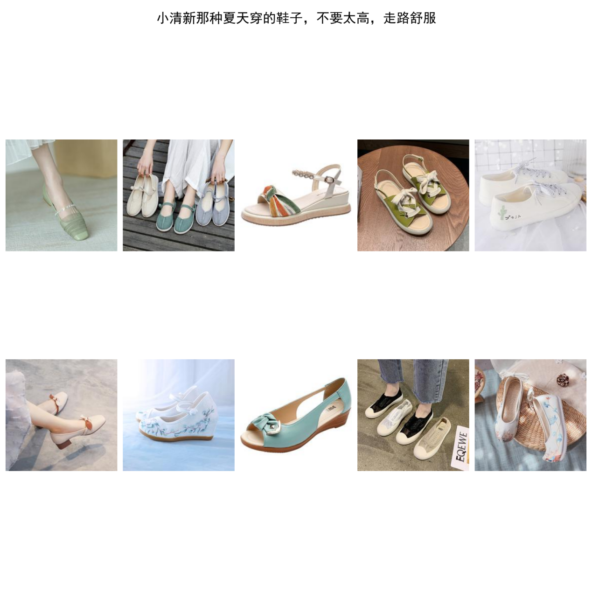
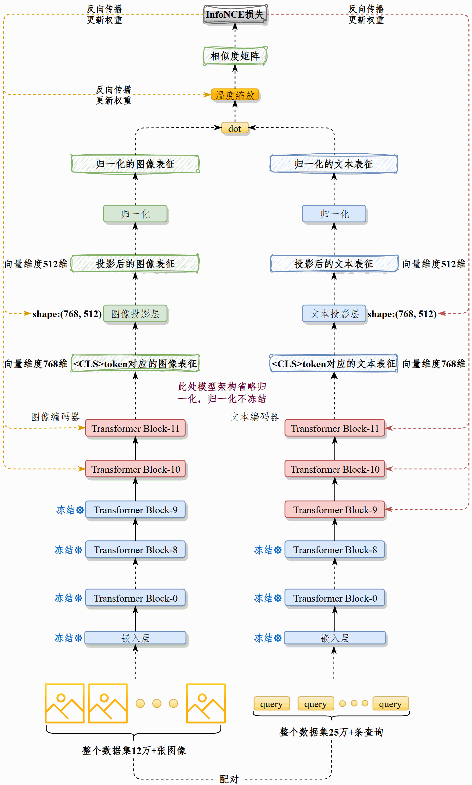
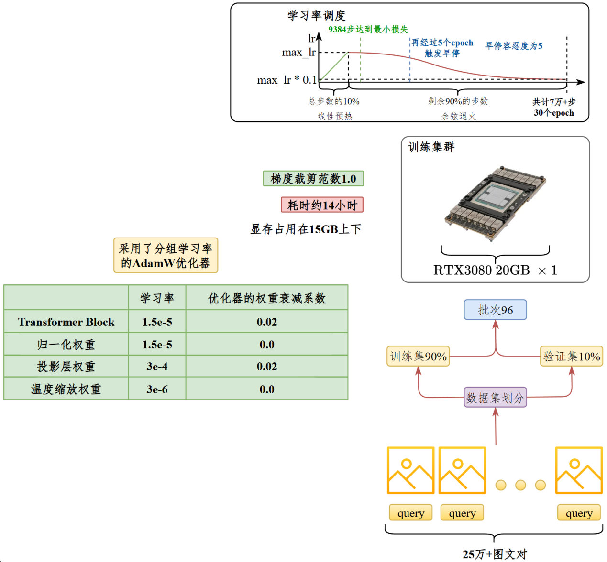
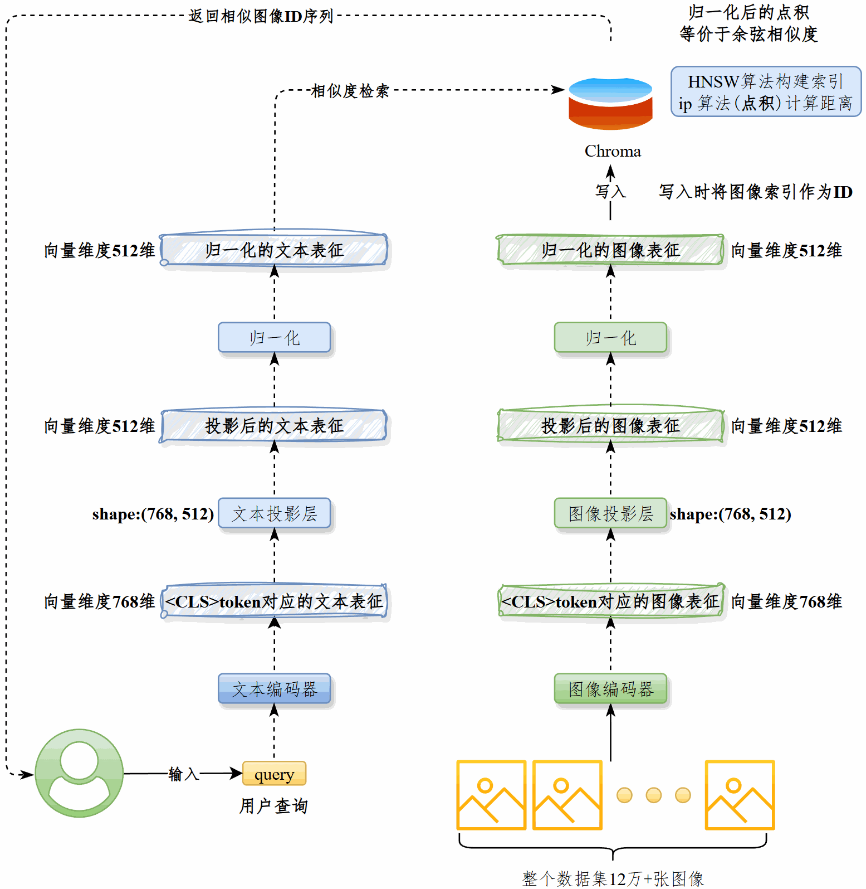

---
tags:
  - 大模型
  - 面试
source: "尚硅谷大模型技术之高频面试题-V2.1.6.docx"
source_blocks: "1969-2035"
reviewed: 2026-10-21
---

# CLIP 文搜图的训练与检索

文搜图依赖领域文本与商品视觉属性是否在同一表示空间中对齐。

前篇：[[知识点总结/80-资料与复习/81-面试知识库/08-大模型高频面试题/05-项目实战/04-CNN 图搜图的特征、索引与评估|CNN 图搜图的特征、索引与评估]] ｜ 后篇：[[知识点总结/80-资料与复习/81-面试知识库/08-大模型高频面试题/05-项目实战/06-商品标题生成的视觉投影与约束|商品标题生成的视觉投影与约束]]

## 深入理解（新增）

通用 CLIP 能提供起点，但电商查询常同时包含品类、材质、颜色和否定条件。单一向量可能漏掉“不要红色”这类约束，可先召回再用结构化属性过滤或重排，单独验证否定词敏感性。

微调时同款商品的多个标题互为潜在正例，不能无条件把同 batch 的其他文本都当真负例。数据划分按商品家族去重，防止同一主图或轻微改写跨集合泄漏。

检索链路应保存编码器版本和预处理配置。更换模型后必须重建同空间索引，不能新 query 向量直接检索旧模型文档向量，即使维数相同也没有可比语义。


## 核心代码（新增）

以下是可在 CPU 运行的机制或业务契约示例，完整源码与测试见 [[知识点总结/80-资料与复习/81-面试知识库/08-大模型高频面试题/06-代码实验/01-核心代码实验与验证范围|核心代码实验与验证范围]]。示例不包含完整模型训练或外部平台部署。

```python
import numpy as np

def clip_contrastive_loss(image_features, text_features, logit_scale=1.0):
    def normalize(x):
        return x / np.maximum(np.linalg.norm(x, axis=1, keepdims=True), 1e-12)
    logits = logit_scale * normalize(image_features) @ normalize(text_features).T
    image_logp = logits - np.logaddexp.reduce(logits, axis=1, keepdims=True)
    text_logp = logits.T - np.logaddexp.reduce(logits.T, axis=1, keepdims=True)
    return float(-(np.diag(image_logp).mean() + np.diag(text_logp).mean()) / 2)

def cosine_similarity(query, vectors):
    query = np.asarray(query, dtype=float)
    vectors = np.asarray(vectors, dtype=float)
    denom = np.linalg.norm(query) * np.linalg.norm(vectors, axis=1)
    return np.divide(vectors @ query, denom, out=np.zeros(len(vectors)), where=denom != 0)

def aggregate_product_hits(hits, top_k=5):
    """hits: iterable of {product_id, image_id, score}; higher score is better."""
    best = {}
    for hit in hits:
        key = hit["product_id"]
        if key not in best or hit["score"] > best[key]["score"]:
            best[key] = dict(hit)
    return sorted(best.values(), key=lambda h: (-h["score"], h["product_id"]))[:top_k]

image = np.eye(3); text = np.eye(3)
assert clip_contrastive_loss(image, text, 10) < \
       clip_contrastive_loss(image, text[::-1], 10)

scores = cosine_similarity([1, 0], [[1, 0], [0, 1], [0, 0]])
assert np.allclose(scores, [1, 0, 0])

hits = [
    {"product_id":"A", "image_id":"A1", "score":.9},
    {"product_id":"A", "image_id":"A2", "score":.8},
    {"product_id":"B", "image_id":"B1", "score":.7},
]
assert [h["product_id"] for h in aggregate_product_hits(hits)] == ["A", "B"]
```

## 追问与验证（新增）

用“黑色皮包”和“非黑色皮包”评估排名变化；再用同款多标题讨论多正例训练应如何调整目标。

## 官方资料与论文

- [CLIP 原论文](https://arxiv.org/abs/2103.00020)

核验日期：2026-10-21。链接中的 `stable`、`main` 或平台文档会继续变化；新增纯 Python/NumPy 实验与原文旧版框架代码已分开标注。

## 原文保留

> [!warning] 原文批注
> 向量维度相同不代表两个模型的向量空间可混用；编码器升级必须明确索引版本。
>
> 原文的团队人数、业务规模、效果百分比、硬件与成本均保留为教材案例陈述；本次未独立复现这些项目指标。

<!-- source-block:1969 -->
### 商品检索-文搜图（多模态）

<!-- source-block:1970 -->
#### 项目周期

<!-- source-block:1971 -->
- 2人团队，总计约3个月。

<!-- source-block:1972 -->
- 需求分析与技术选型1周

<!-- source-block:1973 -->
- 数据准备与预处理3周

<!-- source-block:1974 -->
- 模型开发与训练4周

<!-- source-block:1975 -->
- 系统集成与后端对接3周

<!-- source-block:1976 -->
- 部署上线2周

<!-- source-block:1977 -->
#### 功能介绍

<!-- source-block:1978 -->
##### 项目背景

<!-- source-block:1979 -->
用户在电商平台搜索商品时，传统的检索方式主要依赖倒排索引，这种方式实现简单，但是无法理解语义，仅做字面匹配，对同义词、语境、用户意图等不敏感，用户拼写错误时难以找到结果。

<!-- source-block:1980 -->
以查询：“小清新那种夏天穿的鞋子，不要太高，走路舒服”为例，传统倒排索引系统会先对查询进行分词（如“小清新 / 夏天 / 穿 / 鞋子 / 太高 / 走路 / 舒服”），然后逐个匹配关键词。

<!-- source-block:1981 -->
① 可能重点匹配“鞋子”，这一关键词将导致召回结果非常宽泛，例如：“高跟鞋”、“篮球鞋”、“登山鞋”。

<!-- source-block:1982 -->
② “小清新”这样的修饰词不常出现在商品标题或描述里，往往无法命中。

<!-- source-block:1983 -->
③ “不要太高”是否定语义，但倒排索引只会当作“高”来匹配，结果反而可能出现“高跟鞋”。

<!-- source-block:1984 -->
④ “走路舒服”属于主观描述，如果商品详情没有明确包含“舒服”，则无法匹配。

<!-- source-block:1985 -->
用户可能会搜到：

<!-- source-block:1986 -->
① “夏季新款高跟鞋”（错误匹配，“高”被误认为正向条件）

<!-- source-block:1987 -->
② “运动鞋 夏天款”（部分符合，但缺少“小清新”风格语义）

<!-- source-block:1988 -->
③ “小清新连衣裙”（因为有“小清新”关键字被召回，但不是鞋子）

<!-- source-block:1989 -->
而如果用语义搜索（向量检索），模型会将整句话编码为语义向量，能够搜到与整体语义最相近的商品。

<!-- source-block:1990 -->
基于上述背景，我们开发了基于语义搜索的文搜图模块，对于上文提到的查询，问搜图模块效果如下。

<!-- source-block:1991 -->


<!-- source-block:1992 -->
##### 项目简介

<!-- source-block:1993 -->
对于用户输入的文本查询，根据语义搜索相似商品。

<!-- source-block:1994 -->
#### 实现流程

<!-- source-block:1995 -->
我们在现有预训练CLIP模型的基础上，在25万+图文对上续训，对齐电商场景下的图像和查询文本。然后将图像通过最佳CLIP模型的vision\_model处理为图像表征，写入向量数据库Chroma。

<!-- source-block:1996 -->
用户查询到来时，将其通过最佳CLIP模型的text\_model处理为文本表征，从Chroma中检索相似图像。

<!-- source-block:1997 -->
#### 技术细节

<!-- source-block:1998 -->
##### CLIP模型选型

<!-- source-block:1999 -->
基于Chinese CLIP模型：OFA-Sys/chinese-clip-vit-base-patch16实现。

<!-- source-block:2000 -->
该模型由vision\_model和text\_model以及各自的投影构成。vision\_model接收3通道、尺寸224\*224的图像，text\_model接收原始文本，二者均输出维度为768的向量，然后通过各自的投影层处理为512维向量。

<!-- source-block:2001 -->
##### 向量数据库选型

<!-- source-block:2002 -->
选择Chroma作为向量数据库。

<!-- source-block:2003 -->
#### 总结

<!-- source-block:2004 -->
文搜图模块的功能是：根据用户输入的文本查询搜索相似商品。

<!-- source-block:2005 -->
**首先，续训CLIP Chinese模型。**

<!-- source-block:2006 -->
**首先对图像进行预处理，统一为RGB 3通道格式，尺寸为224\*224。。**

<!-- source-block:2007 -->
**经过CLIP预处理器处理后的图像和查询文本分别进入CLIP的vision\_model和text\_model，按照CLIP模型的标准过程进行前向传播、反向传播。**

<!-- source-block:2008 -->
并非所有权重都会更新。训练过程冻结图像和文本模型的嵌入层、冻结文本模型的前9个Transformer Block，解冻后3层，冻结图像模型的前10个Transformer Block，解冻后2层。解冻归一化权重、解冻投影层、解冻温度缩放权重。

<!-- source-block:2009 -->
**在25万个图文对上训练，训练集和验证集按照9:1划分，批次大小96，每个epoch训练2346步，训练共30个epoch，约7万步。在前10%的步数应用线性预热，学习率从0达到最大值，经过剩余90%的步数学习率衰减至最大值的10%。应用范数为1.0的梯度裁剪。早停容忍度为5个epoch。**

<!-- source-block:2010 -->
采用AdamW优化器，采用分组学习率。

<!-- source-block:2011 -->
| <br> | 学习率 | 优化器的权重衰减系数 |
| --- | --- | --- |
| Transformer Block权重 | 1.5e-5 | 0.02 |
| 归一化权重 | 1.5e-5 | 0.0 |
| 投影层权重 | 3e-4 | 0.02 |
| 温度缩放权重 | 3e-6 | 0.0 |

<!-- source-block:2012 -->
**训练在【1张V100 32GB】上进行，显存占用在15GB左右，训练4个epoch，累计9384步之后验证损失达到最小，再经过5个epoch触发早停。训练时长约5小时。**

<!-- source-block:2013 -->
**生成图像表征并入库**

<!-- source-block:2014 -->
**用最优的vision\_model将图像处理为512维的特征向量，归一化后写入Chroma。**

<!-- source-block:2015 -->
**Chroma采用HNSW算法构建索引，ip算法（点积）计算距离。写入时将图像的唯一索引作为向量ID。**

<!-- source-block:2016 -->
**查询相似图像**

<!-- source-block:2017 -->
用最佳的text\_model将用户查询处理为512维的特征向量，归一化后从Chroma中检索相似图像，获得后者的ID列表，返还给用户。

<!-- source-block:2018 -->
#### 总结-项目串讲

<!-- source-block:2019 -->
##### 训练逻辑

<!-- source-block:2020 -->


<!-- source-block:2021 -->
**串讲**

<!-- source-block:2022 -->
文生图模块的目标是根据文本查询相似图像。为实现这一目标，对CLIP Chinese模型进行了续训。

<!-- source-block:2023 -->
具体做法是：先将图像预处理为RGB三通道、尺寸224×224的图像。用CLIP的预处理器对图像和文本预处理，再分别送入vision\_model和text\_model做标准的前向、反向传播。在训练时我采取了部分参数冻结策略：冻结嵌入层，文本端只解冻最后3个 Transformer Block，视觉端解冻最后2层，同时解冻归一化、投影层以及温度缩放参数。

<!-- source-block:2024 -->
训练数据量是25万对图文，9:1划分训练/验证集，批大小96，共30个epoch，约7万步，使用AdamW分组学习率（投影层最高 3e-4，其余1.5e-5～3e-6），并对不同分组选择不同的AdamW衰减系数（Transformer和投影层0.02，其余为0.0），并结合线性预热、余弦衰减、梯度裁剪和早停机制。

<!-- source-block:2025 -->
在1张V100 32GB上训练，显存控制在15GB左右，实际跑了约4个epoch（9384步验证损失最低，再经过5个epoch触发早停），整体训练时长5小时左右，最终模型在检索效果上有明显提升。

<!-- source-block:2026 -->
**关键超参数**

<!-- source-block:2027 -->


<!-- source-block:2028 -->
注意：企业生产环境一般不会用RTX3080 20GB这种魔改显卡，上图中的显卡是项目开发时的测试环境，面试时可以替换为正常企业级显卡即可。开销和效率接近。

<!-- source-block:2029 -->
| 参数 | 取值 |
| --- | --- |
| 数据量 | 25万+多个图文对 |
| 预处理后尺寸 | RGB 3通道，224\*224 |
| 训练集和验证集比例 | 9:1 |
| AdamW衰减系数 | Transformer和投影层0.02，其余为0.0 |
| epoch | 30 |
| 训练批次 | 96 |
| 最大学习率 | Transformer和归一化1.5e-5，投影层3e-4，温度缩放系数3e-6 |
| 最小学习率 | 最大学习率的10% |
| 学习率线性预热策略 | 前10%步从0线性预热至最大学习率 |
| 余弦退火策略 | 后90%步，逐渐衰减至最大学习率的10% |
| 集群规模 | 1\*V100 32GB |
| 训练时长 | 约5小时 |
| 早停容忍度 | 5个epoch |

<!-- source-block:2030 -->
##### 检索流程

<!-- source-block:2031 -->


<!-- source-block:2032 -->
**串讲**

<!-- source-block:2033 -->
在图像检索部分，我做了两方面工作：首先，用优化后的vision\_model将图像编码为512维特征向量，归一化后写入Chroma，并以唯一索引作为向量ID。

<!-- source-block:2034 -->
Chroma基于HNSW建立索引，使用点积（ip）来衡量相似度。

<!-- source-block:2035 -->
其次，在查询阶段，用户输入的文本会经由text\_model转换成 512 维特征向量，归一化后从Chroma中检索最相似的图像，返回对应的ID列表，从而实现高效的文搜图功能。
