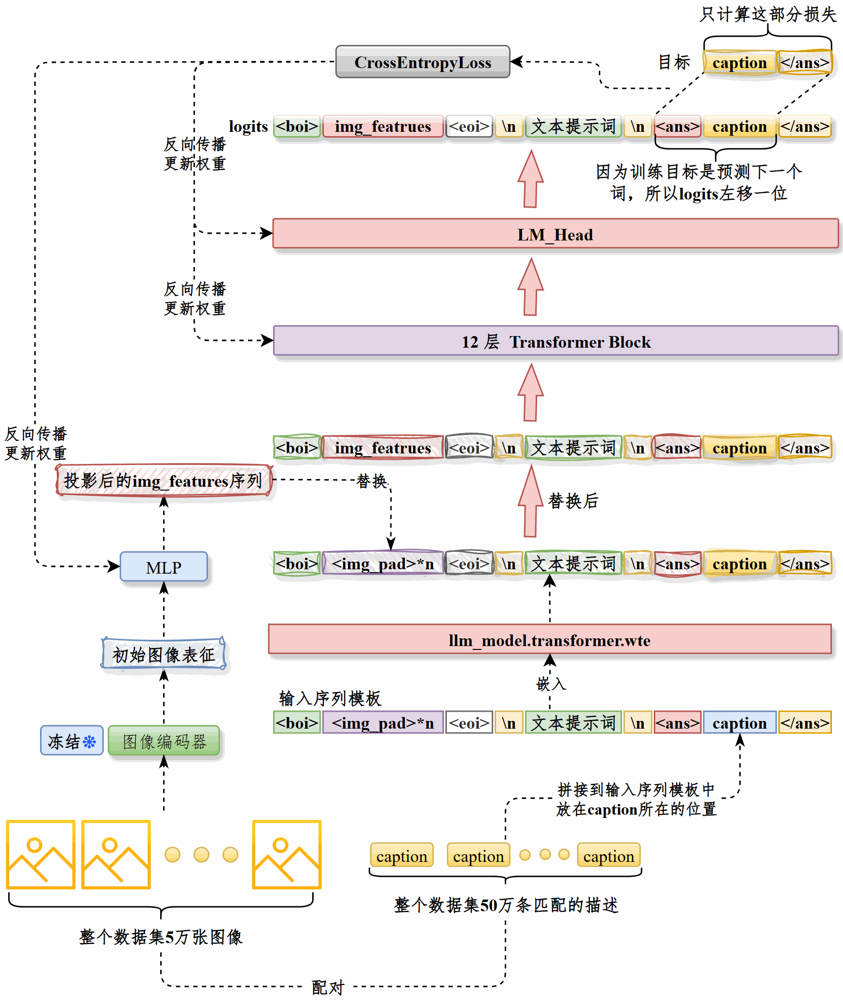
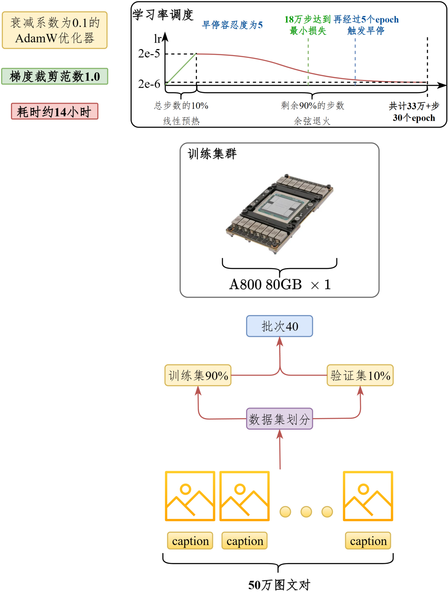
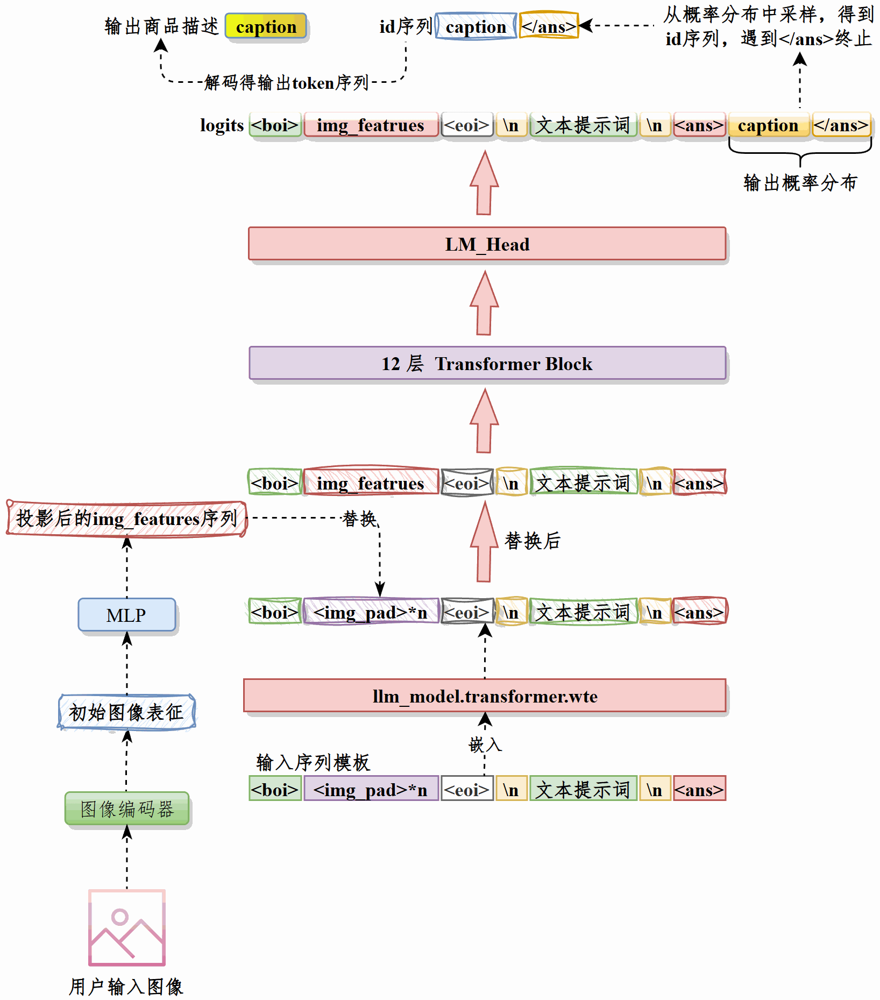

---
tags:
  - 大模型
  - 面试
source: "尚硅谷大模型技术之高频面试题-V2.1.6.docx"
source_blocks: "2036-2101"
reviewed: 2026-10-21
---

# 商品标题生成的视觉投影与约束

把可见属性、已知商品属性和营销表达分开，防止模型补造卖点。

前篇：[[知识点总结/80-资料与复习/81-面试知识库/08-大模型高频面试题/05-项目实战/05-CLIP 文搜图的训练与检索|CLIP 文搜图的训练与检索]] ｜ 后篇：[[知识点总结/80-资料与复习/81-面试知识库/08-大模型高频面试题/05-项目实战/07-商品品类预测与长尾分类|商品品类预测与长尾分类]]

## 深入理解（新增）

视觉编码器输出需经投影或适配模块对接语言模型，训练时还要对齐图像 token 与文本模板。冻结哪些模块会改变显存和可学习能力，不能只描述“接入图片”而不说明梯度流向。

标题生成应受商品事实表约束。图片看不出的材质、容量、认证等字段只能来自可靠商品信息，不能靠视觉猜测；“高端”“爆款”等风格词也不应替代具体属性。

评价应同时看必需属性覆盖、禁用词、长度、重复度和人工可用率。离线 BLEU 高但虚构属性多的标题不能视为改进。下面 CLIP 对齐损失展示视觉文本配对的训练核心，它不是完整多模态生成模型。


## 核心代码（新增）

以下是可在 CPU 运行的机制或业务契约示例，完整源码与测试见 [[知识点总结/80-资料与复习/81-面试知识库/08-大模型高频面试题/06-代码实验/01-核心代码实验与验证范围|核心代码实验与验证范围]]。示例不包含完整模型训练或外部平台部署。

```python
import numpy as np

def clip_contrastive_loss(image_features, text_features, logit_scale=1.0):
    def normalize(x):
        return x / np.maximum(np.linalg.norm(x, axis=1, keepdims=True), 1e-12)
    logits = logit_scale * normalize(image_features) @ normalize(text_features).T
    image_logp = logits - np.logaddexp.reduce(logits, axis=1, keepdims=True)
    text_logp = logits.T - np.logaddexp.reduce(logits.T, axis=1, keepdims=True)
    return float(-(np.diag(image_logp).mean() + np.diag(text_logp).mean()) / 2)

image = np.eye(3); text = np.eye(3)
assert clip_contrastive_loss(image, text, 10) < \
       clip_contrastive_loss(image, text[::-1], 10)
```

## 追问与验证（新增）

故意移除商品容量字段，检查模型能否只描述可见属性而不补造容量；把事实错误率作为独立指标。

## 官方资料与论文

- [CLIP 原论文](https://arxiv.org/abs/2103.00020)
- [Transformers 生成流程](https://huggingface.co/docs/transformers/main/en/llm_tutorial)

核验日期：2026-10-21。链接中的 `stable`、`main` 或平台文档会继续变化；新增纯 Python/NumPy 实验与原文旧版框架代码已分开标注。

## 原文保留

> [!warning] 原文批注
> 图文对齐、视觉投影和自回归生成属于不同模块，CLIP 对比损失不能替代完整标题生成训练。
>
> 原文的团队人数、业务规模、效果百分比、硬件与成本均保留为教材案例陈述；本次未独立复现这些项目指标。

<!-- source-block:2036 -->
### 智能商品发布-标题生成（多模态）

<!-- source-block:2037 -->
#### 项目周期

<!-- source-block:2038 -->
- 1人团队，总计约2个月。

<!-- source-block:2039 -->
- 需求分析与技术选型5天

<!-- source-block:2040 -->
- 数据准备与预处理2周

<!-- source-block:2041 -->
- 模型开发与训练2周

<!-- source-block:2042 -->
- 推理模块开发1周

<!-- source-block:2043 -->
- 系统集成与后端对接1周

<!-- source-block:2044 -->
- 部署上线1周

<!-- source-block:2045 -->
#### 功能介绍

<!-- source-block:2046 -->
根据商家上传的商品图片生成推荐标题，底层是通过多模态图生文实现的。

<!-- source-block:2047 -->
#### 实现流程

<!-- source-block:2048 -->
通过编码器将图像转换为特征-&gt;图像特征投影-&gt;和文本提示嵌入拼接为完整Prompt序列-&gt;LLM根据Prompt生成推荐标题。

<!-- source-block:2049 -->
#### 技术细节

<!-- source-block:2050 -->
##### 图像编码器

<!-- source-block:2051 -->
使用openai/clip-vit-base-patch32作为图像编码器，训练过程冻结模型。

<!-- source-block:2052 -->
该模型接收3通道、尺寸224\*224的图像，将模型输出中的pooler\_output向量作为图像特征传递给下游。该向量汇总了图像的全局信息，维度为768。

<!-- source-block:2053 -->
##### 图像投影层

<!-- source-block:2054 -->
将两个线性层构成MLP，作为图像投影层。将768维的图像特征映射为10\*768的向量，然后再通过view将形状变换为（10, 768），即长度为10的特征向量序列，传递给下游。

<!-- source-block:2055 -->
##### 拼接图像提示和文本提示

<!-- source-block:2056 -->
构造这样的提示词前缀。

```text
<boi><img_pad>*10<eoi>\n用户提示词\n<ans>
```

<!-- source-block:2058 -->
&lt;img\_pad&gt;是图像特征的占位符。

<!-- source-block:2059 -->
上述内容经过LLM的嵌入层处理为向量，然后用图像投影层输出的10个特征替换&lt;img\_pad&gt;对应的10个向量，得到的嵌入矩阵input\_embeds将作为下游LLM的输入。

<!-- source-block:2060 -->
##### LLM

<!-- source-block:2061 -->
选择uer/gpt2-chinese-cluecorpussmall作为LLM，模型由12个Transformer Block构成。

<!-- source-block:2062 -->
接收input\_embeds作为输入，输出推荐标题。

<!-- source-block:2063 -->
#### 总结

<!-- source-block:2064 -->
图生文模块的功能是：根据用户输入的商品图片生成推荐标题。

<!-- source-block:2065 -->
**首先，我们通过图像编码器将图像处理为特征表示。**

<!-- source-block:2066 -->
**在训练过程中图像编码器是完全冻结的，我们完全可以将原始图像提前处理为表征并落盘，训练时加载处理好的图像表征文件而非原图。这样一来，训练时就省去了图像编码器的前向传播过程，显著提升训练效率，节省资源开销。每张图像只需要在预处理时经图像编码器进行一次前向传播，总体的计算量也显著降低。**

<!-- source-block:2067 -->
**首先对图像进行预处理，统一为RGB 3通道格式，尺寸为224\*224。。**

<!-- source-block:2068 -->
**每张图像经过CLIP的vision\_model处理，提取输出中的pooler\_output作为图像表征，以图像的唯一ID为key，pooler\_output为value构建字典，通过torch.save存储为pytorch文件image\_features.pt。该文件只用于训练，不用于推理。**

<!-- source-block:2069 -->
**模型训练细节**

<!-- source-block:2070 -->
**数据集由两部分构成：处理好的图像表征和对应的文本描述，通过图像的唯一ID将图像表征和对应的文本描述caption逐一组合在一起，构建为数据集。**

<!-- source-block:2071 -->
**训练时将caption拼接到下面的提示词模板中**

```text
<boi><img_pad>*10<eoi>\n用户提示词\n<ans>caption</ans>
```

<!-- source-block:2073 -->
然后用LLM的嵌入层处理为特征矩阵。

<!-- source-block:2074 -->
**将图像表征经过投影层处理为提示词序列，替换特征矩阵中&lt;img\_pad&gt;对应的向量，这就是最终给到LLM的input\_embeds**

<!-- source-block:2075 -->
**将input\_embeds输入LLM，只计算caption&lt;/ans&gt;部分的损失，通过反向传播更新整个LLM和投影层权重。**

<!-- source-block:2076 -->
**在50万个图文对上训练，训练集和验证集按照9:1划分，批次大小40，采用衰减系数为0.1的AdamW优化器，应用范数为1.0的梯度裁剪。训练共30个epoch，约33万步，在前10%的步数应用线性预热，学习率从0达到最大值2e-5，经过剩余90%的步数学习率衰减至2e-6。早停容忍度为5个epoch。**

<!-- source-block:2077 -->
**训练在【1张A800 80GB】上进行，显存占用在30~40GB之间，训练16个epoch，累计18万步之后验证损失达到最小，再经过5个epoch触发早停。训练时长约14小时。**

<!-- source-block:2078 -->
**推理过程**

<!-- source-block:2079 -->
**接收用户输入的图像，经过图像编码器处理为向量，然后通过最佳的投影模型投影为向量序列img\_features。**

<!-- source-block:2080 -->
**将下面的提示词前缀处理为嵌入**

```text
<boi><img_pad>*10<eoi>\n用户提示词\n<ans>
```

<!-- source-block:2082 -->
**用img\_featrures替换嵌入后的向量中10个&lt;img\_pad&gt;的位置，这就是input\_embeds，将其输入LLM。**

<!-- source-block:2083 -->
**LLM输出下一个token的logits，根据用户输入的topp和topk调整logits，然后得到下一个token的概率分布，采样得到下一个token的ID。重复此过程直至达到最大输出长度或遇到&lt;/ans&gt; token。得到生成标题的token ID序列。**

<!-- source-block:2084 -->
**对ID序列解码得到模型生成的标题。**

<!-- source-block:2085 -->
#### 项目串讲

<!-- source-block:2086 -->
##### 训练逻辑

<!-- source-block:2087 -->


<!-- source-block:2088 -->
**串讲**

<!-- source-block:2089 -->
图生文模块的目标是根据商品图片自动生成推荐标题

<!-- source-block:2090 -->
整体流程是先对图像进行预处理，统一为 RGB 三通道、224×224 尺寸，再通过CLIP 的vision\_model提取pooler\_output作为图像表征，用图像ID唯一标识，然后将ID和表征共同存储，训练时直接加载。这种方式显著提升了训练效率和资源利用率。

<!-- source-block:2091 -->
训练时将caption拼接到提示词模板中，经由LLM的嵌入层处理，然后将图像表征经过投影层处理，用其输出替换&lt;img\_pad&gt;部分得到最终的输入向量，输入LLM。

<!-- source-block:2092 -->
只计算caption部分的损失，通过反向传播更新LLM和投影层权重。

<!-- source-block:2093 -->
在50万图文对上训练，采用AdamW 优化器和梯度裁剪，应用学习率预热和衰减策略，最终在一张A800 80GB显卡上完成约18万步后达到最优效果并触发早停。训练时长约14小时。

<!-- source-block:2094 -->
**关键超参数**

<!-- source-block:2095 -->


<!-- source-block:2096 -->
| 参数 | 取值 |
| --- | --- |
| 数据量 | 50万个图文对 |
| 预处理后尺寸 | RGB 3通道，224\*224 |
| 训练集和验证集比例 | 9:1 |
| AdamW优化器衰减系数 | 0.1 |
| epoch | 30 |
| 训练批次 | 40 |
| 最大学习率 | 2e-5 |
| 最小学习率 | 2e-6 |
| 学习率线性预热策略 | 前10%步从0线性预热至最大学习率 |
| 余弦退火策略 | 后90%步，逐渐衰减至最大学习率的10% |
| 集群规模 | 1\*A800 80GB |
| 训练时长 | 20小时 |
| 早停容忍度 | 5个epoch |

<!-- source-block:2097 -->
##### 推理逻辑

<!-- source-block:2098 -->


<!-- source-block:2099 -->
**串讲**

<!-- source-block:2100 -->
推理时先接收用户图像，经图像编码器得到向量表示并用最佳投影模型映射为向量序列 img\_features。然后将提示词前缀经过LLM嵌入层得到文本向量，用img\_features依次替换其中10个图像占位符&lt;img\_pad&gt;的位置，形成融合图像语义的input\_embeds并输入 LLM。

<!-- source-block:2101 -->
后者逐步输出下一token的 logits，按用户设定的top-p与top-k进行筛选与采样，获取下一token的 ID，循环直至达到最大输出长度或遇到&lt;/ans&gt;。最后对得到的ID序列解码，输出模型生成的标题。
