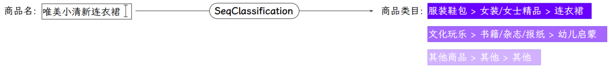
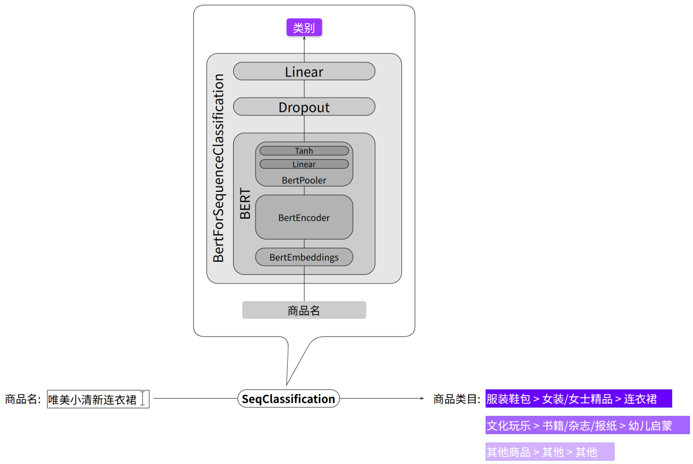

---
tags:
  - 大模型
  - 面试
source: "尚硅谷大模型技术之高频面试题-V2.1.6.docx"
source_blocks: "2102-2134"
reviewed: 2026-10-21
---

# 商品品类预测与长尾分类

品类预测既是分类问题，也是标签体系与长尾数据治理问题。

前篇：[[知识点总结/80-资料与复习/81-面试知识库/08-大模型高频面试题/05-项目实战/06-商品标题生成的视觉投影与约束|商品标题生成的视觉投影与约束]] ｜ 后篇：[[知识点总结/80-资料与复习/81-面试知识库/08-大模型高频面试题/05-项目实战/08-Coze 视频复刻工作流与异步任务|Coze 视频复刻工作流与异步任务]]

## 深入理解（新增）

多级品类应保留父子关系。一级正确、叶子错误和跨大类错误的代价不同；可以分别报告每层准确率、宏平均 F1 和层级距离，避免头部类掩盖长尾失败。

重采样或类别权重会改变训练分布和输出校准。给出低置信度候选或送人工复核，阈值应在独立验证集上按覆盖率与错误率联合选择，不能直接把 softmax 最大值当可靠概率。

新品类出现后，旧模型的闭集分类头无法自然识别新标签。应记录未知类样本、建立标签版本迁移规则，并区分“旧类预测错误”与“新类没有可选标签”。


## 核心代码（新增）

以下是可在 CPU 运行的机制或业务契约示例，完整源码与测试见 [[知识点总结/80-资料与复习/81-面试知识库/08-大模型高频面试题/06-代码实验/01-核心代码实验与验证范围|核心代码实验与验证范围]]。示例不包含完整模型训练或外部平台部署。

```python
def binary_metrics(truth, prediction):
    if len(truth) != len(prediction) or not truth:
        raise ValueError("non-empty equal-length inputs required")
    tp = sum(y == 1 and p == 1 for y, p in zip(truth, prediction))
    fp = sum(y == 0 and p == 1 for y, p in zip(truth, prediction))
    fn = sum(y == 1 and p == 0 for y, p in zip(truth, prediction))
    precision = tp / (tp + fp) if tp + fp else 0.0
    recall = tp / (tp + fn) if tp + fn else 0.0
    f1 = 2 * precision * recall / (precision + recall) if precision + recall else 0.0
    return {"precision": precision, "recall": recall, "f1": f1}

print(binary_metrics([1, 1, 0, 0], [1, 0, 1, 0]))
# precision=recall=f1=0.5
```

## 追问与验证（新增）

把某个长尾类转成 one-vs-rest 评估，比较宏平均与按样本加权平均，解释业务上更关心哪种错误。

## 官方资料与论文

- [scikit-learn：常见陷阱与数据泄漏](https://scikit-learn.org/stable/common_pitfalls.html)

核验日期：2026-10-21。链接中的 `stable`、`main` 或平台文档会继续变化；新增纯 Python/NumPy 实验与原文旧版框架代码已分开标注。

## 原文保留

> [!warning] 原文批注
> 总体准确率无法完整描述长尾多级品类质量，评估必须固定标签版本与未知类处理规则。
>
> 原文的团队人数、业务规模、效果百分比、硬件与成本均保留为教材案例陈述；本次未独立复现这些项目指标。

<!-- source-block:2102 -->
### 智能商品发布-品类预测（文本分类）

<!-- source-block:2103 -->
#### 项目周期

<!-- source-block:2104 -->
- 1人团队，总计约3周。

<!-- source-block:2105 -->
- 需求分析与技术选型2天

<!-- source-block:2106 -->
- 数据准备与预处理5天

<!-- source-block:2107 -->
- 模型开发与训练3天

<!-- source-block:2108 -->
- 推理模块开发2天

<!-- source-block:2109 -->
- 系统集成与后端对接3天

<!-- source-block:2110 -->
- 部署上线2天

<!-- source-block:2111 -->
#### 功能介绍

<!-- source-block:2112 -->
根据商品标题，自动预测商品所属的三级类目，快速完成商品录入。

<!-- source-block:2113 -->


<!-- source-block:2114 -->
#### 实现流程

<!-- source-block:2115 -->
##### 文本分类

<!-- source-block:2116 -->
上述功能的本质就是一个文本分类任务，此处选择使用bert-base-chinese模型实现。如下图所示：

<!-- source-block:2117 -->


<!-- source-block:2118 -->
#### 技术细节

<!-- source-block:2119 -->
##### 构建数据集

<!-- source-block:2120 -->
数据集来自实际的业务数据库，spu\_info和base\_category1、base\_category2、base\_category3。

<!-- source-block:2121 -->
项目的目标是分别预测商品所属的一级分类、二级分类和三级分类，由于这三级分类存在严格的层级关系，因此只需预测三级分类，即可根据结果反推其所属的二级分类和一级分类。

<!-- source-block:2122 -->
所以训练集的格式为spu\_namebase\_category3。

<!-- source-block:2123 -->
由于数据库中的商品存在分类不均衡的问题，所以我们又通过大模型生成了一部分的小类别样本。

<!-- source-block:2124 -->
##### 微调模型

<!-- source-block:2125 -->
具体参数细节如下表：

<!-- source-block:2126 -->
| 预训练模型 | bert-base-chinese |  |
| --- | --- | --- |
| 模型架构 | BERT+Dropout+Linear(BertForSequenceClassification) |  |
| 数据集 | 约50万条，约1000个类别 |  |
| 超参数 | 最大序列长度 | 64 |
| 训练轮次 | 5 |  |
| 批次大小 | 256 |  |
| 学习率 | 2e-5 |  |
| 优化器 | AdamW |  |
| Dropout概率 | 0.1 |  |
| 训练策略 | 全参数微调 |  |
| 混合精度训练 |  |  |
| Warmup | 总步数的10% |  |
| 学习率衰减 | 线性衰减 |  |
| 早停 | 连续3轮验证集F1分数不提升则停止 |  |
| 训练环境 | 设备 | V100 32GB |
| 框架 | Transformers+Pytorch |  |
| 训练时长 | 1小时 |  |
| 评估结果 | 准确率 | 78% |
| 精确率 | 77% |  |
| 召回率 | 76% |  |
| F1分数 | 76% |  |

<!-- source-block:2127 -->
#### 面试串讲

<!-- source-block:2128 -->
这个智能商品发布项目的主要职责就是辅助商家更高效地发布商品，主要包含如下几个功能模块：

<!-- source-block:2129 -->
第一，根据用户上传的商品图片自动生成商品标题

<!-- source-block:2130 -->
第二，根据商品标题预测商品所属品类

<!-- source-block:2131 -->
第三，复刻其它平台相同商品的视频简介

<!-- source-block:2132 -->
我负责的主要是第二个模块，这个模块相对比较简单。其具体任务是分别预测商品所属的一级分类、二级分类和三级分类，由于这三级分类存在严格的层级关系，因此，其实只需预测三级分类即可，然后再根据结果反推其所属的二级分类和一级分类。所以这个任务本质上就是一个简单的文本多分类任务。

<!-- source-block:2133 -->
下面我介绍一下实现细节，首先是数据集的构建，原始数据就来自我们的业务数据库，差不多有50万条样本，但是数据存在类别分布不均的问题，也就是一些冷门类别，商品较少，所以为了保证数据的均衡，我们随机删掉了一部分的热门类别下的商品，然后有使用大模型生成一部分的冷门类别的商品。

<!-- source-block:2134 -->
然后分类模型选用的就是bert-base-chinese，基于Huggingface的Transformers库进行训练，在一张V100显卡上训练了一个小时，最终的F1能达到将近70%，因为类别比较多，所以得分不是特别高。以上就是这个模块的全部内容。
