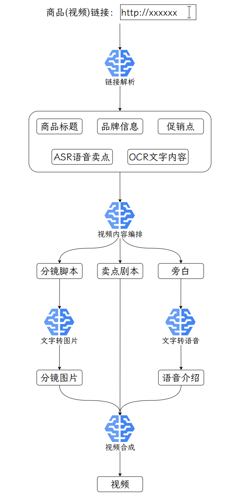

---
tags:
  - 大模型
  - 面试
source: "尚硅谷大模型技术之高频面试题-V2.1.6.docx"
source_blocks: "2135-2234"
reviewed: 2026-10-21
---

# Coze 视频复刻工作流与异步任务

视频工作流应拆成可恢复的任务阶段，并保留音画时间轴。

前篇：[[知识点总结/80-资料与复习/81-面试知识库/08-大模型高频面试题/05-项目实战/07-商品品类预测与长尾分类|商品品类预测与长尾分类]] ｜ 后篇：[[知识点总结/80-资料与复习/81-面试知识库/08-大模型高频面试题/05-项目实战/09-商品评论生成的SFT、奖励模型与PPO|商品评论生成的SFT、奖励模型与PPO]]

## 深入理解（新增）

解析、分镜、文案、配音、画面生成和合成有不同耗时与失败方式。把它们塞进一次同步请求会扩大超时和重试成本；应使用 task_id 保存阶段状态与产物地址，成功阶段可以复用。

并行处理分镜时要限流，并分别设置单节点超时和整任务期限。一个分镜失败是终止、重试还是降级为静态图，应由显式策略决定，不能由模型临时编造完成状态。

合成前检查每段时长、字幕区间、采样率与总时长。轮询远端生成任务不等于再次提交任务；反复提交会浪费资源并产生多个不一致结果。平台异步能力和渠道限制应按当前官方接口核验。


## 核心代码（新增）

以下是可在 CPU 运行的机制或业务契约示例，完整源码与测试见 [[知识点总结/80-资料与复习/81-面试知识库/08-大模型高频面试题/06-代码实验/01-核心代码实验与验证范围|核心代码实验与验证范围]]。示例不包含完整模型训练或外部平台部署。

```python
import asyncio

async def bounded_map(items, operation, concurrency=4, timeout=1.0):
    semaphore = asyncio.Semaphore(concurrency)
    async def one(item):
        async with semaphore:
            return await asyncio.wait_for(operation(item), timeout=timeout)
    return await asyncio.gather(*(one(item) for item in items))

async def fake_operation(item):
    await asyncio.sleep(0.001)
    return item * 2

assert asyncio.run(bounded_map([1, 2], fake_operation)) == [2, 4]
```

## 追问与验证（新增）

模拟五个分镜中一个超时，检查是否保留其余四个产物，并说明重试时如何复用已完成阶段。

## 官方资料与论文

- [扣子：执行工作流 API](https://docs.coze.cn/developer_guides_workflow_run)
- [扣子：代码节点与异常分支](https://docs.coze.cn/guides_code_node)
- [asyncio 任务与超时](https://docs.python.org/3/library/asyncio-task.html)

核验日期：2026-10-21。链接中的 `stable`、`main` 或平台文档会继续变化；新增纯 Python/NumPy 实验与原文旧版框架代码已分开标注。

## 原文保留

> [!warning] 原文批注
> 原文的界面和节点能力属于资料版本；工作流同步、异步和流式模式不是同一个概念，当前限制以官方接口为准。
>
> 原文的团队人数、业务规模、效果百分比、硬件与成本均保留为教材案例陈述；本次未独立复现这些项目指标。

<!-- source-block:2135 -->
### 智能商品发布-视频复刻（Coze）

<!-- source-block:2136 -->
#### 项目周期

<!-- source-block:2137 -->
- 1人团队，总计约1个月。

<!-- source-block:2138 -->
- 需求分析与技术选型与平台熟悉1周

<!-- source-block:2139 -->
- 工作流设计与节点配置2周

<!-- source-block:2140 -->
- 知识库集成与设置1周

<!-- source-block:2141 -->
- 部署与发布3天

<!-- source-block:2142 -->
#### 项目简介

<!-- source-block:2143 -->
开发了一个基于Coze平台的智能电商商品视频内容复刻智能体，通过可视化工作流设计实现了商品展示视频的自动解析、卖点脚本生成和商品视觉素材创作。该智能体能够深度理解商品视频中的产品特性、展示逻辑与促销话术，生成风格一致的电商剧本和高吸引力视觉素材，为电商运营者/商家提供高效的视频制作解决方案。

<!-- source-block:2144 -->
#### 核心功能

<!-- source-block:2145 -->
**智能商品视频解析**

<!-- source-block:2146 -->
- 自动提取视频中的商品标题、品牌信息、价格促销点、ASR语音卖点讲解和OCR文字内容（如包装标签、特效字幕）

<!-- source-block:2147 -->
- 多模态内容分析和关键信息结构化处理

<!-- source-block:2148 -->
- 支持抖音、淘宝、京东等主流电商平台商品视频链接解析

<!-- source-block:2149 -->
**AI电商内容生成**

<!-- source-block:2150 -->
- 基于大语言模型的商品卖点剧本创作和分镜脚本生成

<!-- source-block:2151 -->
- 精细化提示确保内容风格与品牌调性一致

<!-- source-block:2152 -->
- 支持多种商品类型和营销风格适配（如日用百货、数码家电、美妆护肤等）

<!-- source-block:2153 -->
**自动化商品视觉素材生产**

<!-- source-block:2154 -->
- 多风格视觉输出（实物展示、场景化使用、功能演示等）

<!-- source-block:2155 -->
- 文生图节点自动生成高质量商品分镜图片

<!-- source-block:2156 -->
- 批量处理和高并发生成能力

<!-- source-block:2157 -->
**智能化工作流引擎**

<!-- source-block:2158 -->
- 可视化节点编排和流程控制

<!-- source-block:2159 -->
- 异常自动处理和重试机制

<!-- source-block:2160 -->
- 实时执行状态监控

<!-- source-block:2161 -->
#### 技术架构

<!-- source-block:2162 -->
**开发平台: Coze可视化智能体开发平台**

<!-- source-block:2163 -->
**Workflow核心节点:**

<!-- source-block:2164 -->
- 电商视频链接解析节点：提取商品元数据和内容

<!-- source-block:2165 -->
- 大模型节点：GPT-4生成商品卖点剧本和分镜脚本

<!-- source-block:2166 -->
- 文生图节点：多模型支持商品视觉素材生成

<!-- source-block:2167 -->
- 循环节点：批量处理商品卖点脚本

<!-- source-block:2168 -->
- 代码节点：数据格式转换和聚合

<!-- source-block:2169 -->
**知识库:**

<!-- source-block:2170 -->
集成电商视频创作规范和商品展示指南

<!-- source-block:2171 -->
**部署方式:**

<!-- source-block:2172 -->
平台一键发布和版本管理

<!-- source-block:2173 -->
#### 实现流程图

<!-- source-block:2174 -->


<!-- source-block:2175 -->
#### 关键技术实现

<!-- source-block:2176 -->
**精细化提示词工程**

```text
# 大模型节点系统提示词

"""
你是一位专业的电商视频脚本创作专家，需要根据提供的商品视频内容:
1.分析商品的卖点、目标用户和展示风格
2.生成30秒时长的商品展示脚本，每个镜头3-5秒
3.输出scripts数组包含分镜描述
4.输出asides数组包含对应商品卖点讲解
5.输出outline视频大意总结
"""
```

<!-- source-block:2187 -->
**多模型协同优化**

<!-- source-block:2188 -->
- 采用GPT-4进行商品内容理解和卖点提取

<!-- source-block:2189 -->
- 集成多个文生图模型（如通义万相）适配不同商品视觉风格

<!-- source-block:2190 -->
- 选择图生视频平台（如即梦、Vidu、可灵）生成商品视频

<!-- source-block:2191 -->
- 选择智声云配平台，实现商品讲解语音生成

<!-- source-block:2192 -->
**异常处理机制**

<!-- source-block:2193 -->
- 链接解析失败自动重试

<!-- source-block:2194 -->
- 生成内容质量自动评估

<!-- source-block:2195 -->
#### 项目成果

<!-- source-block:2196 -->
**处理效率指标**

<!-- source-block:2197 -->
- 商品视频解析时间: ≤2分钟

<!-- source-block:2198 -->
- 卖点生成准确率: 88%

<!-- source-block:2199 -->
- 分镜生成成功率: 95%

<!-- source-block:2200 -->
- 日均处理任务数: 20+

<!-- source-block:2201 -->
**内容质量表现**

<!-- source-block:2202 -->
- 脚本创意评分: 4.7/5.0

<!-- source-block:2203 -->
- 视觉风格一致性: 92%

<!-- source-block:2204 -->
- 用户满意度: 4.7/5.0

<!-- source-block:2205 -->
**业务价值体现**

<!-- source-block:2206 -->
- 降低商品视频制作成本70%

<!-- source-block:2207 -->
- 提升电商内容创作效率3倍

<!-- source-block:2208 -->
- 支持50+商品品类覆盖

<!-- source-block:2209 -->
**系统稳定性**

<!-- source-block:2210 -->
- 工作流执行成功率：98%

<!-- source-block:2211 -->
- 平均响应时间：&lt;3分钟

<!-- source-block:2212 -->
- 平台可用性：95%

<!-- source-block:2213 -->
#### 技术亮点

<!-- source-block:2214 -->
**低代码智能体开发**

<!-- source-block:2215 -->
- 纯可视化工作流设计和配置

<!-- source-block:2216 -->
- 拖拽式节点编排和参数设置

<!-- source-block:2217 -->
- 实时调试和预览功能

<!-- source-block:2218 -->
**多模态AI能力集成**

<!-- source-block:2219 -->
- 文本、图像、语音多模态处理

<!-- source-block:2220 -->
- 多模型自动选择和调度

<!-- source-block:2221 -->
- 输出质量自动评估优化

<!-- source-block:2222 -->
**平台化部署运维**

<!-- source-block:2223 -->
- 一键发布到Coze应用商店

<!-- source-block:2224 -->
- 云端自动扩缩容

<!-- source-block:2225 -->
**用户体验优化**

<!-- source-block:2226 -->
- 直观的交互界面设计

<!-- source-block:2227 -->
- 多种结果导出格式支持

<!-- source-block:2228 -->
#### 口语化项目阐述

<!-- source-block:2229 -->
在Coze平台上开发了一个智能电商商品视频复刻智能体，用户只需要输入商品视频链接，系统就能自动解析商品内容并生成完整的卖点脚本和视觉素材。通过拖拽式工作流设计，集成了链接解析、AI内容生成、文生图等多个节点，实现了从商品视频输入到营销内容输出的全自动化处理。

<!-- source-block:2230 -->
系统解决了电商运营者手动分析商品视频、编写卖点脚本的痛点，将原本需要数小时的工作压缩到几分钟内完成。这个智能体大大降低了商品视频制作门槛，让普通运营者也能快速创作出专业级的商品展示内容。

<!-- source-block:2231 -->
#### 项目规模

<!-- source-block:2232 -->
- 工作流复杂度：7个核心节点，12+参数配置项。

<!-- source-block:2233 -->
- 处理能力：已生成1,000+商品图片。

<!-- source-block:2234 -->
- 覆盖范围：支持主流电商平台，50+SPU。
