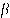
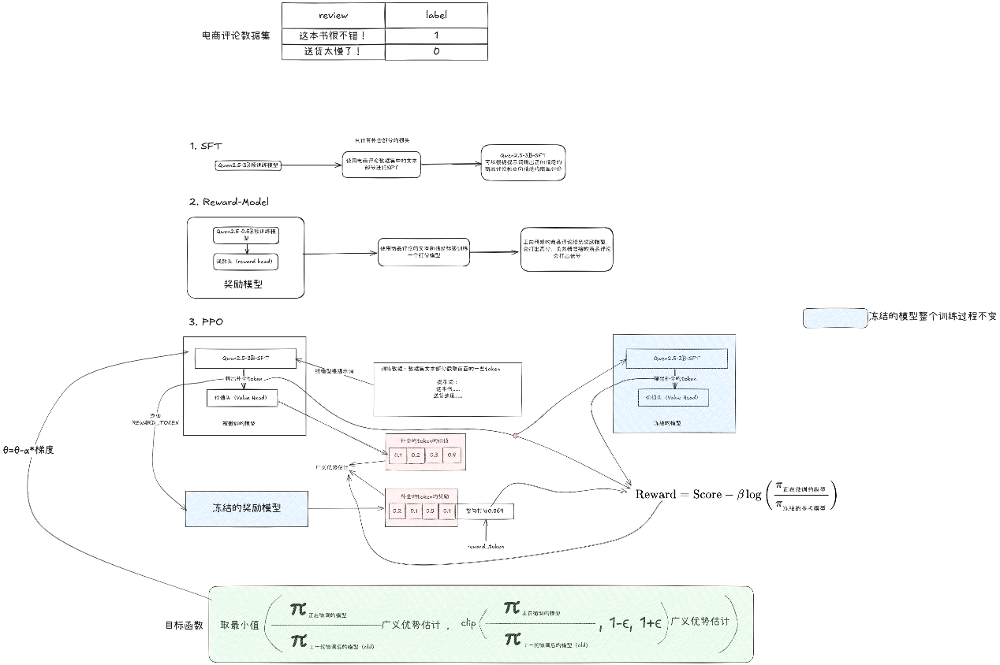

---
tags:
  - 大模型
  - 面试
source: "尚硅谷大模型技术之高频面试题-V2.1.6.docx"
source_blocks: "2235-2324"
reviewed: 2026-10-21
---

# 商品评论生成的SFT、奖励模型与PPO

评论生成的训练目标必须与真实性和用户身份约束一致。

前篇：[[知识点总结/80-资料与复习/81-面试知识库/08-大模型高频面试题/05-项目实战/08-Coze 视频复刻工作流与异步任务|Coze 视频复刻工作流与异步任务]] ｜ 后篇：[[知识点总结/80-资料与复习/81-面试知识库/08-大模型高频面试题/05-项目实战/10-LangChain 商家对话助手与检索链路|LangChain 商家对话助手与检索链路]]

## 深入理解（新增）

SFT 学习评论风格，奖励模型学习成对偏好，PPO 在奖励及约束下更新策略。奖励模型可能偏爱更长、更夸张的文字，导致 reward hacking；应把事实一致、禁用内容和长度分别观察。

用于商家写作辅助时，应明确是示例文案或基于真实反馈的改写，不能把模型生成描述冒充真实购买体验。可将商品属性与用户真实观点作为可核对输入，限制新增事实。

PPO 需要保存 rollout 时的旧策略概率，更新轮数、KL、有效 token 掩码会影响稳定性。只给出一个“奖励提升百分比”不能证明评论质量改善，还需独立人工盲评与事实错误切片。


## 核心代码（新增）

以下是可在 CPU 运行的机制或业务契约示例，完整源码与测试见 [[知识点总结/80-资料与复习/81-面试知识库/08-大模型高频面试题/06-代码实验/01-核心代码实验与验证范围|核心代码实验与验证范围]]。示例不包含完整模型训练或外部平台部署。

```python
import numpy as np

def ppo_surrogate(ratio, advantage, epsilon=0.2):
    unclipped = ratio * advantage
    clipped = np.clip(ratio, 1 - epsilon, 1 + epsilon) * advantage
    return float(np.minimum(unclipped, clipped).mean())

ratio = np.array([1.5, 1.5]); advantage = np.array([1., -1.])
print(ppo_surrogate(ratio, advantage))  # -0.15
```

## 追问与验证（新增）

构造“更长但虚构使用体验”的答案与“简短但忠实反馈”的答案，检查奖励排序及最终人工评价是否一致。

## 官方资料与论文

- [DeepSeekMath：GRPO](https://arxiv.org/abs/2402.03300)
- [Direct Preference Optimization](https://arxiv.org/abs/2305.18290)
- [PPO 原论文](https://arxiv.org/abs/1707.06347)

核验日期：2026-10-21。链接中的 `stable`、`main` 或平台文档会继续变化；新增纯 Python/NumPy 实验与原文旧版框架代码已分开标注。

## 原文保留

> [!warning] 原文批注
> 奖励上升不等于事实质量上升；原文案例数字需同时有评估样本、基线和奖励定义才能复核。
>
> 原文的团队人数、业务规模、效果百分比、硬件与成本均保留为教材案例陈述；本次未独立复现这些项目指标。

<!-- source-block:2235 -->
### 商品智能评论（PPO）

<!-- source-block:2236 -->
#### 项目周期

<!-- source-block:2237 -->
- 1人团队，总计约3周。

<!-- source-block:2238 -->
- 环境搭建与SFT阶段1周

<!-- source-block:2239 -->
- 奖励模型训练与调试1周

<!-- source-block:2240 -->
- PPO强化学习阶段6天

<!-- source-block:2241 -->
- 评估与分析2天

<!-- source-block:2242 -->
#### 功能介绍

<!-- source-block:2243 -->
本项目目标是微调Qwen2.5-3B，使其能够生成符合人类偏好的文本。具体应用场景是：

<!-- source-block:2244 -->
新上线的商品因为缺少评论，不利于用户搜索和购买。所以需要生成一些正向评论。

<!-- source-block:2245 -->
输入一个与商品相关的提示词（如“这本书...”），模型输出一段正向情感的商品评论。

<!-- source-block:2246 -->
通过人类偏好建模(RLHF)，避免生成负向或不合适的评论，使评论更契合业务需求（例如在电商网站中展示积极评论，用于用户引导、推荐场景）。

<!-- source-block:2247 -->
#### 实现流程

<!-- source-block:2248 -->
##### 监督微调（SFT）

<!-- source-block:2249 -->
使用电商评论数据集的文本部分对Qwen2.5-3B进行监督微调，得到Qwen2.5-3B-SFT，使模型具备商品评论生成能力。但此时输出既包含正向评论，也包含负向评论。

<!-- source-block:2250 -->
##### 奖励模型训练（Reward Model）

<!-- source-block:2251 -->
使用电商评论数据集的文本+标签训练奖励模型。模型结构为Qwen2.5-0.5B+reward head：

<!-- source-block:2252 -->
正向评论打高分

<!-- source-block:2253 -->
负向评论打低分

<!-- source-block:2254 -->
##### PPO微调（PPO-RLHF）

<!-- source-block:2255 -->
**使用PPO算法微调Qwen2.5-3B-SFT，使其输出更偏向正向评论。流程如下：**

<!-- source-block:2256 -->
**输入商品评论提示词，Qwen2.5-3B-SFT生成评论**

<!-- source-block:2257 -->
**奖励模型打分（高分→提升生成概率，低分→降低概率）**

<!-- source-block:2258 -->
**Qwen2.5-3B-SFT增加value head作为价值函数网络**

<!-- source-block:2259 -->
**结合奖励与价值估计，使用广义优势估计(GAE)计算优势**

<!-- source-block:2260 -->
**采用PPO-Clip裁剪目标优化策略，保证更新稳定**

<!-- source-block:2261 -->
**引入KL散度惩罚，避免策略偏离初始的sft模型太远**

<!-- source-block:2262 -->
#### 技术细节

<!-- source-block:2263 -->
##### 监督微调（SFT）

<!-- source-block:2264 -->
模型结构：Qwen2.5-3B(3B参数)

<!-- source-block:2265 -->
数据集：电商评论数据集的文本部分（约10万条电商文本）

<!-- source-block:2266 -->
目标：让Qwen2.5-3B具备生成商品评论的能力

<!-- source-block:2267 -->
超参数

<!-- source-block:2268 -->
- 批次大小：32

<!-- source-block:2269 -->
- 学习率：2e-5

<!-- source-block:2270 -->
- 训练轮数：1 epoch

<!-- source-block:2271 -->
- 优化器：AdamW(weight decay=0.1)

<!-- source-block:2272 -->
- 学习率调度：5%预热+余弦退火

<!-- source-block:2273 -->
- 训练环境：单机A800 80G，耗时约3小时

<!-- source-block:2274 -->
##### 奖励模型（Reward Model）

<!-- source-block:2275 -->
**模型结构：Qwen2.5-0.5B+reward head(线性层二分类)**

<!-- source-block:2276 -->
**数据集：电商评论数据集文本+标签**

<!-- source-block:2277 -->
**目标：学习区分正向与负向评论，并给出奖励值**

<!-- source-block:2278 -->
**损失函数：二元交叉熵**

<!-- source-block:2279 -->
**超参数**

<!-- source-block:2280 -->
- 批次大小：32

<!-- source-block:2281 -->
- 学习率：1e-5

<!-- source-block:2282 -->
- 训练轮数：3epoch

<!-- source-block:2283 -->
**训练环境：单机V100 32G，耗时约0.3小时**

<!-- source-block:2284 -->
##### 策略优化（PPO-RLHF）

<!-- source-block:2285 -->
**模型结构：Qwen2.5-3B-SFT+value head**

<!-- source-block:2286 -->
**输入输出：**

<!-- source-block:2287 -->
- 输入：商品评论提示词

<!-- source-block:2288 -->
- 输出：带正向情感的商品评论

<!-- source-block:2289 -->
**奖励函数：**

<!-- source-block:2290 -->
- r=reward model打分

<!-- source-block:2291 -->
**加入KL惩罚**

<!-- source-block:2292 -->
**优势函数：广义优势估计(GAE)， =0.99， =0.95**

<!-- source-block:2293 -->
**优化目标：PPO-Clip( =0.2)**

<!-- source-block:2294 -->
**超参数**

<!-- source-block:2295 -->
- 批次大小：64

<!-- source-block:2296 -->
- 学习率：1e-5

<!-- source-block:2297 -->
- PPO更新步数：4

<!-- source-block:2298 -->
- KL系数 ：0.1

<!-- source-block:2299 -->
-  =0.99， =0.95

<!-- source-block:2300 -->
- 剪切范围 =0.2

<!-- source-block:2301 -->
**训练环境：2张A800 80G，耗时约12小时**

<!-- source-block:2302 -->
#### 总结

<!-- source-block:2303 -->


<!-- source-block:2304 -->
PPO项目的业务目标是：让Qwen2.5-3B-SFT输出正向情感的商品评论。

<!-- source-block:2305 -->
**实现流程为**

<!-- source-block:2306 -->
**使用电商评论数据集对Qwen2.5-3B做SFT，使其会写商品评论**

<!-- source-block:2307 -->
**使用电商评论数据集中的文本+标签训练奖励模型，学会区分正负情感**

<!-- source-block:2308 -->
**使用PPO-RLHF微调SFT模型，使其在KL约束下更倾向输出正向评论**

<!-- source-block:2309 -->
**核心亮点**

<!-- source-block:2310 -->
**业务价值：模型生成的评论更加积极正面，符合平台对“正向内容”的需求**

<!-- source-block:2311 -->
**方法价值：完整复刻了InstructGPT的RLHF流程（SFT→RM→PPO），并应用于情感控制任务**

<!-- source-block:2312 -->
**技术细节**

<!-- source-block:2313 -->
**SFT提供基本写评论能力**

<!-- source-block:2314 -->
**奖励模型提供情感方向监督**

<!-- source-block:2315 -->
**PPO在KL约束下对齐输出，保证稳定与安全**

<!-- source-block:2316 -->
**最终效果**

<!-- source-block:2317 -->
在商品评论提示词下，模型生成的评论整体呈现正向、积极、乐观的风格，避免了负面表达。

<!-- source-block:2318 -->
#### 串讲

<!-- source-block:2319 -->
本项目的需求是：让Qwen2.5-3B能够生成符合人类偏好的文本。在我们的业务场景里，就是希望模型在输出商品评论时，更偏向正向情感。

<!-- source-block:2320 -->
为此，我们完整复刻了OpenAI Instruct GPT的RLHF流程，分成三个阶段：监督微调、奖励模型训练和PPO微调。

<!-- source-block:2321 -->
首先是监督微调阶段。我们用电商评论数据集里的文本对Qwen2.5-3B进行SFT训练，得到的Qwen2.5-3B-SFT模型学会了写商品评论。不过这个阶段的模型输出既有正向评论，也会生成负向评论。

<!-- source-block:2322 -->
接下来是奖励模型。我们在Qwen2.5-0.5B后面加了一个reward head，使用电商评论数据集的文本加标签进行训练。正向评论给高分，负向评论给低分，这样奖励模型就能对评论情感进行打分。

<!-- source-block:2323 -->
最后是PPO微调。我们把SFT模型作为actor，并在它后面加一个value head作为critic。训练时输入商品相关提示词，模型生成评论交给奖励模型打分，打分高的评论会增加其生成概率，打分低的会降低概率。同时我们引入KL散度惩罚，避免模型偏离原始SFT太远；在计算优势时采用广义优势估计GAE；在优化时使用PPO-Clip裁剪目标，保证更新稳定。经过这一阶段，模型基本学会了在给定商品提示词时，输出正向的、积极的商品评论。

<!-- source-block:2324 -->
整体来看，项目实现了从“会写评论”到“写积极评论”的转变，技术路径是 SFT提供写评论能力，奖励模型提供情感偏好信号，PPO在约束下对齐人类偏好。最终效果是：模型生成的评论不仅流畅连贯，而且情感更偏正向，符合业务需求。
