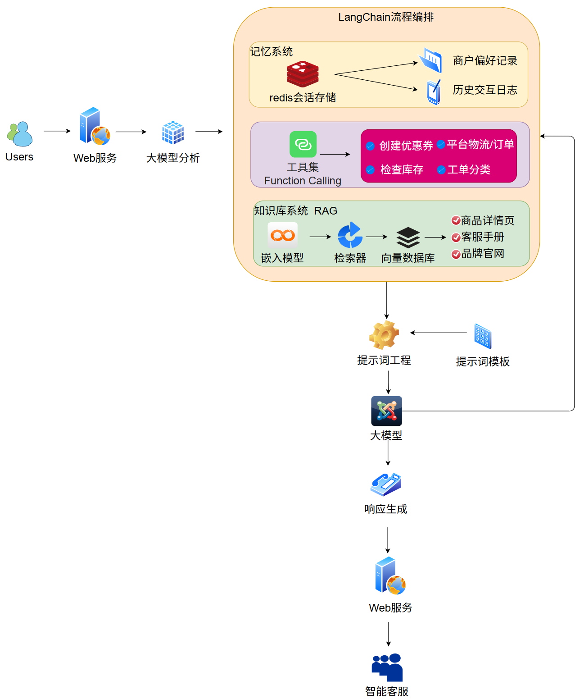

---
tags:
  - 大模型
  - 面试
source: "尚硅谷大模型技术之高频面试题-V2.1.6.docx"
source_blocks: "2325-2468"
reviewed: 2026-10-21
---

# LangChain 商家对话助手与检索链路

把检索链、对话状态和业务工具放在清晰的调用边界内。

前篇：[[知识点总结/80-资料与复习/81-面试知识库/08-大模型高频面试题/05-项目实战/09-商品评论生成的SFT、奖励模型与PPO|商品评论生成的SFT、奖励模型与PPO]] ｜ 后篇：[[知识点总结/80-资料与复习/81-面试知识库/08-大模型高频面试题/05-项目实战/11-Dify 竞品报告的证据、工作流与评估|Dify 竞品报告的证据、工作流与评估]]

## 深入理解（新增）

商家问题可能需要政策文档，也可能需要实时订单数据。应先判别信息来源：静态知识进入 RAG，实时状态走受控工具，无法确认时明确询问。把订单快照塞进向量库会造成时效错误。

多轮 query rewrite 应保留商品、时间和否定条件。检索后把证据与原始问题一起交给回答器，并返回可定位引用；不能仅把改写结果当成用户原意。

框架负责组合调用，不替代业务校验。下面 RRF 代码展示召回融合，完整系统还需独立处理鉴权、调用预算、超时、日志和版本回归；原文旧式链对象仅保留作资料，不作为新增代码基线。


## 核心代码（新增）

以下是可在 CPU 运行的机制或业务契约示例，完整源码与测试见 [[知识点总结/80-资料与复习/81-面试知识库/08-大模型高频面试题/06-代码实验/01-核心代码实验与验证范围|核心代码实验与验证范围]]。示例不包含完整模型训练或外部平台部署。

```python
import json
from collections import defaultdict

def rrf_fuse(rankings, constant=60):
    if constant <= 0:
        raise ValueError("constant must be positive")
    scores = defaultdict(float)
    for ranking in rankings:
        seen = set()
        for rank, doc_id in enumerate(ranking, start=1):
            if doc_id in seen:
                continue
            seen.add(doc_id)
            scores[doc_id] += 1 / (constant + rank)
    return sorted(scores.items(), key=lambda item: (-item[1], item[0]))

def validate_tool_call(payload):
    data = json.loads(payload)
    if not isinstance(data, dict) or set(data) != {"tool", "args"}:
        raise ValueError("invalid envelope")
    if data["tool"] != "get_order" or not isinstance(data["args"], dict):
        raise ValueError("tool not allowed")
    order_id = data["args"].get("order_id")
    if set(data["args"]) != {"order_id"} or not isinstance(order_id, str) or not order_id.isdecimal():
        raise ValueError("invalid order_id")
    return data

def check_citations(claims, retrieved_source_ids):
    """Validate reference membership only; this does not verify factual support."""
    allowed = set(retrieved_source_ids)
    problems = []
    for index, claim in enumerate(claims):
        refs = claim.get("source_ids", [])
        if not refs:
            problems.append((index, "missing citation"))
        for ref in refs:
            if ref not in allowed:
                problems.append((index, "unknown source: " + ref))
    return problems

ranked = rrf_fuse([["sku-A", "sku-B"], ["sku-B", "sku-C"]])
assert ranked[0][0] == "sku-B"

call = validate_tool_call(
    '{"tool":"get_order","args":{"order_id":"123"}}')
assert call["args"]["order_id"] == "123"
# 接下来由执行服务核验调用者身份与订单归属；此函数未实现授权。

claims = [{"source_ids":["doc-v2:chunk-3"]}]
assert check_citations(claims, {"doc-v2:chunk-3"}) == []
# 引用存在不等于引用支持结论，事实支持关系仍须另查。
```

## 追问与验证（新增）

用“刚才那个订单现在到哪了”测试指代解析和实时工具选择，确认不会引用旧文档中的示例订单状态。

## 官方资料与论文

- [LangGraph 工作流](https://docs.langchain.com/oss/python/langgraph/overview)
- [Retrieval-Augmented Generation](https://arxiv.org/abs/2005.11401)

核验日期：2026-10-21。链接中的 `stable`、`main` 或平台文档会继续变化；新增纯 Python/NumPy 实验与原文旧版框架代码已分开标注。

## 原文保留

> [!warning] 原文批注
> 原文框架代码可能随版本变化。新增实现强调明确输入输出边界，不把历史链式 API 当成当前稳定接口。
>
> 原文的团队人数、业务规模、效果百分比、硬件与成本均保留为教材案例陈述；本次未独立复现这些项目指标。

<!-- source-block:2325 -->
### 商家AI助手-对话助手(LangChain)

<!-- source-block:2326 -->
#### 项目周期

<!-- source-block:2327 -->
202x年x月 - 202x年x月 （2-3个月即可，且中间还干着其他项目）。

<!-- source-block:2328 -->
#### 项目介绍

<!-- source-block:2329 -->
开发了专为电商平台商户服务场景设计的智能对话助手，集成店铺运营数据库检索、平台政策实时查询和客户服务管理功能，具备多工具调用能力，并通过记忆机制实现多会话上下文管理。帮助商户快速响应客户咨询，提升店铺运营效率和转化率。

<!-- source-block:2330 -->
#### 核心功能

<!-- source-block:2331 -->
**双引擎知识库**

<!-- source-block:2332 -->
- 本地知识库：基于电商平台API文档、商户操作手册、平台规则指南等构建向量检索系统，支持专业问题解答（包含商品规格与管理、订单处理、活动规则、售后政策等）

<!-- source-block:2333 -->
- 实时搜索引擎：实时查询平台最新政策、活动通知、行业动态等信息

<!-- source-block:2334 -->
**对话记忆系统**

<!-- source-block:2335 -->
- 通过Session ID 隔离不同商户对话历史

<!-- source-block:2336 -->
- 实现连续对话中的上下文记忆（如记住商户偏好、过往问题记录）

<!-- source-block:2337 -->
**场景化工具调用**

<!-- source-block:2338 -->
- 店铺数据报表生成

<!-- source-block:2339 -->
- 营销活动创建与管理

<!-- source-block:2340 -->
- 竞品店铺数据分析

<!-- source-block:2341 -->
- 客户服务工单处理

<!-- source-block:2342 -->
- 库存预警与智能补货

<!-- source-block:2343 -->
**智能决策引擎**

<!-- source-block:2344 -->
- 自动判断何时调用工具/直接回答

<!-- source-block:2345 -->
- 工具调用结果自动整合到回复中

<!-- source-block:2346 -->
- 借助相似度检索算法，筛选高质量向量数据

<!-- source-block:2347 -->
#### 技术栈

<!-- source-block:2348 -->
Python、LangChain v0.3.27、DeepSeek-V3/R1、FAISS、text-embedding-3-large、Function Calling、Redis会话存储

<!-- source-block:2349 -->
#### 架构流程图

<!-- source-block:2350 -->


<!-- source-block:2351 -->
#### 关键技术细节

<!-- source-block:2352 -->
**电商知识库构建**

<!-- source-block:2353 -->
本系统核心在于将分散的、多源异构的电商知识（平台规则、商品信息、教程文档、商户指南、常见问题库）整合为一个可智能检索的统一知识库。

```python
from langchain_community.document_loaders import WebBaseLoader, UnstructuredFileLoader
from langchain_text_splitters import RecursiveCharacterTextSplitter
from langchain_openai import OpenAIEmbeddings
from langchain_community.vectorstores import FAISS
from langchain.tools.retriever import create_retriever_tool

# 1. 从多个来源加载数据 (伪代码示例)
loaders = [
    WebBaseLoader("https://merchant-platform.com/help-center/rules"), # 爬取平台规则网页
    UnstructuredFileLoader("./local_docs/merchant_guide.pdf"),        # 加载本地商户指南
    # ... 可以从数据库、API等更多来源加载
]
documents = []
for loader in loaders:
    documents.extend(loader.load())

# 2. 将文档分割成块
text_splitter = RecursiveCharacterTextSplitter(chunk_size=1000, chunk_overlap=200)
docs = text_splitter.split_documents(documents)

# 3. & 4. 嵌入并存储到向量库 (使用开源嵌入模型示例)
embeddings = OpenAIEmbeddings(model="text-embedding-3-large")
vectorstore = FAISS.from_documents(docs, embeddings)

# 5. 创建检索器并将其封装为一个可供Agent调用的“工具”
retriever = vectorstore.as_retriever(search_kwargs={"k": 3}) # 检索最相关的3个片段
knowledge_base_tool = create_retriever_tool(
    retriever,
    "ecommerce_knowledge_search",
    "搜索电商平台规则、商品管理指南和常见问题解答文档。输入应为具体问题。"
)
```

<!-- source-block:2385 -->
**商户服务工具集**

<!-- source-block:2386 -->
开发了一系列专用工具，包括创建优惠券、检查库存、智能客服回复建议、自动工单分类等，全面提升商户运营效率。

```python
from langchain.agents import tool
from some_merchant_sdk import MerchantAPI # 假设的商户平台API客户端

# 示例工具1：创建优惠券
@tool
def create_coupon_tool(discount_amount: int, coupon_type: str, validity_days: int):
    """为店铺创建并发布一个新的优惠券。输入应包括折扣金额、优惠券类型（如满减、折扣）和有效天数。"""
    # 这里是实际的业务逻辑，调用电商平台的API
    api = MerchantAPI(api_key="YOUR_KEY")
    result = api.create_coupon(discount_amount, coupon_type, validity_days)
    return f"优惠券创建成功！券ID: {result['id']}, 领取链接: {result['url']}"

# 示例工具2：检查库存
@tool
def check_inventory_tool(product_id: str):
    """根据商品ID查询该商品的当前库存水平。"""
    api = MerchantAPI(api_key="YOUR_KEY")
    inventory = api.get_inventory(product_id)
    return f"商品 {product_id} 的当前库存为: {inventory['quantity']} 件。"

# 将所有工具组合成一个列表
tools = [knowledge_base_tool, create_coupon_tool, check_inventory_tool, ...]

# 将工具绑定给LLM，并创建Agent
from langchain.agents import create_tool_calling_agent
from langchain.agents import AgentExecutor
from langchain_openai import ChatOpenAI

model = ChatOpenAI(model="gpt-4o", temperature=0)
agent = create_tool_calling_agent(model, tools, prompt)
agent_executor = AgentExecutor(agent=agent, tools=tools, verbose=True)

# 使用Agent处理用户请求（模型会自动选择调用check_inventory_tool）
result = agent_executor.invoke({"input": "帮我查一下商品P12345还有多少库存？"})
print(result["output"])
```

<!-- source-block:2422 -->
**商户旅程记忆系统**

<!-- source-block:2423 -->
为了实现连续、个性化的对话，我们设计了基于Redis的记忆系统，能够记住商户偏好、常用功能和历史问题，提供精准服务。

```python
from langchain_community.chat_message_histories import RedisChatMessageHistory
from langchain_core.prompts import ChatPromptTemplate, MessagesPlaceholder
from langchain_core.runnables.history import RunnableWithMessageHistory

# 连接到Redis存储对话历史
def get_session_history(session_id: str):
    return RedisChatMessageHistory(session_id, url="redis://localhost:6379")

# 定义提示模板，其中专门有一个位置用于存放历史消息
prompt = ChatPromptTemplate.from_messages([
    ("system", "你是一个专业的电商客服助手，请友好且专业地回答商户问题。"),
    MessagesPlaceholder(variable_name="chat_history"), # 历史记录注入点
    ("human", "{input}"),
])

# 创建Chain
chain = prompt | model

# 将Chain包装成一个带有记忆功能的可运行对象
agent_with_memory = RunnableWithMessageHistory(
    chain,
    get_session_history, # 告诉它如何获取历史
    input_messages_key="input",
    history_messages_key="chat_history",
)

# 使用session_id来调用，实现记忆功能
config = {"configurable": {"session_id": "merchant_456"}} # 商户ID作为session_id
response = agent_with_memory.invoke(
    {"input": "我之前咨询过的那个运费模板设置好了吗？"},
    config=config
)
print(response)
# 助手会记得在这个session_id下的所有对话，并可以回答关于之前设置的运费模板的问题。
```

<!-- source-block:2458 -->
#### 项目成果

<!-- source-block:2459 -->
**客服效率提升：商户问题平均响应时间从人工1~2分钟缩短至15秒**

<!-- source-block:2460 -->
**政策响应能力：实时捕捉几大电商平台政策变化，准确率96-97%**

<!-- source-block:2461 -->
**运营优化：通过智能建议使商户营销活动转化率提升25-30%**

<!-- source-block:2462 -->
**典型应用场景：**

<!-- source-block:2463 -->
- "如何设置店铺满减活动" → 调取教程并引导操作

<!-- source-block:2464 -->
- "最近平台佣金政策有变化吗" → 实时查询并解释最新规则

<!-- source-block:2465 -->
- "记得我上周处理过类似订单问题" → 主动提供解决方案模板

<!-- source-block:2466 -->
#### 项目总结

<!-- source-block:2467 -->
我主导开发了一个能深度理解电商商户需求的智能对话助手，整个系统用LangChain搭框架，DeepSeek R1和Qwen 都可以做大脑，集成多个电商工具的开发与使用。它像专业的电商顾问一样知道什么时候查资料、什么时候调用工具、什么时候直接回答问题。

<!-- source-block:2468 -->
当商户问"如何提升店铺曝光率"，它能智能分析店铺数据并提供个性化建议；问"最新平台活动有哪些"，立即联网抓取最新信息并推荐参与策略。最实用的是记忆功能：商户第二次咨询时，它会主动说"您上周关注的直播带货功能现在已经全面开放，需要我帮您设置吗？"。系统采用电商平台官方数据构建知识库，DeepSeek 专门微调了电商术语理解能力，通过商户工作台直接赋能广大电商卖家。
