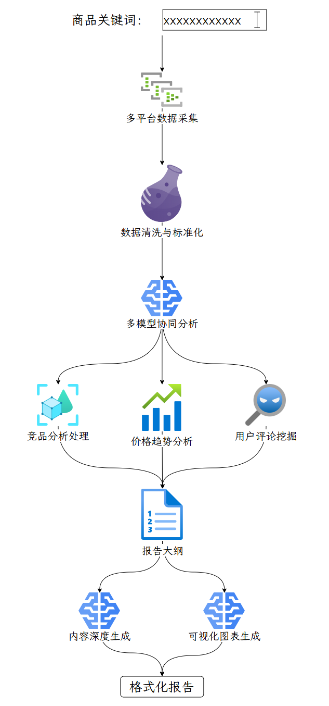

---
tags:
  - 大模型
  - 面试
source: "尚硅谷大模型技术之高频面试题-V2.1.6.docx"
source_blocks: "2469-2558"
reviewed: 2026-10-21
---

# Dify 竞品报告的证据、工作流与评估

报告工作流的关键产物是可回查的证据，而不只是格式完整的文章。

前篇：[[知识点总结/80-资料与复习/81-面试知识库/08-大模型高频面试题/05-项目实战/10-LangChain 商家对话助手与检索链路|LangChain 商家对话助手与检索链路]] ｜ 后篇：[[知识点总结/80-资料与复习/81-面试知识库/08-大模型高频面试题/05-项目实战/12-LangGraph 掌柜问数与SQL执行边界|LangGraph 掌柜问数与SQL执行边界]]

## 深入理解（新增）

竞品报告应先定义比较维度与有效时间，再检索资料并抽取证据表。价格、功能、用户评价来自不同来源，更新频率也不同；报告中每个关键结论应关联 source_id 和采集时间。

同一维度缺少证据时保留未知，不让生成器按常识补齐。结构化 JSON 能约束字段形状，但字段内容仍需校验，例如引用 ID 是否真实存在、金额单位是否一致、对比对象是否属于同一版本。

工作流发布后应保存模型、提示词、知识库和节点配置版本。失败分支返回明确状态，不能把检索空结果包装成成功报告。下面检索指标用于固定样本回归，不表示已部署 Dify 应用。


## 核心代码（新增）

以下是可在 CPU 运行的机制或业务契约示例，完整源码与测试见 [[知识点总结/80-资料与复习/81-面试知识库/08-大模型高频面试题/06-代码实验/01-核心代码实验与验证范围|核心代码实验与验证范围]]。示例不包含完整模型训练或外部平台部署。

```python
def retrieval_metrics(retrieved, relevant, k=5):
    if not relevant:
        raise ValueError("no-answer cases must be evaluated separately")
    top = list(dict.fromkeys(retrieved))[:k]
    hit = set(top) & set(relevant)
    reciprocal_rank = next((1 / rank for rank, doc in enumerate(top, 1) if doc in relevant), 0.0)
    return {"recall_at_k": len(hit) / len(set(relevant)), "mrr": reciprocal_rank}

def check_citations(claims, retrieved_source_ids):
    """Validate reference membership only; this does not verify factual support."""
    allowed = set(retrieved_source_ids)
    problems = []
    for index, claim in enumerate(claims):
        refs = claim.get("source_ids", [])
        if not refs:
            problems.append((index, "missing citation"))
        for ref in refs:
            if ref not in allowed:
                problems.append((index, "unknown source: " + ref))
    return problems

m = retrieval_metrics(["c2", "c1", "c1"], {"c1", "c3"}, k=3)
assert m == {"recall_at_k": 0.5, "mrr": 0.5}

claims = [{"source_ids":["doc-v2:chunk-3"]}]
assert check_citations(claims, {"doc-v2:chunk-3"}) == []
# 引用存在不等于引用支持结论，事实支持关系仍须另查。
```

## 追问与验证（新增）

删除一个竞品关键来源，检查报告是否显示缺证，并验证其余结论仍能逐项回查而不是自动补造。

## 官方资料与论文

- [Dify 知识检索节点源码](https://github.com/langgenius/dify/blob/main/api/core/workflow/nodes/knowledge_retrieval/knowledge_retrieval_node.py)
- [Retrieval-Augmented Generation](https://arxiv.org/abs/2005.11401)

核验日期：2026-10-21。链接中的 `stable`、`main` 或平台文档会继续变化；新增纯 Python/NumPy 实验与原文旧版框架代码已分开标注。

## 原文保留

> [!warning] 原文批注
> 结构化输出只约束结构；引用真实性、资料时效和结论支持关系仍须独立验证。
>
> 原文的团队人数、业务规模、效果百分比、硬件与成本均保留为教材案例陈述；本次未独立复现这些项目指标。

<!-- source-block:2469 -->
### 商家AI助手-竞品调研报告生成（Dify）

<!-- source-block:2470 -->
#### 项目周期

<!-- source-block:2471 -->
1个月即可，且中间还干着其他项目。

<!-- source-block:2472 -->
#### 项目简介

<!-- source-block:2473 -->
基于Dify平台开发了一套商品深度调研报告自动生成系统，通过可视化工作流整合多平台数据采集、竞品分析、价格追踪、用户评论挖掘和多模型分析能力，实现了从用户输入商品关键词到完整深度调研报告的全自动化生产。

<!-- source-block:2474 -->
#### 核心功能

<!-- source-block:2475 -->
**智能商品信息采集**

<!-- source-block:2476 -->
- 多电商平台数据采集（天猫、京东、亚马逊API集成）

<!-- source-block:2477 -->
- 竞品信息自动识别与追踪

<!-- source-block:2478 -->
- 价格历史数据抓取与分析

<!-- source-block:2479 -->
- 用户评论与口碑数据挖掘

<!-- source-block:2480 -->
**内容分析与处理**

<!-- source-block:2481 -->
- 多模型协同竞品对比分析

<!-- source-block:2482 -->
- 价格趋势预测与可视化

<!-- source-block:2483 -->
- 用户情感分析与特征提取

<!-- source-block:2484 -->
- 市场容量与份额评估

<!-- source-block:2485 -->
**智能报告生成**

<!-- source-block:2486 -->
- 自动生成商品调研报告大纲

<!-- source-block:2487 -->
- 多维度数据可视化展示

<!-- source-block:2488 -->
- 竞品对比矩阵自动生成

<!-- source-block:2489 -->
- 市场建议与策略推荐

<!-- source-block:2490 -->
**多格式输出**

<!-- source-block:2491 -->
- Markdown、PDF格式报告输出

<!-- source-block:2492 -->
- 邮件自动发送功能

<!-- source-block:2493 -->
- 原始数据集导出

<!-- source-block:2494 -->
#### 技术架构

<!-- source-block:2495 -->
**开发平台：Dify可视化工作流引擎**

<!-- source-block:2496 -->
**workflow工作流核心组件**

<!-- source-block:2497 -->
- 数据采集节点: 多平台API集成

<!-- source-block:2498 -->
- 处理节点：Python数据清洗器

<!-- source-block:2499 -->
- 分析节点：DeepSeek/OpenAI多模型协作

<!-- source-block:2500 -->
- 可视化节点：Echarts图表生成

<!-- source-block:2501 -->
- 报告节点：模板化报告生成器

<!-- source-block:2502 -->
**数据流：JSON格式数据管道**

<!-- source-block:2503 -->
**集成服务**

<!-- source-block:2504 -->
- 电商平台API接口

<!-- source-block:2505 -->
- 数据存储服务

<!-- source-block:2506 -->
- 多模型API调度

<!-- source-block:2507 -->
- 邮件SMTP推送服务

<!-- source-block:2508 -->
#### 实现流程图

<!-- source-block:2509 -->


<!-- source-block:2510 -->
#### 关键实现细节

<!-- source-block:2511 -->
**模型分工策略**

<!-- source-block:2512 -->
- 数据模型：销售数据预测与分析

<!-- source-block:2513 -->
- 情感模型：用户评论情感分析

<!-- source-block:2514 -->
- 生成模型：报告撰写与策略建议

<!-- source-block:2515 -->
- 可视化模型：数据图表生成

<!-- source-block:2516 -->
**数据处理管道**

```python
def process_product_data(raw_data):
    # 数据去重与清洗
    # 价格数据标准化
    # 评论数据情感标记
    # 竞品关系映射
    return processed_data
```

<!-- source-block:2523 -->
**质量保证机制**

<!-- source-block:2524 -->
- 数据准确性校验

<!-- source-block:2525 -->
- 内容相关性自动评估

<!-- source-block:2526 -->
- 重复信息过滤

<!-- source-block:2527 -->
- 异常值自动检测

<!-- source-block:2528 -->
#### 项目成果

<!-- source-block:2529 -->
**效率提升**

<!-- source-block:2530 -->
- 报告生成时间：从5-10小时（人工搜集资料、撰写调研报告）缩短至15分钟内（由于网络问题工作流可能因超时而失败，需要重跑，此外，需要人工整理输出格式）

<!-- source-block:2531 -->
- 数据处理能力：每分钟处理20+网页内容

<!-- source-block:2532 -->
- 准确率：数据相关性90%以上

<!-- source-block:2533 -->
**质量指标**

<!-- source-block:2534 -->
- 报告结构完整性: 91%

<!-- source-block:2535 -->
- 信息准确率: 88%

<!-- source-block:2536 -->
- 用户满意度: 4.6/5.0

<!-- source-block:2537 -->
**系统性能**

<!-- source-block:2538 -->
- 平均响应时间: &lt;5分钟

<!-- source-block:2539 -->
- 系统可用性: 98.5%

<!-- source-block:2540 -->
#### 技术亮点

<!-- source-block:2541 -->
**可视化工作流设计**

<!-- source-block:2542 -->
- 拖拽式数据流编排

<!-- source-block:2543 -->
- 实时节点监控界面

<!-- source-block:2544 -->
**智能路由机制**

<!-- source-block:2545 -->
- 基于数据质量自动路由

<!-- source-block:2546 -->
- 多平台智能调度

<!-- source-block:2547 -->
- 失败任务自动重试

<!-- source-block:2548 -->
**扩展性架构**

<!-- source-block:2549 -->
- 模块化数据采集器

<!-- source-block:2550 -->
- 标准化API接口

<!-- source-block:2551 -->
- 插件式分析组件

<!-- source-block:2552 -->
#### 口语化项目阐述

<!-- source-block:2553 -->
在Dify平台上开发了一个智能商品调研系统，用户只需要输入商品名称，系统就能自动采集各大电商平台数据、分析竞品信息、追踪价格变化、挖掘用户评论，并生成深度的市场调研报告。通过可视化工作流整合了数据采集、清洗、分析和报告生成多个环节，使用多模型协作确保报告质量。系统能在15分钟内完成原本需要几天的人工调研工作，为电商决策提供数据支持。

<!-- source-block:2554 -->
#### 项目规模

<!-- source-block:2555 -->
- 处理能力: 日均生成报告50+，处理商品页面1000+

<!-- source-block:2556 -->
- 工作流复杂度: 12个核心节点，20+配置参数

<!-- source-block:2557 -->
- 集成服务: 8+电商平台API集成

<!-- source-block:2558 -->
- 覆盖品类: 50+商品品类支持
