---
tags:
  - 大模型
  - 面试
source: "尚硅谷大模型技术之高频面试题-V2.1.6.docx"
source_blocks: "2559-2687"
reviewed: 2026-10-21
---

# LangGraph 掌柜问数与SQL执行边界

自然语言到 SQL 的模型输出应进入受限制的查询执行器。

前篇：[[知识点总结/80-资料与复习/81-面试知识库/08-大模型高频面试题/05-项目实战/11-Dify 竞品报告的证据、工作流与评估|Dify 竞品报告的证据、工作流与评估]] ｜ 后篇：[[知识点总结/80-资料与复习/81-面试知识库/08-大模型高频面试题/05-项目实战/13-LangGraph 智能客服的路由、命令与知识|LangGraph 智能客服的路由、命令与知识]]

## 深入理解（新增）

链路可拆为指标定义、schema 召回、SQL 生成、语法与权限校验、成本检查、执行和结果解释。金额是否含税、时间按支付还是下单、退款是否冲减等业务口径，通常比 SQL 语法更容易出错。

只检查字符串以 SELECT 开头不够；CTE、函数、外部表或多语句都有风险。示例使用 SQLite 只读连接、query_only 和 authorizer 展示数据库层限制；真实数仓还应使用只读身份、表列白名单、超时与扫描预算。

语法正确不等于口径正确。回归集应包含跨表连接导致重复计数、NULL、时区边界和无结果情况；回答要同时返回指标解释和查询条件，不能把执行成功直接当正确答案。


## 核心代码（新增）

以下是可在 CPU 运行的机制或业务契约示例，完整源码与测试见 [[知识点总结/80-资料与复习/81-面试知识库/08-大模型高频面试题/06-代码实验/01-核心代码实验与验证范围|核心代码实验与验证范围]]。示例不包含完整模型训练或外部平台部署。

```python
import sqlite3
from pathlib import Path

def readonly_query(db_path, sql, max_rows=100):
    uri = Path(db_path).resolve().as_uri() + "?mode=ro"
    connection = sqlite3.connect(uri, uri=True)
    try:
        connection.execute("PRAGMA query_only=ON")
        allowed_actions = {sqlite3.SQLITE_SELECT, sqlite3.SQLITE_READ, sqlite3.SQLITE_FUNCTION, sqlite3.SQLITE_RECURSIVE}
        allowed_functions = {"count", "sum", "avg", "min", "max", "abs", "round", "lower", "upper", "length"}
        def authorizer(action, arg1, arg2, database, source):
            if action not in allowed_actions:
                return sqlite3.SQLITE_DENY
            if action == sqlite3.SQLITE_FUNCTION and (arg2 or "").lower() not in allowed_functions:
                return sqlite3.SQLITE_DENY
            return sqlite3.SQLITE_OK
        connection.set_authorizer(authorizer)
        return connection.execute(sql).fetchmany(max_rows)
    finally:
        connection.close()

# 使用应用配置的本地数据库路径，禁止由模型指定任意文件。
# rows = readonly_query("./demo.db", "SELECT COUNT(*) FROM orders")
# 示例仅限制 SQLite 读操作；生产还需租户/表列权限与查询资源预算。
```

### LangGraph 执行骨架（未安装框架实跑）

下面把只读查询器接入状态图，使用调用方提供的候选 SQL，刻意保留生成节点的替换位置。它不包含 LLM，也不把“图执行成功”当作 SQL 语义正确。

```python
from typing import TypedDict
from langgraph.graph import StateGraph, START, END
from langgraph.checkpoint.memory import InMemorySaver
from core_examples import readonly_query

class QueryState(TypedDict, total=False):
    db_path: str  # 真实应用应从可信服务配置注入。
    sql: str
    rows: list

def query_node(state: QueryState):
    return {"rows": readonly_query(state["db_path"], state["sql"])}

builder = StateGraph(QueryState)
builder.add_node("query", query_node)
builder.add_edge(START, "query")
builder.add_edge("query", END)
graph = builder.compile(checkpointer=InMemorySaver())
# graph.invoke({"db_path":"demo.db", "sql":"SELECT COUNT(*) FROM orders"},
#              config={"configurable":{"thread_id":"session-1"}})
```

InMemorySaver 只适合进程内演示，重启会丢失；生产需使用合适的持久化 checkpointer、隔离 thread_id、限制查询资源，并避免把敏感结果随意长期保存。

## 追问与验证（新增）

构造一对多订单明细，检查 JOIN 后总金额是否重复；再测试 INSERT、ATTACH 和未允许函数是否被执行器拒绝。

## 官方资料与论文

- [LangGraph 工作流](https://docs.langchain.com/oss/python/langgraph/overview)
- [LangGraph 持久化](https://docs.langchain.com/oss/python/langgraph/persistence)
- [Python sqlite3 官方参考](https://docs.python.org/3/library/sqlite3.html)

核验日期：2026-10-21。链接中的 `stable`、`main` 或平台文档会继续变化；新增纯 Python/NumPy 实验与原文旧版框架代码已分开标注。

## 原文保留

> [!warning] 原文批注
> SQL 安全不能只靠模型提示词或 SELECT 前缀检查。示例限制 SQLite 写入，但不等同于生产数据库的租户隔离与资源控制。
>
> 原文的团队人数、业务规模、效果百分比、硬件与成本均保留为教材案例陈述；本次未独立复现这些项目指标。

<!-- source-block:2559 -->
### 掌柜问数(LangGraph)

<!-- source-block:2560 -->
#### 项目周期

<!-- source-block:2561 -->
- 总计近2个月：

<!-- source-block:2562 -->
- 基础架构与环境配置：1周

<!-- source-block:2563 -->
- 元数据知识库构建：3周

<!-- source-block:2564 -->
- 问数智能体搭建：2周

<!-- source-block:2565 -->
- 测试、优化与文档：2周

<!-- source-block:2566 -->
#### 技术栈

<!-- source-block:2567 -->
- 后端框架：FastAPI

<!-- source-block:2568 -->
- 数据库：MySQL（业务数据）

<!-- source-block:2569 -->
- 向量存储：Qdrant

<!-- source-block:2570 -->
- 全文检索：Elasticsearch

<!-- source-block:2571 -->
- Agent框架：LangGraph（状态图编排）

<!-- source-block:2572 -->
#### 功能介绍

<!-- source-block:2573 -->
掌柜问数是一个基于自然语言处理与数据分析技术的智能数据服务系统，面向数据仓库应用场景，旨在帮助用户通过对话方式高效获取数据仓库中的数据洞察。用户无需掌握复杂的查询语法，即可用自然语言提出问题，系统自动完成对数据仓库数据的理解、计算分析与结果可视化，大幅提升数据使用效率，降低数据分析门槛，助力业务决策智能化。

<!-- source-block:2574 -->
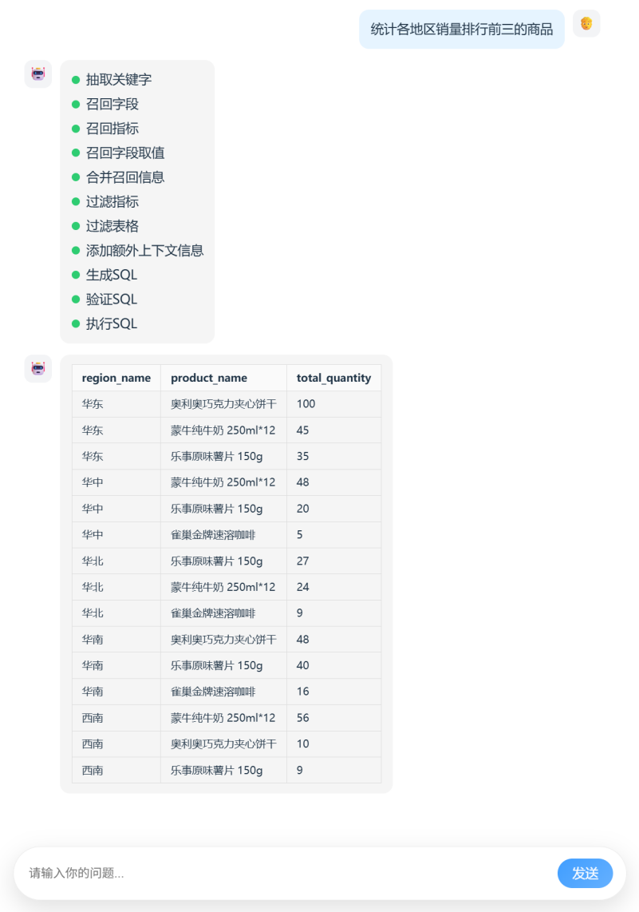

<!-- source-block:2575 -->
#### 项目架构

<!-- source-block:2576 -->
##### 概述

<!-- source-block:2577 -->
本项目以数据仓库的元数据为核心，使用 MySQL 存储结构化元数据信息，结合 Qdrant 构建语义向量索引、Elasticsearch 构建全文索引，形成统一的元数据知识库。查询过程中，系统首先根据用户自然语言问题进行多路召回，筛选相关表、字段及指标定义，再将元数据信息与用户问题共同输入大模型生成 SQL，最终完成自动查询与结果返回，确保生成结果的准确性与可控性。

<!-- source-block:2578 -->
完整的项目架构如下图所示：

<!-- source-block:2579 -->
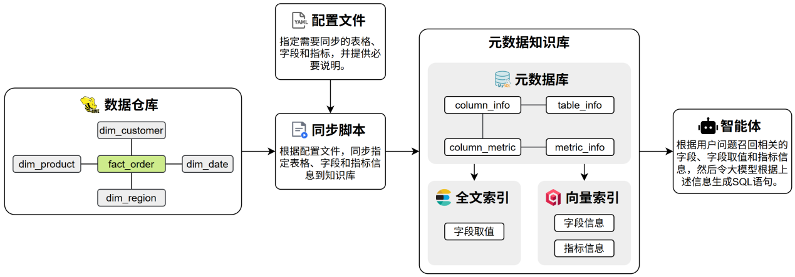

<!-- source-block:2580 -->
##### 元数据知识库

<!-- source-block:2581 -->
元数据知识库作为数据仓库的语义基础设施，用于集中管理和高效检索表结构、字段定义、字段取值示例及复杂指标说明等元数据信息，支撑后续的SQL 生成。

<!-- source-block:2582 -->
完整的元数据统一存储于 MySQL 数据库中，并对其中部分关键信息构建向量索引和全文索引，以提升语义召回与关键词召回的效果。

<!-- source-block:2583 -->
##### 元数据库

<!-- source-block:2584 -->
元数据库共有如下四张表，用于存储完整的元数据信息，包括数据仓库的表格信息、字段信息和指标信息。

<!-- source-block:2585 -->
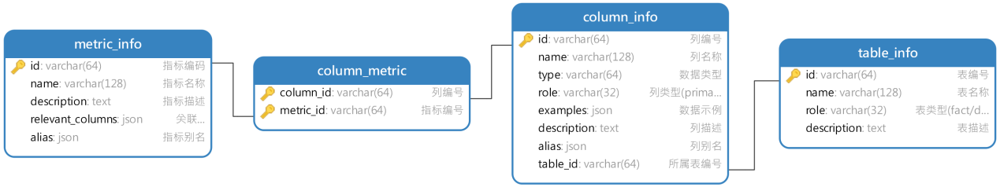

<!-- source-block:2586 -->
各表具体内容示例如下：

<!-- source-block:2587 -->
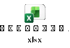

[原文嵌入附件：Microsoft_Excel_Worksheet.xlsx](../assets/原始附件/Microsoft_Excel_Worksheet.xlsx)

<!-- source-block:2588 -->
##### 向量索引

<!-- source-block:2589 -->
向量索引主要用于对column\_info（字段信息）和metric\_info（指标信息）进行语义召回。

<!-- source-block:2590 -->
- column\_info

<!-- source-block:2591 -->
column\_info中，需要建立向量索引的字段如下图所示：

<!-- source-block:2592 -->
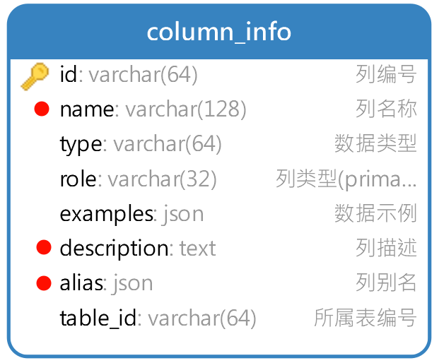

<!-- source-block:2593 -->
具体示例如下图所示：

<!-- source-block:2594 -->
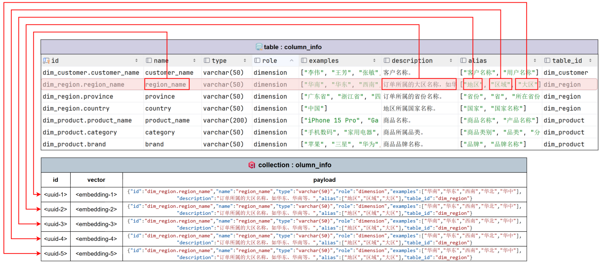

<!-- source-block:2595 -->
- metric\_info

<!-- source-block:2596 -->
metric\_info中，需要建立向量索引的字段如下图所示：

<!-- source-block:2597 -->
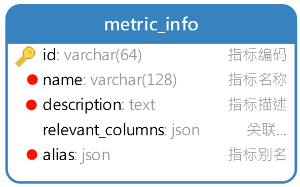

<!-- source-block:2598 -->
具体示例如下图所示：

<!-- source-block:2599 -->
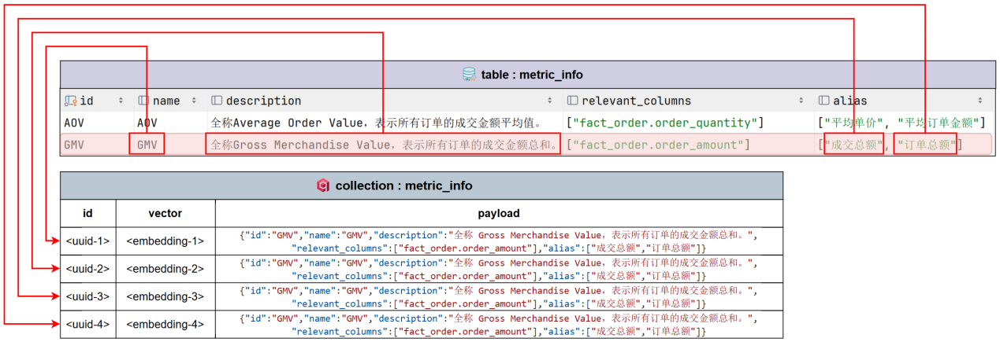

<!-- source-block:2600 -->
##### 全文索引

<!-- source-block:2601 -->
全文索引主要用于对字段取值进行检索与匹配，建立全文索引的主要是数据仓库中的各种维度表中的维度字段，具体字段如下图所示：

<!-- source-block:2602 -->
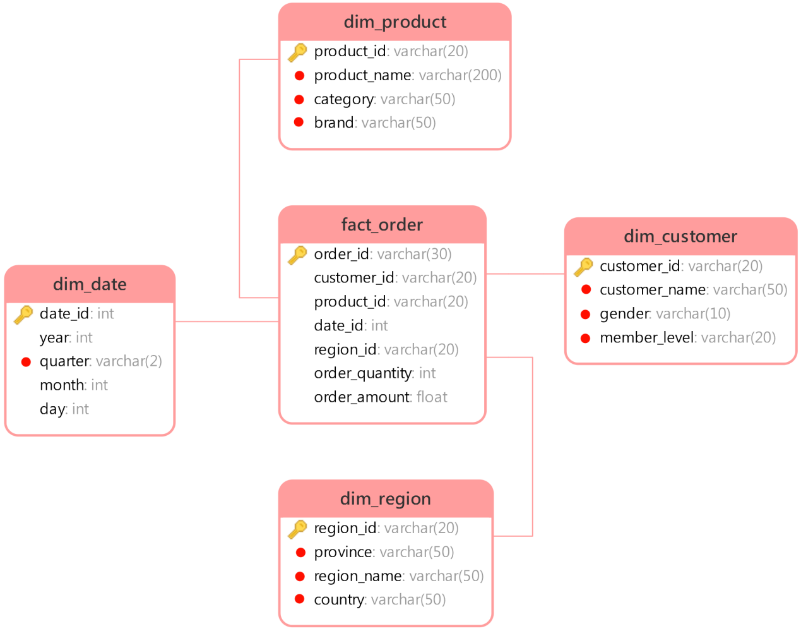

<!-- source-block:2603 -->
具体示例如下图所示：

<!-- source-block:2604 -->
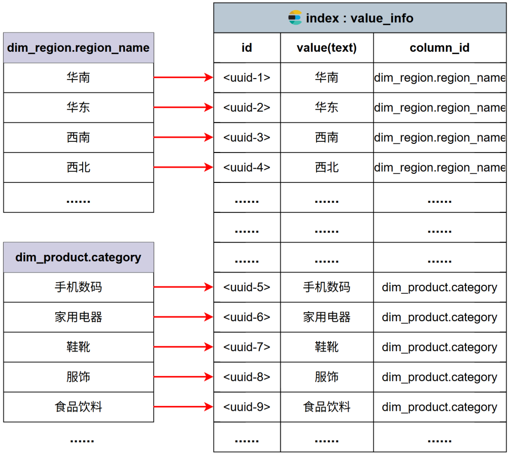

<!-- source-block:2605 -->
##### 问数智能体

<!-- source-block:2606 -->
问数智能体主要基于Langgraph进行开发，具体结构如下图所示：

<!-- source-block:2607 -->
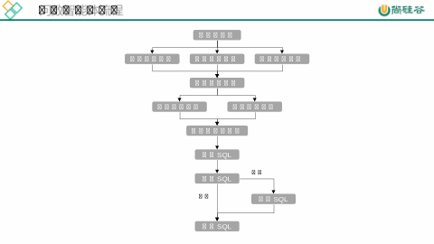

[原文嵌入附件：Microsoft_PowerPoint_Presentation.pptx](../assets/原始附件/Microsoft_PowerPoint_Presentation.pptx)

<!-- source-block:2608 -->
#### 项目串讲

<!-- source-block:2609 -->
这个问数智能体项目，本质上其实就是 NL2SQL。

<!-- source-block:2610 -->
也就是把用户用自然语言提的问题，交给大模型自动生成 SQL 查询语句。

<!-- source-block:2612 -->
要让模型把 SQL 写对，必须提前告诉它两类非常关键的信息：

<!-- source-block:2613 -->
数据仓库里有哪些表、字段

<!-- source-block:2614 -->
一些复杂的业务指标到底是怎么计算的

<!-- source-block:2615 -->
否则模型根本不知道该查哪张表、用哪些字段、指标怎么算。

<!-- source-block:2617 -->
但问题是:

<!-- source-block:2618 -->
数据仓库里的表和指标非常多，不可能一股脑全部丢给模型。

<!-- source-block:2619 -->
给太多信息，模型反而会被干扰，SQL 更容易写错。

<!-- source-block:2621 -->
所以这个项目真正的难点其实是：

<!-- source-block:2622 -->
如何从海量的表信息和指标信息中，精准筛选出“对当前问题最有帮助”的那一小部分，再交给大模型。

<!-- source-block:2624 -->
这里我们借鉴了 RAG 的思想，为整个数据仓库专门设计了一套 元数据知识库。

<!-- source-block:2625 -->
这个知识库里，存的不是业务数据，而是：表信息、字段信息和指标信息

<!-- source-block:2626 -->
为了方便检索，我们同时给它建立了：

<!-- source-block:2627 -->
向量索引（做语义召回）

<!-- source-block:2628 -->
全文索引（做文本召回）

<!-- source-block:2630 -->
在查询的时候，系统会先根据用户的自然语言问题做多路召回，筛选出相关的表、字段和指标定义，然后把这些元数据信息和用户问题一起交给大模型生成 SQL。这样就能保证模型是在“充分理解数据仓库结构”的前提下写 SQL，准确率会高很多。

<!-- source-block:2632 -->
下面我重点讲一下这个元数据知识库是怎么设计的。

<!-- source-block:2633 -->
完整的元数据是存储在 MySQL 里的，主要分三块：表信息、字段信息、指标信息。

<!-- source-block:2635 -->
表信息包括：

<!-- source-block:2636 -->
表名

<!-- source-block:2637 -->
表的角色（事实表还是维度表）

<!-- source-block:2638 -->
表的业务描述

<!-- source-block:2640 -->
字段信息包括：

<!-- source-block:2641 -->
字段名

<!-- source-block:2642 -->
字段别名

<!-- source-block:2643 -->
字段类型

<!-- source-block:2644 -->
字段角色（维度、度量、主键、外键）

<!-- source-block:2645 -->
字段的业务描述

<!-- source-block:2646 -->
以及一些字段取值示例

<!-- source-block:2648 -->
指标信息包括：

<!-- source-block:2649 -->
指标名

<!-- source-block:2650 -->
指标别名

<!-- source-block:2651 -->
指标的业务描述

<!-- source-block:2652 -->
以及这个指标依赖哪些字段

<!-- source-block:2654 -->
接着，我们对字段信息和指标信息都建立了向量索引，索引的内容主要是名称、别名和业务描述，方便通过语义去召回。

<!-- source-block:2656 -->
除此之外，还有一个很关键的点：

<!-- source-block:2657 -->
我们对常用维度字段的取值也建立了索引。

<!-- source-block:2658 -->
因为有些查询，是必须用到具体维度值的，比如：

<!-- source-block:2659 -->
“统计一下华北地区的销售总额”，SQL 里就一定要出现“华北地区”这个具体的值。

<!-- source-block:2660 -->
这里我们用的是全文索引，而不是向量索引。

<!-- source-block:2661 -->
因为字段取值更偏向文本匹配，而不是语义匹配。

<!-- source-block:2663 -->
以上，就是整个元数据知识库的设计。

<!-- source-block:2665 -->
接下来我讲一下查询流程，这个流程是用 langgraph 来编排的。

<!-- source-block:2666 -->
当用户提问后，第一步我们会先做关键词提取，主要是去掉一些无用词，比如停用词、语气词，让后续检索更精准。

<!-- source-block:2668 -->
然后根据这些关键词，分别去召回：

<!-- source-block:2669 -->
字段信息

<!-- source-block:2670 -->
指标信息

<!-- source-block:2671 -->
字段取值

<!-- source-block:2673 -->
召回之后，会做一次信息整合，大概的逻辑是：

<!-- source-block:2674 -->
如果召回了某个指标，就把这个指标相关的字段也补充进来

<!-- source-block:2675 -->
如果召回了某个字段取值，就把它加入到对应字段的示例里

<!-- source-block:2676 -->
最后再按“表”把字段分组整理

<!-- source-block:2678 -->
整理好之后，我们没有直接交给大模型，而是又做了一次精筛。

<!-- source-block:2679 -->
这一步是用大模型来做判断：哪些信息是真正有用的。

<!-- source-block:2680 -->
经过这一步之后，就得到了生成 SQL 所需的最小充分上下文。

<!-- source-block:2682 -->
然后才把：用户问题 + 精筛后的表信息 + 指标信息，一起交给大模型去生成 SQL。

<!-- source-block:2684 -->
SQL 生成之后，我们还会通过 EXPLAIN 做一次校验，如果语法有问题，会把报错信息再交给大模型做自动修正

<!-- source-block:2686 -->
确认没问题之后，才真正执行 SQL

<!-- source-block:2687 -->
以上，就是整个智能问数从提问到最终生成并执行 SQL的完整流程。
