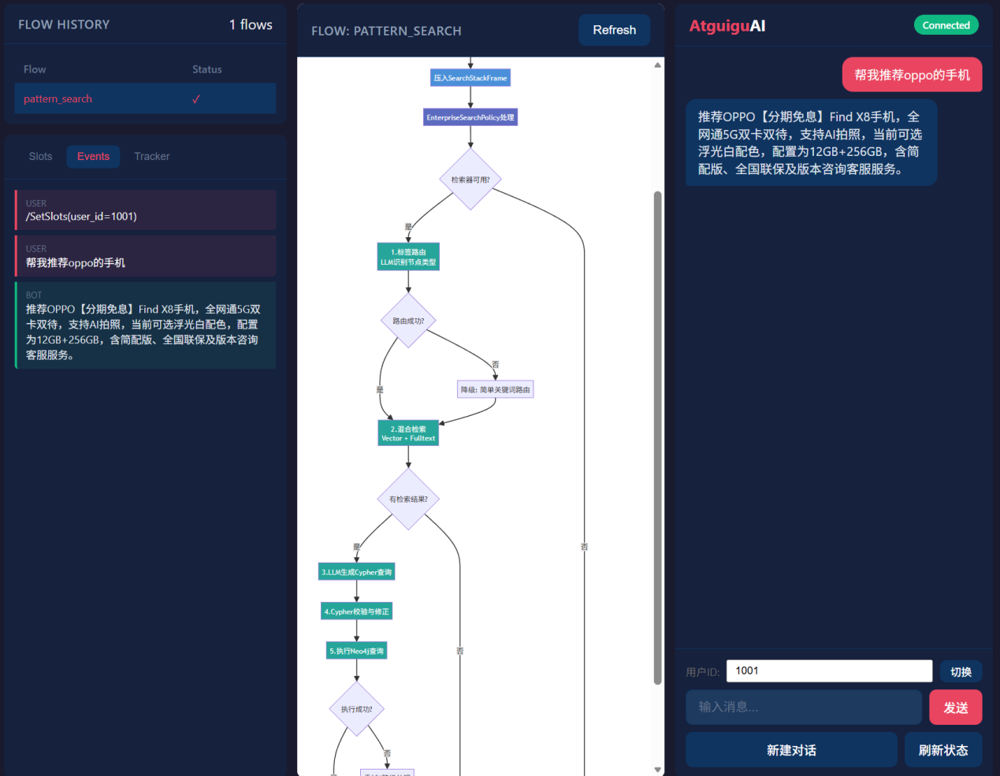
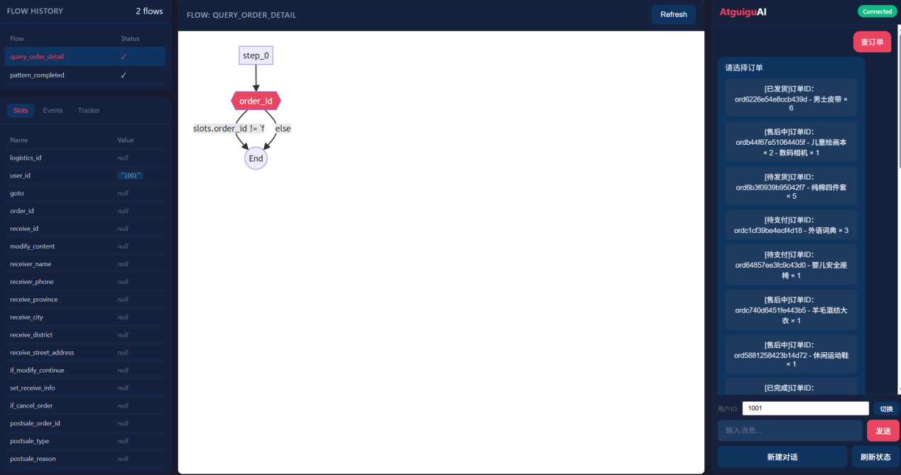
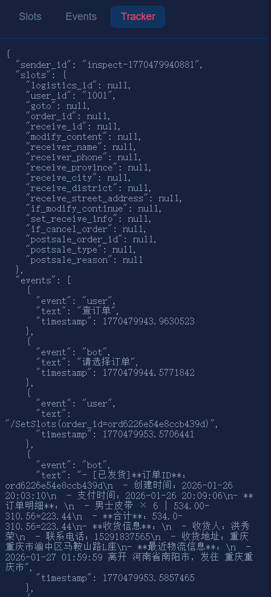
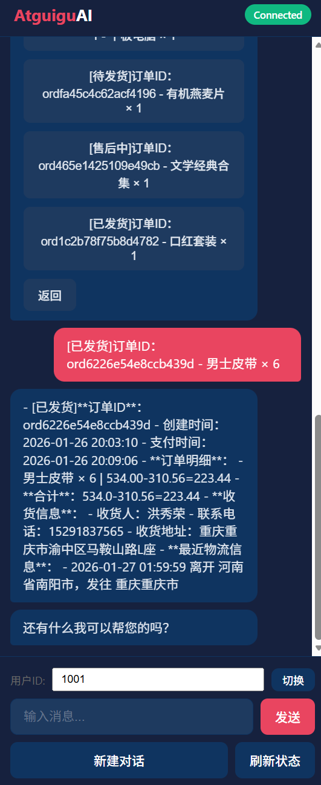
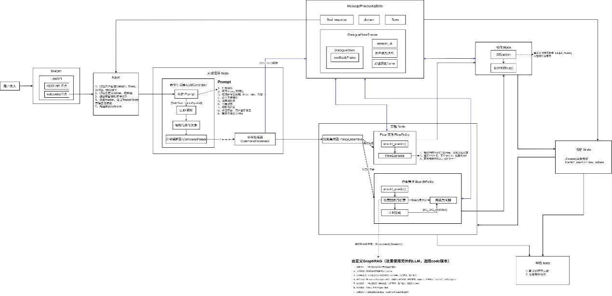

---
tags:
  - 大模型
  - 面试
source: "尚硅谷大模型技术之高频面试题-V2.1.6.docx"
source_blocks: "2688-2864"
reviewed: 2026-10-21
---

# LangGraph 智能客服的路由、命令与知识

用状态图显式表达分类、澄清、检索和业务执行的分工。

前篇：[[知识点总结/80-资料与复习/81-面试知识库/08-大模型高频面试题/05-项目实战/12-LangGraph 掌柜问数与SQL执行边界|LangGraph 掌柜问数与SQL执行边界]] ｜ 后篇：[[知识点总结/80-资料与复习/81-面试知识库/08-大模型高频面试题/05-项目实战/14-GRPO与DAPO训练实验的复现设计|GRPO与DAPO训练实验的复现设计]]

## 深入理解（新增）

路由器决定进入知识问答、订单查询、售后操作或澄清分支；每条边都应有可观察条件和默认兜底。分类置信度不足时收集必要字段，不能在多个高风险分支间靠自由文本猜测。

状态中应区分用户输入、已验证槽位、工具结果和准备执行的动作。interrupt 可用于人工确认，但恢复时节点可能重放，因此写操作需有幂等键，审批结果也要绑定具体参数版本。

测试不只验证最终回复，还要检查经过哪些节点、调用了哪些工具、是否越过授权关卡。把“取消”和“查询取消状态”放在同一组对抗样本中，验证路由和副作用差异。


## 核心代码（新增）

以下是可在 CPU 运行的机制或业务契约示例，完整源码与测试见 [[知识点总结/80-资料与复习/81-面试知识库/08-大模型高频面试题/06-代码实验/01-核心代码实验与验证范围|核心代码实验与验证范围]]。示例不包含完整模型训练或外部平台部署。

```python
import json

def validate_tool_call(payload):
    data = json.loads(payload)
    if not isinstance(data, dict) or set(data) != {"tool", "args"}:
        raise ValueError("invalid envelope")
    if data["tool"] != "get_order" or not isinstance(data["args"], dict):
        raise ValueError("tool not allowed")
    order_id = data["args"].get("order_id")
    if set(data["args"]) != {"order_id"} or not isinstance(order_id, str) or not order_id.isdecimal():
        raise ValueError("invalid order_id")
    return data

def route_customer_request(intent, slots, confirmed=False):
    if intent not in {"knowledge", "order_status", "cancel_order"}:
        return {"next": "clarify", "missing": ["intent"]}
    if intent == "knowledge":
        return {"next": "retrieve"}
    order_id = slots.get("order_id")
    if not isinstance(order_id, str) or not order_id.isdecimal():
        return {"next": "clarify", "missing": ["order_id"]}
    if intent == "cancel_order" and not confirmed:
        return {"next": "confirm", "order_id": order_id}
    # The execution service must still enforce identity, ownership and idempotency.
    return {"next": "execute", "tool": intent, "order_id": order_id}

call = validate_tool_call(
    '{"tool":"get_order","args":{"order_id":"123"}}')
assert call["args"]["order_id"] == "123"
# 接下来由执行服务核验调用者身份与订单归属；此函数未实现授权。

next_step = route_customer_request("cancel_order", {"order_id":"123"})
assert next_step["next"] == "confirm"
```

## 追问与验证（新增）

模拟工具成功后回复节点失败，再恢复图执行；确认不会再次取消订单，且回复来自真实工具结果。

## 官方资料与论文

- [LangGraph 工作流](https://docs.langchain.com/oss/python/langgraph/overview)
- [LangGraph 人工介入与恢复](https://docs.langchain.com/oss/python/langgraph/interrupts)
- [LangGraph 持久化](https://docs.langchain.com/oss/python/langgraph/persistence)

核验日期：2026-10-21。链接中的 `stable`、`main` 或平台文档会继续变化；新增纯 Python/NumPy 实验与原文旧版框架代码已分开标注。

## 原文保留

> [!warning] 原文批注
> 图编排、Command 跳转与工具执行并非同一个权限层；恢复与重试必须考虑外部副作用。
>
> 原文的团队人数、业务规模、效果百分比、硬件与成本均保留为教材案例陈述；本次未独立复现这些项目指标。

<!-- source-block:2688 -->
### 智能客服系统（LangGraph）

<!-- source-block:2689 -->
#### 项目周期

<!-- source-block:2690 -->
- 2人团队，总计约6个月。

<!-- source-block:2691 -->
- 需求分析与技术选型1周

<!-- source-block:2692 -->
- 环境搭建与系统开发8周

<!-- source-block:2693 -->
- 测试与部署1周

<!-- source-block:2694 -->
- 基础任务流开发与集成2周

<!-- source-block:2695 -->
- GraphRAG流程开发1周

<!-- source-block:2696 -->
- 集成与调试1周

<!-- source-block:2697 -->
- LLM微调数据准备2周

<!-- source-block:2698 -->
- LLM微调与评估1周

<!-- source-block:2699 -->
- 模型部署与测试2周

<!-- source-block:2700 -->
- 更多任务流扩展4周

<!-- source-block:2701 -->
#### 技术栈

<!-- source-block:2702 -->
- 后端框架：FastAPI+Uvicorn

<!-- source-block:2703 -->
- 数据库：MySQL（业务数据）

<!-- source-block:2704 -->
- 图数据库：neo4j

<!-- source-block:2705 -->
- ORM：SQLAlchemy

<!-- source-block:2706 -->
- 向量检索：Sentence-transformers

<!-- source-block:2707 -->
- CLI配置：Click

<!-- source-block:2708 -->
- LLM集成：LangChain

<!-- source-block:2709 -->
- 实时双向通信：WebSocket

<!-- source-block:2710 -->
- Agent框架：LangGraph（状态图编排）

<!-- source-block:2711 -->
#### 功能介绍

<!-- source-block:2712 -->
基于LLM驱动的多轮对话系统和知识图谱构建的智能电商客服系统，主要有以下功能：

<!-- source-block:2713 -->
提供任务型对话，根据预设流程进行对话，通过多轮对话交互帮助用户完成特定任务，如物流、订单、售后相关业务流程等。

<!-- source-block:2714 -->
提供知识库问答对话，基于知识图谱和GraphRAG，支持售前产品咨询的复杂问题和多跳推理。

<!-- source-block:2715 -->
支持话题切换和闲聊，接入LLM支持用户的非业务对话，并对回复内容做出严肃限制，避免涉及敏感内容的回复。

<!-- source-block:2716 -->


<!-- source-block:2717 -->


<!-- source-block:2718 -->
 

<!-- source-block:2719 -->
#### 项目架构

<!-- source-block:2720 -->
##### 总体架构

<!-- source-block:2721 -->


<!-- source-block:2722 -->


[原文嵌入附件：oleObject2.bin](../assets/原始附件/oleObject2.bin)

[原文嵌入附件：oleObject2.drawio](../assets/原始附件/oleObject2.drawio)

<!-- source-block:2723 -->
##### 生成“命令生成模型”的微调数据

<!-- source-block:2724 -->


<!-- source-block:2725 -->
准备覆盖重要对话流程的端到端测试数据，准备命令生成微调数据集。

<!-- source-block:2726 -->
##### 命令生成模型微调与部署

<!-- source-block:2727 -->
##### 数据集

<!-- source-block:2728 -->
覆盖高频步骤路径与边界场景（如模糊意图、多意图、口语化表达等）。

<!-- source-block:2729 -->
共计约1万条样本，按8：2划分训练集和验证集。

<!-- source-block:2730 -->
训练集：8000条左右。

<!-- source-block:2731 -->
验证集：2000条左右。

<!-- source-block:2732 -->
##### 模型训练

<!-- source-block:2733 -->
| 预训练模型 | Qwen3-8B |  |  |
| --- | --- | --- | --- |
| 超参数 | 最大序列长度 | 4096 |  |
| 训练轮次 | 3 |  |  |
| LoRA | 秩r | 16 |  |
| 目标模块 | 注意力和MLP部分 |  |  |
| 缩放系数α | 16，与r相等 |  |  |
| Dropout概率 | 0 |  |  |
| 不微调bias |  |  |  |
| 不使用秩稳定LoRA |  |  |  |
| 优化器 | 8bit-AdamW |  |  |
| 学习率 | 2e-4 |  |  |
| 权重衰减 | 0.01 |  |  |
| 每设备训练批次大小 | 2 |  |  |
| 梯度累计步数 | 8 |  |  |
| 每设备验证批次大小 | 4 |  |  |
| 训练多少步后验证一次 | 50 |  |  |
| 训练策略 | 量化 | 4bit |  |
| 启用梯度检查点以节省显存 |  |  |  |
| 精度配置 | 优先bf16，如果不支持bf16则使用fp16 |  |  |
| 学习率预热 | 总步数的5% |  |  |
| 学习率衰减 | 余弦衰减 |  |  |
| 训练环境 | 设备 | V100 32G单卡 |  |
| 框架 | Unsloth+Transformers |  |  |
| 训练时长 | 3小时（训练2小时+验证1小时） |  |  |
| 训练结果 | 初始损失值 | 2.4 |  |
| 最终验证集损失值 | 1.0 |  |  |
| 模型部署 | vllm部署 |  |  |
| 最大序列长度 | 4096 |  |  |
| 显存占用 | 20G左右（V100，不量化） |  |  |

<!-- source-block:2734 -->


<!-- source-block:2735 -->
##### 信息型对话（GraphRAG）

<!-- source-block:2736 -->
LLM根据Prompt从用户输入中提取入口节点实体和其对应的类型。

<!-- source-block:2737 -->
获取入口节点实体和标签之后，使用混合检索从Neo4j中检索出若干候选入口节点。

<!-- source-block:2738 -->


<!-- source-block:2739 -->
LLM根据用户输入、候选入口节点、Neo4j的schema信息，生成Cypher查询语句。

<!-- source-block:2740 -->
将生成的Cypher语句交给LLM进行验证，返回Cypher中的存在的语法与逻辑错误。

<!-- source-block:2741 -->
LLM根据验证出的错误信息对Cypher进行修正，得到最终的Cypher语句。

<!-- source-block:2742 -->
执行查询语句，将查询结果返回LLM作为上下文参考。

<!-- source-block:2743 -->
LLM根据用户输入和上下文参考生成回复。

<!-- source-block:2744 -->


<!-- source-block:2745 -->
#### 项目串讲

<!-- source-block:2746 -->
这个智能客服项目，本质上是一个基于大语言模型的多轮对话系统，支持任务型对话、知识型对话、闲聊型对话。

<!-- source-block:2747 -->
它的核心能力是：把复杂的客服业务流程，通过配置文件定义好，然后让大模型理解用户意图，自动执行这些流程。

<!-- source-block:2748 -->
整个系统最关键的设计思想是：不让大模型直接生成回复，而是让它生成"命令"，由系统来执行这些命令。

<!-- source-block:2749 -->
这样做的好处是，既能利用大模型强大的理解能力，又能保证业务流程的可控性。

<!-- source-block:2750 -->
但问题是：

<!-- source-block:2751 -->
怎么让大模型知道该生成什么命令？

<!-- source-block:2752 -->
怎么管理复杂的多轮对话状态？

<!-- source-block:2753 -->
怎么在对话过程中灵活切换不同的业务流程？

<!-- source-block:2754 -->
这个项目真正的难点其实是：

<!-- source-block:2755 -->
如何设计一套机制，让系统既能处理结构化的业务流程（比如订单查询、物流跟踪），又能灵活应对开放式的问答和闲聊。

<!-- source-block:2756 -->
下面我重点讲一下这个系统是怎么解决这些问题的。

<!-- source-block:2757 -->
**一是核心设计：LangGraph 图式编排**

<!-- source-block:2758 -->
整个对话处理流程，是用 LangGraph 编排成一个图。

<!-- source-block:2759 -->
图里有 5 个核心节点：understand（理解）、policy（决策）、action（执行）、guard（守护）、response（响应）。

<!-- source-block:2760 -->
当用户发来一条消息，系统会：

<!-- source-block:2761 -->
**understand 节点：把用户的话交给大模型，让它生成结构化命令**

<!-- source-block:2762 -->
**policy 节点：根据命令决定下一步要执行什么动作**

<!-- source-block:2763 -->
**action 节点：执行具体的动作（比如查数据库、调API）**

<!-- source-block:2764 -->
**guard 节点：检查是否还有命令没执行完，如果有就跳回 policy 继续**

<!-- source-block:2765 -->
**response 节点：把所有执行结果整理成消息，返回给用户**

<!-- source-block:2766 -->
这个图的精妙之处在于：policy 和 action 之间可以循环多次。

<!-- source-block:2767 -->
比如用户说"我要查物流，订单号是12345，顺便帮我改个地址"，大模型会一次生成 3 条命令，系统会依次执行这 3 条命令，直到全部完成。

<!-- source-block:2768 -->
**二是 Tracker：对话的记忆体**

<!-- source-block:2769 -->
Tracker 是整个系统的状态管理核心。

<!-- source-block:2770 -->
每个用户都有一个会话级别独立的 Tracker，里面记录了：

<!-- source-block:2771 -->
- 槽位值（比如 order\_id=12345、receiver\_name=张三）

<!-- source-block:2772 -->
- 对话历史（用户说了什么、系统回了什么）

<!-- source-block:2773 -->
- 对话栈（当前在执行哪个流程、执行到哪一步了）

<!-- source-block:2775 -->
**为什么需要对话栈？**

<!-- source-block:2776 -->
因为对话是会中断和嵌套的。

<!-- source-block:2777 -->
**举个例子：**

<!-- source-block:2778 -->
用户在查物流（Flow A），中途突然问"你们客服电话是多少"（知识检索），回答完之后要继续查物流。

<!-- source-block:2779 -->
这时候系统会先把 Flow A 压栈，然后处理知识检索，检索完了弹栈，回到 Flow A 继续。

<!-- source-block:2780 -->
对话栈让系统能够自然地处理对话中断、嵌套、回退，这是传统状态机很难做到的。

<!-- source-block:2781 -->
**三是Flow：把对话流程配置化**

<!-- source-block:2782 -->
Flow 是这个系统最核心的机制。

<!-- source-block:2783 -->
一个 Flow 就是一个业务流程，用 YAML 文件定义，包含多个步骤。

<!-- source-block:2784 -->
比如订单查询的 Flow，会定义像如下的步骤：

<!-- source-block:2785 -->
**收集订单号（如果用户没说，就问他要）**

<!-- source-block:2786 -->
**查询订单（调用自定义的 action\_query\_order）**

<!-- source-block:2787 -->
**根据订单状态，决定是显示物流信息还是显示订单状态**

<!-- source-block:2789 -->
Flow 支持很多高级特性：

<!-- source-block:2790 -->
- 条件分支：根据槽位值决定走哪个分支

<!-- source-block:2791 -->
- 嵌套调用：一个 Flow 可以调用另一个 Flow（比如售后流程里调用地址修改流程）

<!-- source-block:2792 -->
- 动态跳转：根据业务逻辑动态决定下一步

<!-- source-block:2794 -->
关键是，这些都是通过配置文件定义的，不需要写代码。

<!-- source-block:2795 -->
要新增一个业务流程，只需要写一个 YAML 文件就行了。

<!-- source-block:2796 -->
**四是命令生成：怎么让大模型知道该干什么**

<!-- source-block:2797 -->
这是最核心的部分。

<!-- source-block:2798 -->
系统会给大模型构建一个超级详细的 Prompt，里面包含：

<!-- source-block:2799 -->
- 当前对话状态（有哪些槽位、活跃的 Flow 是什么、对话历史）

<!-- source-block:2800 -->
- 可用的 Flow 列表（每个 Flow 能干什么）

<!-- source-block:2801 -->
- 可用的命令类型（StartFlow、SetSlot、Answer、CancelFlow 等）

<!-- source-block:2802 -->
- 决策规则（什么情况下用什么命令）

<!-- source-block:2804 -->
大模型根据这个 Prompt，生成结构化的命令。

<!-- source-block:2805 -->
比如：

<!-- source-block:2806 -->
StartFlow(flow\_order)

<!-- source-block:2807 -->
SetSlot(order\_id, "12345")

<!-- source-block:2809 -->
然后系统会解析这些命令，依次执行。

<!-- source-block:2810 -->
这里有个很巧妙的设计：Prompt 里会动态裁剪内容。

<!-- source-block:2811 -->
因为 Flow 可能有很多个，槽位也可能有很多个，全部塞进 Prompt 会超长。

<!-- source-block:2812 -->
所以系统会根据当前上下文，只保留最相关的 Flow 和槽位。

<!-- source-block:2813 -->
这样既能给大模型足够的信息，又不会超出 token 限制。

<!-- source-block:2815 -->
**五是策略决策：FlowPolicy 和 EnterpriseSearchPolicy**

<!-- source-block:2816 -->
**系统有两个核心策略：**

<!-- source-block:2817 -->
- FlowPolicy：如果当前有活跃的 Flow，就执行 Flow 的下一个步骤。

<!-- source-block:2818 -->
这个策略优先级最高，因为 Flow 是明确定义的业务流程，必须优先保证执行。

<!-- source-block:2819 -->
- EnterpriseSearchPolicy：如果没有活跃的 Flow，就从知识库检索答案，这个策略处理知识和型问答。

<!-- source-block:2820 -->
**两个策略是互补的：**

<!-- source-block:2821 -->
- 结构化的任务用 Flow 处理，保证业务逻辑的准确性

<!-- source-block:2822 -->
- 知识型的问答用检索处理，灵活应对各种问题

<!-- source-block:2823 -->
策略集成器会按优先级选择最合适的策略，如果都不行，就返回"我没听懂"。

<!-- source-block:2824 -->
**六是Action：怎么对接外部系统**

<!-- source-block:2825 -->
Action 是系统与外部世界交互的桥梁。

<!-- source-block:2826 -->
当需要查数据库、调 API、执行业务逻辑时，就需要写一个自定义 Action。

<!-- source-block:2828 -->
比如查询订单的 Action：

<!-- source-block:2829 -->
可以定义一个Action ，继承抽象基类，实现run函数：

<!-- source-block:2830 -->
- 读取 Tracker 里的槽位值

<!-- source-block:2831 -->
- 调用数据库或 API

<!-- source-block:2832 -->
- 修改槽位值

<!-- source-block:2833 -->
- 返回响应消息

<!-- source-block:2834 -->
系统启动时会自动扫描 \`actions/\` 目录，把所有 Action 注册进来，不需要手动配置。

<!-- source-block:2835 -->
**七是多通道接入：REST、WebSocket、控制台**

<!-- source-block:2836 -->
系统支持多种接入方式：

<!-- source-block:2837 -->
REST API：提供标准的 HTTP 接口，可以集成到任何前端

<!-- source-block:2838 -->
WebSocket：实时双向通信，适合需要即时反馈的场景。比如客服系统，需要实时推送订单状态变化。

<!-- source-block:2839 -->
Inspect 调试页面：Web 可视化界面，可以：

<!-- source-block:2840 -->
- 查看对话栈的变化

<!-- source-block:2841 -->
- 查看每一步生成的命令

<!-- source-block:2842 -->
- 手动修改槽位值

<!-- source-block:2843 -->
- 重放历史对话

<!-- source-block:2844 -->
这个调试页面对开发非常有用，能直观地看到系统内部是怎么运行的。

<!-- source-block:2845 -->
**八是CLI 工具：从初始化到部署**

<!-- source-block:2846 -->
系统提供了一套完整的命令行工具：

<!-- source-block:2847 -->
- init：初始化项目，生成目录结构和配置文件

<!-- source-block:2848 -->
- train：训练模型，把 Flow 定义、对话样本打包成模型文件

<!-- source-block:2849 -->
- run：启动服务，提供 REST API 和 WebSocket 接口

<!-- source-block:2850 -->
- inspect：启动调试页面，可视化查看对话流程

<!-- source-block:2851 -->
整个流程非常顺畅：init 创建项目 → 编写 Flow 和 Action → train 打包模型 → run 启动服务 → inspect 测试调试 → run正式启动。

<!-- source-block:2853 -->
这个系统的核心设计思想就三点：

<!-- source-block:2854 -->
**命令驱动：大模型生成命令，系统执行命令，既灵活又可控**

<!-- source-block:2855 -->
**Flow 配置化：业务流程用 YAML 定义，不用写代码，易维护易扩展**

<!-- source-block:2856 -->
**对话栈管理：用栈结构管理对话上下文，自然处理中断和嵌套**

<!-- source-block:2857 -->
**技术亮点：**

<!-- source-block:2858 -->
- LangGraph 图式编排，让流程清晰可控

<!-- source-block:2859 -->
- Tracker 统一状态管理，避免状态不一致

<!-- source-block:2860 -->
- 多策略融合决策，灵活应对不同场景

<!-- source-block:2861 -->
- 自动发现和注册机制，开发体验友好

<!-- source-block:2862 -->
- 完整的工具链支持，从开发到部署一站式

<!-- source-block:2863 -->
对于开发者来说，这个框架提供了一个强大的基础设施，可以快速构建各种对话应用。

<!-- source-block:2864 -->
无论是客服机器人、任务助手、还是知识问答系统，都能轻松实现。
