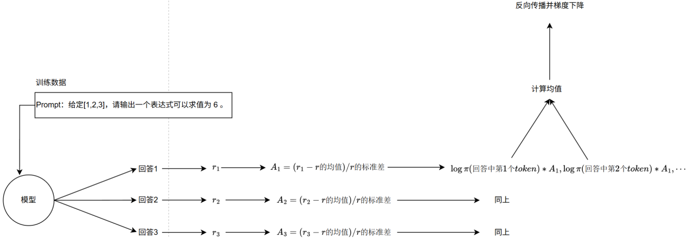
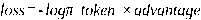

---
tags:
  - 大模型
  - 面试
source: "尚硅谷大模型技术之高频面试题-V2.1.6.docx"
source_blocks: "2865-2935"
reviewed: 2026-10-21
---

# GRPO与DAPO训练实验的复现设计

训练实验的可信度来自完整配置、奖励分解和同预算对照。

前篇：[[知识点总结/80-资料与复习/81-面试知识库/08-大模型高频面试题/05-项目实战/13-LangGraph 智能客服的路由、命令与知识|LangGraph 智能客服的路由、命令与知识]] ｜ 后篇：[[知识点总结/80-资料与复习/81-面试知识库/08-大模型高频面试题/05-项目实战/15-商品知识图谱的建模、实体与同步|商品知识图谱的建模、实体与同步]]

## 深入理解（新增）

同 prompt 多采样组成 group，优势应在组内计算。全对或全错导致奖励无差异时，增加采样数未必恢复有效信号；可以分析题目难度与奖励覆盖，而不是只延长训练。

GRPO、DAPO 等方法的实现细节涉及裁剪、采样过滤、长度与损失归一化。不能把不同版本实现的同名配置当作等价；实验必须记录仓库 commit、奖励函数、batch 口径和有效 token 数。

对照实验固定模型、数据、生成预算和验证器，分别报告正确率、响应长度、KL、吞吐与丢弃样本比例。只比较训练 reward 容易把更长输出或验证器漏洞当成算法收益。


## 核心代码（新增）

以下是可在 CPU 运行的机制或业务契约示例，完整源码与测试见 [[知识点总结/80-资料与复习/81-面试知识库/08-大模型高频面试题/06-代码实验/01-核心代码实验与验证范围|核心代码实验与验证范围]]。示例不包含完整模型训练或外部平台部署。

```python
import numpy as np

def grpo_advantages(rewards, eps=1e-8):
    rewards = np.asarray(rewards, dtype=float)
    if rewards.ndim != 2:
        raise ValueError("shape must be [prompts, completions_per_prompt]")
    return (rewards - rewards.mean(axis=1, keepdims=True)) / (rewards.std(axis=1, keepdims=True) + eps)

def ppo_surrogate(ratio, advantage, epsilon=0.2):
    unclipped = ratio * advantage
    clipped = np.clip(ratio, 1 - epsilon, 1 + epsilon) * advantage
    return float(np.minimum(unclipped, clipped).mean())

a = grpo_advantages([[0, 1, 2], [1, 1, 1]])
assert np.allclose(a[1], 0)  # 全组奖励相同，没有相对区分信号。

ratio = np.array([1.5, 1.5]); advantage = np.array([1., -1.])
print(ppo_surrogate(ratio, advantage))  # -0.15
```

## 追问与验证（新增）

统计每个 batch 中奖励方差为零的 group 比例，比较“训练步数相同”与“有效更新 token 相同”的结论。

## 官方资料与论文

- [DeepSeekMath：GRPO](https://arxiv.org/abs/2402.03300)

核验日期：2026-10-21。链接中的 `stable`、`main` 或平台文档会继续变化；新增纯 Python/NumPy 实验与原文旧版框架代码已分开标注。

## 原文保留

> [!warning] 原文批注
> 资料中的算法比较是案例口径；本节代码只覆盖组内优势与裁剪核心，不宣称复现完整 GRPO/DAPO 训练。
>
> 原文的团队人数、业务规模、效果百分比、硬件与成本均保留为教材案例陈述；本次未独立复现这些项目指标。

<!-- source-block:2865 -->
### 强化学习个人学习项目（GRPO）

<!-- source-block:2866 -->
也是学习项目。

<!-- source-block:2867 -->
#### 项目周期

<!-- source-block:2868 -->
- 1人团队，总计约1.5月。

<!-- source-block:2869 -->
- 奖励函数设计与实现1周

<!-- source-block:2870 -->
- 徒手实现DAPO算法3周

<!-- source-block:2871 -->
- 训练与超参数调试2周

<!-- source-block:2872 -->
- 评估与对比2天

<!-- source-block:2873 -->
#### 功能介绍

<!-- source-block:2874 -->
本项目目标是：基于强化学习改进大模型的推理能力，尤其是在数学推理与医学问答场景中。

<!-- source-block:2875 -->
我们选择了一个已经监督微调过的底座模型Qwen2.5-3B-Instruct，在此基础上从零实现 字节提出的GRPO算法改进版DAPO，并结合数学与医学推理数据集进行训练。

<!-- source-block:2876 -->
最终目标是让模型：

<!-- source-block:2877 -->
在通用任务中具备更强的逻辑推理能力

<!-- source-block:2878 -->
在医疗类任务中能涌现出结构化、逐步推理的解答能力，为病人病情提供合理回答

<!-- source-block:2879 -->
#### 实现流程

<!-- source-block:2880 -->
##### 选择SFT底座模型

<!-- source-block:2881 -->
采用 Qwen2.5-3B-Instruct 作为基础模型

<!-- source-block:2882 -->
##### 实现 DAPO 算法（基于GRPO改进）

<!-- source-block:2883 -->
**每次对同一问题生成8条候选回答**

<!-- source-block:2884 -->
**奖励函数对8条回答进行打分**

<!-- source-block:2885 -->
**计算每条回答相对组内均值的优势 (Group Relative Policy Optimization)**

<!-- source-block:2886 -->
**将 token级别的log概率 × 回答优势 作为损失进行反向传播**

<!-- source-block:2887 -->
##### 混合数据集训练

<!-- source-block:2888 -->
**数学推理数据集（如GSM8K、MATH）**

<!-- source-block:2889 -->
**医学问答数据集（MedQA、临床问诊数据）**

<!-- source-block:2890 -->
**通过混合训练，使模型既能做逻辑推理，又能在医学领域展现推理能力**

<!-- source-block:2891 -->
##### 训练环境

<!-- source-block:2892 -->
**使用 AutoDL 平台**

<!-- source-block:2893 -->
**硬件：L20 GPU，显存足够支撑中等规模批次训练**

<!-- source-block:2894 -->
##### 工程实现

<!-- source-block:2895 -->
**手工实现 GRPO/DAPO/GSPO 算法，未依赖 trl 等RLHF库，确保可控性与可对比性**

<!-- source-block:2896 -->
**集成 unsloth 用于高效LoRA训练，加速迭代**

<!-- source-block:2897 -->
**结合 vLLM 部署推理，提高推理吞吐量与响应速度**

<!-- source-block:2898 -->
#### 技术细节

<!-- source-block:2899 -->


<!-- source-block:2900 -->
##### 算法实现(DAPO)

<!-- source-block:2901 -->
输入：一个问题

<!-- source-block:2902 -->
输出：8条回答

<!-- source-block:2903 -->
奖励函数：基于回答正确性、逻辑完整性、专业性（医学场景下）打分

<!-- source-block:2904 -->
优势计算：每条回答减去组平均值，得到 group-relative advantage

<!-- source-block:2905 -->
损失函数：对每个token，

<!-- source-block:2906 -->
##### 数据集与训练

<!-- source-block:2907 -->
数学推理数据集：GSM8K、MATH

<!-- source-block:2908 -->
医学问答数据集：MedQA、中英双语临床对话数据

<!-- source-block:2909 -->
数据混合策略：按比例采样（数学:医学 = 7:3）

<!-- source-block:2910 -->
目标：增强通用推理能力 + 医学专业问答能力

<!-- source-block:2911 -->
##### 超参数配置

<!-- source-block:2912 -->
批次大小：128

<!-- source-block:2913 -->
学习率：1e-5

<!-- source-block:2914 -->
生成样本数：8 (per prompt)

<!-- source-block:2915 -->
训练轮数：3 epoch

<!-- source-block:2916 -->
奖励归一化方式：z-score

<!-- source-block:2917 -->
优化器：AdamW, weight decay=0.1

<!-- source-block:2918 -->
 =0.99， =0.95 (用于优势估计的折扣因子和tracker系数)

<!-- source-block:2919 -->
##### 工程与工具

<!-- source-block:2920 -->
unsloth：用于LoRA微调，显著降低显存占用

<!-- source-block:2921 -->
vLLM：作为推理引擎，提升吞吐量和延迟表现

<!-- source-block:2922 -->
AutoDL：云端GPU平台，硬件为L20卡，保证训练效率

<!-- source-block:2923 -->
手工实现对比实验：实现GRPO、DAPO、GSPO三种算法，用于性能对比和消融实验

<!-- source-block:2924 -->
#### 总结

<!-- source-block:2925 -->
本项目在 Qwen2.5-3B-Instruct 基础上，复现并改进了GRPO类算法，采用DAPO进行强化学习微调，最终实现了一个具备 链式推理能力 的大模型：

<!-- source-block:2926 -->
在数学任务中能输出逐步推理过程

<!-- source-block:2927 -->
在医学问答中能够围绕病人病情进行结构化解释与解答

<!-- source-block:2928 -->
工程层面使用 unsloth + vLLM 提升训练与推理效率

<!-- source-block:2929 -->
该项目不仅满足了业务需求（医疗场景下的高质量推理回答），也验证了不同策略优化算法（GRPO、DAPO、GSPO）在大模型推理能力提升方面的差异。

<!-- source-block:2930 -->
#### 项目串讲

<!-- source-block:2931 -->
本项目的目标是让大模型具备更强的推理能力，尤其在数学和医学场景下能生成符合人类需求的思维链回答。

<!-- source-block:2932 -->
我们选择了一个已经SFT过的底座模型Qwen2.5-3B-Instruct，然后从零实现了字节提出的GRPO改进版DAPO算法。具体做法是：模型针对同一个问题一次性输出8条回答，用奖励函数对这8条回答进行评分，再计算每条回答相对于组平均值的优势。训练时，我们把每个token的对数概率乘上该回答的优势作为损失，进行反向传播。这样可以在组内比较回答优劣，从而更稳定地提升模型的生成质量。

<!-- source-block:2933 -->
在数据上，我们混合使用了数学推理数据和医学问答数据。这样一方面模型学会了逐步推理的能力，另一方面也在医学场景中涌现出了针对病情进行分析和回答的能力。

<!-- source-block:2934 -->
训练方面，我们使用AutoDL平台的L20 GPU进行训练，并在工程上手工实现了GRPO、DAPO和GSPO等算法，方便对比实验效果。同时结合了unsloth用于高效LoRA训练，以及vLLM作为推理引擎，加速推理吞吐。

<!-- source-block:2935 -->
最终模型在数学问题上能够生成清晰的逐步推理链，在医学问答中也能给出合理的分析和解释，整体表现符合业务需求。
