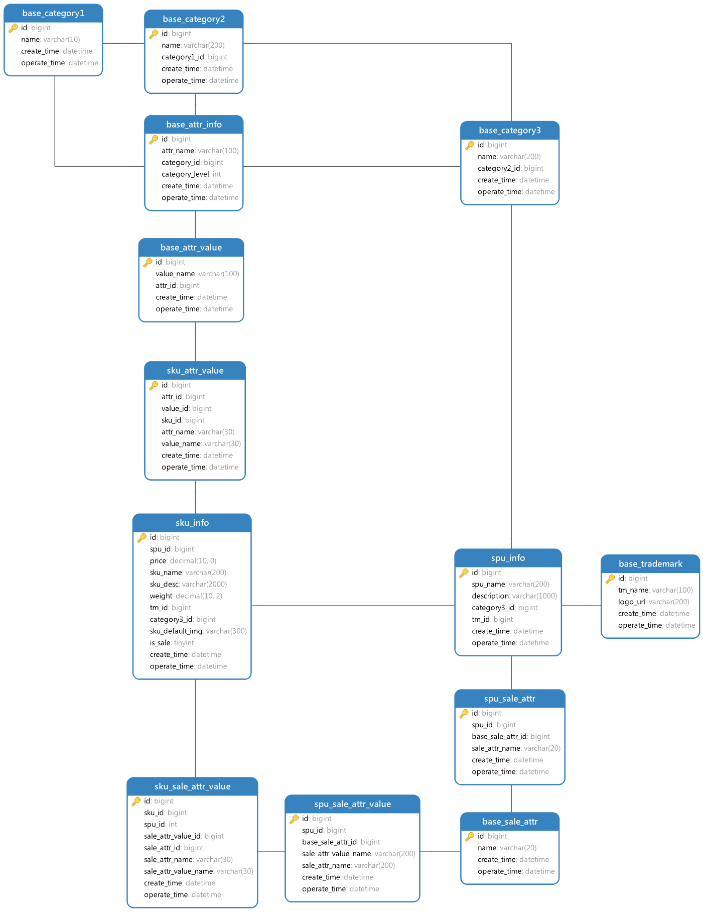
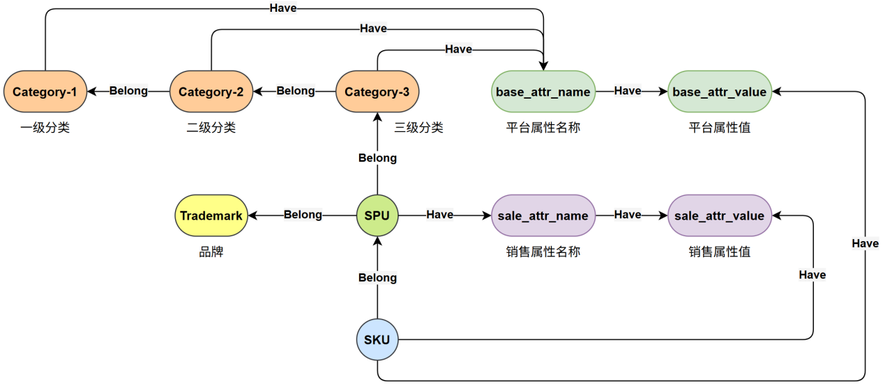
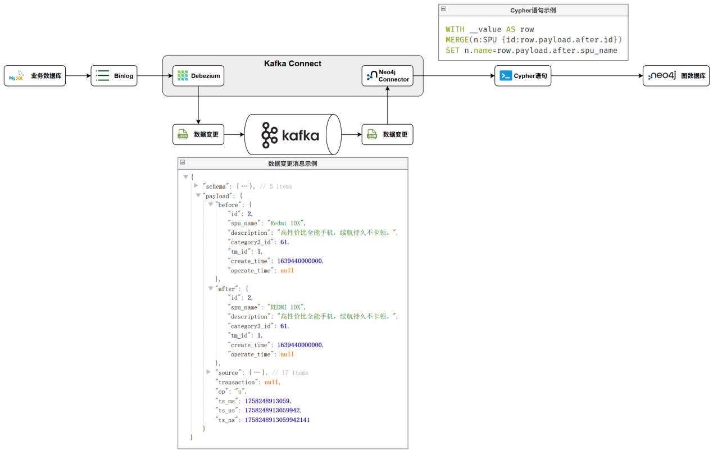
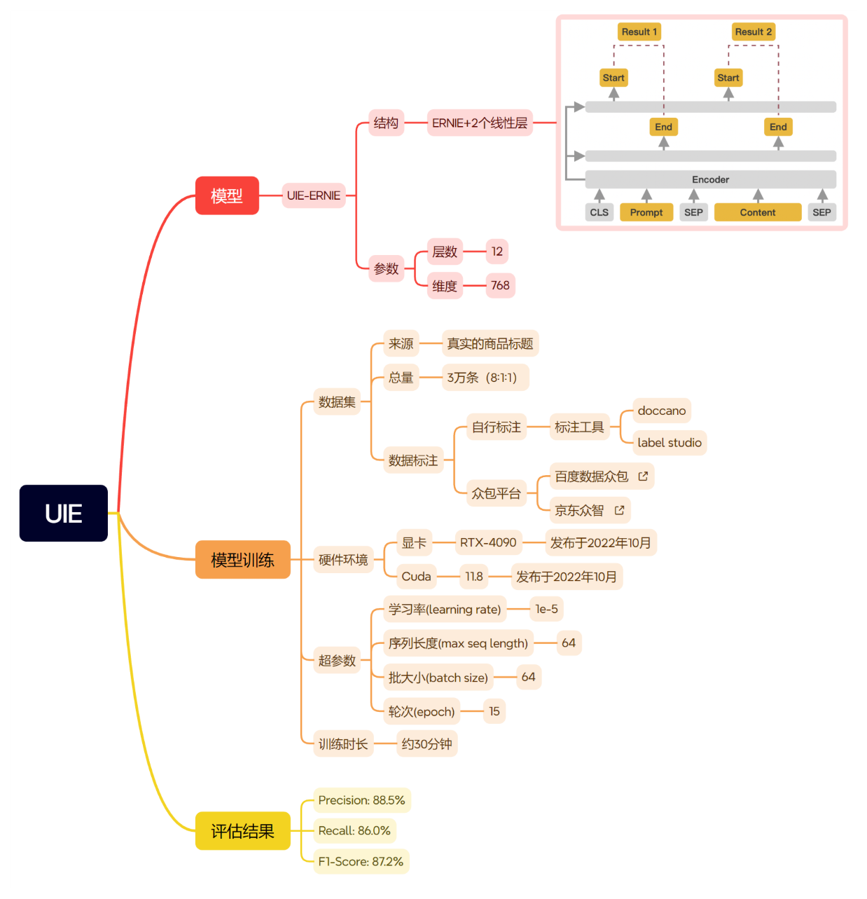

---
tags:
  - 大模型
  - 面试
source: "尚硅谷大模型技术之高频面试题-V2.1.6.docx"
source_blocks: "2936-3000"
reviewed: 2026-10-21
---

# 商品知识图谱的建模、实体与同步

先固定商品实体身份，再谈关系抽取和图查询。

前篇：[[知识点总结/80-资料与复习/81-面试知识库/08-大模型高频面试题/05-项目实战/14-GRPO与DAPO训练实验的复现设计|GRPO与DAPO训练实验的复现设计]] ｜ 后篇：[[知识点总结/80-资料与复习/81-面试知识库/08-大模型高频面试题/05-项目实战/16-Rasa 电商客服的任务对话与知识问答|Rasa 电商客服的任务对话与知识问答]]

## 深入理解（新增）

商品、SKU、品牌、品类和属性不能只靠名称连接。商品名会变，同名品牌可能存在歧义；主键应来自稳定业务标识，别名作为属性或独立映射，实体对齐记录来源与置信度。

MERGE 的模式必须围绕唯一键设计。把整条路径一次 MERGE，可能在局部实体已存在时创建意料之外的节点；应先匹配或合并节点，再合并关系，并配置与业务一致的唯一约束。

从数据库同步时记录事件版本和删除状态，重复消费需幂等。图中“有关联”不代表“因果有效”，推荐或问答都应验证实际任务收益。下面检索去重逻辑体现实体 ID 稳定的重要性，另附 Cypher 写入示例。


## 核心代码（新增）

以下是可在 CPU 运行的机制或业务契约示例，完整源码与测试见 [[知识点总结/80-资料与复习/81-面试知识库/08-大模型高频面试题/06-代码实验/01-核心代码实验与验证范围|核心代码实验与验证范围]]。示例不包含完整模型训练或外部平台部署。

```python
from collections import defaultdict

def rrf_fuse(rankings, constant=60):
    if constant <= 0:
        raise ValueError("constant must be positive")
    scores = defaultdict(float)
    for ranking in rankings:
        seen = set()
        for rank, doc_id in enumerate(ranking, start=1):
            if doc_id in seen:
                continue
            seen.add(doc_id)
            scores[doc_id] += 1 / (constant + rank)
    return sorted(scores.items(), key=lambda item: (-item[1], item[0]))

ranked = rrf_fuse([["sku-A", "sku-B"], ["sku-B", "sku-C"]])
assert ranked[0][0] == "sku-B"
```

### 图谱写入核心（Neo4j 模板）

以下模板依据 Neo4j 文档核验，未连接数据库执行。唯一键与来源版本需要由业务系统提供；语句可分别执行，参数通过驱动绑定。

```cypher
CREATE CONSTRAINT product_id_unique IF NOT EXISTS
FOR (p:Product) REQUIRE p.product_id IS UNIQUE;
CREATE CONSTRAINT brand_id_unique IF NOT EXISTS
FOR (b:Brand) REQUIRE b.brand_id IS UNIQUE;
```

```cypher
MERGE (p:Product {product_id: $product_id})
SET p.name = $product_name, p.version = $version
MERGE (b:Brand {brand_id: $brand_id})
SET b.name = $brand_name
MERGE (p)-[r:OF_BRAND]->(b)
SET r.source_id = $source_id, r.version = $version
RETURN p.product_id;
```

关系需要随删除、修订同步清理；上面的 MERGE 只展示幂等合并，不是完整版本迁移程序。

## 追问与验证（新增）

对同一 SKU 重复导入，再修改名称并下架，检查是否只保留一个实体且关系状态正确。

## 官方资料与论文

- [Neo4j MERGE 语义](https://neo4j.com/docs/cypher-manual/current/clauses/merge/)

核验日期：2026-10-21。链接中的 `stable`、`main` 或平台文档会继续变化；新增纯 Python/NumPy 实验与原文旧版框架代码已分开标注。

## 原文保留

> [!warning] 原文批注
> 实体名称不应直接作为全局唯一主键；图谱关系必须带来源或业务定义，不能将抽取结果直接视为事实。
>
> RRF 示例强调稳定实体 ID 与去重；图谱写入核心另见本节 Cypher 模板，尚未连接 Neo4j 实跑。
>
> 原文的团队人数、业务规模、效果百分比、硬件与成本均保留为教材案例陈述；本次未独立复现这些项目指标。

<!-- source-block:2936 -->
### 商品图谱项目（Neo4j）

<!-- source-block:2937 -->
#### 项目周期

<!-- source-block:2938 -->
- 2人团队，总计约2.5个月。

<!-- source-block:2939 -->
- 需求分析与架构设计2周

<!-- source-block:2940 -->
- 数据管道搭建与调试3周

<!-- source-block:2941 -->
- 实体抽取模块开发与测试2周

<!-- source-block:2942 -->
- 索引构建与应用层开发1周

<!-- source-block:2943 -->
- 部署与测试2周

<!-- source-block:2944 -->
#### 功能介绍

<!-- source-block:2945 -->
商品知识图谱基于Neo4j图数据库构建，包含SKU、SPU、品类、品牌以及各种属性信息。

<!-- source-block:2946 -->
数据的主要来源是业务数据库中的结构化数据，以及部分非结构化数据，实现了图谱与业务数据库数据的实时同步。

<!-- source-block:2947 -->
为方便上层应用，为图谱中的数据构建了全文索引和向量索引，以支持全文检索和语义检索。

<!-- source-block:2948 -->
完整架构如下图所示：

<!-- source-block:2949 -->


[原文嵌入附件：oleObject3.bin](../assets/原始附件/oleObject3.bin)

[原文嵌入附件：oleObject3.svg](../assets/原始附件/oleObject3.svg)

<!-- source-block:2950 -->
#### 实现流程

<!-- source-block:2951 -->
##### 数据建模

<!-- source-block:2952 -->
##### 业务数据库

<!-- source-block:2953 -->
业务数据库中的数据模型如下图所示：

<!-- source-block:2954 -->


<!-- source-block:2955 -->
模型原文件如下：

<!-- source-block:2956 -->


[原文嵌入附件：oleObject4.bin](../assets/原始附件/oleObject4.bin)

<!-- source-block:2957 -->
##### 图数据库

<!-- source-block:2958 -->
图数据库中的数据模型与业务数据库基本保持一致，如下图所示

<!-- source-block:2959 -->


<!-- source-block:2960 -->
##### 数据同步

<!-- source-block:2961 -->
为保证数据的时效性，搭建了一条数据的实时同步通道，如下图所示。

<!-- source-block:2962 -->


<!-- source-block:2963 -->
上述流程涉及到的组件有：

<!-- source-block:2964 -->
[Kafka](https://kafka.apache.org/)——消息队列，用于承载和传输Mysql的数据库变更事件。

<!-- source-block:2965 -->
[Debezium](https://debezium.io/)——监听 MySQL Binlog，实时捕获数据库的插入、更新、删除操作，并将变更数据写入 Kafka。

<!-- source-block:2966 -->
[Neo4j Kafka Connector](https://neo4j.ac.cn/docs/kafka/current/)——从 Kafka 消费变更数据并转换为 Cypher 语句，将变更数据实时写入 Neo4j 图数据库。

<!-- source-block:2967 -->
##### 实体抽取

<!-- source-block:2968 -->
因为有些商品在录入时，部分属性并未录入，而是直接包含在了商品标题中，所以我们就需要从商品标题中将这些属性抽取出来，以填补缺失的属性。

<!-- source-block:2969 -->
属性抽取使用的模型是百度开源的通用抽取模型——UIE，其基于ERNIE模型，并在ERNIE模型的基础上增加了两个线性层，一个用于预测实体的起始位置，一个用于预测结束位置。

<!-- source-block:2970 -->


<!-- source-block:2971 -->
ERNIE和BERT的结构类似，都是编码器模型。不同的是预训练方式，BERT在训练时是随机掩盖若干个独立的token，然后令模型预测这些token，而ERNIE在训练时不是掩盖单个Token，而是掩盖整个实体，这样模型就能学到更丰富的实体知识，所以其在实体抽取任务上更有优势。

<!-- source-block:2972 -->


<!-- source-block:2973 -->
##### 创建索引

<!-- source-block:2974 -->
为方便上层应用查询，创建了全文索引和向量索引。

<!-- source-block:2975 -->
##### 全文索引

<!-- source-block:2976 -->
全文索引的基本原理如下图所示：

<!-- source-block:2977 -->


<!-- source-block:2978 -->
##### 向量索引

<!-- source-block:2979 -->
Neo4j底层的向量索引算法为HNSW (Hierarchical Navigable Small World)，其原理图如下所示：

<!-- source-block:2980 -->


<!-- source-block:2981 -->
HNSW算法借鉴了如下算法：

<!-- source-block:2982 -->
NSW (Navigable Small World)

<!-- source-block:2983 -->


<!-- source-block:2984 -->
Skip List

<!-- source-block:2985 -->


<!-- source-block:2986 -->
#### 技术细节

<!-- source-block:2987 -->
##### 实体抽取模型

<!-- source-block:2988 -->
实体抽取采用百度开源的UIE模型，UIE支持零样本预测，但在我们实际的这个场景中，直接使用的效果不太理想，因此又对齐进行了微调。微调细节如下图所示：

<!-- source-block:2989 -->


<!-- source-block:2990 -->
##### Embedding模型

<!-- source-block:2991 -->
采用[BAAI/bge-small-zh-v1.5](https://huggingface.co/BAAI/bge-small-zh-v1.5)，向量维度为512。

<!-- source-block:2992 -->
#### 面试串讲

<!-- source-block:2993 -->
我们搭建这个商品知识图谱的初衷主要是为上层的AI应用提供数据支撑，比如智能客服、推荐系统等等。

<!-- source-block:2994 -->
这个图谱主要的数据来源是业务数据库中商品相关的表格，包括SKU、SPU、品类、品牌，以及各种属性表，这些大都是结构化的数据，除此之外，还有一些非结构化的数据，例如商品标题，因为有些商品在录入时，部分属性并未录入，而是直接包含在了商品标题中，所以我们就需要从商品标题中将这些属性抽取出来，以填补缺失的属性。

<!-- source-block:2995 -->
下面我先介绍一下数据通道，我们的业务数据库是Mysql，图谱用的是Neo4j，为了保证图谱数据的时效性，我们设计并搭建了一条实时的数据同步通道。

<!-- source-block:2996 -->
首先使用Debezium监听MySql的Binlog，从而获取变更数据，Debezium会将变更数据写入Kafka消息队列中。然后我们又使用了Neo4j官方提供的一个Kafka Connector，它可以实时消费Kafka中的变更数据，只要有新的变更数据，它就会执行我们指定的Cypher语句，将变更数据写入Neo4j，从而完成Neo4j与MySql数据的实时同步。

<!-- source-block:2997 -->
然后我再重点介绍一下同步过程中的实体抽取，这个实体抽取主要是从商品标题中抽取特定的属性，这里我们使用了百度开源的一个通用信息抽取模型，叫做UIE，这个模型以百度自家的ERNIE预训练模型作为基础。ERNIE和BERT的结构类似，都是编码器模型。但它们的预训练方式不一样：BERT在训练时是随机掩盖若干个独立的token，然后令模型预测这些token，而ERNIE在训练时不是掩盖单个Token，而是掩盖整个实体，这样模型就能学到更丰富的实体知识，所以其在实体抽取任务上更有优势。

<!-- source-block:2998 -->
然后UIE在ERNIE的基础之上，又使用了两个线性层，一个线性层用于预测实体的起始位置，另一个线性层用于预测结束位置。在推理时，根据起始位置和结束位置就能截取到实体信息了。UIE支持零样本预测，但在我们实际的这个场景中，直接使用的效果不太理想。所以我们人工标注了大约3万条数据，对模型进行了微调。调优之后，F1值达到了88%，基本满足了我们业务上的要求。

<!-- source-block:2999 -->
最后，数据进入Neo4j之后，为了支持上层复杂查询，我们给图谱建立了两种索引：一个是全文索引，主要用于关键词检索；另一个是向量索引，用于语义相似度查询，当然，建立向量索引需要先有向量，这里我们使用的Embedding模型是BGE，这是一个开箱即用的高质量Embedding模型，不需要微调就能有很好的效果。

<!-- source-block:3000 -->
以上就是这个图谱项目的全部内容。
