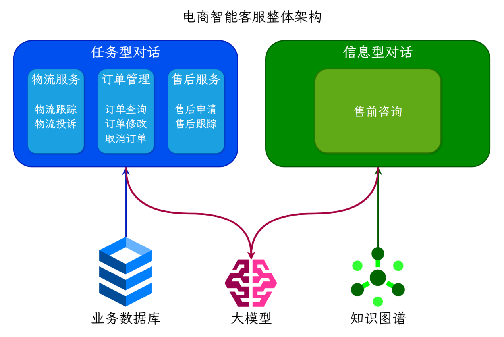
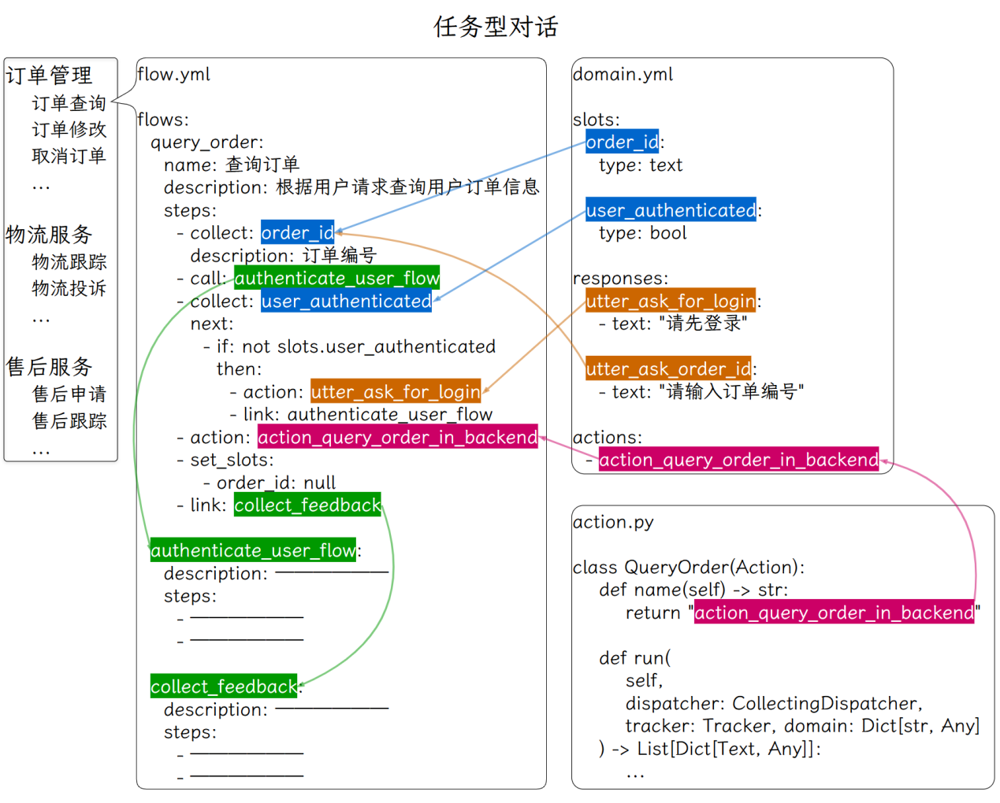

---
tags:
  - 大模型
  - 面试
source: "尚硅谷大模型技术之高频面试题-V2.1.6.docx"
source_blocks: "3001-3125"
reviewed: 2026-10-21
---

# Rasa 电商客服的任务对话与知识问答

任务对话优先保证槽位、状态与动作执行的一致性。

前篇：[[知识点总结/80-资料与复习/81-面试知识库/08-大模型高频面试题/05-项目实战/15-商品知识图谱的建模、实体与同步|商品知识图谱的建模、实体与同步]] ｜ 后篇：[[知识点总结/80-资料与复习/81-面试知识库/08-大模型高频面试题/05-项目实战/17-电商客服的面试追问与指标核验|电商客服的面试追问与指标核验]]

## 深入理解（新增）

意图分类识别用户希望做什么，槽位保存需要的参数，表单负责收集缺失信息，自定义 action 调用业务服务。知识问答则依赖证据检索，两类路径的成功判据不同。

“查订单”和“修改订单”可能共享订单号，却需要不同授权和确认。槽位来自用户输入时仍需业务校验，校验失败不能继续执行；切换任务还要定义槽位清空或保留策略，防止旧订单号泄漏到新任务。

原文 Rasa 项目作为历史实现保留；新增代码展示业务契约而不绑定旧版 SDK。迁移到其他编排框架时，只替换路由和状态实现，动作权限、幂等与验证集仍需保留。


## 核心代码（新增）

以下是可在 CPU 运行的机制或业务契约示例，完整源码与测试见 [[知识点总结/80-资料与复习/81-面试知识库/08-大模型高频面试题/06-代码实验/01-核心代码实验与验证范围|核心代码实验与验证范围]]。示例不包含完整模型训练或外部平台部署。

```python
import json

def validate_tool_call(payload):
    data = json.loads(payload)
    if not isinstance(data, dict) or set(data) != {"tool", "args"}:
        raise ValueError("invalid envelope")
    if data["tool"] != "get_order" or not isinstance(data["args"], dict):
        raise ValueError("tool not allowed")
    order_id = data["args"].get("order_id")
    if set(data["args"]) != {"order_id"} or not isinstance(order_id, str) or not order_id.isdecimal():
        raise ValueError("invalid order_id")
    return data

def route_customer_request(intent, slots, confirmed=False):
    if intent not in {"knowledge", "order_status", "cancel_order"}:
        return {"next": "clarify", "missing": ["intent"]}
    if intent == "knowledge":
        return {"next": "retrieve"}
    order_id = slots.get("order_id")
    if not isinstance(order_id, str) or not order_id.isdecimal():
        return {"next": "clarify", "missing": ["order_id"]}
    if intent == "cancel_order" and not confirmed:
        return {"next": "confirm", "order_id": order_id}
    # The execution service must still enforce identity, ownership and idempotency.
    return {"next": "execute", "tool": intent, "order_id": order_id}

call = validate_tool_call(
    '{"tool":"get_order","args":{"order_id":"123"}}')
assert call["args"]["order_id"] == "123"
# 接下来由执行服务核验调用者身份与订单归属；此函数未实现授权。

next_step = route_customer_request("cancel_order", {"order_id":"123"})
assert next_step["next"] == "confirm"
```

## 追问与验证（新增）

先查询订单 A，再切到订单 B 的售后流程，检查槽位是否正确更新，工具是否仍误用订单 A。

## 官方资料与论文

- [Rasa 3.x 官方表单示例](https://github.com/RasaHQ/rasa-3.x-form-examples)
- [LangGraph 工作流](https://docs.langchain.com/oss/python/langgraph/overview)

核验日期：2026-10-21。链接中的 `stable`、`main` 或平台文档会继续变化；新增纯 Python/NumPy 实验与原文旧版框架代码已分开标注。

## 原文保留

> [!warning] 原文批注
> Rasa 旧版表单与当前产品文档应分开核验；原文接口保留作资料，不默认适用于任意当前版本。
>
> 原文的团队人数、业务规模、效果百分比、硬件与成本均保留为教材案例陈述；本次未独立复现这些项目指标。

<!-- source-block:3001 -->
### 电商智能客服项目（Rasa Pro）

<!-- source-block:3002 -->
#### 项目周期

<!-- source-block:3003 -->
- 2人团队，总计约5.5个月。

<!-- source-block:3004 -->
- 需求分析与技术选型2周

<!-- source-block:3005 -->
- 环境搭建与熟悉框架3周

<!-- source-block:3006 -->
- 基础任务流开发与集成4周

<!-- source-block:3007 -->
- 测试与部署2周

<!-- source-block:3008 -->
- GraphRAG流程开发1周

<!-- source-block:3009 -->
- 集成与调试2周

<!-- source-block:3010 -->
- LLM微调数据准备2周

<!-- source-block:3011 -->
- LLM微调与评估1周

<!-- source-block:3012 -->
- 模型部署与测试2周

<!-- source-block:3013 -->
- 更多任务流扩展4周

<!-- source-block:3014 -->
#### 功能介绍

<!-- source-block:3015 -->
基于Rasa Pro框架结合LLM和知识图谱构建的智能电商客服系统，主要有以下功能：

<!-- source-block:3016 -->
提供任务型对话，根据预设流程进行对话，通过多轮对话交互帮助用户完成特定任务，如物流、订单、售后相关业务流程等。

<!-- source-block:3017 -->
提供知识库问答对话，基于知识图谱和GraphRAG，支持售前产品咨询的复杂问题和多跳推理。

<!-- source-block:3018 -->
支持意外对话修复和闲聊，接入LLM支持用户的非业务对话，并对回复内容做出严肃限制，避免涉及敏感内容的回复。

<!-- source-block:3019 -->
#### 实现流程

<!-- source-block:3020 -->
##### 调用流程

<!-- source-block:3021 -->
部署服务：Rasa Pro + LLM（vllm部署） + 知识图谱（neo4j）+ Embedding模型（fastapi+uvicorn）

<!-- source-block:3022 -->
后端服务：Rasa提供restful接口，供前端调用。

<!-- source-block:3023 -->
前端服务：公司自研web、app，调用后端服务。

<!-- source-block:3024 -->
##### 实现流程

<!-- source-block:3025 -->


<!-- source-block:3026 -->
用户query

<!-- source-block:3027 -->
=》Rasa对话理解（读取tracker store，调用LLM）

<!-- source-block:3028 -->
=》Rasa对话管理器（执行flow或者pattern）

<!-- source-block:3029 -->
-》匹配到flow，执行flow和对应的action，返回结果

<!-- source-block:3030 -->
-》未匹配到flow，执行pattern\_search -&gt; 执行企业搜索策略 -&gt; 调用GraphRAG

<!-- source-block:3031 -->
-》标签路由：LLM识别问题涉及的节点类型和实体

<!-- source-block:3032 -->
-》节点检索：使用混合检索找到候选入口节点

<!-- source-block:3033 -->
-》Cypher生成：LLM根据入口节点和问题生成Cypher查询语句

<!-- source-block:3034 -->
-》语句验证：验证Cypher语句的正确性

<!-- source-block:3035 -->
-》语句校正：如有错误则进行校正

<!-- source-block:3036 -->
-》执行查询：在Neo4j中执行Cypher查询

<!-- source-block:3037 -->
-》返回结果：将查询结果返回

<!-- source-block:3038 -->
-》pattern\_search无结果-》最终回退到pattern-chat闲聊

<!-- source-block:3039 -->
-》更新tracker store：添加新对话、更新slot等

<!-- source-block:3040 -->
=》Rasa NLG：将结果输入到LLM上下文，由LLM生成回复

<!-- source-block:3041 -->
#### 技术细节

<!-- source-block:3042 -->
##### Rasa Pro框架介绍

<!-- source-block:3043 -->


<!-- source-block:3044 -->
**CALM由三部分组成：对话理解、对话管理、响应生成**

<!-- source-block:3045 -->
**对话理解**

<!-- source-block:3046 -->
当用户发送消息时，LLM命令生成器从tracker store读取完整对话记录与已收集的信息，调用LLM，识别用户意图、提取槽位，并生成下一步的命令列表，发送给对话管理器。

<!-- source-block:3047 -->
这里prompt的内容包括：

<!-- source-block:3048 -->
① 任务描述

<!-- source-block:3049 -->
② 可用的Flows和Slots（开启流程检索，只放匹配度高的几个流程）

<!-- source-block:3050 -->
③ 可用操作：start flow、set slot、search and reply等

<!-- source-block:3051 -->
④ 通用指令：指令+描述

<!-- source-block:3052 -->
⑤ 决策规则表：满足xx条件，触发xx指令=》生成xx命令

<!-- source-block:3053 -->
⑥ 当前状态：活跃的flow、当前请求的slot和已填充的slots等

<!-- source-block:3054 -->
⑦ 对话历史

<!-- source-block:3055 -->
⑧ 要求生成最新命令序列

<!-- source-block:3056 -->
这里使用的SearchReadyLLMCommandGenerator，可以触发RAG。

<!-- source-block:3057 -->
**对话管理**

<!-- source-block:3058 -->
对话管理器接收命令序列，采取下一步操作：

<!-- source-block:3059 -->
启动、停止或回复流程

<!-- source-block:3060 -->
对话模式流程处理意外交互

<!-- source-block:3061 -->
执行企业搜索RAG

<!-- source-block:3062 -->
收集信息

<!-- source-block:3063 -->
触发action

<!-- source-block:3064 -->
**响应生成**

<!-- source-block:3065 -->
利用上下文响应重述器，生成自然的回复，提高对话的流程性和连贯性。

<!-- source-block:3066 -->
这里配置了LLM进行对执行结果的重述响应。

<!-- source-block:3067 -->
**Rasa构建AI助手流程**

<!-- source-block:3068 -->
**配置rasa：pipeline、policy、endpoint等**

<!-- source-block:3069 -->
**根据业务设计和用户行为设计流程。**

<!-- source-block:3070 -->
**编写流程中设计的槽位、响应、动作等。**

<!-- source-block:3071 -->
自定义动作通过继承Action类并重写run方法来实现，可以调用外部API，查询数据库或执行其他逻辑。

<!-- source-block:3072 -->
槽位和对话历史会自动存储在track store中。

<!-- source-block:3073 -->
**训练并调试助手。在调试过程中将对话保存为端到端测试示例。**

<!-- source-block:3074 -->
**微调小型语言模型用于执行命令生成任务。将其部署并集成到Rasa中。**

<!-- source-block:3075 -->
##### 任务型对话

<!-- source-block:3076 -->


<!-- source-block:3077 -->
在流程中定义一个业务操作的各个步骤。

<!-- source-block:3078 -->
通过槽位存储操作过程中所需的信息。

<!-- source-block:3079 -->
通过定义响应来引导LLM如何回复用户。

<!-- source-block:3080 -->
通过编写自定义动作来调用外部API，查询或操作业务数据库，来获取业务相关信息或执行用户操作。

<!-- source-block:3081 -->
##### 信息型对话

<!-- source-block:3082 -->
结合知识图谱与GraphRAG，支持复杂的商品搜索、推荐、知识问答等功能。

<!-- source-block:3083 -->
##### 生成“命令生成模型”的微调数据

<!-- source-block:3084 -->


<!-- source-block:3085 -->
准备覆盖重要对话流程的端到端测试数据，执行rasa命令生成微调数据集。

<!-- source-block:3086 -->
##### 命令生成模型微调与部署

<!-- source-block:3087 -->
##### 数据集

<!-- source-block:3088 -->
由Rasa合成数据模块生成，覆盖高频步骤路径与边界场景（如模糊意图、多意图、口语化表达等）。

<!-- source-block:3089 -->
共计约1万条样本，按8：2划分训练集和验证集。

<!-- source-block:3090 -->
训练集：8000条左右。

<!-- source-block:3091 -->
验证集：2000条左右。

<!-- source-block:3092 -->
##### 模型训练

<!-- source-block:3093 -->
| 预训练模型 | Qwen3-8B |  |  |
| --- | --- | --- | --- |
| 超参数 | 最大序列长度 | 4096 |  |
| 训练轮次 | 3 |  |  |
| LoRA | 秩r | 16 |  |
| 目标模块 | 注意力和MLP部分 |  |  |
| 缩放系数α | 16，与r相等 |  |  |
| Dropout概率 | 0 |  |  |
| 不微调bias |  |  |  |
| 不使用秩稳定LoRA |  |  |  |
| 优化器 | 8bit-AdamW |  |  |
| 学习率 | 2e-4 |  |  |
| 权重衰减 | 0.01 |  |  |
| 每设备训练批次大小 | 2 |  |  |
| 梯度累计步数 | 8 |  |  |
| 每设备验证批次大小 | 4 |  |  |
| 训练多少步后验证一次 | 50 |  |  |
| 训练策略 | 量化 | 4bit |  |
| 启用梯度检查点以节省显存 |  |  |  |
| 精度配置 | 优先bf16，如果不支持bf16则使用fp16 |  |  |
| 学习率预热 | 总步数的5% |  |  |
| 学习率衰减 | 余弦衰减 |  |  |
| 训练环境 | 设备 | V100 32G单卡 |  |
| 框架 | Unsloth+Transformers |  |  |
| 训练时长 | 3小时（训练2小时+验证1小时） |  |  |
| 训练结果 | 初始损失值 | 2.4 |  |
| 最终验证集损失值 | 1.0 |  |  |
| 模型部署 | vllm部署 |  |  |
| 最大序列长度 | 4096 |  |  |
| 显存占用 | 20G左右（V100，不量化） |  |  |

<!-- source-block:3094 -->


<!-- source-block:3095 -->
##### 信息型对话（GraphRAG）

<!-- source-block:3096 -->
LLM根据Prompt从用户输入中提取入口节点实体和其对应的类型。

<!-- source-block:3097 -->
获取入口节点实体和标签之后，使用混合检索从Neo4j中检索出若干候选入口节点。

<!-- source-block:3098 -->


<!-- source-block:3099 -->
LLM根据用户输入、候选入口节点、Neo4j的schema信息，生成Cypher查询语句。

<!-- source-block:3100 -->
将生成的Cypher语句交给LLM进行验证，返回Cypher中的存在的语法与逻辑错误。

<!-- source-block:3101 -->
LLM根据验证出的错误信息对Cypher进行修正，得到最终的Cypher语句。

<!-- source-block:3102 -->
执行查询语句，将查询结果返回LLM作为上下文参考。

<!-- source-block:3103 -->
LLM根据用户输入和上下文参考生成回复。

<!-- source-block:3104 -->


<!-- source-block:3105 -->
#### 项目总结

<!-- source-block:3106 -->
该项目实现了基于Rasa Pro框架的智能电商客服系统，集成了大语言模型、任务型对话流程管理、知识图谱和GraphRAG。

<!-- source-block:3107 -->
能够自动化处理售前咨询、订单管理、物流查询、售后服务等核心业务场景，提供高效的客户服务解决方案。

<!-- source-block:3108 -->
项目主要包含任务型对话部分和信息型对话部分，支持闲聊。

<!-- source-block:3109 -->
任务型对话针对结构化的目标导向任务，如查询订单或修改地址，通过预定义流程管理输入输出。

<!-- source-block:3110 -->
信息型对话则集成RAG和GraphRAG，利用外部知识库响应用户问题，如商品搜索和推荐。

<!-- source-block:3111 -->
首先我们使用Rasa Pro框架构建AI助手，基于CALM（对话理解、管理、响应生成）设计流程。

<!-- source-block:3112 -->
在对话理解中，采用SearchReadyLLMCommandGenerator，根据prompt将用户消息转换为命令。多轮对话的对话历史、槽位信息由tracker store存储和更新。

<!-- source-block:3113 -->
prompt包括当前状态、对话历史、可用流程/槽位/动作、可用操作、决策规则等。

<!-- source-block:3114 -->
对话管理接收命令执行操作，如路由流程、收集信息、执行动作、或处理意外交互，通过对话模式（如修复、导航、外部支持）处理非线性对话。

<!-- source-block:3115 -->
响应生成利用上下文重述器生成自然回复。

<!-- source-block:3116 -->
构建流程时，在YAML文件中定义流程ID、描述和步骤，包括收集信息、执行动作、设置槽位等；编写槽位存储信息、响应引导回复、自定义动作调用外部API或数据库。

<!-- source-block:3117 -->
为优化命令生成并提高响应速度，我们准备了端到端测试数据，使用Rasa命令标注模块提取命令，合成数据生成模块创建重述版本，最终生成微调数据集。

<!-- source-block:3118 -->
数据集覆盖高频路径和边界场景，共计约1万条样本，训练集8000条、验证集2000条。

<!-- source-block:3119 -->
预训练模型选择Qwen3-8B，采用LoRA微调。训练时使用4bit量化、梯度检查点、bf16精度。每设备训练批次大小2，梯度累计步数8；使用Unsloth在V100单卡上训练。

<!-- source-block:3120 -->
之后使用vllm部署模型，最大序列长度4096。

<!-- source-block:3121 -->
对于信息型对话我们结合了知识图谱和GraphRAG。

<!-- source-block:3122 -->
LLM从用户输入提取入口节点实体和类型，使用混合检索从Neo4j中获取候选节点。

<!-- source-block:3123 -->
根据用户输入、候选节点和schema生成Cypher查询语句，之后LLM验证并修正语法逻辑错误。

<!-- source-block:3124 -->
得到修正后的Cypher语句后执行查询，将结果作为上下文参考生成回复。

<!-- source-block:3125 -->
结合任务型对话和信息型对话功能，最终实现了支持多场景的AI助手，可满足不同业务的需求。
