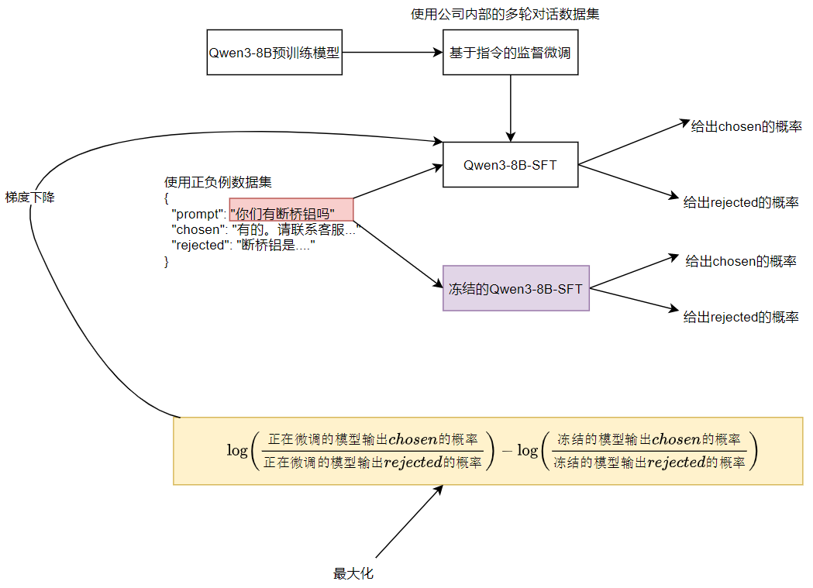

---
tags:
  - 大模型
  - 面试
source: "尚硅谷大模型技术之高频面试题-V2.1.6.docx"
source_blocks: "3186-3275"
reviewed: 2026-10-21
---

# 闲聊DPO的偏好构造与效果退化

偏好数据必须比较同一问题下的回答，且偏好标准应稳定。

前篇：[[知识点总结/80-资料与复习/81-面试知识库/08-大模型高频面试题/05-项目实战/17-电商客服的面试追问与指标核验|电商客服的面试追问与指标核验]] ｜ 后篇：[[知识点总结/80-资料与复习/81-面试知识库/08-大模型高频面试题/05-项目实战/19-教育知识图谱的关系设计与版本|教育知识图谱的关系设计与版本]]

## 深入理解（新增）

chosen 与 rejected 需要共享 prompt，并按同样模板计算回答 log probability。不同长度会改变序列对数概率总和的分布，长度偏差应通过数据设计和明确目标处理，不能事后随意改成平均概率。

偏好标注应说明看重事实、帮助程度、语气还是安全边界。若 rejected 只是明显乱码，模型可能只学会格式区分；应包含接近但有关键错误的难负例，同时检查标注一致性。

训练后观察隐式奖励间隔、KL、长度和独立任务集。chosen 奖励下降而间隔增加可能仍降低 DPO loss，不能只凭单条曲线判断失败；过度偏好优化也可能损伤原有能力。


## 核心代码（新增）

以下是可在 CPU 运行的机制或业务契约示例，完整源码与测试见 [[知识点总结/80-资料与复习/81-面试知识库/08-大模型高频面试题/06-代码实验/01-核心代码实验与验证范围|核心代码实验与验证范围]]。示例不包含完整模型训练或外部平台部署。

```python
import numpy as np

def dpo_loss(chosen_logp, rejected_logp, ref_chosen_logp, ref_rejected_logp, beta=0.1):
    margin = beta * ((chosen_logp - rejected_logp) - (ref_chosen_logp - ref_rejected_logp))
    return float(np.logaddexp(0.0, -margin).mean())

base = dpo_loss(np.array([-2.]), np.array([-2.]),
                np.array([-2.]), np.array([-2.]))
better = dpo_loss(np.array([-1.]), np.array([-3.]),
                  np.array([-2.]), np.array([-2.]))
assert better < base
```

## 追问与验证（新增）

保持参考概率不变，同时降低 chosen 和 rejected 概率但扩大二者间隔，观察 loss，解释绝对奖励与相对目标的区别。

## 官方资料与论文

- [Direct Preference Optimization](https://arxiv.org/abs/2305.18290)
- [TRL DPOTrainer](https://huggingface.co/docs/trl/dpo_trainer)

核验日期：2026-10-21。链接中的 `stable`、`main` 或平台文档会继续变化；新增纯 Python/NumPy 实验与原文旧版框架代码已分开标注。

## 原文保留

> [!warning] 原文批注
> DPO 判断依据是相对参考模型的偏好间隔及独立生成质量，不是 chosen 隐式奖励必须单调上升。
>
> 原文的团队人数、业务规模、效果百分比、硬件与成本均保留为教材案例陈述；本次未独立复现这些项目指标。

<!-- source-block:3186 -->
### 电商智能客服闲聊项目（DPO）

<!-- source-block:3187 -->
#### 项目周期

<!-- source-block:3188 -->
- 1人团队，总计约2个月。

<!-- source-block:3189 -->
- 需求分析与数据审计2周

<!-- source-block:3190 -->
- 环境搭建与STF阶段2周

<!-- source-block:3191 -->
- DPO算法实现与调试2周

<!-- source-block:3192 -->
- 评估测试与迭代1周

<!-- source-block:3193 -->
- 模型部署与集成1周

<!-- source-block:3194 -->
#### 功能介绍

<!-- source-block:3195 -->
本项目的目标是：在电商客服场景中，让大模型输出更符合用户和业务需求的客服回复。

<!-- source-block:3196 -->
具体应用场景为：

<!-- source-block:3197 -->
**任务型对话：帮助用户完成物流查询、订单跟踪、售后处理等流程**

<!-- source-block:3198 -->
**知识库问答：基于知识图谱和GraphRAG，回答复杂的售前咨询**

<!-- source-block:3199 -->
**闲聊与修复：在非业务场景下保持自然对话，但避免涉及敏感内容**

<!-- source-block:3200 -->
为实现这一目标，我们基于 Qwen3-8B 模型，采用监督微调 (SFT) 和 DPO 算法，使模型学会在多轮对话中输出 更贴近客户偏好的回复。

<!-- source-block:3201 -->
#### 实现流程

<!-- source-block:3202 -->
##### 选择底座模型

<!-- source-block:3203 -->
使用 Qwen3-8B 作为基础大模型

<!-- source-block:3204 -->
##### 监督微调（SFT）

<!-- source-block:3205 -->
数据集：公司内部客服多轮对话数据集

<!-- source-block:3206 -->
策略：只针对 回答部分 计算损失

<!-- source-block:3207 -->
目标：让模型具备客服多轮对话的基础能力

<!-- source-block:3208 -->
##### DPO微调

<!-- source-block:3209 -->
数据集：公司内部标注对话数据（包含正负例回复）

<!-- source-block:3210 -->
策略：只对回答部分计算损失

<!-- source-block:3211 -->
算法：实现 Direct Preference Optimization (DPO)

<!-- source-block:3212 -->
目标：让模型学习客户偏好，生成更符合预期的回答

<!-- source-block:3213 -->
##### 工程实现

<!-- source-block:3214 -->
在工程实现中，我们采用Hugging Face TRL库来构建DPO训练流程。TRL提供了稳定的训练基础设施，同时允许我们在其框架内扩展或重写损失函数，从而实现高度可控的训练逻辑，并便于在实验中进行不同损失函数的对比研究。

<!-- source-block:3215 -->
#### 技术细节

<!-- source-block:3216 -->
##### SFT阶段

<!-- source-block:3217 -->
**模型结构：Qwen3-8B**

<!-- source-block:3218 -->
**数据集：内部多轮客服对话（约50万轮）**

<!-- source-block:3219 -->
**训练策略：只对客服回答部分计算损失，避免将用户输入当作监督信号**

<!-- source-block:3220 -->
**超参数**

<!-- source-block:3221 -->
- 批次大小：128

<!-- source-block:3222 -->
- 学习率：2e-5

<!-- source-block:3223 -->
- 训练轮数：1 epoch

<!-- source-block:3224 -->
- 优化器：AdamW

<!-- source-block:3225 -->
- 学习率调度：5%线性预热+余弦退火

<!-- source-block:3226 -->
- 训练环境：1×A800 80GB，耗时约2小时

<!-- source-block:3227 -->
##### DPO阶段

<!-- source-block:3228 -->
**数据集：内部标注的客服对话（包含正负例回答，约10万对）**

<!-- source-block:3229 -->
**模型结构：Qwen3-8B -SFT**

<!-- source-block:3230 -->
**算法实现：**

<!-- source-block:3231 -->
输入相同上下文，包含preferred回答（正例）和rejected回答（负例）

<!-- source-block:3232 -->
使用DPO公式计算loss，只对回答部分的token计算损失

<!-- source-block:3233 -->
**超参数**

<!-- source-block:3234 -->
- 批次大小：32

<!-- source-block:3235 -->
- 学习率：1e-5

<!-- source-block:3236 -->
- 训练轮数：1 epoch

<!-- source-block:3237 -->
- β值：0.1

<!-- source-block:3238 -->
**训练环境：2×A800 80GB，耗时3小时**

<!-- source-block:3239 -->
#### 总结

<!-- source-block:3240 -->


<!-- source-block:3241 -->
本项目面向 电商客服系统，在 Qwen3-8B 模型基础上，结合公司内部客服多轮对话数据与偏好标注数据，完成了 SFT + DPO 微调。

<!-- source-block:3242 -->
**SFT：让模型具备客服场景下的多轮对话能力**

<!-- source-block:3243 -->
**DPO：通过正负例偏好学习，让模型更贴近客户需求，减少不合适或冷漠的回复**

<!-- source-block:3244 -->
**工程实现：依托TRL的DPOTrainer作为核心训练框架。借助TRL的可扩展接口，我们可以重写默认的DPO loss，或在训练过程中动态切换不同的损失函数。**

<!-- source-block:3245 -->
最终效果：在电商客服场景下，模型能够输出 更加自然、符合客户偏好且业务安全的回复，在任务型、知识库问答和闲聊场景中均表现稳定。

<!-- source-block:3246 -->
#### 项目串讲

<!-- source-block:3247 -->
我们的业务目标是优化电商客服系统，让模型能在多轮对话中生成更符合客户需求的回答。

<!-- source-block:3248 -->
我们选择了 Qwen3-8B 作为底座模型，首先利用公司内部的多轮客服对话数据集进行了监督微调。在这个阶段，我们只针对回答部分计算损失，避免训练过程中把用户输入也当作监督信号，这样得到的 Qwen3-8B -SFT 模型具备了客服多轮对话的基础能力。

<!-- source-block:3249 -->
接下来，我们使用公司内部标注的对话数据，这些数据包含正负例回答。我们通过 DPO 算法，在训练时同样只针对回答部分计算损失。DPO的原理是比较正例和负例回答的对数概率差异，再结合参考模型的对比，最终优化生成结果，让模型更贴近客户的偏好。

<!-- source-block:3250 -->
在工程上，我们采用TRL库来构建DPO训练流程，在保证基础设施稳定的同时，还可以借助TRL的可扩展接口，重写默认的DPO Loss，或在训练过程中切换不同的损失函数，快速对比多种偏好优化策略。

<!-- source-block:3251 -->
最终效果是：在电商客服场景中，无论是任务型对话、知识库问答还是闲聊修复，模型的回复都更自然、更符合客户预期，并且能够避免出现敏感或不合适的内容。

<!-- source-block:3252 -->
#### 疑难解析

<!-- source-block:3253 -->
##### 为什么要使用DPO训练

<!-- source-block:3254 -->
之前训练的模型的回复效果并不理想，虽然能够一定程度上基于规则进行拒答，但仍会出现复杂敏感词遗漏，回复质量不高（例如情绪倾向不好、对话延伸性不强、机械化回复）。当出现任务流匹配错误等情况下，回复质量会明显下降。

<!-- source-block:3255 -->
这里使用强化学习的目标，是为了学习生成人类更能接受的回复的策略，这与模型微调的训练目的并不一样。

<!-- source-block:3256 -->
##### SFT与DPO训练目标的区别，SFT+DPO训练方式的优点

<!-- source-block:3257 -->
训练目标不同，SFT让模型学会模仿人类示例，DPO优化模型输出、使学习更符合人类偏好的回答。SFT并非必须，但是进行会使得模型性能更为稳定，DPO训练更为平稳。SFT可以很好的保障模型的基本能力，避免DPO过度偏离。DPO通常训练数据量较少，SFT可以提供大量基础数据，并且有效避免模型过度追求奖励。

<!-- source-block:3258 -->
##### DPO损失函数中β的作用，如何取到散度的作用

<!-- source-block:3259 -->
β是超参数，用来控制KL惩罚强度。KL散度确保微调策略模型不会偏离基础模型太远，KL 散度正则项是对新策略与旧策略的分布差距进行惩罚项，作用是约束策略更新幅度，防止过度偏离基础模型或训练前策略，从而保证训练稳定性和生成安全性。

<!-- source-block:3260 -->
β越大，更新越保守，探索性弱。β越小，更新则更为激进，但风险也会更大。

<!-- source-block:3261 -->
##### 数据集如何构建、正负例的构建方法

<!-- source-block:3262 -->
数据集中会由业务提供一部分基础数据，之后进行筛选一部分高质量数据，并收集可靠的用户query集合，对于这些query，会由人工撰写一部分高质量回复，也会使用多个模型生成多候选答案，选择最符合偏好的作为正例。负例则多是由构建正例时，淘汰的数据构成，也可直接使用大模型进行数据增强。

<!-- source-block:3263 -->
##### DPO、PPO、GRPO

<!-- source-block:3264 -->
**DPO（Direct Preference Optimization）**

<!-- source-block:3265 -->
直接优化偏好，绕开 RLHF 中复杂的策略梯度采样，直接用正负例比较来微调模型。进行对比式学习，而不是直接最大化 reward。

<!-- source-block:3266 -->
**PPO（Proximal Policy Optimization）**

<!-- source-block:3267 -->
标准的强化学习，策略优化+收敛稳定，PPO通过KL散度、clip等，限制策略更新幅度，避免过度偏离旧策略。允许模型通过RL最大化任意 reward 信号，进行策略更新。

<!-- source-block:3268 -->
**GRPO（Group Relative Policy Optimization）**

<!-- source-block:3269 -->
对于每个prompt生成候选输出组，在组内计算相对优势来更新策略。优点在于不依赖价值网络，通过组内相对优势进行计算，提高候选区分能力，并且由于每生成一条回复都会先进行模型参数更新，再生成下一次输出，是一种模型参数动态更新方式。

<!-- source-block:3270 -->
##### DPO的优势

<!-- source-block:3271 -->
在强化学习算法中，DPO无需采样策略梯度，训练更稳定、易收敛。

<!-- source-block:3272 -->
##### 强化学习训练中，是否出现模型性能倒退的情况

<!-- source-block:3273 -->
性能倒退通常会表现为任务准确率下降、输出质量下降、奖励上升但业务指标下降、生成模板化回复。这是由于奖励模型不完备、学习梯度过大、缺乏模型训练策略约束、模型过优化。缓解方式通常是增加数据多样性、奖励模型性能、防过拟化训练策略。

<!-- source-block:3274 -->
##### 奖励模型通常如何设计的

<!-- source-block:3275 -->
奖励模型直接决定策略模型的性能，通常会由一个神经网络结构构建完成。设计的关键是，高质量的标注数据、正负例平衡与多样化、多维度奖励融合，并具备评价一致性。奖励模型不存在最优，但一直存在优化空间。
