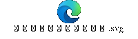
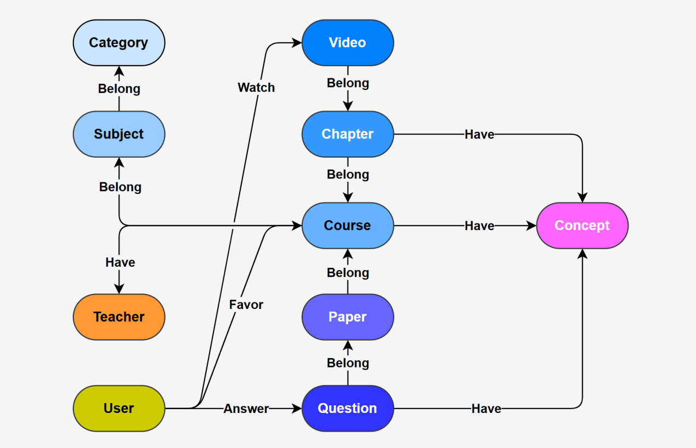
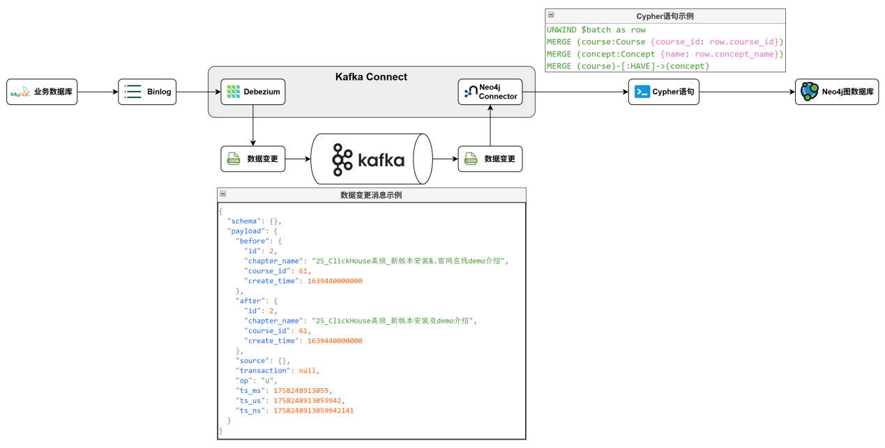
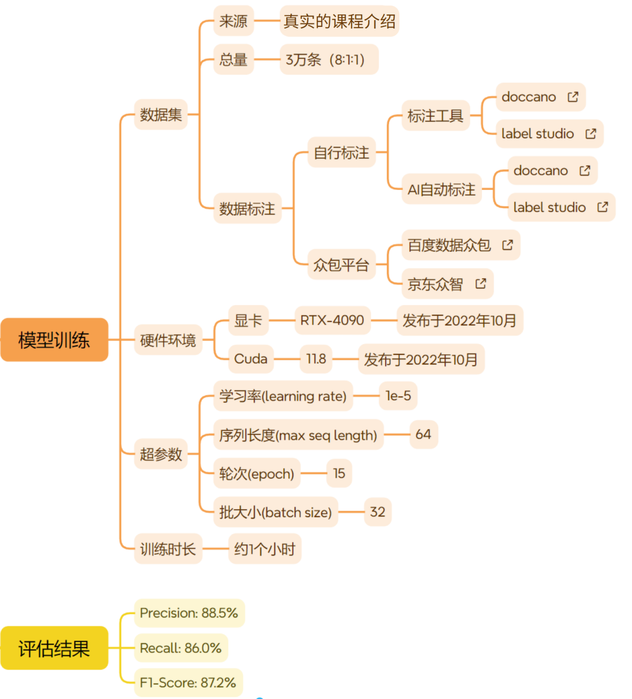

---
tags:
  - 大模型
  - 面试
source: "尚硅谷大模型技术之高频面试题-V2.1.6.docx"
source_blocks: "3276-3341"
reviewed: 2026-10-21
---

# 教育知识图谱的关系设计与版本

教育图谱中的先修关系需要定义课程版本、方向与适用条件。

前篇：[[知识点总结/80-资料与复习/81-面试知识库/08-大模型高频面试题/05-项目实战/18-闲聊DPO的偏好构造与效果退化|闲聊DPO的偏好构造与效果退化]] ｜ 后篇：[[知识点总结/80-资料与复习/81-面试知识库/08-大模型高频面试题/05-项目实战/20-教育RAG客服的课程语境与证据|教育RAG客服的课程语境与证据]]

## 深入理解（新增）

“知识点 A 是 B 的先修”与“课程 A 包含 B”是两种关系，不能用一个相关边替代。节点主键应包含学科或课程体系，防止不同教材同名术语被错误合并。

先修关系用于学习路径时应检测环和孤立节点。知识图谱可以存在一般关系环，但若把先修子图解释为严格学习顺序，就需要明确循环依赖的处置策略。

抽取结果进入图谱前，应保存原句、章节、教材版本和审核状态。检索回答引用课程材料而非只引用一个无来源的图谱三元组；教材更新时关系也要随版本更新。


## 核心代码（新增）

以下是可在 CPU 运行的机制或业务契约示例，完整源码与测试见 [[知识点总结/80-资料与复习/81-面试知识库/08-大模型高频面试题/06-代码实验/01-核心代码实验与验证范围|核心代码实验与验证范围]]。示例不包含完整模型训练或外部平台部署。

```python
from collections import defaultdict

def rrf_fuse(rankings, constant=60):
    if constant <= 0:
        raise ValueError("constant must be positive")
    scores = defaultdict(float)
    for ranking in rankings:
        seen = set()
        for rank, doc_id in enumerate(ranking, start=1):
            if doc_id in seen:
                continue
            seen.add(doc_id)
            scores[doc_id] += 1 / (constant + rank)
    return sorted(scores.items(), key=lambda item: (-item[1], item[0]))

def validate_prerequisites(edges):
    """(A, B) means A must be learned before B; raise on cycles."""
    adjacency = defaultdict(list)
    for a, b in edges:
        adjacency[a].append(b)
    visiting, finished = set(), set()
    def visit(node):
        if node in visiting:
            raise ValueError("cyclic prerequisite: " + node)
        if node in finished:
            return
        visiting.add(node)
        for child in adjacency.get(node, []):
            visit(child)
        visiting.remove(node)
        finished.add(node)
    for node in list(adjacency):
        visit(node)
    return True

ranked = rrf_fuse([["sku-A", "sku-B"], ["sku-B", "sku-C"]])
assert ranked[0][0] == "sku-B"

assert validate_prerequisites([("Python", "PyTorch"), ("PyTorch", "微调")])
```

### 图谱写入核心（Neo4j 模板）

以下模板依据 Neo4j 文档核验，未连接数据库执行。唯一键与来源版本需要由业务系统提供；语句可分别执行，参数通过驱动绑定。

```cypher
CREATE CONSTRAINT product_id_unique IF NOT EXISTS
FOR (p:Product) REQUIRE p.product_id IS UNIQUE;
CREATE CONSTRAINT brand_id_unique IF NOT EXISTS
FOR (b:Brand) REQUIRE b.brand_id IS UNIQUE;
```

```cypher
MERGE (p:Product {product_id: $product_id})
SET p.name = $product_name, p.version = $version
MERGE (b:Brand {brand_id: $brand_id})
SET b.name = $brand_name
MERGE (p)-[r:OF_BRAND]->(b)
SET r.source_id = $source_id, r.version = $version
RETURN p.product_id;
```

关系需要随删除、修订同步清理；上面的 MERGE 只展示幂等合并，不是完整版本迁移程序。

## 追问与验证（新增）

构造 A 先修 B、B 先修 C、C 先修 A 的数据，说明哪种关系定义下这是冲突，哪些普通关联可以成环。

## 官方资料与论文

- [Neo4j MERGE 语义](https://neo4j.com/docs/cypher-manual/current/clauses/merge/)

核验日期：2026-10-21。链接中的 `stable`、`main` 或平台文档会继续变化；新增纯 Python/NumPy 实验与原文旧版框架代码已分开标注。

## 原文保留

> [!warning] 原文批注
> 图结构并不自动保证知识正确；先修、包含、相似等关系需要不同约束及可追溯来源。
>
> 原文的团队人数、业务规模、效果百分比、硬件与成本均保留为教材案例陈述；本次未独立复现这些项目指标。

<!-- source-block:3276 -->
### AI智教图谱项目（Neo4j）

<!-- source-block:3277 -->
#### 项目周期

<!-- source-block:3278 -->
- 2人团队，总计约3个月。

<!-- source-block:3279 -->
- 需求分析与架构设计2周

<!-- source-block:3280 -->
- 数据管道搭建与调试3周

<!-- source-block:3281 -->
- 实体抽取模块开发与测试4周

<!-- source-block:3282 -->
- 索引构建与应用层开发1周

<!-- source-block:3283 -->
- 部署与测试2周

<!-- source-block:3284 -->
#### 功能介绍

<!-- source-block:3285 -->
在线教育平台知识图谱基于Neo4j图数据库构建，包含分类、学科、课程、章节、视频、试卷、试题以及各种知识点，同时记录了用户部分行为用于后续构建用户画像。

<!-- source-block:3286 -->
数据的主要来源是业务数据库中的结构化数据，以及部分非结构化数据，实现了图谱与业务数据库数据的实时同步。

<!-- source-block:3287 -->
为方便上层应用，为图谱中的数据构建了全文索引和向量索引，以支持全文检索和语义检索。

<!-- source-block:3288 -->
完整架构如下图所示：

<!-- source-block:3289 -->


[原文嵌入附件：oleObject5.bin](../assets/原始附件/oleObject5.bin)

[原文嵌入附件：oleObject5.svg](../assets/原始附件/oleObject5.svg)

<!-- source-block:3290 -->
#### 实现流程

<!-- source-block:3291 -->
##### 数据建模

<!-- source-block:3292 -->
##### 业务数据库

<!-- source-block:3293 -->
业务数据库中的数据模型如下图所示：

<!-- source-block:3294 -->


[原文嵌入附件：oleObject6.bin](../assets/原始附件/oleObject6.bin)

[原文嵌入附件：oleObject6.svg](../assets/原始附件/oleObject6.svg)

<!-- source-block:3295 -->
模型原文件如下：

<!-- source-block:3296 -->


[原文嵌入附件：oleObject7.bin](../assets/原始附件/oleObject7.bin)

<!-- source-block:3297 -->
##### 图数据库

<!-- source-block:3298 -->
图数据库中的数据模型与业务数据库基本保持一致，如下图所示。

<!-- source-block:3299 -->


<!-- source-block:3300 -->
##### 数据同步

<!-- source-block:3301 -->
为保证数据的时效性，搭建了一条数据的实时同步通道，如下图所示。

<!-- source-block:3302 -->


<!-- source-block:3303 -->
上述流程涉及到的组件有：

<!-- source-block:3304 -->
[Kafka](https://kafka.apache.org/)——消息队列，用于承载和传输Mysql的数据库变更事件。

<!-- source-block:3305 -->
[Debezium](https://debezium.io/)——监听 MySQL Binlog，实时捕获数据库的插入、更新、删除操作，并将变更数据写入 Kafka。

<!-- source-block:3306 -->
[Neo4j Kafka Connector](https://neo4j.ac.cn/docs/kafka/current/)——从 Kafka 消费变更数据并转换为 Cypher 语句，将变更数据实时写入 Neo4j 图数据库。

<!-- source-block:3307 -->
##### 实体抽取

<!-- source-block:3308 -->
因为有些课程、章节在录入时，部分相关知识点并未录入，而是直接包含在了课程描述、章节标题中，所以我们就需要从课程描述、章节标题中将这些知识点抽取出来，以填补缺失的知识点。

<!-- source-block:3309 -->
知识点抽取使用的模型是百度开源的通用抽取模型——UIE，其基于ERNIE模型，并在ERNIE模型的基础上增加了两个线性层，一个用于预测实体的起始位置，一个用于预测结束位置。

<!-- source-block:3310 -->


<!-- source-block:3311 -->
ERNIE和BERT的结构类似，都是编码器模型。不同的是预训练方式，BERT在训练时是随机掩盖若干个独立的token，然后令模型预测这些token，而ERNIE在训练时不是掩盖单个Token，而是掩盖整个实体，这样模型就能学到更丰富的实体知识，所以其在实体抽取任务上更有优势。

<!-- source-block:3312 -->


<!-- source-block:3313 -->
##### 创建索引

<!-- source-block:3314 -->
为方便上层应用查询，创建了全文索引和向量索引。

<!-- source-block:3315 -->
##### 全文索引

<!-- source-block:3316 -->
全文索引的基本原理如下图所示：

<!-- source-block:3317 -->


<!-- source-block:3318 -->
##### 向量索引

<!-- source-block:3319 -->
Neo4j底层的向量索引算法为HNSW（Hierarchical Navigable Small World），其原理图如下所示：

<!-- source-block:3320 -->


<!-- source-block:3321 -->
HNSW算法借鉴了如下算法：

<!-- source-block:3322 -->
NSW（Navigable Small World）

<!-- source-block:3323 -->


<!-- source-block:3324 -->
Skip List

<!-- source-block:3325 -->


<!-- source-block:3326 -->
#### 技术细节

<!-- source-block:3327 -->
##### 实体抽取模型

<!-- source-block:3328 -->
实体抽取采用百度开源的UIE模型，UIE支持零样本预测，但在我们实际的这个场景中，直接使用的效果不太理想，因此又对齐进行了微调。微调细节如下图所示：

<!-- source-block:3329 -->


<!-- source-block:3330 -->
##### Embedding模型

<!-- source-block:3331 -->
采用[BAAI/bge-small-zh-v1.5](https://huggingface.co/BAAI/bge-small-zh-v1.5)，向量维度为512。

<!-- source-block:3332 -->
#### 总结

<!-- source-block:3333 -->
我们搭建这在线教育知识图谱的初衷主要是为上层的AI应用提供数据支撑，比如智能客服、推荐系统等等。

<!-- source-block:3334 -->
这个图谱主要的数据来源是业务数据库中课程相关的表格，包括学科、课程、章节、视频、试卷等，这些大都是结构化的数据，除此之外，还有一些非结构化的数据，例如课程描述，章节标题，我们需要从这些数据中将知识点抽取出来，以构建知识体系网络。

<!-- source-block:3335 -->
下面我先介绍一下数据通道，我们的业务数据库是Mysql，图谱用的是Neo4j，为了保证图谱数据的时效性，我们设计并搭建了一条实时的数据同步通道。

<!-- source-block:3336 -->
首先使用Debezium监听MySql的Binlog，从而获取变更数据，Debezium会将变更数据写入Kafka消息队列中。然后我们又使用了Neo4j官方提供的一个Kafka Connector，它可以实时消费Kafka中的变更数据，只要有新的变更数据，它就会执行我们指定的Cypher语句，将变更数据写入Neo4j，从而完成Neo4j与MySql数据的实时同步。

<!-- source-block:3337 -->
然后我再重点介绍一下同步过程中的实体抽取，这个实体抽取主要是从课程描述和章节标题中抽取知识点，这里我们使用了百度开源的一个通用信息抽取模型，叫做UIE，这个模型以百度自家的ERNIE预训练模型作为基础。ERNIE和BERT的结构类似，都是编码器模型。但它们的预训练方式不一样：BERT在训练时是随机掩盖若干个独立的token，然后令模型预测这些token，而ERNIE在训练时不是掩盖单个Token，而是掩盖整个实体，这样模型就能学到更丰富的实体知识，所以其在实体抽取任务上更有优势。

<!-- source-block:3338 -->
然后在UIE在ERNIE的基础之上，又使用了两个线性层，一个线性层用于预测实体的起始位置，另一个线性层用于预测结束位置。在推理时，根据起始位置和结束位置就能截取到实体信息了。

<!-- source-block:3339 -->
UIE是支持零样本预测，但在我们实际的这个场景中，直接使用的效果不太理想。所以我们人工标注了大约3万条数据，对模型进行了微调。调优之后，F1值达到了88%，基本满足了我们业务上的要求。

<!-- source-block:3340 -->
最后，数据进入Neo4j之后，为了支持上层复杂查询，我们给图谱建立了两种索引：一个是全文索引，主要用于关键词检索；另一个是向量索引，用于语义相似度查询，当然，建立向量索引需要先有向量，这里我们使用的Embedding模型是BGE，这是一个开箱即用的高质量Embedding模型，不需要微调就能有很好的效果。

<!-- source-block:3341 -->
以上就是这个图谱项目的全部内容。
