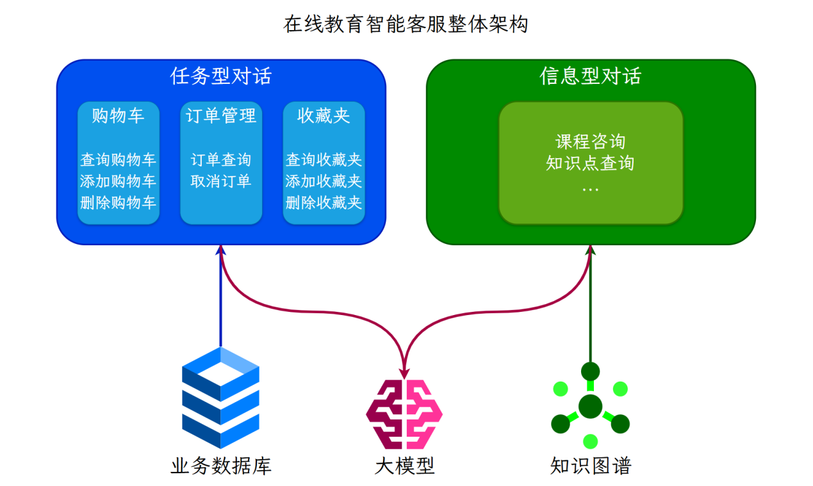
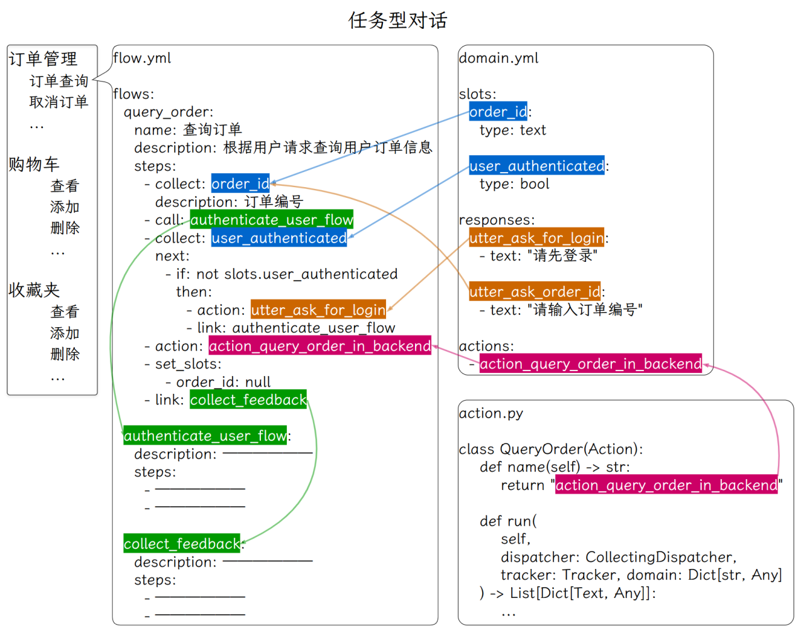

---
tags:
  - 大模型
  - 面试
source: "尚硅谷大模型技术之高频面试题-V2.1.6.docx"
source_blocks: "3342-3466"
reviewed: 2026-10-21
---

# 教育RAG客服的课程语境与证据

教育问答需要同时匹配知识内容与学习者当前课程语境。

前篇：[[知识点总结/80-资料与复习/81-面试知识库/08-大模型高频面试题/05-项目实战/19-教育知识图谱的关系设计与版本|教育知识图谱的关系设计与版本]] ｜ 后篇：[[知识点总结/80-资料与复习/81-面试知识库/08-大模型高频面试题/05-项目实战/21-医疗知识图谱的来源与关系约束|医疗知识图谱的来源与关系约束]]

## 深入理解（新增）

同一术语在不同年级、教材和课程中的讲解深度不同，检索前应把课程版本、章节和目标学习者作为过滤条件。直接使用全库相似度可能返回内容正确但不适合当前课程的答案。

图谱适合补充概念关系，向量与词项检索适合定位原始教材段落。融合时保留来源类型，生成器应能区分“教材明确说明”和“依据关系推导”，不给推断伪造教材引用。

评估要覆盖定义题、推导题、例题与课程外问题。教学提示是否适当需要独立标准，不能用答案长度代表讲解质量。无证据时给出检索缺口，比编造教材页码更可靠。


## 核心代码（新增）

以下是可在 CPU 运行的机制或业务契约示例，完整源码与测试见 [[知识点总结/80-资料与复习/81-面试知识库/08-大模型高频面试题/06-代码实验/01-核心代码实验与验证范围|核心代码实验与验证范围]]。示例不包含完整模型训练或外部平台部署。

```python
from collections import defaultdict

def rrf_fuse(rankings, constant=60):
    if constant <= 0:
        raise ValueError("constant must be positive")
    scores = defaultdict(float)
    for ranking in rankings:
        seen = set()
        for rank, doc_id in enumerate(ranking, start=1):
            if doc_id in seen:
                continue
            seen.add(doc_id)
            scores[doc_id] += 1 / (constant + rank)
    return sorted(scores.items(), key=lambda item: (-item[1], item[0]))

def retrieval_metrics(retrieved, relevant, k=5):
    if not relevant:
        raise ValueError("no-answer cases must be evaluated separately")
    top = list(dict.fromkeys(retrieved))[:k]
    hit = set(top) & set(relevant)
    reciprocal_rank = next((1 / rank for rank, doc in enumerate(top, 1) if doc in relevant), 0.0)
    return {"recall_at_k": len(hit) / len(set(relevant)), "mrr": reciprocal_rank}

def check_citations(claims, retrieved_source_ids):
    """Validate reference membership only; this does not verify factual support."""
    allowed = set(retrieved_source_ids)
    problems = []
    for index, claim in enumerate(claims):
        refs = claim.get("source_ids", [])
        if not refs:
            problems.append((index, "missing citation"))
        for ref in refs:
            if ref not in allowed:
                problems.append((index, "unknown source: " + ref))
    return problems

ranked = rrf_fuse([["sku-A", "sku-B"], ["sku-B", "sku-C"]])
assert ranked[0][0] == "sku-B"

m = retrieval_metrics(["c2", "c1", "c1"], {"c1", "c3"}, k=3)
assert m == {"recall_at_k": 0.5, "mrr": 0.5}

claims = [{"source_ids":["doc-v2:chunk-3"]}]
assert check_citations(claims, {"doc-v2:chunk-3"}) == []
# 引用存在不等于引用支持结论，事实支持关系仍须另查。
```

## 追问与验证（新增）

针对同名术语建立两个年级的资料，确认课程过滤生效，再检查引用是否来自对应版本教材。

## 官方资料与论文

- [Retrieval-Augmented Generation](https://arxiv.org/abs/2005.11401)
- [Neo4j MERGE 语义](https://neo4j.com/docs/cypher-manual/current/clauses/merge/)

核验日期：2026-10-21。链接中的 `stable`、`main` 或平台文档会继续变化；新增纯 Python/NumPy 实验与原文旧版框架代码已分开标注。

## 原文保留

> [!warning] 原文批注
> 知识覆盖与教学适配是不同维度；回答内容大致正确也可能超出当前课程或引用错误版本。
>
> 原文的团队人数、业务规模、效果百分比、硬件与成本均保留为教材案例陈述；本次未独立复现这些项目指标。

<!-- source-block:3342 -->
### 在线教育智能RAG客服项目（Rasa Pro）

<!-- source-block:3343 -->
#### 项目周期

<!-- source-block:3344 -->
- 2人团队，总计约5.5个月。

<!-- source-block:3345 -->
- 需求分析与技术选型2周

<!-- source-block:3346 -->
- 环境搭建与熟悉框架3周

<!-- source-block:3347 -->
- 基础任务流开发与集成4周

<!-- source-block:3348 -->
- 测试与部署2周

<!-- source-block:3349 -->
- GraphRAG流程开发1周

<!-- source-block:3350 -->
- 集成与调试2周

<!-- source-block:3351 -->
- LLM微调数据准备2周

<!-- source-block:3352 -->
- LLM微调与评估1周

<!-- source-block:3353 -->
- 模型部署与测试2周

<!-- source-block:3354 -->
- 更多任务流扩展4周

<!-- source-block:3355 -->
#### 功能介绍

<!-- source-block:3356 -->
基于Rasa Pro框架结合LLM和知识图谱构建的在线教育智能客服系统，主要有以下功能：

<!-- source-block:3357 -->
提供任务型对话，根据预设流程进行对话，通过多轮对话交互帮助用户完成特定任务，如订单、购物车、收藏夹相关业务流程等。

<!-- source-block:3358 -->
提供知识库问答对话，基于知识图谱和GraphRAG，支持课程咨询、知识点关系梳理等复杂问题和多跳推理。

<!-- source-block:3359 -->
支持意外对话修复和闲聊，接入LLM支持用户的非业务对话，并对回复内容做出严肃限制，避免涉及敏感内容的回复。

<!-- source-block:3360 -->
#### 实现流程

<!-- source-block:3361 -->
##### 调用流程

<!-- source-block:3362 -->
- 部署服务：Rasa Pro + LLM（vllm部署） + 知识图谱（neo4j）+ Embedding模型（fastapi+uvicorn）

<!-- source-block:3363 -->
- 后端服务：Rasa提供restful接口，供前端调用。

<!-- source-block:3364 -->
- 前端服务：公司自研web、app，调用后端服务。

<!-- source-block:3365 -->
##### 实现流程

<!-- source-block:3366 -->


<!-- source-block:3367 -->
用户query

<!-- source-block:3368 -->
=》Rasa对话理解（读取tracker store，调用LLM）

<!-- source-block:3369 -->
=》Rasa对话管理器（执行flow或者pattern）

<!-- source-block:3370 -->
-》匹配到flow，执行flow和对应的action，返回结果

<!-- source-block:3371 -->
-》未匹配到flow，执行pattern\_search -&gt; 执行企业搜索策略 -&gt; 调用GraphRAG

<!-- source-block:3372 -->
-》标签路由：LLM识别问题涉及的节点类型和实体

<!-- source-block:3373 -->
-》节点检索：使用混合检索找到候选入口节点

<!-- source-block:3374 -->
-》Cypher生成：LLM根据入口节点和问题生成Cypher查询语句

<!-- source-block:3375 -->
-》语句验证：验证Cypher语句的正确性

<!-- source-block:3376 -->
-》语句校正：如有错误则进行校正

<!-- source-block:3377 -->
-》执行查询：在Neo4j中执行Cypher查询

<!-- source-block:3378 -->
-》返回结果：将查询结果返回

<!-- source-block:3379 -->
-》pattern\_search无结果-》最终回退到pattern-chat闲聊

<!-- source-block:3380 -->
-》更新tracker store：添加新对话、更新slot等

<!-- source-block:3381 -->
=》Rasa NLG：将结果输入到LLM上下文，由LLM生成回复

<!-- source-block:3382 -->
#### 技术细节

<!-- source-block:3383 -->
##### Rasa Pro框架介绍

<!-- source-block:3384 -->


<!-- source-block:3385 -->
**CALM由三部分组成：对话理解、对话管理、响应生成**

<!-- source-block:3386 -->
**对话理解：**

<!-- source-block:3387 -->
当用户发送消息时，LLM命令生成器从tracker store读取完整对话记录与已收集的信息，调用LLM，识别用户意图、提取槽位，并生成下一步的命令列表，发送给对话管理器。

<!-- source-block:3388 -->
这里prompt的内容包括：

<!-- source-block:3389 -->
① 任务描述

<!-- source-block:3390 -->
② 可用的Flows和Slots（开启流程检索，只放匹配度高的几个流程）

<!-- source-block:3391 -->
③ 可用操作：start flow、set slot、search and reply等

<!-- source-block:3392 -->
④ 通用指令：指令+描述

<!-- source-block:3393 -->
⑤ 决策规则表：满足xx条件，触发xx指令=》生成xx命令

<!-- source-block:3394 -->
⑥ 当前状态：活跃的flow、当前请求的slot和已填充的slots等

<!-- source-block:3395 -->
⑦ 对话历史

<!-- source-block:3396 -->
⑧ 要求生成最新命令序列

<!-- source-block:3397 -->
这里使用的SearchReadyLLMCommandGenerator，可以触发RAG。

<!-- source-block:3398 -->
**对话管理：**

<!-- source-block:3399 -->
对话管理器接收命令序列，采取下一步操作：

<!-- source-block:3400 -->
启动、停止或回复流程

<!-- source-block:3401 -->
对话模式流程处理意外交互

<!-- source-block:3402 -->
执行企业搜索RAG

<!-- source-block:3403 -->
收集信息

<!-- source-block:3404 -->
触发action

<!-- source-block:3405 -->
**响应生成：**

<!-- source-block:3406 -->
利用上下文响应重述器，生成自然的回复，提高对话的流程性和连贯性。

<!-- source-block:3407 -->
这里配置了LLM进行对执行结果的重述响应。

<!-- source-block:3408 -->
**Rasa构建AI助手流程**

<!-- source-block:3409 -->
**配置rasa：pipeline、policy、endpoint等**

<!-- source-block:3410 -->
**根据业务设计和用户行为设计流程。**

<!-- source-block:3411 -->
**编写流程中设计的槽位、响应、动作等。**

<!-- source-block:3412 -->
自定义动作通过继承Action类并重写run方法来实现，可以调用外部API，查询数据库或执行其他逻辑。

<!-- source-block:3413 -->
槽位和对话历史会自动存储在track store中。

<!-- source-block:3414 -->
**训练并调试助手。在调试过程中将对话保存为端到端测试示例。**

<!-- source-block:3415 -->
**微调小型语言模型用于执行命令生成任务。将其部署并集成到Rasa中。**

<!-- source-block:3416 -->
##### 任务型对话

<!-- source-block:3417 -->


<!-- source-block:3418 -->
在流程中定义一个业务操作的各个步骤。

<!-- source-block:3419 -->
通过槽位存储操作过程中所需的信息。

<!-- source-block:3420 -->
通过定义响应来引导LLM如何回复用户。

<!-- source-block:3421 -->
通过编写自定义动作来调用外部API，查询或操作业务数据库，来获取业务相关信息或执行用户操作。

<!-- source-block:3422 -->
##### 信息型对话

<!-- source-block:3423 -->
结合知识图谱与GraphRAG，支持复杂的课程咨询、知识点梳理等功能。

<!-- source-block:3424 -->
##### 生成命令生成模型微调数据

<!-- source-block:3425 -->


<!-- source-block:3426 -->
准备覆盖重要对话流程的端到端测试数据，执行rasa命令生成微调数据集。

<!-- source-block:3427 -->
##### 命令生成模型微调与部署

<!-- source-block:3428 -->
##### 数据集

<!-- source-block:3429 -->
由Rasa合成数据模块生成，覆盖高频步骤路径与边界场景（如模糊意图、多意图、口语化表达等）。

<!-- source-block:3430 -->
共计约1万条样本，按8：2划分训练集和验证集。

<!-- source-block:3431 -->
训练集：8000条左右。

<!-- source-block:3432 -->
验证集：2000条左右。

<!-- source-block:3433 -->
##### 模型训练

<!-- source-block:3434 -->
| 预训练模型 | Qwen3-8B |  |  |
| --- | --- | --- | --- |
| 超参数 | 最大序列长度 | 4096 |  |
| 训练轮次 | 3 |  |  |
| LoRA | 秩r | 16 |  |
| 目标模块 | 注意力和MLP部分 |  |  |
| 缩放系数α | 16，与r相等 |  |  |
| Dropout概率 | 0 |  |  |
| 不微调bias |  |  |  |
| 不使用秩稳定LoRA |  |  |  |
| 优化器 | 8bit-AdamW |  |  |
| 学习率 | 2e-4 |  |  |
| 权重衰减 | 0.01 |  |  |
| 每设备训练批次大小 | 2 |  |  |
| 梯度累计步数 | 8 |  |  |
| 每设备验证批次大小 | 4 |  |  |
| 训练多少步后验证一次 | 50 |  |  |
| 训练策略 | 量化 | 4bit |  |
| 启用梯度检查点以节省显存 |  |  |  |
| 精度配置 | 优先bf16，如果不支持bf16则使用fp16 |  |  |
| 学习率预热 | 总步数的5% |  |  |
| 学习率衰减 | 余弦衰减 |  |  |
| 训练环境 | 设备 | V100 32GB |  |
| 框架 | Unsloth+Transformers |  |  |
| 训练时长 | 1.5小时（训练60分钟+验证30分钟） |  |  |
| 训练结果 | 初始损失值 | 2.4 |  |
| 最终验证集损失值 | 1.0 |  |  |
| 模型部署 | vllm部署 |  |  |
| 最大序列长度 | 4096 |  |  |
| 显存占用 | 22G |  |  |

<!-- source-block:3435 -->


<!-- source-block:3436 -->
##### 信息型对话（GraphRAG）

<!-- source-block:3437 -->
LLM根据Prompt从用户输入中提取入口节点实体和其对应的类型。

<!-- source-block:3438 -->
获取入口节点实体和标签之后，使用混合检索从Neo4j中检索出若干候选入口节点。

<!-- source-block:3439 -->


<!-- source-block:3440 -->
LLM根据用户输入、候选入口节点、Neo4j的schema信息，生成Cypher查询语句。

<!-- source-block:3441 -->
将生成的Cypher语句交给LLM进行验证，返回Cypher中的存在的语法与逻辑错误。

<!-- source-block:3442 -->
LLM根据验证出的错误信息对Cypher进行修正，得到最终的Cypher语句。

<!-- source-block:3443 -->
执行查询语句，将查询结果返回LLM作为上下文参考。

<!-- source-block:3444 -->
LLM根据用户输入和上下文参考生成回复。

<!-- source-block:3445 -->


<!-- source-block:3446 -->
#### 项目总结

<!-- source-block:3447 -->
该项目实现了基于Rasa Pro框架的在线教育智能客服系统，集成了大语言模型、任务型对话流程管理、知识图谱和GraphRAG。

<!-- source-block:3448 -->
能够自动化处理课程咨询、订单管理、购物车管理、收藏夹管理、知识点查询等核心业务场景，提供高效的客户服务解决方案。

<!-- source-block:3449 -->
项目主要包含任务型对话部分和信息型对话部分，支持闲聊。

<!-- source-block:3450 -->
任务型对话针对结构化的目标导向任务，如查询订单或移除收藏，通过预定义流程管理输入输出。

<!-- source-block:3451 -->
信息型对话则集成RAG和GraphRAG，利用外部知识库响应用户问题，如课程搜索和推荐。

<!-- source-block:3452 -->
首先我们使用Rasa Pro框架构建AI助手，基于CALM（对话理解、管理、响应生成）设计流程。

<!-- source-block:3453 -->
在对话理解中，采用SearchReadyLLMCommandGenerator，根据prompt将用户消息转换为命令。多轮对话的对话历史、槽位信息由tracker store存储和更新。

<!-- source-block:3454 -->
prompt包括当前状态、对话历史、可用流程/槽位/动作、可用操作、决策规则等。

<!-- source-block:3455 -->
对话管理接收命令执行操作，如路由流程、收集信息、执行动作、或处理意外交互，通过对话模式（如修复、导航、外部支持）处理非线性对话。

<!-- source-block:3456 -->
响应生成利用上下文重述器生成自然回复。

<!-- source-block:3457 -->
构建流程时，在YAML文件中定义流程ID、描述和步骤，包括收集信息、执行动作、设置槽位等；编写槽位存储信息、响应引导回复、自定义动作调用外部API或数据库。

<!-- source-block:3458 -->
为优化命令生成并提高响应速度，我们准备了端到端测试数据，使用Rasa命令标注模块提取命令，合成数据生成模块创建重述版本，最终生成微调数据集。

<!-- source-block:3459 -->
数据集覆盖高频路径和边界场景，共计约1万条样本，训练集8000条、验证集2000条。

<!-- source-block:3460 -->
预训练模型选择Qwen3-8B，采用LoRA微调。训练时使用4bit量化、梯度检查点、bf16精度。每设备训练批次大小2，梯度累计步数8；使用Unsloth在V100单卡上训练。

<!-- source-block:3461 -->
之后使用vllm部署模型，最大序列长度4096。

<!-- source-block:3462 -->
对于信息型对话我们结合了知识图谱和GraphRAG。

<!-- source-block:3463 -->
LLM从用户输入提取入口节点实体和类型，使用混合检索从Neo4j中获取候选节点。

<!-- source-block:3464 -->
根据用户输入、候选节点和schema生成Cypher查询语句，之后LLM验证并修正语法逻辑错误。

<!-- source-block:3465 -->
得到修正后的Cypher语句后执行查询，将结果作为上下文参考生成回复。

<!-- source-block:3466 -->
结合任务型对话和信息型对话功能，最终实现了支持多场景的AI助手，可满足不同业务的需求。
