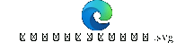
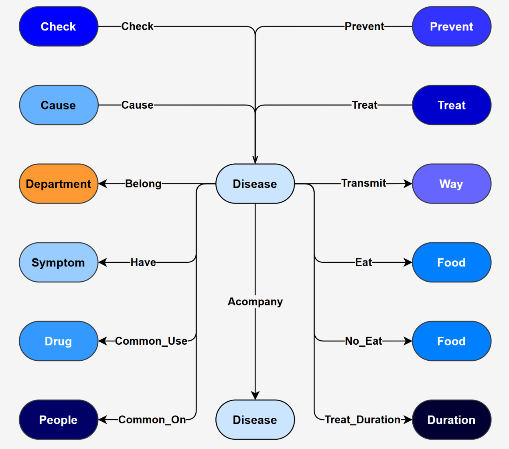
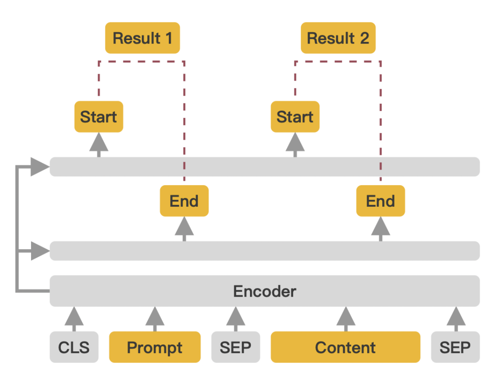
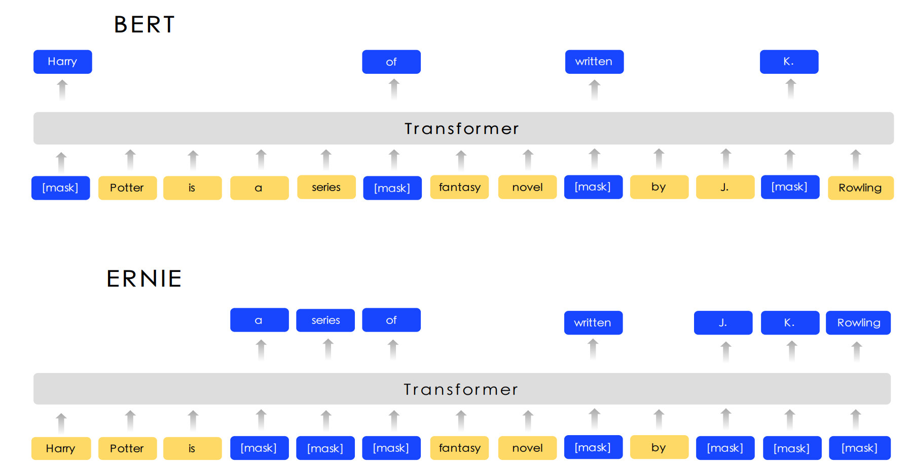
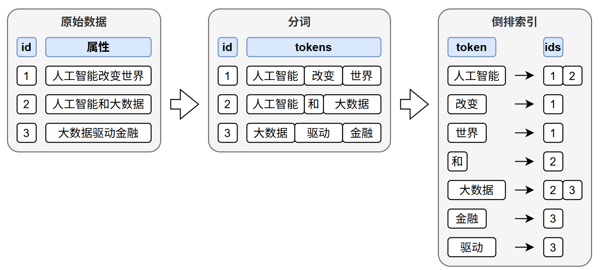
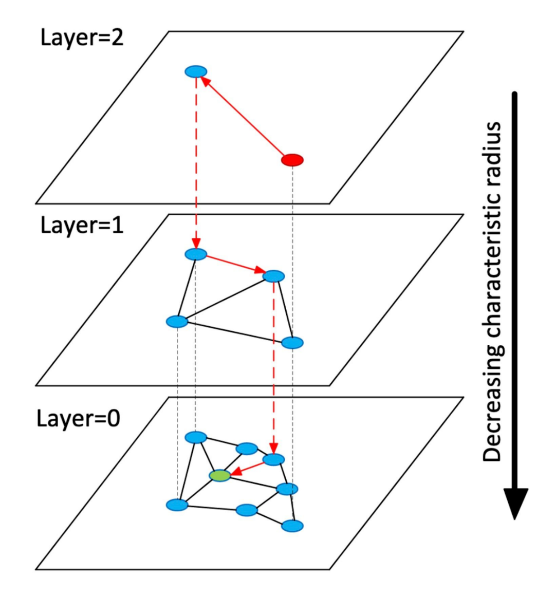
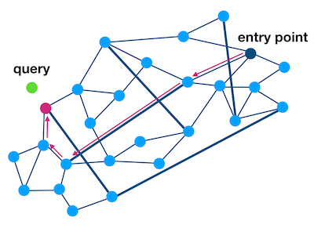
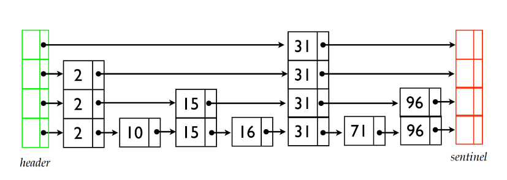
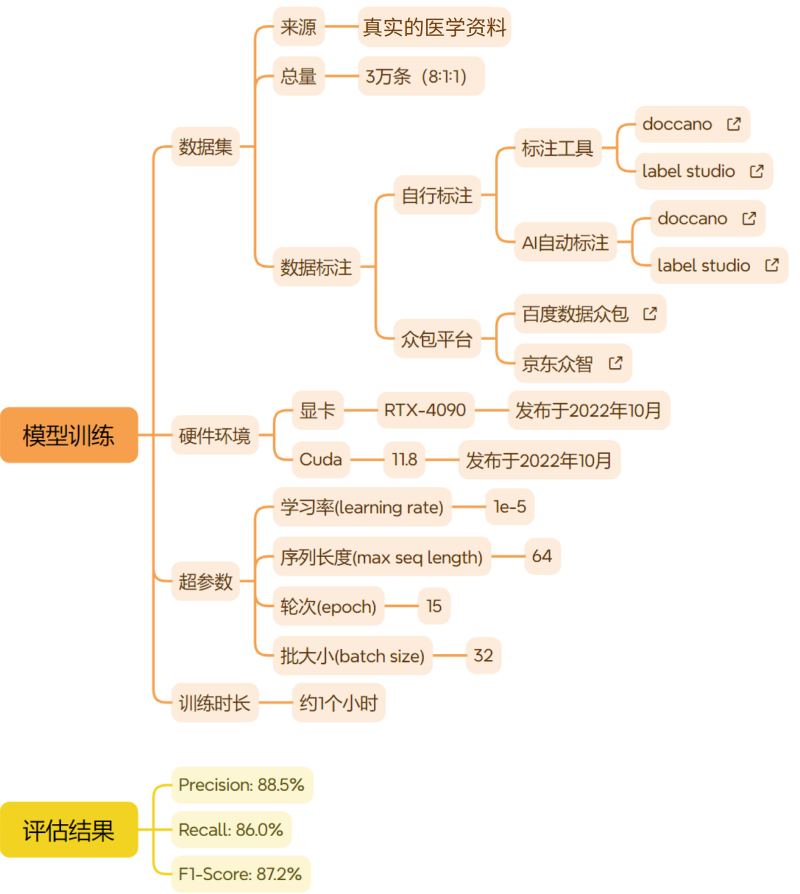

---
tags:
  - 大模型
  - 面试
source: "尚硅谷大模型技术之高频面试题-V2.1.6.docx"
source_blocks: "3467-3520"
reviewed: 2026-10-21
---

# 医疗知识图谱的来源与关系约束

医疗图谱工程首先要保证来源、关系类型与知识版本可追溯。

前篇：[[知识点总结/80-资料与复习/81-面试知识库/08-大模型高频面试题/05-项目实战/20-教育RAG客服的课程语境与证据|教育RAG客服的课程语境与证据]] ｜ 后篇：[[知识点总结/80-资料与复习/81-面试知识库/08-大模型高频面试题/05-项目实战/22-医疗RAG客服的检索、时效与拒答|医疗RAG客服的检索、时效与拒答]]

## 深入理解（新增）

疾病、症状、检查和药品之间的关系应区分“可能相关”“用于诊断”“适应证”等语义，不能把文本共现直接转成确定诊疗规则。实体同义词对齐也需保留原始名称与标准标识。

文献、指南和药品说明的适用条件、有效时间不同。每条关系附 source_id、发布日期、适用人群和审核状态，更新时保留历史，避免新旧结论混成一个无时间边界的图。

本案例只用于知识工程与检索设计。评估重点是实体链接、关系抽取、来源定位和冲突检测；系统检索到一条关系并不构成对具体个人的诊断或用药结论。


## 核心代码（新增）

以下是可在 CPU 运行的机制或业务契约示例，完整源码与测试见 [[知识点总结/80-资料与复习/81-面试知识库/08-大模型高频面试题/06-代码实验/01-核心代码实验与验证范围|核心代码实验与验证范围]]。示例不包含完整模型训练或外部平台部署。

```python
from collections import defaultdict

def rrf_fuse(rankings, constant=60):
    if constant <= 0:
        raise ValueError("constant must be positive")
    scores = defaultdict(float)
    for ranking in rankings:
        seen = set()
        for rank, doc_id in enumerate(ranking, start=1):
            if doc_id in seen:
                continue
            seen.add(doc_id)
            scores[doc_id] += 1 / (constant + rank)
    return sorted(scores.items(), key=lambda item: (-item[1], item[0]))

def check_citations(claims, retrieved_source_ids):
    """Validate reference membership only; this does not verify factual support."""
    allowed = set(retrieved_source_ids)
    problems = []
    for index, claim in enumerate(claims):
        refs = claim.get("source_ids", [])
        if not refs:
            problems.append((index, "missing citation"))
        for ref in refs:
            if ref not in allowed:
                problems.append((index, "unknown source: " + ref))
    return problems

ranked = rrf_fuse([["sku-A", "sku-B"], ["sku-B", "sku-C"]])
assert ranked[0][0] == "sku-B"

claims = [{"source_ids":["doc-v2:chunk-3"]}]
assert check_citations(claims, {"doc-v2:chunk-3"}) == []
# 引用存在不等于引用支持结论，事实支持关系仍须另查。
```

### 图谱写入核心（Neo4j 模板）

以下模板依据 Neo4j 文档核验，未连接数据库执行。唯一键与来源版本需要由业务系统提供；语句可分别执行，参数通过驱动绑定。

```cypher
CREATE CONSTRAINT product_id_unique IF NOT EXISTS
FOR (p:Product) REQUIRE p.product_id IS UNIQUE;
CREATE CONSTRAINT brand_id_unique IF NOT EXISTS
FOR (b:Brand) REQUIRE b.brand_id IS UNIQUE;
```

```cypher
MERGE (p:Product {product_id: $product_id})
SET p.name = $product_name, p.version = $version
MERGE (b:Brand {brand_id: $brand_id})
SET b.name = $brand_name
MERGE (p)-[r:OF_BRAND]->(b)
SET r.source_id = $source_id, r.version = $version
RETURN p.product_id;
```

关系需要随删除、修订同步清理；上面的 MERGE 只展示幂等合并，不是完整版本迁移程序。

## 追问与验证（新增）

对同一实体导入两份时间不同且存在冲突的材料，验证系统能否同时展示来源与版本，而不是静默覆盖。

## 官方资料与论文

- [Neo4j MERGE 语义](https://neo4j.com/docs/cypher-manual/current/clauses/merge/)

核验日期：2026-10-21。链接中的 `stable`、`main` 或平台文档会继续变化；新增纯 Python/NumPy 实验与原文旧版框架代码已分开标注。

## 原文保留

> [!warning] 原文批注
> 本节不补造诊疗规则。图谱抽取与检索结果必须保留原始医学来源和适用条件，不能直接变成个体决策。
>
> 原文的团队人数、业务规模、效果百分比、硬件与成本均保留为教材案例陈述；本次未独立复现这些项目指标。

<!-- source-block:3467 -->
### 智医助手图谱项目（Neo4j）

<!-- source-block:3468 -->
#### 项目周期

<!-- source-block:3469 -->
- 2人团队，总计约3个月。

<!-- source-block:3470 -->
- 需求分析与架构设计2周

<!-- source-block:3471 -->
- 数据管道搭建与调试3周

<!-- source-block:3472 -->
- 实体抽取模块开发与测试4周

<!-- source-block:3473 -->
- 索引构建与应用层开发1周

<!-- source-block:3474 -->
- 部署与测试2周

<!-- source-block:3475 -->
#### 功能介绍

<!-- source-block:3476 -->
互联网医疗知识图谱基于Neo4j图数据库构建，包含疾病、科室、症状、诱因、药物、食物、传播途径等。

<!-- source-block:3477 -->
数据的来源包含三部分。一是开源医疗知识图谱种的结构化数据，二是开源带标注的医疗数据集，三是部分医学书籍和期刊等非结构化数据。

<!-- source-block:3478 -->
为方便上层应用，为图谱中的数据构建了全文索引和向量索引，以支持全文检索和语义检索。

<!-- source-block:3479 -->
完整架构如下图所示：

<!-- source-block:3480 -->


[原文嵌入附件：oleObject8.bin](../assets/原始附件/oleObject8.bin)

[原文嵌入附件：oleObject8.svg](../assets/原始附件/oleObject8.svg)

<!-- source-block:3481 -->
#### 实现流程

<!-- source-block:3482 -->
##### 数据建模

<!-- source-block:3483 -->
##### 图数据库

<!-- source-block:3484 -->
图数据库中的数据模型如下图所示。

<!-- source-block:3485 -->


<!-- source-block:3486 -->
##### 实体抽取

<!-- source-block:3487 -->
在利用医学书籍和期刊构建知识图谱时，我们需要从文本片段中将疾病、症状、诱因、并发症等实体和关系抽取出来。此外如果期刊是英文我们需要先将其翻译为中文。所有抽取出的内容必须经过人工审核通过之后才能存入知识图谱。

<!-- source-block:3488 -->
医学实体和关系抽取使用的模型是百度开源的通用抽取模型——UIE，其基于ERNIE模型，并在ERNIE模型的基础上增加了两个线性层，一个用于预测实体的起始位置，一个用于预测结束位置。

<!-- source-block:3489 -->


<!-- source-block:3490 -->
ERNIE和BERT的结构类似，都是编码器模型。不同的是预训练方式，BERT在训练时是随机掩盖若干个独立的token，然后令模型预测这些token，而ERNIE在训练时不是掩盖单个Token，而是掩盖整个实体，这样模型就能学到更丰富的实体知识，所以其在实体抽取任务上更有优势。

<!-- source-block:3491 -->


<!-- source-block:3492 -->
##### 创建索引

<!-- source-block:3493 -->
为方便上层应用查询，创建了全文索引和向量索引。

<!-- source-block:3494 -->
##### 全文索引

<!-- source-block:3495 -->
全文索引的基本原理如下图所示：

<!-- source-block:3496 -->


<!-- source-block:3497 -->
##### 向量索引

<!-- source-block:3498 -->
Neo4j底层的向量索引算法为HNSW（Hierarchical Navigable Small World），其原理图如下所示：

<!-- source-block:3499 -->


<!-- source-block:3500 -->
HNSW算法借鉴了如下算法：

<!-- source-block:3501 -->
NSW（Navigable Small World）

<!-- source-block:3502 -->


<!-- source-block:3503 -->
Skip List

<!-- source-block:3504 -->


<!-- source-block:3505 -->
#### 技术细节

<!-- source-block:3506 -->
##### 实体抽取模型

<!-- source-block:3507 -->
实体抽取采用百度开源的UIE模型，UIE支持零样本预测，但在我们实际的这个场景中，直接使用的效果不太理想，因此又对齐进行了微调。微调细节如下图所示：

<!-- source-block:3508 -->


<!-- source-block:3509 -->
##### Embedding模型

<!-- source-block:3510 -->
采用[BAAI/bge-small-zh-v1.5](https://huggingface.co/BAAI/bge-small-zh-v1.5)，向量维度为512。

<!-- source-block:3511 -->
#### 总结

<!-- source-block:3512 -->
我们搭建这互联网医疗知识图谱的初衷主要是为上层的AI应用提供数据支撑，比如智能客服等。

<!-- source-block:3513 -->
这个图谱主要的数据来源是一些开源的医疗知识图谱数据和开源的带标注医学数据集，包括疾病、症状、诱因、并发症等，这些大都是结构化的数据，除此之外，还有一些非结构化的数据，包括医学书籍和期刊等，我们需要从这些数据中将疾病、症状等和他们之间的关系抽取出来，以构建医疗知识网络。

<!-- source-block:3514 -->
我们使用的是Neo4j图数据库来构建知识图谱。

<!-- source-block:3515 -->
同步过程中的实体抽取，主要是从医学数据和期刊的文本片段中抽取各种实体和关系。如果文本是英文的，在抽取之前我们还需要将其先翻译为中文。这里我们使用了百度开源的一个通用信息抽取模型，叫做UIE，这个模型以百度自家的ERNIE预训练模型作为基础。ERNIE和BERT的结构类似，都是编码器模型。但它们的预训练方式不一样：BERT在训练时是随机掩盖若干个独立的token，然后令模型预测这些token，而ERNIE在训练时不是掩盖单个Token，而是掩盖整个实体，这样模型就能学到更丰富的实体知识，所以其在实体抽取任务上更有优势。

<!-- source-block:3516 -->
然后在UIE在ERNIE的基础之上，又使用了两个线性层，一个线性层用于预测实体的起始位置，另一个线性层用于预测结束位置。在推理时，根据起始位置和结束位置就能截取到实体信息了。

<!-- source-block:3517 -->
UIE是支持零样本预测，但在我们实际的这个场景中，直接使用的效果不太理想。所以我们人工标注了大约3万条数据，对模型进行了微调。调优之后，F1值达到了88%，基本满足了我们业务上的要求。

<!-- source-block:3518 -->
在抽取出实体和关系之后，必须经过人工的检查校验才能够进入Neo4j。

<!-- source-block:3519 -->
最后，数据进入Neo4j之后，为了支持上层复杂查询，我们给图谱建立了两种索引：一个是全文索引，主要用于关键词检索；另一个是向量索引，用于语义相似度查询，当然，建立向量索引需要先有向量，这里我们使用的Embedding模型是BGE，这是一个开箱即用的高质量Embedding模型，不需要微调就能有很好的效果。

<!-- source-block:3520 -->
以上就是这个图谱项目的全部内容。
